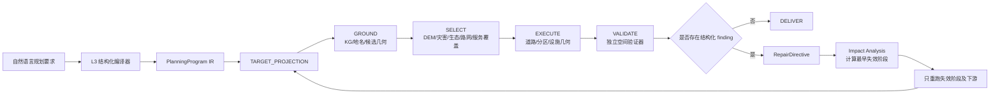

# Exa 架构对齐结论：LLM 职责边界与本项目现状

> 状态：`ANALYSIS / REFERENCE` · 本文固化 2026-08-13 一次 Exa 检索结论与本项目当前实现的对齐关系，
> 作为后续落地的"宪法"引用。落地清单见 [19_WIRING_ROADMAP.md](19_WIRING_ROADMAP.md)，
> 阶段完成度见 [10_IMPLEMENTATION_STATUS.md](10_IMPLEMENTATION_STATUS.md)，
> 迭代细节见 [16_20260813_ITERATION_LOG.md](16_20260813_ITERATION_LOG.md)。

## 1. 核心结论

从 2024—2026 年的论文、官方仓库与真实开源实现看，稳定的地理规划智能体不是：

> LLM 直接生成道路、分区、设施几何 → 后面再用正则或另一个 LLM 修一遍。

而是：

> LLM 把自然语言编译成受约束的规划中间表示、在有限工具/动作集合中选择、解释结构化验证错误、
> 提出目标级修复指令；真正的实体定位、几何生成、空间约束判断、路径计算、冲突检测和提交由
> 确定性 GIS 工具、优化器和独立验证器完成。



五条原则：

1. **结构约束前置**，而不是生成后文本修复。
2. **语义闭集分类**，不允许 LLM 自由发明类型。
3. **LLM 只能通过空间工具获取或验证几何**，不能凭文本创造几何。
4. **VALIDATE 产生目标级、证据级、血缘级 finding**，才能自动重规划。
5. **resume 必须基于 artifact parent/checksum 和阶段依赖**，不是简单从上一次停点继续。

角色边界一句话：

```text
LLM              = 编译器前端 + 工具选择器 + 结构化诊断解释器 + 修复策略选择器
KG/GIS/DEM/优化器 = 事实和几何生产者
VALIDATE         = 独立裁判
RepairDirective/ImpactAnalysis = 目标级重规划控制器
Checkpoint/Checksum            = resume 和最小重跑边界
```

## 2. 检索案例与本项目的映射

| 案例 | 关键机制 | 本项目对应阶段/模块 |
|---|---|---|
| Plan2Map / GeoPlanAgent | 定位拆 Reader/Locate/Map-matching/Segmentation/Projection/Critic；不确定性结构化表达；动作闭集 `approve/switch/retry_locate` | `domain/ground/` + `spatial/grounding/resolver.py` + `workflow/stages/ground.py`；动作闭集映射到 `RepairDirective` |
| GIS Copilot | LLM 选择 GIS 工具、生成流程参数，不代替 GIS 计算 | `infrastructure/llm/tools/`（access 工具集）+ `workflow/tools/execute_node.py` |
| GeoBenchX | `reject_task()` 显式拒绝不可解任务；本地快照可复现；保留 LLM—工具交互历史 | fail-closed 语义见 §5；`constraint_index_unavailable` / `road_*_MISSING` 稳定 code |
| PlanGEN | Constraint/Verifier/Selection 三 Agent 分工；不满足约束时选择重规划策略 | `domain/validation/`（verifier）+ `domain/allocation/`（selection）|
| SagaLLM | 任务依赖图、独立 Global Validation、事务提交/回滚、只重跑受影响部分 | `repair_impact.py` 的 `earliest_invalid_stage` + `ArtifactDescriptor.parent_digests` |
| JSONSchemaBench | 结构化输出必须单独评估 schema 覆盖/结构正确率；结构合法 ≠ 规划语义合法 | `planning_semantics.py` + `semantic_repair.validate_*` |
| XGrammar / YieldLang | 解码阶段约束结构，而非生成后修复 | 本项目用 `with_structured_output(method="function_calling")`；语义正确性由 `SemanticCompiler`/确定性 validator 补足 |
| RePair / FeedbackEval | 诊断→patch→重编译；结构化反馈优于自然语言；2—3 轮后收益递减 | `semantic_repair.py`（max_rounds=3 + 确定性校验 + 内容寻址缓存）|
| LangGraph Persistence | checkpoint/resume/只重跑失效下游；super-step 已成功输出不重复计算 | `infrastructure/runtime/planning_runtime_service.py` + `repair_impact.py` |

## 3. 现状 vs 建议对比表

| 分析建议 | 现状实现 | 判定 |
|---|---|---|
| L3 编译成受约束 IR，不做文本数字修补 | `planning_semantics.py` + `ClaimDraft v2` 闭集化道路 length/width、zone area、facility 参数；`claim_adapter.py` 纯字段透传；`workflow/stages/target_projection.py` 确定性映射 | ✅ |
| 语义闭集分类，不允许 LLM 发明类型 | `domain/program/classification_generator.py`（LLM 只给闭集代码 + rationale，失败回退 category 不猜码）| ✅ |
| 生成后不靠正则修，LLM 输出 patch 且过 schema 校验 | `domain/program/semantic_repair.py`（闭集 patch + `validate_semantic_repair_candidate` + 内容寻址缓存 + max_rounds=3）| ✅ |
| GROUND 只做检索/消歧，禁止全村 centroid 代理 | `resolver.py` + `evidence/index/place_evidence_index.py` + `village_cluster_mapper.py` + `flash_mention_extractor.py` 多实体类型注册 | ⚠️ 残留几何兜底 |
| 结构化不确定性（radius/reason/status）| `GroundingResult` 有 `status/confidence/unresolved_reason`，但缺 radius_m/reason_code 细分，置信度仅 0/0.7/1 | ⚠️ PARTIAL |
| SELECT 接入真实 DEM/坡度/约束/路网/服务覆盖/全局分配 | `suitability/terrain.py` + `terrain_adapter.py` + `spatial_factors.py` + `service.py` 已实现；`global_zone_parcel_allocator.py` 全局 MIP 已写完 | ⚠️ 侧线已写，主链未接 |
| EXECUTE 几何由工具产生、带 artifact lineage | worker typed contract + CAS refs（`workflow/stages/execute.py`）；road contract 区分 existing/new（`contracts/domain/road_planning.py` + `spatial/network/road_candidate_preparation.py`）| ⚠️ road 侧线未接旧生成器 |
| zone 每 BSM 唯一权威地类 + 分层 overlay | 全局 allocator 已加 `sum(x[target,bsm])<=1` + overlay pass-through | ⚠️ 旧 zone worker 仍独立 reclassify + 无条件 merge |
| VALIDATE→finding→RepairDirective→ImpactAnalysis→最小重跑 | `domain/validation/repair_directives.py`（4 类闭集、all-or-nothing）+ `repair_impact.py`（parent/checksum）+ `workflow/stages/validate.py` 已接线 | ✅ 编译/影响分析/主链路由 |
| RepairDirective 被 worker 真正消费 | SELECT 消费 exclude_bsms/reallocate；EXECUTE 消费 rebuild_geometry/require_source_evidence 未接线 | ⚠️ PARTIAL |
| finding 带 target/BSM/evidence 全 lineage | hard_constraint/overlap/road 三类已补 lineage；area_conservation/topology/continuity/accessibility/classification_missing 仍缺 | ⚠️ PARTIAL |
| 显式 reject/不可解 + fail-closed | `constraint_index_unavailable`、`road_*_MISSING` 稳定 code、road candidate preparation 无回退 | ✅ 大体落地，全村 fallback 漏网 |
| 内容寻址缓存 + resume + 幂等 | semantic_repair/flash/village/terrain 副路径已 cache；`ArtifactDescriptor.parent_digests` 入 resume 校验 | ✅ |
| LLM 工具闭集动作空间 + 工具注册绑定 | 2 意图工具 bind；6 access 工具注册未 bind；`execute_node` 读遗留空 `TOOL_REGISTRY` | ⚠️ GAP |
| 渲染最后做 + 视觉 QA | DELIVER snapshot 驱动；PNG 缺比例尺/道路分级/标签避让 | ⚠️ 低优先 |

## 4. LLM 调用四分类契约

### A. 编译调用

- 用途：L3 claim → `PlanningProgram`；text → typed quantity；text → 闭集 object/action；source claim → dependency。
- 约束：必须 constrained decoding（`with_structured_output(method="function_calling")`）。
- 落点：`planning_semantics.py`、`claim_adapter.py`、`semantic_repair.py`。

### B. 检索规划调用

- 用途：多类型实体查询、KG relation 选择、地名消歧、空间工具选择。
- 约束：不生成几何，只输出文本/候选索引。
- 落点：`flash_mention_extractor.py`、`village_cluster_mapper.py`。

### C. 修复调用

- 输入必须是：`typed finding + affected targets + artifact lineage + allowed repairs`。
- 输出只能是：`RepairPatch`（不能重写完整流程）。
- 落点：`semantic_repair.py`、`repair_directives.py`。

### D. 重规划选择调用

- 闭集策略：`exclude_bsms / reallocate / rebuild_geometry / require_source_evidence`。
- 选择后仍由确定性编译器和工具执行。
- 落点：`repair_directives._POLICIES`。

## 5. Fail-closed 边界清单

| 阶段 | 必须 fail-closed 的情况 | 现状 |
|---|---|---|
| L3 / 编译层 | schema 不合法、target_id 不稳定、object_type 不在闭集、quantity 无 kind、unit 与 kind 不一致、output_kind 与 object_type 不一致、claim_set diagnostic 为 error、source claim 不可追溯 | ✅ L3 Gate 已阻断 severity=error |
| TARGET_PROJECTION | 文本只取到未分类数字、道路长/宽/编号混淆、zone 面积无来源、facility 无类别、目标类型与动作冲突 | ✅ 纯字段映射 + 源头语义检查 |
| GROUND | 只有地名文本无候选、候选无几何、几何无 provenance、只有村级代理却需道路/设施/水体、只能全村回退 | ⚠️ 全村兜底残留 |
| SELECT | DEM 缺失但有坡度要求、constraint index 不可用、所有候选违反硬约束、面积/容量不足、路网可达性无法计算、设施服务覆盖不满足 | ⚠️ 侧线已写，主链待接 |
| EXECUTE | source contract 缺失、道路端点缺失、路径计算失败、polygon 拓扑非法、BSM 与输出几何无关联、输出无 target lineage、无 parent artifact | ✅ road candidate preparation fail-closed；⚠️ 旧生成器未接 |
| VALIDATE | finding 无 target_id、只有数量统计、无 evidence refs、无 BSM lineage、依赖 relax 元数据、无法确定最早失效阶段 | ✅ 编译 all-or-nothing + impact blocked |

## 6. 参考

- [19_WIRING_ROADMAP.md](19_WIRING_ROADMAP.md)：按模块落地路线图
- [10_IMPLEMENTATION_STATUS.md](10_IMPLEMENTATION_STATUS.md)：实现状态台账
- [16_20260813_ITERATION_LOG.md](16_20260813_ITERATION_LOG.md)：本轮真实 LLM 全链迭代细节
- [13_AUTOREPAIR_MULTIMODAL.md](13_AUTOREPAIR_MULTIMODAL.md)：自动迭代与多模态设计
- [17_LLM_TOOL_BINDING.md](17_LLM_TOOL_BINDING.md)：LLM 工具绑定边界
