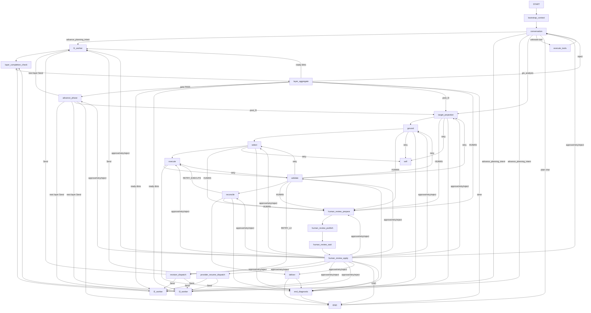

# A5 子图化设计：四段拆子图（已去风险，待专项实施）

> 状态：**设计完成 + 原语已实测验证**。生产图仍为单层扁平 StateGraph；
> 按蓝图“建议最后做”，且 resume 语义需真实 LLM 验收，本轮不落地拆图。

## 1. 当前拓扑（单层扁平 StateGraph(WorkflowState)，25 节点）



## 2. 四段语义映射

| 段 | 节点 | 职责 |
|---|---|---|
| **意图环** | `conversation` `bootstrap_context` `execute_tools` | 意图解析、工具执行、修订触发 |
| **认知层 map-reduce** | `l1/l2/l3_worker` `layer_completion_check` `layer_aggregate` `advance_phase` `revision_dispatch` `provider_resume_dispatch` | 维度并行 + 完成屏障 + gate 聚合 + 阶段推进 |
| **空间链** | `target_projection` → `ground` → `select` → `execute` → `validate` → `reconcile` → `deliver` | post-L3 主图链，全 gate 驱动 |
| **HITL** | `human_review_prepare/publish/wait/apply` | 暂停准备、发布、interrupt、决策应用 |

`bootstrap_context` 属于意图环前置（数据上下文构建），`end_diagnostic` 是父图级
哨兵节点（所有段都可能跳入）。

## 3. 跨段出口契约（进入子图时需 Command(PARENT)）

| 源段 | 出口 | 目标段/节点 | 触发条件 |
|---|---|---|---|
| 意图环 | conversation → l1/l2/l3_worker | 认知层 | advance_planning_intent / 修订分发 |
| 意图环 | conversation → target_projection | 空间链 | gis_analysis |
| 认知层 | layer_aggregate → target_projection | 空间链 | post_l3 / L3 gate PASS |
| 认知层 | layer_aggregate → conversation | 意图环 | reject（human 后） |
| 认知层 | layer_aggregate → human_review_prepare | HITL | gate HUMAN / 死锁 |
| 空间链 | 各 stage → human_review_prepare | HITL | gate 非 PASS 非重试 |
| HITL | apply → advance_phase/revision_dispatch/…/conversation | 认知层/空间链/意图环 | approve/retry/reject |
| 任意段 | → end_diagnostic | 父图哨兵 | dispatch 拒绝 / 重试耗尽 / 加载失败 |

设计：父图只保留 `intent_loop`、`cognitive`、`spatial_chain`、`hitl`、
`end_diagnostic` 五个节点。每个子图 **START 处放一个入口路由节点**（根据
state 的 `phase`/`paused_stage`/`revision_target_dimensions` 等分派到段内
具体节点），**出口处放一个授权出口节点**：

```python
def cognitive_exit(state) -> Command:
    target = route_after_analysis(state)          # 现 after_analysis 逻辑
    if target in COGNITIVE_INTERNAL_NODES:
        return Command(goto=target)               # 段内跳转
    return Command(graph=Command.PARENT, goto=parent_target(target))
```

## 4. 出口授权适配（关键，防审计丢失）

当前每条条件边都走 `_dispatch_route`（materialize + `authorize_route_result`
+ 拒绝时写 `terminal_patch` 回 END_DIAGNOSTIC）。子图化后跨段出口必须由
出口节点自己完成同一审计，否则 dispatch 策略会被绕过：

```python
def _subgraph_exit(source: str, route: Callable, state: dict) -> Command:
    result = _dispatch_route(source, route, state)   # 复用现有审计
    if result == END_DIAGNOSTIC:
        return Command(graph=Command.PARENT, goto="end_diagnostic")
    return Command(graph=Command.PARENT, goto=_parent_node(result))
```

段内条件边仍可用 `conditional_map` + 普通条件边，无需 Command。

## 5. Checkpoint / 恢复影响（已实测）

`backend/tests/contracts/test_langgraph_primitives.py` 钉死了以下原语（本机
langgraph 1.2.x 实测通过）：

- 编译子图直接 `add_node` 且与父图共享状态（`S` 全通道）。
- 子图内 `interrupt()`：父图 `get_state().tasks[].interrupts` 可读；
  父图 `Command(resume=...)` 可恢复（`PlanningRuntimeService.resume_from_interrupt`
  的现有调用路径无需改动）。
- `Command(graph=Command.PARENT, goto=..., update=...)` 跨图跳转生效。
- `output_schema` 不过滤 `stream_mode=["values","checkpoints"]`（runtime 依赖
  的 values 流保持全量）；`invoke` 最终输出被过滤（A6）。
- 注意：`aupdate_state(as_node="__start__")` 会被 `input_schema` 过滤
  （A6 实测），所以 input_schema 不能收窄。

已知仍需注意：
- `layer_completion_check` 的 `defer=True` 屏障保留在认知层子图内即可，
  defer 是节点级属性，子图化不改变语义。
- interrupt 在子图内的 checkpoint namespace 会多一层段名（`hitl:...`）；
  `aget_state` 的 thread 顶层 values 仍是完整 WorkflowState，`materialize_workflow_state`
  无需改动。
- 真实 LLM 验收（`tests/acceptance/test_real_graph_resume_delivery*`）是
  A5 落地的前置门禁，本环境无 API key，故不落地。

## 6. 建议实施顺序与门禁

1. 认知层子图（最大、含 defer + Send map-reduce）→ 先做，回归最大。
2. HITL 子图（interrupt + Command(resume)）→ 次之，验证 resume。
3. 空间链子图（纯 gate 链，出口最少）→ 再次。
4. 意图环子图（与其余段交互最多）→ 最后。

每步门禁：`pytest tests/contracts tests/core -m "not slow"` + 图编译 +
`get_graph()` 节点清单核对 + 真实 LLM 验收测试。
