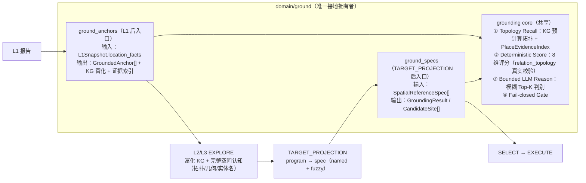

# 统一接地核心设计（Unified Grounding Core）

> 状态：`DESIGN / PLAN` · 本文把散落在 `domain/ground`、`spatial/grounding`、
> `infrastructure/kg/enrichment`、`workflow/layers/context_bootstrap` 的接地职责收敛为
> **`domain/ground` 单一拥有者**，并定义一个同时服务 `ground_anchors`（L1 后）与
> `ground_specs`（TARGET_PROJECTION 后）的共享 grounding core。
> LLM 职责边界对齐 [18_EXA_ARCHITECTURE_ALIGNMENT.md](18_EXA_ARCHITECTURE_ALIGNMENT.md)；
> 落地清单并入 [19_WIRING_ROADMAP.md](19_WIRING_ROADMAP.md)；
> 评分/索引基础见 [12_PLACE_NAME_RESOLUTION.md](12_PLACE_NAME_RESOLUTION.md)；
> EXPLORE 边界见 [11_EXPLORE_KG_ENRICHMENT.md](11_EXPLORE_KG_ENRICHMENT.md)。

## 1. 背景与问题

### 1.1 接地职责分散在四个包

| 包 | 现有接地职责 | 问题 |
|---|---|---|
| `domain/ground/aggregate.py` | `ground_aggregate`：spec→`GroundingResult` 编排 | 只是编排，核心逻辑在别处 |
| `spatial/grounding/` | `SpatialResolver`、`report_grounder`、`flash_mention_extractor`、`village_cluster_mapper` | 与 `domain/ground` 割裂，入口不统一 |
| `infrastructure/kg/enrichment/` | `name_backfill`、`extract_bindings`/`run_wave`（L1 后 wave） | 名字接地被当作"KG 增强"，而非 GROUND 职责 |
| `workflow/layers/context_bootstrap.py` | `_hydrate_l1_spatial_facts`（gazetteer 重建/索引/回填） | 接地动作出现在"上下文引导"里 |

同一份"报告名字→KG 实体/几何"的工作存在三个入口：L1 后 wave（`layer_aggregate_node`→
`_maybe_extract_bindings`→`extract_bindings`）、GROUND 懒加载（`_require_context`→
`_hydrate_l1_spatial_facts`）、GROUND 阶段（`ground_node`→`ground_report`/`resolve_spec`）。

### 1.2 原始 KG 文字/语义弱

GIS bundle 构建的 KG 实体大量使用占位名（`infrastructure/kg/builder/`）：

```text
水体_bsm / 溪流_bsm    WaterBody
道路_bsm               Road（且多无名称）
居民点N                 ResidentialCluster
facility_N / 设施_i     Facility（单字 label 常见）
建筑_bsm / 行政区_bsm    Building / AdministrativeVillage
灾害防控线_bsm / 洪涝控制线_bsm / 行政界线_bsm / 等高线_ele
规划道路_i              层4 规划要素
```

语义侧：实体有 `RDF.type`、`bsm`、几何与部分 `gis_description`，但**没有别名、没有可检索的
描述/注解**；`describe_entity` 是查询期动态合成，`EntityAnnotation` 只由增强 wave 写入且稀疏。
因此 L2/L3 的 EXPLORE（`get_village_cognition`）会把占位名直接带进 prompt。

### 1.3 拓扑未真正参与定位

KG 已预计算空间关系（真实运行：1691 touches、6048 nearby、416 connected、365 road-intersects），
但 `evidence/index/evidence_scorer.py` 的 `relation_topology` 维度目前只是：

```python
evidence["relation_topology"] = 0.3 if getattr(entry, "relation_refs", None) else 0.0
```

即"**有没有关系**"而非"**关系对不对**"。典型失败模式：

- 同名村多候选：`园寨` 命中多个 cluster，需要 `sfWithin/nearby` + 几何就近消歧；
- `祠堂@社前村`：候选祠堂必须与"社前村"cluster 有 `serves/nearby` 才算证据；
- `金田河`：需要匹配 WaterBody 且走向（西南至东北贯穿）与报告一致；
- `沿 Y122 提质`：需要 `connected_via_road/road-intersects` 找到 Y122 的 edge 集合再限定路段。

### 1.4 L1 是空间权威，但接地时机不对

`START → bootstrap_context → intent_loop`（`workflow/root_graph.py:725-726`）在 L1 **之前**运行，
此时无 L1 snapshot；`name_backfill`/`PlaceEvidenceIndex` 真正构建发生在 GROUND 的
`_require_context` 懒加载（`workflow/stages/support.py:142-144`）。结果：**L2/L3 消费的 KG 仍是
占位名**，最准确的空间信息（L1 location_facts）没有被提前利用。

## 2. 目标与非目标

**目标**

1. 接地职责全部收敛到 `domain/ground`，消除三个入口并行的现状。
2. 定义一个共享 grounding core：`Topology Recall → Deterministic Score → Bounded LLM Reason →
   Fail-closed Gate`，同时服务 `ground_anchors` 与 `ground_specs`。
3. 定位必须利用 KG 预计算拓扑（touches/nearby/contains/connected_via_road/road-intersects），
   `relation_topology` 从"有无关系"升级为"拓扑一致性"。
4. L1 后立即 `ground_anchors`（无新节点，扩展现有钩子），让 L2/L3 EXPLORE 消费富化 KG
   （真名/别名/描述/关系）与完整空间认知。
5. GROUND 阶段保留模糊落位能力：L3 规划目标含命名引用 + 模糊引用（方向/距离/拓扑/组合），
   模糊引用由 grounding core 的 LLM Reason 在 KG 候选上判别。

**非目标**

- 不让 LLM 生成坐标/BSM/entity_ref/几何（边界见 §4.3）。
- 不把"落位"提前：规划目标集来自 L3 `PlanningProgram`，`ground_specs` 仍在其后运行。
- 不改变 EXPLORE 的横向证据服务边界（L1/L2/L3 只交 `ExplorationRequest`）。

## 3. 架构总览



## 4. grounding core 四段

### 4.1 Topology Recall（确定性）

对每个待接地引用，从两个正交来源生成候选：

```text
名字侧：PlaceEvidenceIndex（gazetteer + KG 命名实体 + L1 facts + POI）
空间侧：KG 预计算拓扑 + 几何
  named    → entity/BSM 精确或别名命中
  village  → cluster（sfWithin 地块聚合）+ 几何就近
  facility@村 → serves/nearby 候选，且与村 cluster 拓扑一致
  water    → WaterBody + 走向（report location hint）一致
  road     → connected_via_road/road-intersects 限定 edge 集合
  方向/距离 → direction bbox + nearby/距离粗筛
```

候选必须带：`entity_ref / entity_type / canonical_name / aliases / geometry_ref /
source_bsms / relation_refs / evidence_refs`（复用 `PlaceResolutionCandidate`）。

### 4.2 Deterministic Score（8 维，`relation_topology` 升级）

沿用 `EvidenceScore` 权重表（`exact_canonical_alias=1.0`、`l1_fact_exact=1.0`、
`entity_type_role=0.5`、`relation_topology=0.5`、`within_bundle=0.5`、
`geometry_near_anchor=0.5`、`external_geocoder=0.3`、`fuzzy_short_name=prohibited`），
把 `relation_topology` 从"有无 relation_refs"升级为：

```text
候选 relation_refs 与 mention 的 location/relation hint 做拓扑匹配：
  hint 含"X村"        → 候选与 X 村 cluster 存在 serves/nearby/sfWithin → 加分
  hint 含"沿/汇入/通往"  → 候选与目标 water/road 存在 connected_via_road/nearby → 加分
  无 hint             → 该维度 0，不惩罚也不加分
```

评分仍为配置驱动、可解释、可审计，不写进 LLM prompt。

### 4.3 Bounded LLM Reason（仅模糊/歧义 Top-K）

只有 `ambiguous`（或 `fuzzy/composed` 型 spec）才进入 LLM，且**在 Recall 候选集内**判别：

```text
输入：mention/spec + Top-K 候选（每个含 entity_ref/BSM/geometry WKT/拓扑关系）+ 关系定义
输出：{candidate_id, match, reason, missing_evidence}   （结构化闭集）
```

- LLM 是 reasoner 不是生成器：**不得新增 entity_ref/BSM/坐标/几何**。
- 几何/坐标只来自 KG/bundle（对齐 EACL 2026 recaller/reasoner 拆分：
  LLM 推理强于地理知识生成；对齐 arXiv 2505.17136：
  LLM 拓扑推理需要喂几何/place-type 上下文）。
- 失败或超时保持 `ambiguous`，不得降级为第一个候选。

### 4.4 Fail-closed Gate

```text
resolved    单一候选达阈值且有拓扑证据 → 通过
ambiguous   多候选接近 / 弱证据 / LLM 无法判别 → HUMAN / 重试
unresolved  无有效候选 → HUMAN，禁止整类/全村兜底
```

## 5. 两个入口

### 5.1 `ground_anchors`（L1 后，无新节点）

- 时机：`layer_aggregate_node` 的 `layer==1` 分支、`l1_aggregate` 完成且 **L1 gate PASS** 后，
  扩展现有 `_invoke_extraction` 钩子，内部改调 `domain/ground.ground_anchors`。
- 职责（内部复用 core 与既有组件）：
  1. `name_backfill`（占位名→真名，LLM 只消歧）；
  2. 对 `L1Snapshot.location_facts` 逐个走 core → `GroundedAnchor[]`
     （`mention → entity_ref + BSM + geometry_ref + topology_evidence`）；
  3. 富化 KG：`EntityAnnotation`（别名/描述）+ 关系注记（复用 `descriptions.py`/`relations.py`）→
     `bump kg_version`；
  4. 重建 `PlaceEvidenceIndex` + gazetteer（从 GROUND 懒加载提前）。
- 产物：`grounded_anchors` artifact + 富化 KG + 新版本证据索引；L2/L3 EXPLORE 消费。

### 5.2 `ground_specs`（TARGET_PROJECTION 后）

- 时机：GROUND 阶段（`workflow/stages/ground.py`）。
- 职责：`SpatialReferenceSpec[]` → core → `GroundingResult`/`CandidateSite[]`；
  `named` 引用优先命中 `ground_anchors` 的 `GroundedAnchor`（entity_ref），`fuzzy/composed`
  引用走 topology recall + LLM reason；未解析进 gate。
- 保留：`resolve_anchors`（intent candidate_bsms 补证据）、方向/距离/topology 空间算子。

## 6. 契约

```python
class GroundedAnchor(BaseModel):
    """L1 锚点接地产物：location_fact → KG 实体/几何 + 拓扑证据。"""
    location_fact_ref: str          # 关联 L1LocationFact
    mention: str
    normalized_name: str
    role: str
    entity_ref: str
    entity_type: str
    geometry_ref: str | None
    source_bsms: list[str]
    relation_refs: list[str]
    topology_evidence: list[str]    # 命中的预计算拓扑（nearby/serves/connected_via_road/...）
    confidence: float
    status: Literal["resolved", "ambiguous", "unresolved"]
    source_report_ref: str
    source_span: str
    query_trace: list[dict]
```

`ground_anchors` 输出 `GroundedAnchor[]`；`ground_specs` 输出 `GroundingResult`。两者都带
`context_version + kg_version + index version`。

## 7. 工作流接线改动

| 现状 | 目标 |
|---|---|
| `layer_aggregate_node` → `_maybe_extract_bindings` → `run_wave`（enrichment 内） | 同一钩子改调 `domain/ground.ground_anchors(state)`；gate PASS 才跑 |
| `_require_context`（support.py）→ `_hydrate_l1_spatial_facts` | 逻辑并入 `ground_anchors`；`_hydrate_l1_spatial_facts` 只保留上下文挂载 |
| `ground_node` → `ground_report` + `resolve_anchors` + `ground_aggregate` | `ground_node` 调 `ground_specs`；`ground_report` 的候选派生并入 core |
| `extract_bindings`/`name_backfill` 散布调用 | 收敛为 core 的组件，由 `ground_anchors`/`ground_specs` 调用 |

删除/废弃的重复入口：`layer_aggregate_node` 里的 enrichment 直调、`_hydrate_l1_spatial_facts`
中的回填/索引步骤（保留挂载与幂等键）。

## 8. 版本 / 失效 / 幂等

- 缓存键：`(context_version, kg_version, report_version, content_hash, index_version)`。
- L1 修订（revision_impact_tree）：按 `source_report_ref + report_version` 失效受影响
  `GroundedAnchor` 与 KG 注解，重跑 core；未变部分缓存命中。
- `kg_version` bump 后：`EvidenceBundle` 标 stale、`PlaceEvidenceIndex` 重建、`context` 水合键更新。
- LLM 调用按 `sha256(content)` 缓存（沿用 `flash_mention_extractor`/`name_backfill` 的缓存模式），
  resume/replay 不重调模型。
- `ground_anchors`/`ground_specs` 均幂等：同输入同输出，可重放。

## 9. 迁移路径

### M0：收敛拥有者（不改变行为）

- 把 `_hydrate_l1_spatial_facts` 的回填/索引步骤与 `extract_bindings`(L1 wave) 迁入
  `domain/ground.ground_anchors`；`layer_aggregate_node` 只保留 `await ground_anchors(state)`；
  `_require_context` 只保留上下文挂载。
- 验收：真实 session 行为等价（`kg_version`、gazetteer、索引内容 diff 为空）。

### M1：拓扑进入定位（`relation_topology` 真实校验）

- `evidence_scorer`：`relation_topology` 按 §4.2 升级。
- `ground_anchors` 的 recall：`祠堂@社前村`/`金田河`/`沿Y122提质` 用预计算拓扑限定候选。
- 验收：新增 case 见 §10。

### M2：模糊 spec 全链路

- `resolve_spec` recall 以 KG 预计算拓扑为主干（替换 gazetteer+direction bbox fallback 为主）；
- Reason 接 `flash_mention_extractor` 模式的结构化判别（候选 WKT/拓扑喂入）；
- 验收：`村北沿河新建养老设施`、`位于园寨与田坑之间提质Y122` 等组合引用闭环。

## 10. 验收标准

固定 fixture 至少覆盖：

1. 同名村多候选 → 拓扑/几何消歧为 resolved；
2. `祠堂@社前村` → `serves/nearby` 证据加分；
3. `金田河` → WaterBody + 走向一致；
4. `沿 Y122 提质` → `connected_via_road/road-intersects` 限定 edge 段；
5. `村北沿河新建养老设施`（fuzzy composed）→ recall 候选 + LLM reason top-k + gate；
6. L1 修订 → 受影响 anchors 失效重跑，未变部分缓存命中；
7. 幂等：同输入同输出；LLM 缓存命中；
8. LLM 不产生 BSM/坐标/entity_ref（协议校验）。

每个 case 验证：status、候选排序、`evidence_refs`、`topology_evidence`、
`context/kg/index version`、gate 路由。

## 11. 边界与风险

- **LLM 只命名/分配/判别，不造几何**：几何与 BSM 只来自 KG/bundle（§4.3，强制协议校验）。
- **候选必须来自 KG 预计算拓扑**：Reason 不新增候选。
- **fail-closed**：无候选/低分 → HUMAN；禁止整类/全村兜底。
- **外部验证**：EACL 2026 recaller/reasoner、arXiv 2505.17136（LLM 拓扑推理需几何上下文）、
  ParQR-QE（定性空间推理查询 KG）、SAWGraph（预计算拓扑关系）、UrbanKGent（LLM 空间任务需注入几何+关系定义）。
- **风险**：M0 收敛可能短暂改变 checkpoint/resume 行为（富化时机提前）→ 以幂等键与缓存保证可重放；
  拓扑校验对 `relation_refs` 缺失的旧 session 降级为 0 分而非误判。