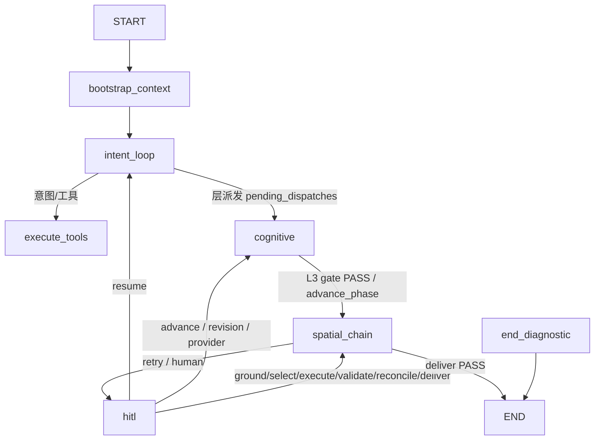

# 模块实现与结构性产出盘点（以实际代码为准）

> 状态：`CURRENT`（事实台账）· 基准：`backend/app` 实际代码（核验日期 2026-08-15）
> 本文只描述**实际实现**。与旧设计文档（`docs/architecture/structure.md`、`agent-graph.md`、
> `docs/design/10_IMPLEMENTATION_STATUS.md`、`18_EXA_ARCHITECTURE_ALIGNMENT.md`、`19_WIRING_ROADMAP.md`）
> 不一致处，以实际代码为准；关键差异在 §6 集中列出。
> 状态标记沿用 10_IMPLEMENTATION_STATUS.md 约定：`CURRENT`（有代码与证据）/ `PARTIAL`（有片段未闭环）/ `GAP`（接线断裂或未实现）/ `TARGET`（仅设计）。

## 1. 实际运行图：四段子图（不是扁平线性链）

父图 `backend/app/workflow/root_graph.py::create_unified_planning_graph`：

- 父图只保留 `bootstrap_context` + 四个段节点（`intent_loop` / `cognitive` / `spatial_chain` / `hitl`）+ `end_diagnostic`（`segments.py::build_segments`）。
- 跨段跳转统一由路由节点发 `Command(graph=Command.PARENT, goto=<segment>, update={"subgraph_entry": ...})`（`segments.py::_map_route_result`）。
- 段内成员（`segments.py`）：
  - `intent_loop`：`conversation`、`execute_tools`
  - `cognitive`：`l1_worker`、`l2_worker`、`l3_worker`、`layer_completion_check`（`defer=True` 屏障）、`layer_aggregate`、`advance_phase`、`revision_dispatch`、`provider_resume_dispatch`
  - `spatial_chain`：`target_projection`、`ground`、`select`、`execute`、`validate`、`reconcile`、`deliver`（每个节点后挂 `{stage}_router`，gate 驱动）
  - `hitl`：`human_review_prepare`、`human_review_publish`、`human_review_wait`、`human_review_apply`
- `EXECUTE` 是 gate 路由的显式豁免（`root_graph.py::route_after_execute`）：不读 gate artifact，仅在 `fatal_error` 时 fail-closed 到 `END_DIAGNOSTIC`，否则恒推进 `validate`。

## 2. 维度配置（`backend/app/config/phases.yaml`，共 28 维）

| 层 | 执行方式 | 维度 key |
|---|---|---|
| L1 现状分析（12） | parallel | location, socio_economic, villager_wishes, superior_planning, natural_environment, land_use, traffic, public_services, infrastructure, ecological_green, architecture, historical_culture |
| L2 规划思路（4） | wave | resource_endowment, planning_positioning, development_goals, planning_strategies |
| L3 详细规划（12） | wave | industry, spatial_structure, land_use_planning, settlement_planning, traffic_planning, public_service, infrastructure_planning, ecological, disaster_prevention, heritage, landscape, project_bank |

加载入口：`backend/app/config/loader.py`（`load_config` → `phases.yaml`），`get_dimension_config` / `get_layer_dimensions` / `get_wave_config`。

## 3. 结构性产物注册表（权威来源 `backend/app/workflow/stage_adapter.py::_KEY_BY_TYPE`）

| 契约类型 | artifact key（`artifact_refs`） | 生产节点 | 主要消费方 |
|---|---|---|---|
| `IntentCompilationResult` | `target_projection` | target_projection | ground、select、validate |
| `GroundingResult` | `grounding_result` | ground | select、reconcile、validate、deliver |
| `DemandPortfolio` | `demand_portfolio` | select | select 内部 |
| `SuitabilitySurface` | `suitability_surface` | select | select 内部 |
| `GlobalZoneAllocationResult` | `global_zone_allocation` | select | execute、deliver |
| `GlobalSiteAllocationResult` | `global_site_allocation` | select | execute、deliver |
| `PortfolioDecision` | `portfolio_decision` | select | select gate、execute、deliver |
| `SiteSelectionDecision` | `site_selection` | select | execute、validate、reconcile、deliver |
| `ExecutionPlan` | `execution_plan` | select | execute、validate、reconcile、deliver |
| `ParcelChangeSet` | `parcel_changeset` | execute | validate、reconcile、deliver |
| `PlannedState` | `planned_state` | execute | validate、reconcile、deliver、render |
| `LayoutConfigs` | `layout_configs` | execute | 渲染 |
| `ExecutionDiagnostics` | `execution_diagnostics` | execute | validate（worker 失败）、deliver |
| `ExecutionResult` | `execution_result` | execute | validate、reconcile、deliver |
| `ValidationReport` | `validation_report` | validate | reconcile、deliver；gate 路由 |
| `RepairDirectiveCompilation` | `repair_directives` | validate | select（消费 exclude_bsms/reallocate）、execute（消费 exclude_bsms/rebuild_strategy）、路由 |
| `RepairImpactPlan` | `repair_impact` | validate | root_graph 路由 |
| `ReconciliationReport` | `reconciliation_report` | reconcile | deliver |
| `DeferralLedger` | `deferral_ledger` | deliver / root_graph 搁置路径 | execute、select、deliver |
| `DeliverySpatialSnapshot` | `delivery_spatial_snapshot` | deliver | API / v1 delivery、export、map-layers |
| `RenderLayers` | `render_layers` | deliver | map-layers、render artifacts |
| `DeliveryManifest` | `delivery_manifest` | deliver | deliver gate、终态 |
| `ExportResult` | `export_result` | deliver | 导出 API |
| `RenderArtifacts` | `render_artifacts` | deliver | HTML/PNG 前端产物 |
| `L1Snapshot` | `l1_snapshot` | cognitive L1 aggregate | L2/L3 prompt、ground anchors |
| `L2Strategy` | `l2_strategy` | cognitive L2 aggregate | L3 prompt、L3 gate、program |
| `PlanningProgram` | `planning_program` | cognitive L3 aggregate | target_projection、validate（L3 repair）、reconcile、dispatch |

## 4. 各模块实现与产出

### 4.1 启动与上下文

| 模块 | 入口文件 | 关键函数/类 | 结构性产出 |
|---|---|---|---|
| 启动/生命周期 | `app/bootstrap/lifespan.py`、`app/main.py` | CompositionRoot | 依赖组合 |
| 上下文构建 | `app/workflow/layers/context_bootstrap.py` | `bootstrap_context_node` | `SessionDataSnapshot`（`app/data/model/snapshot.py`）、`SpatialWorkspace`（`app/spatial/model/workspace.py`）、`PlanningContext`（`app/infrastructure/context/`） |
| 会话/运行 | `app/infrastructure/runtime/planning_runtime_service.py` | `trigger_planning_execution` | 图单例 + checkpoint 启停 |

### 4.2 认知层（cognitive）

| 模块 | 入口文件 | 关键函数 | 结构性产出（契约 + key） | 状态 |
|---|---|---|---|---|
| L1 worker（12 维） | `app/domain/assessment/analysis_node.py` | `analyze_dimension` | `L1Snapshot` → `l1_snapshot` | CURRENT |
| L1 聚合 | `app/domain/assessment/aggregate.py` | `merge_fragments` | `L1Snapshot` | CURRENT |
| L1 gate | `app/domain/assessment/gate.py` | `evaluate_l1_gate` | `GateDecision`（CAS gate_ref） | CURRENT |
| L2 worker（4 维） | `app/domain/objectives/worker.py` | `analyze_l2_dimension` | `L2StrategyFragment` | CURRENT |
| L2 聚合 | `app/domain/objectives/aggregate.py` | `merge_strategy_fragments` / `l2_aggregate` | `L2Strategy` → `l2_strategy` | CURRENT |
| L2 gate | `app/domain/objectives/gate.py` | `evaluate_l2_gate` | `GateDecision` | CURRENT |
| L3 worker（12 维） | `app/domain/program/worker.py` | `analyze_l3_dimension` | `PlanningClaimSet`（schema 2.0，`app/contracts/program.py`） | CURRENT |
| L3 聚合/组装 | `app/domain/program/aggregate.py` + `assembler.py` | `assemble_planning_program` | `PlanningProgram`（schema 4.0，`app/contracts/domain/l3_contracts.py`）→ `planning_program` | CURRENT |
| L3 gate | `app/domain/program/gate.py` | `evaluate_l3_gate` | `GateDecision`（program_rework / EXPLORE / HUMAN / PASS） | CURRENT |
| 层完成屏障 | `app/workflow/plan_state/completion_node.py` | `layer_completion_check`（`defer=True`） | 层聚合触发 | CURRENT |
| 层聚合节点 | `app/workflow/layers/layer_aggregate_node.py` | `layer_aggregate_node` | 写入 l1/l2/planning_program | CURRENT |
| 阶段推进 | `app/workflow/layers/phase_machine.py`、`root_graph.py::_authorized_advance_phase` | — | phase 推进 / Send 派发 | CURRENT |

### 4.3 空间链（spatial_chain）

| 阶段 | 入口文件/节点函数 | 输入 refs | 结构性产出 | 状态/已知缺口 |
|---|---|---|---|---|
| TARGET_PROJECTION | `app/workflow/stages/target_projection.py::target_projection_node` | `planning_program` | `IntentCompilationResult` → `target_projection` | CURRENT；缺失 program ref 直接失败交给 resume 完整性策略 |
| GROUND | `app/workflow/stages/ground.py::ground_node` | `target_projection` | `GroundingResult` → `grounding_result`（可回写 `target_projection` 锚点） | CURRENT；flash 提及增强（`_flash_enhance_unresolved`）仅在 unresolved 数严格下降时采纳 |
| SELECT | `app/workflow/stages/select.py::select_node` | `grounding_result`、`repair_directives`、`deferral_ledger` | `DemandPortfolio`、`SuitabilitySurface`、`GlobalZoneAllocationResult`、`GlobalSiteAllocationResult`、`PortfolioDecision`、`SiteSelectionDecision`、`ExecutionPlan` | CURRENT；已消费 repair directives（`_apply_repair_directives`，仅 exclude_bsms/reallocate） |
| EXECUTE | `app/workflow/stages/execute.py::execute_node` | `execution_plan`、`repair_directives`、`deferral_ledger` | `ParcelChangeSet`、`PlannedState`、`LayoutConfigs`、`ExecutionDiagnostics`、`ExecutionResult` | CURRENT；已消费 `exclude_bsms`/`rebuild_strategy`，`require_source_evidence` 目标显式 unresolved（execute.py §50-106） |
| VALIDATE | `app/workflow/stages/validate.py::validate_node` | `target_projection`、`site_selection`、`execution_plan`、`execution_result`、`deferral_ledger` | `ValidationReport`、`RepairDirectiveCompilation`、`RepairImpactPlan` | CURRENT；见 25 号校验台账 |
| RECONCILE | `app/workflow/stages/reconcile.py::reconcile_node` | `planning_program`、`target_projection`、`grounding_result`、`site_selection`、`execution_plan`、`execution_result`、`validation_report`、`deferral_ledger` | `ReconciliationReport` → `reconciliation_report` | CURRENT |
| DELIVER | `app/workflow/stages/deliver.py::deliver_node` | validation/reconciliation/execution/ledger | `DeferralLedger`、`DeliverySpatialSnapshot`、`RenderLayers`、`DeliveryManifest`、`ExportResult`、`RenderArtifacts` | CURRENT；缺失 planned 输出时降级 `diagnostic_only` |

### 4.4 领域与空间子模块（结构性契约出口）

| 目录 | 主要文件 | 结构性产出契约 |
|---|---|---|
| `app/domain/assessment/` | analysis_node / aggregate / gate | `L1Snapshot`、`AnalysisReport`、`GateDecision` |
| `app/domain/objectives/` | worker / aggregate / gate | `L2Strategy`、`StrategyConflict` |
| `app/domain/program/` | worker / claim_draft / claim_adapter / aggregate / assembler / semantic_repair / gate / classification / classification_generator / flash_unit_repair / unit_normalization | `PlanningClaimSet`、`PlanningProgram`、`InterventionSemanticPatch` |
| `app/domain/ground/` | aggregate / gate / anchors / review | `GroundingResult`（经 spatial 契约） |
| `app/domain/allocation/` | select_service / select_gate / global_zone_parcel_allocator / global_site_allocator | `SiteSelectionDecision`、`PortfolioDecision`、分配求解结果 |
| `app/domain/materialization/` | zone_worker / road_worker / merge / execute 等 | `ParcelChangeSet` 变更、`PlannedState` 地块 |
| `app/domain/suitability/` | terrain / service / spatial_factors | `SuitabilitySurface`、`EliminatedCandidate` |
| `app/domain/validation/` | validate / validate_checks / validate_gate / reconcile / checks / reconcile_gate / repair_directives / repair_impact / adjustment_executor / review / report_service | `ValidationReport`、`RepairDirectiveCompilation`、`RepairImpactPlan`、`ReconciliationReport` |
| `app/domain/delivery/` | aggregate / gate / manifest | `DeliveryManifest`、`DeliverySpatialSnapshot` |
| `app/spatial/grounding/` | resolver / grounding / evidence | `GroundingResult`、`CandidateSite` |
| `app/spatial/network/` | network_builder / comparison_evaluator / location_confirmation / road_candidate_preparation | 路网/可达性证据、`RoadPlanningConfig` |
| `app/spatial/model/` | workspace / area_engine / subdivision | `SpatialWorkspace`、面积引擎 |
| `app/spatial/validation/` | detector / resolver | `ConflictReport`（跨维度指标/约束/空间冲突） |
| `app/spatial/query/` | context 等 | 空间查询证据 |
| `app/evidence/` | retrieval/*（agent、evidence_service、place_evidence_index） | `EvidenceBundle`、`ExplorationRequest/Result` |
| `app/infrastructure/llm/` | factory / dimension_runtime / tools（registry + access/*） | LLM 客户端、flash/主模型、工具注册表 |
| `app/infrastructure/artifacts/` | repository / runtime / fingerprint | CAS artifact、`ArtifactDescriptor`、parent_digests |
| `app/infrastructure/events/` | repository / connection_hub / sse_publisher | 事件序号与 SSE |
| `app/infrastructure/rendering/`、`export/` | render_delivery_artifacts / export_package | HTML/PNG、导出包 |

## 5. 状态与已知缺口（仅列代码可证）

- `PARTIAL`：修复指令的消费已存在但范围有限——SELECT 只消费 `exclude_bsms`/`reallocate`，EXECUTE 消费 `exclude_bsms`/`rebuild_strategy` 并把 `require_source_evidence` 记 unresolved；`road_route_failed` 的 `reroute_avoiding_bsms` 只在特定 `rebuild_strategy` 分支生效。
- `PARTIAL`：`ExecutionResult`/`PlannedState` 依赖 EXECUTE 内部 worker 产出；无 worker 结果时 VALIDATE 由 `check_worker_failures` / `missing_planned_state` 阻断。
- `GAP`（设计未落地）：旧文档声称的"校验必须带完整 lineage"并未覆盖全部检查（见 25 号台账），`repair_directives` 对缺失 lineage 的 finding 会整批 `blocked`。

## 6. 与旧设计文档的关键差异（文档过时点）

1. **图结构**：旧 `agent-graph.md` 画成扁平线性链；实际是四段子图 + `Command(PARENT)` 跨段跳转（`segments.py`）。
2. **校验数量**：`validate_checks.py` 文档字符串写"Nine pure checks"，实际导出并执行 **10 个**检查（含 `check_traceability`、`check_worker_failures`）。
3. **EXECUTE 消费修复指令**：19 号路线图 P0 标注"EXECUTE 消费 rebuild_geometry 未接线"；实际 `execute.py` 已读取 `repair_directives` 并应用 `exclude_bsms`/`rebuild_strategy`，SELECT 也消费 `exclude_bsms`/`reallocate`。
4. **工具注册**：17 号文档称 `execute_node` 读遗留空 `TOOL_REGISTRY`；实际 `execute_node.py` 走 `ToolRegistry.get_tool_info/get_tool`，access 工具已在 `infrastructure/llm/tools/__init__.py::_register` 注册。
5. **维度数**：旧文档常写"12 维/28 维"，实际 `phases.yaml` 为 L1=12、L2=4、L3=12（28 维）。
6. **产物 key**：旧 `backend-state-contract.md` 未完整列出的 key（`demand_portfolio`、`suitability_surface`、`global_zone_allocation`、`global_site_allocation`、`portfolio_decision`、`execution_diagnostics`、`render_artifacts` 等）以 `stage_adapter._KEY_BY_TYPE` 为准。

## 7. 验证方法

- 上述路径/函数/契约类名均来自 `backend/app` 只读核验（grep + 文件阅读），未运行任何会改写仓库的命令。
- 如需复验：`stage_adapter.py::_KEY_BY_TYPE` 为产物 key 权威注册表；`phases.yaml` 为维度权威来源；`segments.py` 为图结构权威来源。