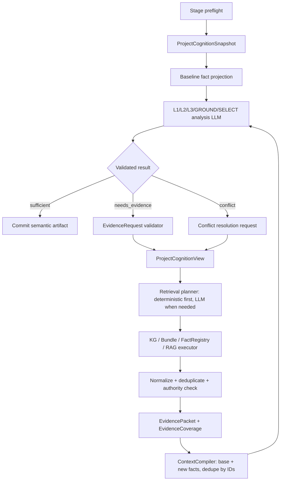

# ADR 007: L1/L2/L3 证据检索、项目认知与 LLM 上下文隔离

## Status

Superseded — see [ADR 008](008-final-llm-context-evidence-boundary.md) for the
current implementation contract. This document remains only as historical
design context; its legacy compatibility allowances are not part of the
runtime boundary.

本文是目标设计，不表示所有代码路径已经完成。当前实现状态仍以
`docs/architecture/`、测试和代码为准。

## Context

当前系统存在三类相互放大的问题：

1. L1、L2 默认过度相信文本资料。文本资料只覆盖项目的一部分，KG 和 Bundle
   中已有的实体、属性、拓扑和空间事实没有在 L1/L2 的证据不足阶段得到同等
   的利用；
2. 检索上下文与分析上下文没有严格分离。检索查询、候选列表、后端返回、
   查询轨迹和分析材料容易被反复拼接，导致同一事实在多轮调用中出现数次，
   最终形成数万 token 的输入；
3. 不同 LLM 调用各自管理 prompt、重试和结构化输出。支持严格 schema 的模型
   可以工作，但不支持 native tool/schema 的模型会在协议层失败，或者需要把
   大量历史上下文一起重试。

本 ADR 确定一条统一边界：

> L1 仍然负责把原始文本语义化，L2 仍然保持高度抽象；但所有来源，包括文本、
> KG、Bundle 和允许的外部证据，都进入同一个带来源和冲突信息的 Fact Registry。
> L1/L2/L3 先获得一个轻量的 Project Cognition，再通过按缺口编译的
> EvidenceRequirement 定向检索；检索过程由 Evidence Plane 隔离，分析 LLM 只接收
> 去重后的事实投影和最小必要证据。所有 LLM 调用统一经过 LLM Manager。

## Decision summary

系统采用以下七项不可变设计决定：

1. `ProjectCognitionSnapshot` 是检索前置条件，不是分析报告，也不是完整 KG/
   Bundle dump。任何检索请求都必须绑定项目、数据快照、空间/时间范围和可用
   数据能力；
2. `FactRegistry` 是跨来源的规范事实索引。文本 L1、KG、Bundle 可以共同支持
   一个事实，但必须保留各自的来源族、权威等级、定位、版本和冲突信息；
3. L1、L2、L3、GROUND、SELECT 都可以在证据不足时触发同一个
   `EvidenceBroker`。检索调用和分析调用使用不同的 context packet，检索轨迹
   不进入分析 prompt；
4. L2 继续输出高度抽象的决策、目标方向、优先级、约束和不确定性。L2 不增加
   详细规划交接层，L3 的细节通过 `L1 Fact Projection + L2 Abstract Decision +
   任务级证据检索`补足；
5. GROUND、SELECT 保留 LLM 推理，但 LLM 只能在已经由系统构造的闭集候选或
   方案卡片中判断。Bundle/KG 的完整几何、全量属性和 solver 结果留在确定性
   存储与工具侧；
6. LLM Manager 统一管理 context 编译、调用协议、结构化输出、重试、并发、
   token 预算、缓存、审计和指标；业务 worker 不得直接拼接完整上游报告或直
   接调用 provider；
7. 报告正文和摘要是 display projection。报告摘要是独立异步 LLM 调用，不阻塞
   语义 artifact 提交，不参与依赖传递，也不通过截断报告正文来控制上下文。

## 1. Canonical data model

### 1.1 六类数据不能再由一个 `content` 字段混合承担

```text
raw source
    │
    ├── source index / source segments
    │
    ▼
L1 semantic observations
    │
    ├──┐
    │  ├── text-origin facts
    │  ├── KG-origin facts
    │  └── Bundle-origin facts
    ▼
Fact Registry ─────────────── Project Cognition Snapshot
    │                                      │
    │                                      ├── Retrieval Planner
    │                                      └── Evidence Broker
    │                                                  │
    └────────────── typed fact projections ◄───────────┘
                 │
                 ├── L1 report / L2 decision
                 ├── L3 claims and planning program
                 ├── GROUND candidate context
                 └── SELECT scenario context

semantic artifact ──► display report ──► async summary projection
```

| 数据层 | 作用 | 是否默认进入分析 LLM |
| --- | --- | --- |
| Raw Source | 上传文档、PDF、GIS、数据库、原始用户输入 | 仅 L1 的 source-segment 调用按任务读取 |
| Source Index | source、版本、页码、段落、表格单元格、字符 span、GIS feature locator | 只进入需要溯源的 L1 context |
| Fact Registry | 规范化事实、来源、证据、冲突、状态和版本 | 通过精确 projection 进入 |
| Project Cognition | 项目身份、快照、图层/字段/关系能力、范围和少量实体锚点 | 只进入检索规划调用 |
| Evidence Packet | 某一缺口请求得到的去重事实和证据投影 | 以事实 projection 进入，查询轨迹不进入 |
| Display Report/Summary | 面向用户阅读和列表展示的文本 | 不作为下游语义依赖 |

### 1.2 L1 是原始文本语义生产者，不是所有事实的唯一来源

必须区分两个概念：

- L1 是唯一允许重新读取原始报告、PDF 段落和上传表格，并把它们解释为
  `Observation`/`Fact` 的阶段；
- `FactRegistry` 是项目级跨来源事实索引，除了 L1 文本事实，也接收 KG、
  Bundle 和经过允许的外部来源事实。

因此，KG/Bundle 事实可以支持 L1/L2，但不能伪装成 L1 原文观察：

```text
L1 text observation:
  origin = text
  source_ref = document/page/span

KG fact:
  origin = kg
  source_ref = kg_snapshot/entity/edge

Bundle fact:
  origin = bundle
  source_ref = bundle_snapshot/layer/feature/attribute
  geometry_ref = immutable feature reference
```

L1 报告可以综合这些来源，但必须在事实 lineage 中标明“文本观察”与“项目数据
补充事实”的区别。L2 可以引用它们形成抽象决策，但不得把 KG/Bundle 的补充事实
回写成无来源的文本结论。

### 1.3 Fact Registry 的规范记录

内部记录建议采用以下语义字段；字段级 Pydantic 契约由代码实现，本文只规定语义：

```json
{
  "fact_id": "fact:parcel:001:land_use",
  "fact_key": "sha256:...",
  "subject_ref": "bundle:parcel:001",
  "predicate": "land_use",
  "normalized_value": "arable_land",
  "value": "永久基本农田",
  "unit": null,
  "scope": {
    "spatial_ref": "bundle:parcel:001",
    "valid_time": "2024"
  },
  "source_families": ["bundle", "kg"],
  "source_refs": [
    "bundle:snapshot-7:land_use:parcel-001",
    "kg:snapshot-3:edge-881"
  ],
  "evidence_refs": ["feature:parcel-001:attribute:land_use"],
  "authority": "bundle_source",
  "confidence": 0.99,
  "status": "observed",
  "conflict_group_id": null,
  "geometry_ref": "bundle:snapshot-7:feature:parcel-001",
  "snapshot_refs": ["bundle:snapshot-7", "kg:snapshot-3"]
}
```

Bundle 的几何本身不直接序列化到 LLM context。上下文只放
`geometry_ref`、几何类型、面积/长度等被当前 requirement 请求的派生属性，以及
可定位的 source feature；完整 geometry 留在 Bundle/空间计算层。

### 1.4 去重和冲突

`fact_key` 至少由下列规范化字段计算：

```text
canonical_subject_ref
+ normalized_predicate
+ normalized_value
+ spatial_scope
+ valid_time
+ qualifier
```

以下来源可以合并为同一个 `fact_id`：

```text
文本：“村东侧有东河经过”
KG：东河 --located_in--> 村域东侧
Bundle：water feature 001 与村域边界关系为 east/intersects
```

合并只合并事实身份，不合并来源权威。必须保留所有 source/evidence refs。

不同值不能用“来源数量最多”“距离最近”或 LLM 偏好覆盖：

```text
fact_id: population@2024
conflict_group_id: conflict:population:2024
  - value = 3000, source = document-a
  - value = 3500, source = bundle-statistics-b
```

如果冲突可由时间、空间范围、统计口径或实体类型解释，生成不同 scope 的
事实；否则保留 `conflicted`，由 `EvidenceCoverage` 报告未消解。

## 2. Project Cognition: 检索前的项目数据认知

### 2.1 为什么检索前必须先有 cognition

“请搜索更多资料”不是可执行查询。检索 planner 至少需要知道：

- 当前是哪一个项目、哪一个 session、哪一个 revision；
- 项目的空间范围、行政层级、CRS 和时间基准是什么；
- 当前 Bundle/KG/L1 Fact Registry 使用哪个 snapshot 和 digest；
- 当前项目实际有哪些图层、实体类型、字段、关系、时间覆盖和查询能力；
- 哪些事实已经存在，哪些只是索引中可查询，哪些数据源不可用或过期；
- 当前 mention 或 target 能映射到哪些 canonical entity/feature 锚点。

否则 LLM 会把项目外常识、公开 POI 或想象中的字段当成项目内数据，或者在错误
的图层上反复检索。

### 2.2 ProjectCognitionSnapshot

`ProjectCognitionSnapshot` 是由确定性代码从项目数据索引、Bundle manifest、KG
schema、Fact Registry 统计和当前任务范围构造的版本化 artifact：

```json
{
  "project_ref": "project:village-001",
  "session_id": "session-001",
  "revision": 4,
  "spatial_scope": {
    "administrative_refs": ["admin:village-001"],
    "bbox_ref": "scope:bbox:001",
    "crs": "EPSG:4490"
  },
  "time_scope": {
    "as_of": "2024",
    "allowed_valid_times": ["2022", "2023", "2024"]
  },
  "snapshots": {
    "bundle": {"id": "bundle:s7", "digest": "sha256:..."},
    "kg": {"id": "kg:k3", "digest": "sha256:..."},
    "facts": {"id": "facts:f12", "digest": "sha256:..."}
  },
  "available_data": {
    "bundle_layers": [
      {
        "layer_key": "parcels_current",
        "entity_type": "parcel",
        "fields": ["land_use", "area", "availability"],
        "supports": ["filter", "intersects", "adjacency", "aggregate"],
        "coverage": "project_scope",
        "feature_count": 1820
      }
    ],
    "kg_entity_types": ["village", "river", "road", "facility", "parcel"],
    "kg_relations": ["located_in", "adjacent_to", "connects", "serves"],
    "fact_types": ["population", "land_use", "slope", "road_access"]
  },
  "quality": {
    "unavailable_channels": [],
    "stale_sources": [],
    "known_gaps": ["ecology_inventory"]
  },
  "cognition_digest": "sha256:..."
}
```

它只描述项目“有什么、在哪个范围、能查什么、当前版本是什么”，不包含：

- 全量 Bundle feature；
- 全量 KG 子图；
- 全部 L1/L2 报告正文；
- 全文原始资料；
- 上一次 LLM 的完整 prompt/completion；
- 查询后端的内部 SQL、向量分数或无关调试信息。

### 2.3 ProjectCognitionView: manifest + 少量项目锚点

只有 manifest 仍可能过于抽象，因此每个检索请求再生成一个有界的
`ProjectCognitionView`：

```text
ProjectCognitionView
  = ProjectCognitionSnapshot 的必要字段
  + 当前 request 引用的 canonical entity/feature 锚点
  + 当前字段/关系的可查询能力
  + 已知事实类型和数据覆盖状态
```

锚点只由确定性 resolver 按 `target_ref`、mention、fact type、空间范围选出；
它不是把整个项目数据放入 prompt。锚点示例：

```json
{
  "entity_anchors": [
    {
      "entity_ref": "kg:river:001",
      "canonical_name": "东河",
      "types": ["river", "water"],
      "aliases": ["东河水系"],
      "scope_hint": "project_scope",
      "source_refs": ["kg:k3:entity:001"]
    }
  ],
  "queryable_fields": ["slope", "land_use", "road_access"],
  "queryable_relations": ["located_in", "connects", "adjacent_to"]
}
```

如果没有 canonical anchor，resolver 只能返回有限的 name/role/scope 候选；它不能
让 planner 通过自然语言创造一个 Bundle feature ID。

### 2.4 cognition 的生命周期

```text
项目/Bundle/KG 加载
    │
    ▼
确定性 schema、范围、snapshot、coverage、entity index
    │
    ▼
ProjectCognitionSnapshot(commit)
    │
    ├── 每个 EvidenceRequest 生成 ProjectCognitionView
    ├── LLM retrieval planner 只读取 View
    └── 任何 snapshot 变更使旧 request/context digest 失效
```

Project cognition 必须在 artifact 中持久化引用和 digest，支持 resume、重放和
“同一个查询是否实际使用同一份项目数据”的审计。

## 3. 统一 Evidence Plane

### 3.1 L1/L2/L3/GROUND/SELECT 共享一个 EvidenceBroker

证据不足不是某个阶段的专用异常，而是一个跨阶段的控制流：



其中 `J` 的 planner 不是分析 LLM 的附属 prompt。它是独立的 retrieval call，
其输入和输出都由 `LLM Manager` 管理，但其内部材料不进入 `D`。

### 3.2 先确定性查询，复杂语义才使用 retrieval LLM

为了提速和稳定性，EvidenceBroker 按以下顺序执行：

1. 根据 stage/dimension 配置、`EvidenceRequirement` 和已知 refs 编译结构化
   查询；
2. 直接查询 Fact Registry、KG、Bundle 的字段、实体、关系、空间和聚合能力；
3. 只有当存在别名扩展、关系路径选择、多个数据源组合或查询意图不明确时，
   才调用 retrieval planner LLM；
4. planner 只能输出 `RetrievalPlan`，不能直接把自然语言当作后端查询；
5. 所有计划必须经确定性 validator 检查 scope、source family、field、limit、
   cursor、authority 和允许的操作后执行。

这样既保留 LLM 在“怎么查”和“缺什么”的推理能力，又不让每一个简单字段查询
都额外消耗一次模型调用。

### 3.3 EvidenceRequirement 是检索的唯一业务入口

业务阶段不得直接发送字符串 query 给 KG 或 Bundle。必须先产生：

```json
{
  "requirement_id": "req:l1:ecology:001",
  "requester": {
    "stage": "L1",
    "dimension_key": "ecology",
    "artifact_ref": "l1:ecology:rev-4"
  },
  "purpose": "support_dimension_assessment",
  "target_refs": ["project:village-001"],
  "required_fact_types": ["ecology_resource", "protected_area"],
  "required_relations": [],
  "spatial_scope_ref": "admin:village-001",
  "valid_time": "2024",
  "acceptable_sources": ["fact_registry", "kg", "bundle"],
  "minimum_authority": "kg_plus_bundle",
  "required_fields": ["value", "source_ref", "locator"],
  "success_condition": "each required fact type is supported or explicitly unavailable",
  "round": 0
}
```

`EvidenceRequirement` 表示“必须证明什么”；`GeometryRequirement` 继续表示“需
要什么空间形态”，二者不能合并成一个模糊 query。

### 3.4 分析 LLM 的缺口输出

分析调用可以判断“现有材料不足”，但不能直接访问任意后端。它只输出小型、可
验证的请求：

```json
{
  "status": "needs_evidence",
  "missing_requirements": [
    "缺少候选地块的坡度",
    "缺少候选地块到现有道路的连通关系"
  ],
  "evidence_requests": [
    {
      "request_id": "er-001",
      "target_refs": ["candidate:001", "candidate:002"],
      "required_fact_types": ["slope", "road_access"],
      "required_relations": ["connects"],
      "source_families": ["bundle", "kg"],
      "purpose": "candidate_comparison"
    }
  ]
}
```

本地 validator 会：

- 检查 target 是否来自当前闭集或当前 Fact Registry；
- 检查 fact type/relation 是否在 Project Cognition 中可查询；
- 补齐当前项目、snapshot、scope、time、limit、round；
- 去重相同的 request fingerprint；
- 拒绝任意 URL、未注册字段、自由 SQL、未授权 source family 和新造实体 ID。

### 3.5 RetrievalPlan

需要 retrieval LLM 时，它接收的是 `RetrievalPlannerContext`，输出小而封闭的：

```json
{
  "status": "plan",
  "plans": [
    {
      "plan_id": "plan-001",
      "source_family": "bundle",
      "operation": "feature_attribute_lookup",
      "layer_key": "parcels_current",
      "target_refs": ["candidate:001", "candidate:002"],
      "fields": ["slope", "area"],
      "spatial_scope_ref": "admin:village-001",
      "relation_path": [],
      "limit": 20,
      "cursor": null,
      "reason_code": "required_fact_type_available_in_bundle"
    },
    {
      "plan_id": "plan-002",
      "source_family": "kg",
      "operation": "relation_lookup",
      "entity_refs": ["candidate:001", "road:*"],
      "relation_path": ["connects", "located_in"],
      "fields": ["road_access"],
      "limit": 20,
      "cursor": null,
      "reason_code": "required_relation_available_in_kg"
    }
  ]
}
```

planner 不输出事实结论，不输出完整证据正文，不输出 geometry，不输出最终候选
选择。它只决定可执行的检索计划。

### 3.6 EvidencePacket 和 EvidenceCoverage

执行后返回的是面向消费者的证据包，而不是后端响应的原样 dump：

```json
{
  "packet_id": "packet-001",
  "request_fingerprint": "sha256:...",
  "status": "partial",
  "facts": [
    {
      "fact_id": "fact:candidate:001:slope",
      "subject_ref": "candidate:001",
      "predicate": "slope",
      "value": 8.2,
      "unit": "degree",
      "source_family": "bundle",
      "source_refs": ["bundle:s7:terrain:feature-22"],
      "evidence_refs": ["feature-22:attribute:slope"],
      "authority": "bundle_source",
      "status": "observed"
    }
  ],
  "resolved_requirement_ids": ["req:slope"],
  "missing_requirement_ids": ["req:road_access"],
  "conflict_group_ids": [],
  "packet_digest": "sha256:..."
}
```

`EvidenceCoverage` 至少记录：

- 每个 requirement 的 `supported/contradicted/ambiguous/unavailable` 状态；
- 支持它的 fact/evidence refs；
- authority 和 snapshot；
- 是否还有下一页；
- 停止原因、预算和不可用通道。

`query_trace`、后端耗时、候选排序、向量分数和原始 provider response 只留在审计
artifact，不渲染到分析 prompt。

## 4. 上下文隔离规则

### 4.1 四种 packet 必须分开

| Packet | 消费者 | 必须包含 | 明确禁止 |
| --- | --- | --- | --- |
| `RetrievalPlannerContext` | retrieval planner LLM | project cognition、相关 entity anchor、requirement、可查询能力、已尝试 request digest | 全部事实正文、原始报告、上轮分析 prompt、query trace |
| `EvidencePacket` | EvidenceCoverage/ContextCompiler | 新增规范事实、证据 refs、状态、冲突和缺口 | 原始后端响应、无关候选、重复事实 |
| `AnalysisContext` | L1/L2/L3/GROUND/SELECT LLM | task、直接依赖投影、去重 facts、必要 evidence、约束/闭集、coverage | retrieval plan、query trace、全量 KG/Bundle、完整上游 report body |
| `AuditTrace` | 日志/审计/诊断 | call id、request/packet digest、source/query、latency、counts、failure code | prompt 正文、原始报告、完整 completion、密钥 |

### 4.2 检索上下文不能“回流”到分析上下文

检索 LLM 可能看到：

```text
project identity + snapshot + available layers/relations
+ target/entity anchors
+ missing fact types/relations
+ spatial/time scope
+ bounded query budget
```

分析 LLM 只看到：

```text
task boundary
+ direct dependency projections
+ canonical facts/evidence snippets
+ coverage and uncertainty
+ output contract
```

分析 LLM 不需要知道“系统尝试了哪三个 query、哪个后端返回了 37 个候选、哪个
候选被 reranker 排在第 8 位”。它只需要知道当前事实、来源引用、冲突和是否仍
缺口。如果确实需要更多信息，它再次输出 typed request；不能要求把整个检索日志
追加进 prompt。

### 4.3 每轮重新编译，不追加完整历史

错误模式是：

```text
base prompt
+ first full context
+ first completion
+ retrieval prompt
+ full retrieval result
+ second full context
```

正确模式是：

```text
Fact Registry snapshot
    ├── base fact ids
    ├── new packet fact ids
    └── evidence refs
          │
          ▼
ContextCompiler
  - 按 fact_id/evidence_ref 去重
  - 按当前 contract 投影字段
  - 按当前 token budget 排序
  - 生成新的 context_digest
          │
          ▼
new AnalysisContext
```

上轮 completion 只保留为 artifact 和 validator feedback。下一轮只引用
`artifact_ref`、`feedback_codes`、`fact_ids` 和 `context_digest`，不把上轮消息重新
作为对话历史发送。

### 4.4 严禁用字符截断作为上下文管理

下列做法不属于正式上下文控制：

- `report.content[:3000]`；
- `prompt[:N]`；
- 把完整 JSON 序列化后按字符截断；
- 先把所有候选塞进 prompt，再用 `[:20]` 静默丢失其余候选；
- 把上轮完整 evidence packet 粘回下一轮。

允许的控制手段是：

- typed projection：只取当前 contract 声明的字段；
- dependency routing：只取 DAG 允许的直接依赖；
- fact/evidence dedup：同一 ID 只出现一次；
- exact query：按实体、字段、关系、范围、时间查询；
- pagination：明确 `cursor/has_more/next_request`，不静默丢项；
- partition/bucket：候选过多时按 scope、类型或问题分桶；
- aggregation：对统计类数据返回可重算的聚合及 source refs；
- semantic source segmentation：L1 按页、段落、表格和语义单元分段；
- explicit budget failure：无法满足预算时返回 `budget_exhausted`，不假装完整。

## 5. L1 设计

### 5.1 L1 的目标和输入

L1 的目标是建立可验证的观察和事实，不是输出一份正文后让下游重新解析。

每个 L1 dimension 的 `L1AnalysisContext` 包含：

```text
task/dimension contract
+ 当前 source segment（页/段/表格单元格的完整语义单元）
+ source index refs
+ ProjectCognitionView 的必要项目锚点（可选）
+ 当前 dimension 已提交的 canonical facts
+ 与本 dimension 直接相关的 KG/Bundle fact projection
+ EvidenceCoverage/uncertainty
+ 输出契约和当前 pass cursor
```

它不包含其他维度的全部报告正文、全量 Bundle、全量 KG、摘要或检索日志。

### 5.2 L1 的 evidence loop

```text
L1 preflight
  → source index + ProjectCognitionSnapshot
  → baseline fact projection
  → OBSERVE LLM
  → local source/span/fact validator
  → EvidenceCoverage evaluator
       ├── sufficient/partial-with-allowed-gap → register
       └── needs_evidence → EvidenceBroker(KG/Bundle/FactRegistry)
                                → dedup packet
                                → OBSERVE/REPAIR LLM with new projection
  → L1 fact register
  → L1 report synthesis
```

L1 的分析模型可以指出：文本没有涵盖生态资源，但不能自行补写生态结论。系统
会根据 dimension 的 `EvidenceRequirement` 在 KG、Bundle 或 Fact Registry 中查询；
如果确实不存在，L1 artifact 必须保存 `unavailable/partial`，而不是把外部常识
写成项目事实。

### 5.3 L1 输出

L1 语义输出是小型的 typed artifact：

```json
{
  "status": "resolved",
  "observations": [
    {
      "observation_id": "obs-001",
      "fact_refs": ["fact:river:001:located_east"],
      "source_segment_refs": ["doc-001:page-3:paragraph-2"],
      "evidence_refs": ["doc-001:page-3:paragraph-2"],
      "confidence": 0.92
    }
  ],
  "fact_refs": [
    "fact:river:001:located_east",
    "fact:ecology:bundle:003"
  ],
  "missing_requirement_ids": [],
  "conflict_group_ids": [],
  "input_digest": "sha256:..."
}
```

`fact_refs` 可以同时指向 text、KG 和 Bundle 来源，但每个 FactRecord 的
`source_family` 和 authority 必须保留。

### 5.4 L1 Display Report

L1 Display Report 的输入不是单纯 facts，也不是整个原始资料，而是：

```text
validated L1 fact projection
+ observation/source references
+ evidence coverage
+ conflicts/uncertainty
+ missing information
+ report template
```

如果需要引用原文，报告调用可以通过 EvidenceBroker 获取精确的 source span；不
把全文重新加入。报告正文只服务展示、导出和人工阅读，不成为 L2/L3 依赖。

## 6. L2 设计

### 6.1 L2 保持高度抽象

L2 的职责不变：

- 形成策略、方向、目标和优先级；
- 识别关键约束、风险、不确定性和取舍；
- 引用事实和证据；
- 不做 L3 的详细规划；
- 不生成候选地块、坐标、几何、完整实施方案。

L2 不需要携带所有细节。它只要让下游知道“抽象决策是什么、基于哪些事实、
有哪些约束和不确定性”。

### 6.2 L2 的 evidence loop

```text
L2 preflight
  → ProjectCognitionView（只用于需要检索的 planner）
  → L1 Fact Projection + 当前直接依赖决策
  → L2 DECISION LLM
  → decision/fact/constraint validator
       ├── resolved → AbstractDecision artifact
       └── needs_evidence → EvidenceRequest
                              → planner(KG/Bundle/FactRegistry)
                              → normalized fact packet
                              → 重新编译 L2 AnalysisContext
                              → L2 DECISION LLM
  → L2 report synthesis
```

这里的检索不是把 KG/Bundle 原文塞给 L2，而是把缺口转换成项目内可执行的
`EvidenceRequirement`。例如 L2 需要判断“生态农业是否具备基础”，可能要求：

```text
required_fact_types = [soil_quality, water_availability, ecology_resource]
source_families = [fact_registry, bundle, kg]
scope = current village
time = current planning baseline
```

执行后 L2 只看到：

```text
fact:soil_quality -> value + authority + evidence_ref
fact:water_availability -> value + authority + evidence_ref
fact:ecology_resource -> unavailable/partial + coverage status
```

而看不到查询 SQL、所有候选 feature、KG 邻居列表或所有原始文档。

### 6.3 L2 输出

```json
{
  "status": "resolved",
  "decisions": [
    {
      "decision_id": "decision-001",
      "topic": "发展定位",
      "value": "生态农业与乡村旅游协同发展",
      "priority": "high",
      "fact_refs": [
        "fact:soil_quality:001",
        "fact:water_availability:002",
        "fact:ecology_resource:003"
      ],
      "evidence_refs": [
        "bundle:s7:soil:feature-1",
        "kg:k3:edge-88"
      ],
      "constraints": [
        "不得突破永久基本农田保护边界"
      ],
      "uncertainty_refs": [],
      "status": "resolved"
    }
  ],
  "unresolved_questions": [],
  "fact_refs": [
    "fact:soil_quality:001",
    "fact:water_availability:002"
  ],
  "input_digest": "sha256:..."
}
```

当证据不足时，L2 输出 `needs_evidence`，不降低抽象层级去猜细节。检索完成后
仍然只生成同一种高度抽象的 decision artifact。

### 6.4 L2-B → L3-A

L3-A 的 context compiler 精确接收四类内容：

1. L2-B 的抽象 decision、priority、constraint、uncertainty、fact_refs 和
   evidence_refs；
2. L2-B 引用的 Fact Registry 记录；
3. L3-A 根据自身 dimension contract 声明的直接 L1 facts；
4. L3-A 当前 task 的 targeted EvidencePacket。

不接收：

- L2-B report body；
- L2-B retrieval planner context/trace；
- L2-B 的原始 prompt 和完整 completion；
- 整个 L1 report body；
- L1 原始资料全文；
- summary 或历史 AIMessage。

如果 L3-A 需要原始规范句、表格数字或原文限定条件，只能凭
`evidence_ref/source_span` 向 EvidenceBroker 请求精确片段。这样 L2 可以保持
简略，L3 仍然得到完成任务所需的事实和证据。

## 7. L3、GROUND、SELECT 的统一使用方式

### 7.1 L3

L3 的主输入仍是：

```text
deduplicated L1 facts
+ abstract L2 decisions
+ direct dependency artifacts from DAG
+ L3-specific EvidenceRequirement/EvidencePacket
+ planning contract
```

L3 发现缺少参数、约束依据、关系或可执行条件时，沿同一个 evidence loop 查询
KG/Bundle/Fact Registry。它不能重新解析 L1 原始报告，也不能把每条事实机械升级
为空间干预。

### 7.2 GROUND

GROUND 保留 LLM 推理，输入只包含：

- mention/target/role/spatial hint；
- 当前 ProjectCognition 产生的有限 entity/candidate anchors；
- Bundle/KG 返回的闭集候选卡片；
- 关系/拓扑/证据摘要；
- `allowed_candidate_ids`、选择模式和 input digest。

如果候选身份、属性或关系证据不全，GROUND 输出 `needs_evidence`，由
EvidenceBroker 定向查询。LLM 不能创造 BSM、geometry、coordinate 或新的
candidate ID。候选卡片只显示必要属性和 refs，完整 geometry 留在 Bundle/空间层。

### 7.3 SELECT

SELECT 仍以确定性 solver、约束 evaluator、ScenarioSet 和 gate 为权威，LLM 负责
语义 framing、软偏好理解、候选/场景比较和 critic：

- 输入是 `GroundedPlanningProblem`、L2 抽象方向、candidate/scenario cards、
  hard-constraint status、证据 refs；
- 输出只能是闭集 `candidate_id`/`scenario_id`、preference、trade-off code、
  `needs_evidence` 或 `abstain`；
- 如果比较所需的坡度、道路连通、覆盖或服务关系缺失，SELECT 只请求缺失字段；
- solver/gate 最终重新验证 LLM 建议，LLM 不能覆盖硬约束或直接提交方案。

当可行场景只有一个且没有语义歧义时，可以跳过 SELECT LLM advisor，但不能因为
优化性能而删除 GROUND/SELECT 的 LLM 能力边界。

## 8. LLM Manager 统一管理

### 8.1 业务阶段不得直接管理 provider

所有下列调用必须进入同一个 `LLMManager`：

- L1 observe、repair、report；
- L2 decision、repair、report；
- L3 claims、repair、report；
- retrieval planner/query expansion；
- GROUND candidate reasoning；
- SELECT preference/scenario review/critic；
- display summary；
- 未来 EXECUTE 的 bounded diagnosis/recovery。

业务代码只提供 `LLMCallSpec` 和领域 artifact refs：

```python
LLMCallSpec(
    contract_key="l2.decision",
    stage="L2",
    purpose="abstract_strategy_decision",
    context_refs=("l1:facts:f12", "project:cognition:s7"),
    context_policy="l2_analysis_v1",
    response_model=L2DecisionOutput,
    output_mode="structured",
    allow_content_json=True,
    max_input_tokens=..., 
    max_output_tokens=..., 
    max_retrieval_rounds=1,
)
```

### 8.2 Manager 的职责

```text
LLMManager
├── ContextResolver
│   ├── artifact/dependency resolver
│   ├── ProjectCognitionView builder
│   ├── FactProjection builder
│   ├── EvidenceBroker adapter
│   └── ContextCompiler + digest + token preflight
├── ProtocolResolver
│   ├── native tool/schema
│   ├── response-format JSON
│   ├── JSON mode
│   └── portable content JSON
├── StructuredRunner
│   ├── Pydantic validation
│   ├── closed-set validation
│   ├── contract-specific repair
│   └── bounded retry
├── TextRunner
│   ├── report body
│   └── async summary
├── Budget/Concurrency/Cache
├── UsageRecorder
└── FailureRouter
```

推荐的代码落点是继续以
`backend/app/infrastructure/llm/structured.py` 为 provider/structured boundary，
在其上增加 context/evidence orchestration；`dimension_runtime.py`、GROUND、
SELECT 和 report store 只通过 manager 进入模型。

### 8.3 ContextResolver 的硬边界

ContextResolver 必须有显式 projection policy，而不是让 worker 自己拼字符串：

```text
l1.observe.v1
  allowed = source_segment, source_refs, project_anchor_view,
            related_fact_projection, evidence_coverage

l2.decision.v1
  allowed = l1_fact_projection, direct_l2_dependencies,
            project_scope, evidence_coverage, constraints

l3.claims.v1
  allowed = direct_l1_facts, direct_l2_decisions,
            planning_contract, targeted_evidence, candidate_refs

ground.candidate.v1
  allowed = mention_case, closed_candidate_cards, relation_evidence,
            selection_policy

select.review.v1
  allowed = problem_card, scenario_cards, objective_cards,
            certificates, soft_preferences

retrieval.plan.v1
  allowed = project_cognition_view, evidence_request,
            queryable_fields/relations, tried_request_digests
```

当 projection 发现内容超预算时，它必须报告具体的 `projection_over_budget` 或
`pagination_required`；不能自动改为报告正文截断。

## 9. 结构化输出与调用协议

### 9.1 协议降级阶梯

由 `ProtocolResolver` 根据 provider capability cache 和 contract policy 选择：

```text
native tool / strict schema
        ↓ unsupported
response-format JSON / JSON mode
        ↓ unsupported
assistant content JSON
        ↓ invalid
bounded repair with validator feedback
        ↓ still invalid
typed failure / human review
```

对于没有严格 schema 的模型，`content JSON` 不是直接信任：

1. 提取 assistant content；
2. 只接受完整 JSON object 或约定的 fenced JSON；
3. 用安全 JSON decoder 解析；
4. 用 Pydantic `model_validate` 校验；
5. 执行 domain、closed-set、digest、source-ref 和版本校验；
6. 失败时只重试小型 validator feedback，不附加旧完整 prompt/completion。

### 9.2 小型 envelope 优于巨型 schema

所有分析契约优先使用：

```text
status
+ facts/decisions/claims refs
+ missing requirement ids
+ evidence request ids
+ reason codes
+ input digest
```

事实、候选和完整证据留在 artifact store/Fact Registry。模型输出引用，不在一次
completion 中重复回写整棵对象树。

### 9.3 报告调用和摘要调用使用 TextRunner

报告正文需要自然语言质量，不应强迫模型一次输出一个包含大量长文本的巨型
schema。`TextRunner` 接收已经验证的 semantic projection，并由本地 citation/
fact validator 检查引用；它不负责产生下游事实。

摘要调用同样是独立文本调用，但输入是完整、规范的 semantic artifact projection，
不是 `report_body[:N]`。

## 10. 异步报告摘要与依赖生命周期

### 10.1 语义提交不等待摘要

报告生命周期固定为：

```text
PENDING
  → DEPENDENCIES_RESOLVED
  → RUNNING
  → SEMANTIC_ARTIFACT_COMMITTED
  → DISPLAY_REPORT_COMMITTED(summary_status=pending)
  → SUMMARY_PENDING
  → SUMMARY_RESOLVED / SUMMARY_FAILED / SUMMARY_UNAVAILABLE
```

依赖 readiness 在 semantic artifact commit 时确定，不等待 report summary。

### 10.2 Summary 输入和并发控制

summary task 使用：

```text
report_id + version + semantic_artifact_ref + semantic_artifact_digest
+ display-summary contract
```

要求：

- `TaskSupervisor` 按 `(session, layer, dimension, version)` 去重；
- 报告先保存，summary 后台生成；
- summary 更新使用 report/version compare-and-set，旧任务不能覆盖新版本；
- summary 失败只影响 display projection，不影响 L1/L2/L3 依赖；
- 不把完整 report body、prompt 或 provider response 放进 task state；
- 不以字符截断作为 summary 的输入策略；
- 旧数据没有 semantic artifact 时，必须走显式 legacy compatibility path 并记录
  `summary_source=legacy_report_body`，不得静默伪造 excerpt。

## 11. Context7 对比和本项目的适配

Context7 的文档检索实现可以参考其 [resolve library ID 与版本识别](https://github.com/upstash/context7/blob/master/README.md)、
[单主题 query 约束](https://github.com/upstash/context7/blob/master/skills/find-docs/SKILL.md)
以及返回带 `title/content/source` 的 [JSON documentation context](https://github.com/upstash/context7/blob/master/docs/sdks/ts/commands/get-context.mdx)。
它的价值在于检索契约，而不是具体数据模型。

| Context7 做法 | 本项目对应设计 | 必须保留的差异 |
| --- | --- | --- |
| 先 resolve library ID | 先生成 `ProjectCognitionSnapshot` 和 `ProjectCognitionView` | identity 是 project/session/snapshot/CRS，不是库名 |
| prompt 指定版本 | requirement 绑定 Bundle/KG/Fact snapshot 和 valid time | 版本是可审计的数据 lineage |
| 一个 query 聚焦一个主题 | 一个 `EvidenceRequirement` 聚焦一个缺口/字段族 | 必须加 authority、scope、关系和成功条件 |
| 返回少量相关文档片段 | 返回 `EvidencePacket` 中的 FactProjection/EvidenceSnippet | 需要 dedup、冲突、source family 和 confidence |
| JSON 数组或 text context | 内部始终保留 typed JSON，分析时渲染最小 projection | 不能让 text rendering 变成第二事实源 |
| source 标识片段来源 | source_ref/evidence_ref/locator/snapshot digest | KG/Bundled geometry 不能被文档片段规则覆盖 |
| 检索结果供生成模型使用 | 检索结果先进入 Evidence Plane，再编译给分析 LLM | query trace 和 planner context 不可回流 |

因此，本项目不是“把 Context7 接到每个 LLM prompt”，而是借鉴其四个原则：

```text
resolve identity → scope query → return source-backed projection → keep context bounded
```

再补充规划系统必需的 authority、geometry、conflict、snapshot、closed-set 和
gate 语义。

## 12. 预算、缓存和性能规则

### 12.1 Token budget 分层

每个 `LLMCallSpec` 在调用前计算：

```text
provider_context_limit
- reserved_output_tokens
- protocol/system reserve
= input_budget
```

ContextCompiler 按优先级投影：

1. 当前 task 和 output contract；
2. 直接依赖和必要的闭集约束；
3. required facts；
4. conflict/uncertainty/missing status；
5. supporting facts；
6. 可选解释性 evidence snippet。

超过预算时，优先拆分 requirement、分页或重新查询，不降低为任意字符截断。

### 12.2 Cache key

可缓存但必须绑定版本：

```text
ProjectCognitionSnapshot:
  project_ref + session + revision + source snapshot digests

EvidencePacket:
  project cognition digest + requirement fingerprint + cursor + source policy

AnalysisContext:
  contract key + dependency artifact digests + packet digests + projection policy

LLM result:
  model/provider + protocol + call spec + context digest + prompt version
```

任何 Bundle/KG/L1 revision 变化都使相关 context 和 evidence cache 失效。

### 12.3 并行和去重

- 不同 L1 dimensions 的互不相交 requirement 可以并行检索；
- 同一 `request_fingerprint` 只执行一次；
- 同一 fact 在 registry 中只存一个 canonical record；
- 同一 fact 在一个 AnalysisContext 中只渲染一次；
- 先执行 structured lookup，再按需要执行 KG relation 或 dense recall；
- dense/RAG 不可用时继续 Bundle/KG/lexical/Fact Registry，并记录 coverage 降级。

## 13. 可观测性

每次 LLM call 和 evidence round 记录安全元数据：

```text
call_id
stage / dimension / purpose
contract_key / prompt_version
model / provider / protocol
context_digest / dependency_keys
input_message_count / input_chars / estimated_input_tokens
output_chars / estimated_output_tokens
fact_count / evidence_count / candidate_count
retrieval_round / request_count / source_families
retry_count / fallback_reason
queue_latency / provider_latency / total_latency
status / failure_code / summary_status
```

日志不得包含完整 prompt、报告正文、原始 evidence、provider completion、密钥或
未脱敏的用户资料。诊断需要内容时只使用 artifact ref、digest、字段计数和定位
信息。

## 14. 验收不变量

以下规则作为实现和回归测试的硬验收条件：

1. L1/L2 在缺失文本事实时可以产生合法 `EvidenceRequest`，并从 KG/Bundle/
   Fact Registry 获得去重事实；
2. 每次检索都绑定 ProjectCognitionSnapshot、source snapshot、scope、time 和
   request fingerprint；
3. retrieval planner 看不到完整分析上下文，分析 LLM 看不到 query trace、
   planner prompt 和全量后端响应；
4. KG/Bundle 事实进入 Fact Registry 时保留 source family、authority、locator、
   snapshot 和 geometry/entity refs；
5. 相同规范事实跨来源只生成一个 canonical `fact_id`；不同值保留 conflict
   variants；
6. L2 输出仍是抽象 decision，不因证据补充而膨胀为 L3 详细规划；
7. L2-B→L3-A 只传直接依赖、fact refs、L2 decision 和 targeted evidence，
   不传完整 report body 或历史 prompt；
8. GROUND/SELECT 的 LLM 仍能进行语义推理，但任何 ID、候选、硬约束、geometry
   和 solver 结论都必须经过本地闭集/确定性验证；
9. 不支持严格 schema 的模型可以通过 JSON-content/JSON-mode fallback 产出经
   本地校验的 typed result；无效 JSON 或 schema mismatch 不会被提升为成功；
10. 报告保存不等待 summary LLM，summary 失败不会阻断语义依赖；
11. 生产语义 prompt 路径没有任意 `content[:N]`、`prompt[:N]` 或静默候选切片；
12. 指标可以证明下游 semantic call 的 `dependency_report_body_bytes=0`，以及
    同一 `fact_id/evidence_ref` 在 context 中没有重复渲染。

## 15. 实施顺序

按以下顺序实现，避免先修 prompt 再被新的数据路径重新放大：

1. 定义 `FactRecord`、canonical key、source family、authority、conflict 和
   `FactProjection`；将 KG/Bundle 的可查询字段接入 Fact Registry；
2. 构造 `ProjectCognitionSnapshot`、`ProjectCognitionView` 和 snapshot digest；
3. 实现统一 `EvidenceRequirement`、`EvidenceRequest`、`RetrievalPlan`、
   `EvidencePacket`、`EvidenceCoverage` 和 EvidenceBroker；
4. 在 `LLMManager/ContextResolver` 中建立 contract-specific projection，先接
   L1/L2，再接 L3/GROUND/SELECT；
5. 将 L1/L2 的 evidence loop 接到 manager：deterministic lookup 优先，复杂
   语义才启用 retrieval planner LLM；
6. 将 L2/L3 dependency loader 改为 artifact/fact projection，不再调用全量
   report body loader；
7. 统一 structured runner 的 strict → JSON mode → content JSON fallback，并
   对所有输出执行 Pydantic、domain、closed-set、digest 校验；
8. 让 GROUND/SELECT 使用 compact candidate/scenario cards 和同一个 evidence loop；
9. 将 report save 与 async summary 解耦，使用 version-guarded background task；
10. 增加 context size、dedup、retrieval isolation、non-strict provider、summary
    race 和 end-to-end lineage 测试，再做真实会话验收。

## 16. 当前实现对应的迁移锚点

目标设计需要优先收敛这些现有边界：

- `backend/app/infrastructure/llm/structured.py`：保留为统一 provider/structured
  boundary，加入 protocol fallback、context metrics 和 contract policy；
- `backend/app/infrastructure/llm/dimension_runtime.py`：依赖加载改为 direct
  artifact/fact projection，并接入 L1/L2/L3 的 ContextResolver；
- `backend/app/evidence/retrieval/evidence_service.py`、
  `backend/app/infrastructure/rag/context.py`：收敛为 EvidenceBroker 的通道，
  不直接把原始检索上下文传入分析 worker；
- `backend/app/spatial/grounding/resolver.py`、
  `backend/app/workflow/stages/ground.py`：保留 closed-set GROUND LLM，移除用
  字符切片控制上下文的路径，改为 candidate/evidence projection；
- SELECT 的 scenario optimizer/master coordinator：继续作为硬约束和可行性权威，
  增加 compact LLM advisor/reviewer，而不是把 LLM 结果当第二权威；
- `backend/app/infrastructure/reports/report_store.py`、
  `backend/app/infrastructure/tasks/task_supervisor.py`、
  `backend/app/data/ingestion/summary_generator.py`：实现 pending-first、异步
  summary、CAS version guard 和完整 semantic artifact 输入。

## Consequence

### Positive

- L1/L2 不再受限于文本资料是否全面，能使用项目已有 KG/Bundle 事实；
- 分析 prompt 不再携带检索系统内部噪声，输入 token 和重复率可测量、可控制；
- L2 的抽象层级保持稳定，L3 通过 Fact Registry 和按需证据得到细节；
- GROUND/SELECT 保留 LLM 推理，同时把候选、几何、硬约束和 solver 结果放回
  确定性边界；
- 非严格 schema 模型有统一可验证的降级路径；
- 报告摘要不会阻塞主链，也不会成为隐形事实源。

### Costs and trade-offs

- 需要维护 Fact Registry、Project Cognition 和 EvidenceBroker 三套明确的内部
  契约，而不是继续用字符串 prompt 快速拼接；
- 证据不足时可能增加一次 retrieval round，但每轮是有界、可缓存和可审计的；
- source authority 和 conflict 不能被简单的相似度排序隐藏，前端和报告需要
  展示 partial/conflicted/unavailable 状态；
- 迁移期间必须同时兼容旧 report store 和新 semantic artifact，但兼容路径必须
  显式标记，不能污染新的 canonical context。

## Final invariant

```text
project cognition first
  → typed requirement
  → bounded retrieval
  → normalized/deduplicated fact packet
  → contract-specific analysis context
  → locally validated small output
  → semantic artifact commit
  → independent display report/summary projection
```

整个系统中，只有这条链可以把项目资料变成下游 LLM 的输入；任何把完整报告、
全量 KG/Bundle、检索轨迹或历史消息直接拼回分析 prompt 的路径，都属于违反本
ADR 的上下文越权。
