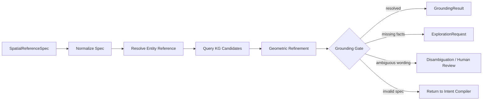
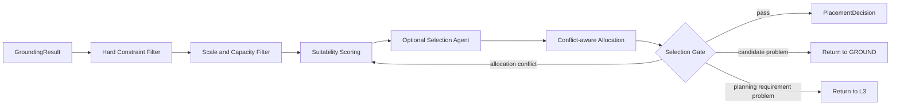
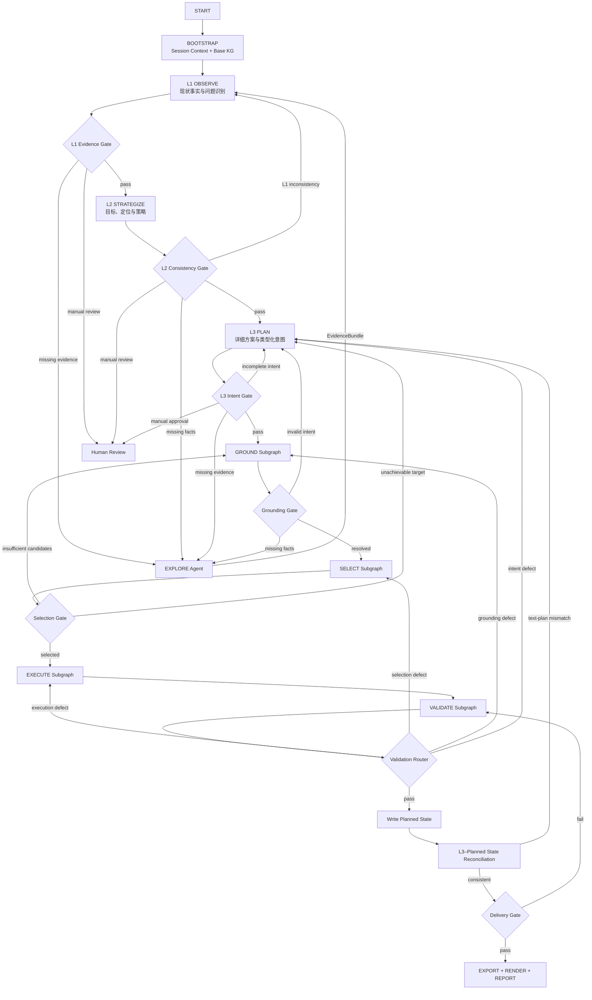

# Agent 主图（Agent Graph）

> 回答"主图怎么跑"。
> 设计理由见 [design/04_PLANNING_PIPELINE.md](../design/04_PLANNING_PIPELINE.md) 与 [design/05_EXPLORE_BRIDGE.md](../design/05_EXPLORE_BRIDGE.md)。

## 1. 当前实现：6 节点主图

`create_unified_planning_graph()`（`backend/app/agent/graph.py`）构建 `StateGraph(AgentState)`，注册 6 个节点：

```
                         START
                           │
                           ▼
                   ┌───────────────┐
                   │ conversation  │  中央路由（大脑）
                   │ conversation/ │  bind_tools: advance_planning_intent
                   │ node.py       │  + gis_analysis + analytics tools
                   └───────┬───────┘
                           │ after_conversation (routing.py)
          ┌────────────────┼────────────────┬──────────────┐
          ▼                ▼                ▼              ▼
   ┌─────────────┐  ┌──────────────┐  ┌────────────┐    END
   │execute_tools│  │analyze_      │  │ gis_agent  │  (闲聊/问答)
   │tools/       │  │dimension     │  │ graph.py   │
   │execute_node │  │analysis/     │  │ PARSE+LAYOUT
   └──────┬──────┘  │node.py       │  └─────┬──────┘
          │         └──────┬───────┘        │
          │                │                │
          ▼                ▼                ▼
   ┌──────────────┐  ┌──────────────┐
   │conversation  │  │layer_completion_ │
   └──────────────┘  │check             │
                     │completion/       │
                     │node.py           │
                     └────────┬─────────┘
                              │ after_analysis (routing.py)
                              │ Wave 调度 + 跨层提前分发
                              ▼
                    ┌─────────────────┐
                    │ analyze_dimension│ (下一波 Send)
                    │ explore → gis_agent  (phase=completed, EXPLORE 桥接)
                    │ conversation / END
                    └─────────────────┘
```

### 节点表

| 节点                       | 实现文件                        | 职责                                                                                                                              | 状态              |
| -------------------------- | ------------------------------- | --------------------------------------------------------------------------------------------------------------------------------- | ----------------- |
| `conversation`           | `agent/conversation/node.py`  | 中央路由。`bind_tools([advance_planning_intent, gis_analysis] + analytics)`，LLM 决策后经 `after_conversation` 路由           | `[IMPLEMENTED]` |
| `execute_tools`          | `agent/tools/execute_node.py` | `[过渡性]` 仅处理非路由 tool_calls（`knowledge_search`、`web_search`、`population_prediction`）。路由类工具被过滤         | `[DEPRECATED?]` |
| `analyze_dimension`      | `agent/analysis/node.py`      | RAG 检索 + KG 查询 +`DataPipeline` 工具执行 + LLM 流式生成 + EXPLORE brief 注入                                                 | `[IMPLEMENTED]` |
| `layer_completion_check` | `agent/completion/node.py`    | 层级完成检测。`step_mode` 走 `interrupt()` 暂停审批；连续模式自动推进下一层；层边界触发 bundle 快照 + KG enrichment           | `[IMPLEMENTED]` |
| `explore`                | `agent/explore/node.py`       | EXPLORE 认知引擎：桥接 agent（`ExploreFlashAgent`）+ 确定性概要索引，解析规划文本产出空间认知与 EXPLORE 指令，供 PARSE/GIS 消费 | `[IMPLEMENTED]` |
| `gis_agent`              | `agent/graph.py`              | PARSE（规则解析器）+ LAYOUT（确定性管线）混合。加载 bundle + 用户上传 → PARSE → LAYOUT → SSE 推送                              | `[IMPLEMENTED]` |

### 边定义

```python
# graph.py
builder.add_edge(START, "conversation")
builder.add_conditional_edges("conversation", after_conversation,
    {"execute_tools", "analyze_dimension", "gis_agent", END})
builder.add_edge("execute_tools", "conversation")
builder.add_edge("gis_agent", END)
builder.add_edge("analyze_dimension", "layer_completion_check")
builder.add_edge("explore", "gis_agent")
builder.add_conditional_edges("layer_completion_check", after_analysis,
    {"analyze_dimension", "explore", "conversation", END})
```

## 2. 路由逻辑

### `after_conversation`（`routing.py:27`）

对话后路由，按优先级：

1. **级联修订** — `need_revision` + `feedback` 存在时，计算影响树（`get_impact_tree_compat`），`Send` 分发 Wave 0 目标维度到 `analyze_dimension`（`is_revision=True`）
2. **推进意图** — 检测 `advance_planning_intent` tool_call → `_dispatch_current` 分发当前层维度
3. **GIS 分析** — 检测 `gis_analysis` tool_call → `gis_agent`
4. **其他工具** — 未知 tool_call → `execute_tools`
5. **普通对话** — 无 tool_call → `END`

### `after_analysis`（`routing.py:129`）

分析后路由，三选一：

1. **级联修订模式** — 依赖检查：遍历 `revision_impact_tree` 中未完成维度，检查同层 + 跨层依赖是否就绪，就绪则 `Send` 分发
2. **正常推进** — Wave 调度：当前层依赖已完成的维度 `Send` 分发；**跨层提前分发**（`routing.py:263-287`）—— 下一层中跨层依赖已就绪的维度可提前启动
3. **完成** — 无就绪维度 → `END`

## 3. EXPLORE 桥接节点（已实现）

EXPLORE 已提升为主图第 6 节点（`agent/explore/`），`phase=completed`（L3 完成）且非 `step_mode` 时触发一次（`explore_done` 标记防重复）：

```
conversation ──► analyze_dimension (L1/L2/L3)
  │                    │
  │                    ▼
  │             layer_completion_check
  │                    │
  │                    ▼ (phase=completed, 非 step_mode)
  │             ┌──────────┐
  │             │ explore  │  读 L1+L2+L3 全量报告 + KG 交互
  │             │          │  产出概要索引 + EXPLORE 指令
  │             └────┬─────┘
  │                  ▼
  │             gis_agent (PARSE + LAYOUT)
  │                  │
  │                  ▼
  │             END（gis_agent → conversation → END）
  └──────────────────┘
```

**EXPLORE 提升为主图顶层节点的原因**（详见 [design/05](../design/05_EXPLORE_BRIDGE.md)）：

- 按需读取 L1+L2+L3 全量报告，产出 `ReportSummaryIndex` 供 PARSE 导航（解决此前仅取 L3 报告导致 L1/L2 空间线索丢失的问题）
- KG 交互集中在 EXPLORE，PARSE 不直接查 KG，职责清晰

## 4. 已知问题

| 问题                 | 位置                 | 影响                                 |
| -------------------- | -------------------- | ------------------------------------ |
| execute_tools 过渡性 | `execute_node.py`  | 仅处理非路由工具，路由类被过滤后转发 |
| 开环无校核轮         | `design/04` 断点⑥ | L3 文本与 L4 几何无一致性校核        |

## 5. 相关文件

```
backend/app/agent/
├── graph.py                 # create_unified_planning_graph() + gis_agent_node
├── routing.py               # after_conversation + after_analysis
├── state.py                 # AgentState, PlanningPhase
├── conversation/node.py     # conversation_node (中央路由)
├── tools/execute_node.py    # execute_tools_node (非路由工具)
├── analysis/
│   ├── node.py              # analyze_dimension (RAG + KG + DataPipeline + LLM)
│   └── pipeline.py          # DataPipeline (统一工具执行)
├── explore/
│   ├── node.py              # explore_node (EXPLORE 认知引擎)
│   ├── agent.py             # ExploreFlashAgent 桥接
│   └── summaries.py         # 确定性概要索引
├── completion/node.py       # layer_completion_check (interrupt / auto-advance)
└── gis/
    ├── agent.py             # create_parse_agent_graph (PARSE 兼容入口)
    ├── layout_pipeline.py   # build_layout_pipeline (LAYOUT 确定性管线)
    ├── parse/               # PARSE Agent（规则解析器）
    └── execute/             # EXECUTE Agent 子图
是的，`GROUND` 和 `SELECT` 应该独立，但更准确地说：应该是独立子图，不一定都做成自主 LLM Agent。

当前主图只有 6 个顶层节点，[`explore → gis_agent → END`](F:/project/Village_Planning_Agent/backend/app/agent/graph.py:248)，而 `gis_agent` 内部又塞入 PARSE、KG、EXECUTE、VALIDATE、EXPORT、RENDER。顶层图过于粗，GIS 子图又过于肥，导致错误无法准确回到产生问题的阶段。

## 哪些应该是 Agent

| 能力 | 形态 | 原因 |
|---|---|---|
| EXPLORE | Tool-calling Agent | 需要动态决定查询 KG、RAG、外部数据还是报告 |
| L1/L2/L3 分析 | 专业分析 Agent | 需要综合资料、解释与生成规划判断 |
| PARSE | 类型化 Compiler 节点 | 输出结构稳定，不需要自由规划工具调用 |
| GROUND | 确定性子图 | 实体解析、KG 查询、几何精化都应可复现 |
| SELECT | 混合决策子图 | 硬约束和评分确定性执行，可选 LLM 终选 |
| EXECUTE | 算法 Worker 子图 | MIP、道路、设施生成属于确定性算法 |
| VALIDATE | Evaluator 子图 | 规则校验、约束检查、结果路由 |
| DELIVER | 确定性节点 | 汇交、导出、渲染、质量门槛 |

所以我的建议是：

> GROUND 单独成子图，但默认不是 Agent；SELECT 单独成子图，其中可以包含一个受约束的 Selection Agent。

### GROUND 子图



GROUND 的输出不应该只是 BSM 数组，而应包含完整证据：

```python
class GroundingResult(BaseModel):
    target_id: str
    spec: SpatialReferenceSpec
    candidates: list[GroundedCandidate]
    reference_entities: list[str]
    query_trace: list[QueryEvidence]
    confidence: float
    status: Literal['resolved', 'ambiguous', 'unresolved']
    unresolved_reason: str | None
```

它负责回答：

> “这个空间描述对应哪些候选空间对象，证据是什么？”

不负责回答：

> “最终选哪个？”

### SELECT 子图

SELECT 是真正的规划决策阶段，可以采用“确定性过滤 + 模型辅助排序 + 确定性复核”：



Selection Agent 只接收经过硬过滤后的 Top-K 候选，例如：

- 用地性质
- 可建设面积
- 聚落距离
- 道路可达性
- 设施服务覆盖
- 坡度
- 灾害与控制线
- KG 关系
- 规划目标和证据

它只输出排序和理由，不能直接生成坐标。最终结果再由确定性 Gate 检查。

## 理想的 L1/L2/L3 顶层图

不建议继续使用：

```text
conversation
  → analyze_dimension
  → layer_completion_check
  → analyze_dimension
  → ...
  → explore
  → 巨大的 gis_agent
  → END
```

应该改成分层子图加显式产物：



这张图的关键不是节点更多，而是每个节点都有：

- 唯一输入契约
- 唯一输出契约
- 明确的失败归因
- 定向反馈边
- 可独立测试的职责

## L1、L2、L3 内部也应该各自是子图

### L1：现状认知

```text
加载事实
→ 并行维度分析
→ 汇总现状模型
→ 交叉一致性校验
→ 证据完整性 Gate
→ L1Snapshot
```

输出不应只是若干 Markdown 报告，而应同时生成：

- `FactSet`
- `ConstraintInventory`
- `ProblemInventory`
- `OpportunityInventory`
- `EvidenceGap[]`
- `L1Snapshot`

EXPLORE 在这里作为按需能力，被 Evidence Gate 调用，而不是固定跑一次。

### L2：策略推导

```text
L1Snapshot
→ 目标生成
→ 多策略方案
→ 跨维度协调
→ 约束和可实施性预检
→ 策略一致性 Gate
→ L2Strategy
```

输出：

- 规划目标
- 发展定位
- 空间结构策略
- 用地调整原则
- 设施与交通策略
- 策略依赖和冲突
- `L2Strategy`

L2 必须只建立在已批准的 L1 事实之上，并保留完整 provenance。

### L3：规划编译

```text
L1Snapshot + L2Strategy
→ 详细规划维度并行生成
→ 目标合并
→ Intent Compiler
→ 跨目标冲突检测
→ Intent Gate
→ L3PlanningIntent
```

最终 L3 的权威产物不是 Markdown，而是：

```python
class L3PlanningIntent(BaseModel):
    goals: list[PlanningGoal]
    zones: list[ZoneTarget]
    facilities: list[FacilityTarget]
    roads: list[RoadTarget]
    projects: list[ProjectTarget]
    constraints: list[SpatialConstraint]
    spatial_references: list[SpatialReferenceSpec]
    indicators: PlanningIndicatorTable
    provenance: ProvenanceGraph
```

Markdown 报告只是它的一个展示视图。

## EXPLORE 应该变成横向能力

EXPLORE 不属于固定的 `L3 → GIS` 管线阶段，而是所有 Gate 都能调用的横向能力：

```text
L1 Gate ─┐
L2 Gate ─┼─→ ExplorationRequest → EXPLORE → EvidenceBundle
L3 Gate ─┤
GROUND ──┤
VALIDATE ┘
```

不同调用模式可以统一为同一契约：

```python
class ExplorationRequest(BaseModel):
    request_id: str
    requested_by: Literal['l1', 'l2', 'l3', 'ground', 'validate']
    questions: list[str]
    required_facts: list[str]
    entity_scope: list[str]
    source_preferences: list[str]
```

EXPLORE 永远返回证据，不返回规划指令或最终候选地块。

## 还需要解决一个命名冲突

当前“规划 L1/L2/L3”和“KG L1/L2/L3/L4”使用相同层级名称，非常容易造成误解。建议把 KG 层改名为：

- `BaseFacts`
- `DerivedRelations`
- `IntentGraph`
- `PlannedState`

于是数据关系会更清楚：

```text
Planning L1 → reads BaseFacts + DerivedRelations
Planning L2 → reads L1Snapshot + DerivedRelations
Planning L3 → writes IntentGraph
EXECUTE     → writes PlannedState
RECONCILE   → compares IntentGraph with PlannedState
```

最终顶层主图只需要维护阶段和 Gate；维度调度、空间解析、选址和执行分别留在自己的子图中。这样可以彻底替换现在由 [`after_analysis()`](F:/project/Village_Planning_Agent/backend/app/agent/routing.py:129) 同时处理层级、波次、修订、跨层依赖和 EXPLORE 路由的集中式复杂逻辑。

```

```
