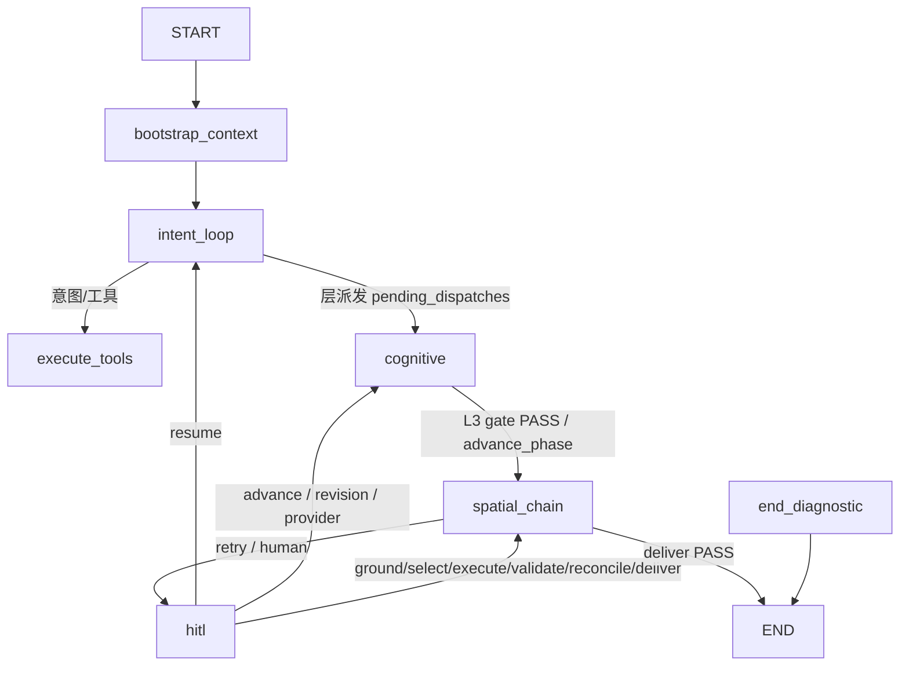

# 当前 LangGraph 主图（四段子图）

> 本文只描述 `backend/app/workflow/root_graph.py` + `segments.py` 的当前接线。目标图和不变量
> 见 [`../design/00_SYSTEM_DESIGN.md`](../design/00_SYSTEM_DESIGN.md)；完成度见
> [`../design/10_IMPLEMENTATION_STATUS_CURRENT_20260818.md`](../design/10_IMPLEMENTATION_STATUS_CURRENT_20260818.md)；
> 与旧“扁平线性链”表述的差异见 [`../design/27_IMPLEMENTATION_VS_DESIGN.md`](../design/27_IMPLEMENTATION_VS_DESIGN.md)。

## 1. 父图结构

`create_unified_planning_graph()`（`root_graph.py`）只保留 `bootstrap_context` + 四个段节点
+ `end_diagnostic`；段内成员由 `segments.py::build_segments` 定义。跨段跳转统一由路由节点发
`Command(graph=Command.PARENT, goto=<segment>)`（`segments.py::_map_route_result`）。



## 2. 段内成员（`segments.py`）

| 段 | 节点 |
|---|---|
| `intent_loop` | `conversation`、`execute_tools` |
| `cognitive` | `l1_worker`、`l2_worker`、`l3_worker`、`layer_completion_check`（`defer=True` 屏障）、`layer_aggregate`、`advance_phase`、`revision_dispatch`、`provider_resume_dispatch` |
| `spatial_chain` | `target_projection`、`ground`、`select`、`execute`、`validate`、`reconcile`、`deliver`（每个节点后挂 `{stage}_router`，gate 驱动） |
| `hitl` | `human_review_prepare`、`human_review_publish`、`human_review_wait`、`human_review_apply` |

## 3. 阶段路由（gate 驱动）

- `root_graph.py` 提供 `route_after_{target_projection,ground,select,execute,validate,reconcile,deliver}`；
  gate 决策由 `workflow/stages/support.py::GATE_CHANNELS` 与各阶段 gate 产生。
- `EXECUTE` 是显式豁免：`route_after_execute` 不读 gate artifact，仅在 `fatal_error` 时
  fail-closed 到 `END_DIAGNOSTIC`，否则恒推进 `validate`。
- retry 预算耗尽或 HUMAN 需要时进入 `hitl`；`application/interrupts.py::collect_human_review_items`
  从 checkpoint gate channel 收集待审项。
- `WorkflowState`（`workflow/state.py`）只保存控制字段与 artifact refs；阶段业务结果由
  `workflow/stage_adapter.py` 持久化为 CAS artifact。

## 4. 恢复与人工审核

LangGraph 的 interrupt 必须配合持久化 checkpointer 和相同 `thread_id` 使用。应用层通过
`application/commands/resume_*`、`application/recovery/resume_service.py` 和 runtime service
组织恢复；API 不应自行拼装后续节点状态。恢复前需辨别：当前是否存在真实 interrupt、请求
是否指向正确事件/checkpoint、父 artifact 与 context fingerprint 是否匹配、是恢复当前分支
还是从历史 checkpoint 创建新 branch、retry 耗尽是否应进入 `diagnostic_only` 或 HUMAN。

中断点前的节点可能在恢复时重放，因此不可幂等副作用不能放在 interrupt 前。SSE 只发布可
重放事件，详细 transport 字段以 [backend-api.md](backend-api.md) 为准。

## 5. 当前与目标的区别

根图已有四段子图、独立 post-L3 阶段节点、统一控制 state 和真实 HUMAN/checkpoint 恢复路径；
这只证明编排边界存在，不证明每个 worker 都已形成独立的 typed contract、真实规划内容和
法定完整交付。任何“完整规划闭环”的表述都必须同时满足状态台账的真实验收条件。

## 6. 验证入口

```powershell
pytest backend/tests/contracts backend/tests/core -q
pytest backend/tests/e2e -q
```

真实 provider、PNG/HTML/GeoJSON 和进程重启 resume 不应由离线 fixture 或单元测试代替。
