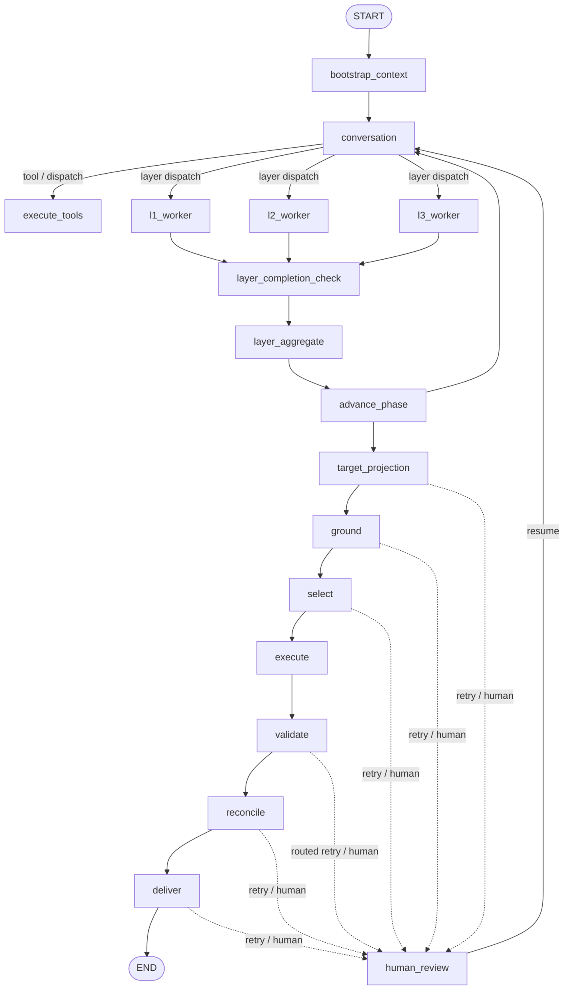

# 当前 LangGraph 主图

> 本文只描述 `backend/app/workflow/root_graph.py` 的当前接线。目标图和不变量见
> [`../design/00_SYSTEM_DESIGN.md`](../design/00_SYSTEM_DESIGN.md)。阶段完成度见
> [`../design/10_IMPLEMENTATION_STATUS.md`](../design/10_IMPLEMENTATION_STATUS.md)。

## 1. 根图入口

根图由 `create_unified_planning_graph()` 构建，运行时由
`infrastructure/runtime/planning_runtime_service.py` 使用 checkpoint 启动或恢复。
当前节点分为四组：



实际 conditional edges 会根据 gate artifact、retry budget、`paused_stage` 和 terminal
状态回到上游阶段，或进入 `human_review_prepare → human_review_publish →
human_review_wait → human_review_apply`。图中“顺序经过”不等于“阶段已完全闭环”。

## 2. 节点职责

| 节点组 | 当前入口 | 职责 |
|---|---|---|
| Bootstrap | `workflow/layers/context_bootstrap.py` | 建立运行所需上下文和引用 |
| Conversation | `workflow/conversation/` | 识别用户意图、路由维度或空间流程 |
| Tools | `workflow/tools/execute_node.py` | 执行非路由工具并回写 ToolMessage；当前注册表接线状态见 `design/17` |
| L1/L2/L3 | `workflow/layers/`、`domain/assessment/` 等 | 并行或波次执行认知层 worker，生成报告和阶段产物 |
| Layer control | `workflow/plan_state/`、`workflow/layers/` | 检查维度完成、聚合、推进阶段或触发审核 |
| Post-L3 stages | `workflow/stages/*.py` | 依次调用 target projection、ground、select、execute、validate、reconcile、deliver |
| Human review | `root_graph.py` + `application/interrupts.py` | 统一准备、发布、等待和应用人工决定 |
| Terminal | `workflow/terminal.py` | 将重试耗尽或不可恢复情况落为显式诊断终态 |

## 3. 控制状态与阶段结果

`workflow/state.py` 中的 `WorkflowState` 是根图控制边界，保存会话/分支身份、阶段、
状态、retry、interrupt、terminal 和 `artifact_refs` 等引用。完整业务对象不应写入根图 state；
阶段节点通过 artifact runtime 读取 typed payload。

阶段主链的当前节点名称是：

```text
TARGET_PROJECTION → GROUND → SELECT → EXECUTE
  → VALIDATE → RECONCILE → DELIVER
```

其中 `TARGET_PROJECTION` 只把已组装的 `PlanningProgram` 投影为空间目标；它不应重新解析
Markdown、猜分类或直接选地。`GROUND` 处理实体和几何接地，`SELECT` 处理候选评估，
`EXECUTE` 生成空间变化，后续阶段负责校验、对账和交付。

## 4. 恢复与人工审核

LangGraph 的 interrupt 必须配合持久化 checkpointer 和相同 `thread_id` 使用。当前应用层
通过 `application/commands/resume_*`、`application/recovery/resume_service.py` 和
runtime service 组织恢复；API 不应自行拼装后续节点状态。

恢复前需要辨别：

- 当前是否存在真实 interrupt；
- 请求是否指向正确的事件/ checkpoint；
- 父 artifact 和 context fingerprint 是否仍匹配；
- 是恢复当前分支，还是从历史 checkpoint 创建新 branch；
- retry 已耗尽时是否应进入 `diagnostic_only` 或 HUMAN。

中断点前的节点可能在恢复时重放，因此不可幂等副作用不能放在 interrupt 前。SSE 只发布
可重放事件，详细 transport 字段以 [backend-api.md](backend-api.md) 为准。

## 5. 当前与目标的区别

当前根图已经有独立 post-L3 节点、统一控制 state 和真实 HUMAN/checkpoint 恢复路径；
这只证明编排边界存在，不证明每个 worker 都已形成独立的 typed contract、真实规划内容
和法定完整交付。任何“完整规划闭环”的表述都必须同时满足状态台账的真实验收条件。

## 6. 验证入口

```powershell
pytest backend/tests/contracts backend/tests/core -q
pytest backend/tests/e2e -q
```

真实 provider、PNG/HTML/GeoJSON 和进程重启 resume 不应由离线 fixture 或单元测试代替。
