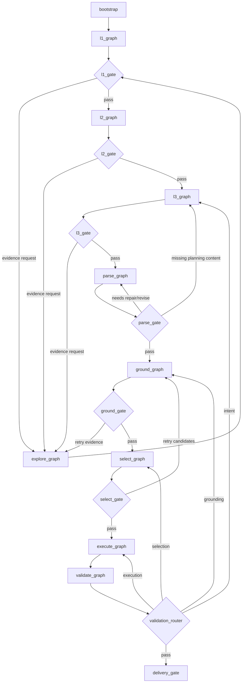
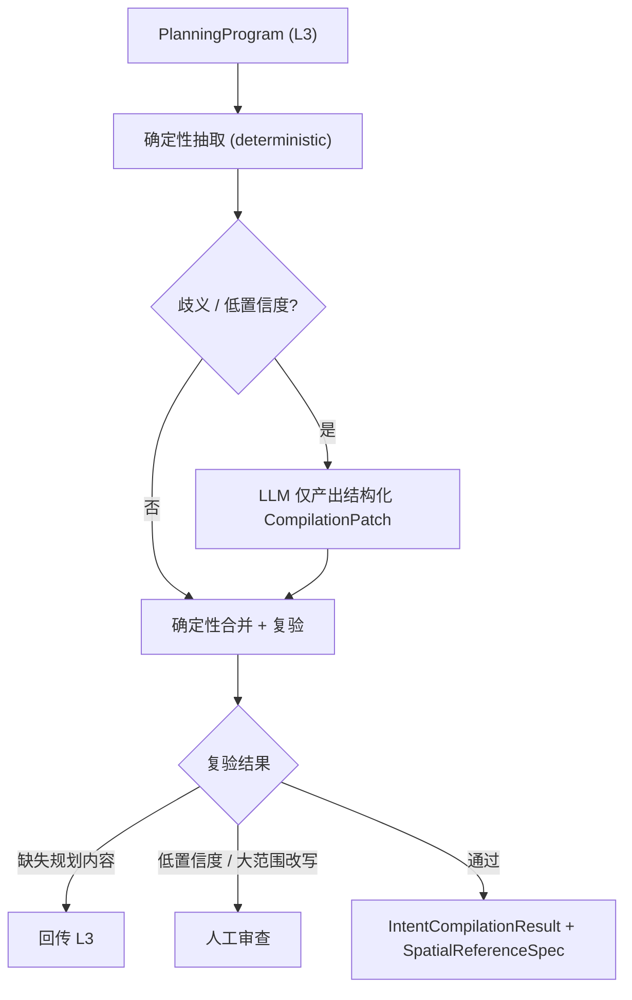

# 工作流图：当前实现与目标子图

## 1. 当前主图

当前入口为 `backend/app/agent/bootstrap/graph.py:create_unified_planning_graph`，包含 conversation、execute_tools、analyze_dimension、layer_completion_check、explore 和 gis_agent 六类节点。`gis_agent` 内部继续调用 `layout_pipeline`，因此顶层图看似简单，实际把 PARSE、KG、EXECUTE、VALIDATE、EXPORT、RENDER 聚合在一个节点中。

当前主要路径：

```text
conversation
  → analyze_dimension (Send 并行)
  → layer_completion_check
  → explore
  → gis_agent
  → END
```

当前路径仅适合作为迁移兼容层，不是目标边界。

## 2. 目标主图



### 2.1 PARSE 子图（独立顶层阶段）

PARSE 是**独立的顶层阶段**，形式上不属于 select_graph（不再与 SELECT 合并）。输入为 L3 `PlanningProgram`，输出为 `IntentCompilationResult` + `SpatialReferenceSpec`。

三种模式：

- **COMPILE**：首次编译 L3 PlanningProgram → IntentCompilationResult + SpatialReferenceSpec。
- **REPAIR**：基于已有编译结果 + 用户局部纠正（`ParseRevisionRequest.user_revisions` / `patch_ids`）做定向修复。
- **REVISE**：大范围重写（低置信度 / 结构性变更），产出新 revision。

混合设计（hybrid repair）：



设计要点：

- 确定性抽取优先；LLM 只产出结构化 `CompilationPatch`（actor = "llm"），不直接改写 artifact。
- 补丁由确定性合并器合并，随后重新校验（`ParseTrace.steps` 记录确定性步骤日志）。
- 缺失的规划内容路由回 L3；低置信度 / 大范围改写路由到人工审查（`CompilationStatus.NEEDS_REVIEW`）。
- `CompilationPatch` 只保存 `rationale`（简要判断依据），不保存模型内部推理链。
- 诊断统一收敛为 `ParseDiagnostic`（severity/code/message），兼容字段 `compilation_errors` 保留供旧消费者。

## 3. 子图契约

| 子图 | 输入 | 输出 |
|---|---|---|
| `l1_graph` | Context + EvidenceBundle | `L1Snapshot` |
| `l2_graph` | `L1Snapshot` | `L2Strategy` |
| `l3_graph` | L1 + L2 + evidence | `L3PlanningIntent` |
| `parse_graph` | `PlanningProgram` | `IntentCompilationResult` + `SpatialReferenceSpec` |
| `explore_graph` | `ExplorationRequest` | `EvidenceBundle` |
| `ground_graph` | `SpatialReferenceSpec` | `GroundingResult` |
| `select_graph` | `GroundingResult` + requirements | `PlacementDecision` |
| `execute_graph` | `PlacementDecision` | `PlannedState` |
| `validate_graph` | artifacts + context | `ValidationReport` |

## 4. Agent 形态

- EXPLORE：工具调用 Agent。
- L1/L2/L3：专业分析 Agent 的层内 worker。
- GROUND：确定性子图，歧义时才请求 Agent/人工。
- SELECT：规则过滤 + 可选 Top-K Selection Agent。
- EXECUTE：确定性 Worker，不使用自由规划 Agent。
- VALIDATE：确定性 Evaluator。

## 5. 状态规则

LangGraph State 只保存：`context_ref`、`active_stage`、`active_gate`、`artifact_refs`、`pending_requests`、`validation_issues` 和 `human_review`。完整报告、KG、地块和图层通过 artifact store 读取。

## 6. 相关文件

> 注：本结构为 2026-08 迁移后的目录归属。L1/L2/L3 子图尚未独立（L2/L3 暂借 l1_observe 实现），GROUND/SELECT/VALIDATE/RECONCILE 核心算法仍在 app/modules/spatial_ops + app/modules/kg，后续逐模块完善时再深入。

```
backend/app/agent/
├── bootstrap/          # 主图工厂 + 阶段机 (graph.py, phase_machine.py, gis_agent_entry.py)
├── conversation_router/ # 中央路由 (node.py + edges.py)
├── l1_observe/         # L1 现状分析 (analysis_node.py + pipeline.py + formatters.py)
├── l2_strategize/      # L2 策略推导 (占位, 暂借 l1_observe)
├── l3_plan/            # L3 详细规划 (占位, 暂借 l1_observe)
├── explore/            # EXPLORE 认知引擎 (横向能力)
├── ground/             # GROUND 空间接地 (format_bound_intent.py)
├── select/             # SELECT/PARSE (parse_agent.py, parse_state.py, parse_fallback.py, prompts.py)
├── execute/            # EXECUTE (layout_pipeline.py, execute_agent.py, road_generator.py, vocab_*)
├── validate/           # VALIDATE (占位)
├── plan_state/         # PLAN_STATE (state.py + completion_node.py)
├── reconcile/          # RECONCILE (占位)
├── deliver/            # DELIVER (gis_pipeline_state.py)
└── tools/              # 主图工具调度 (execute_node.py)
```
