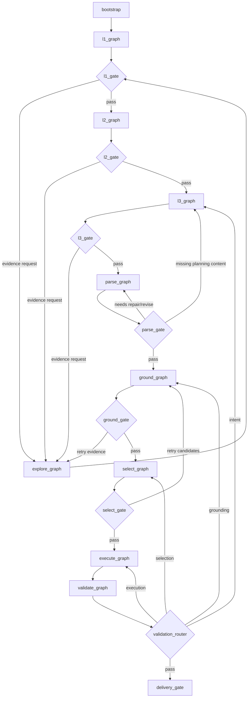
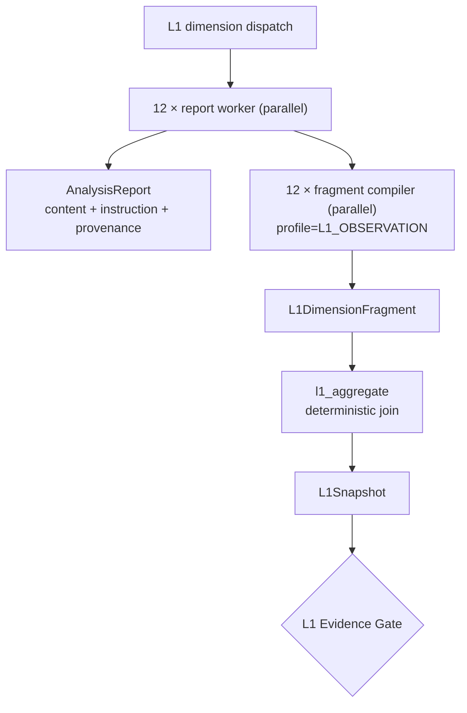
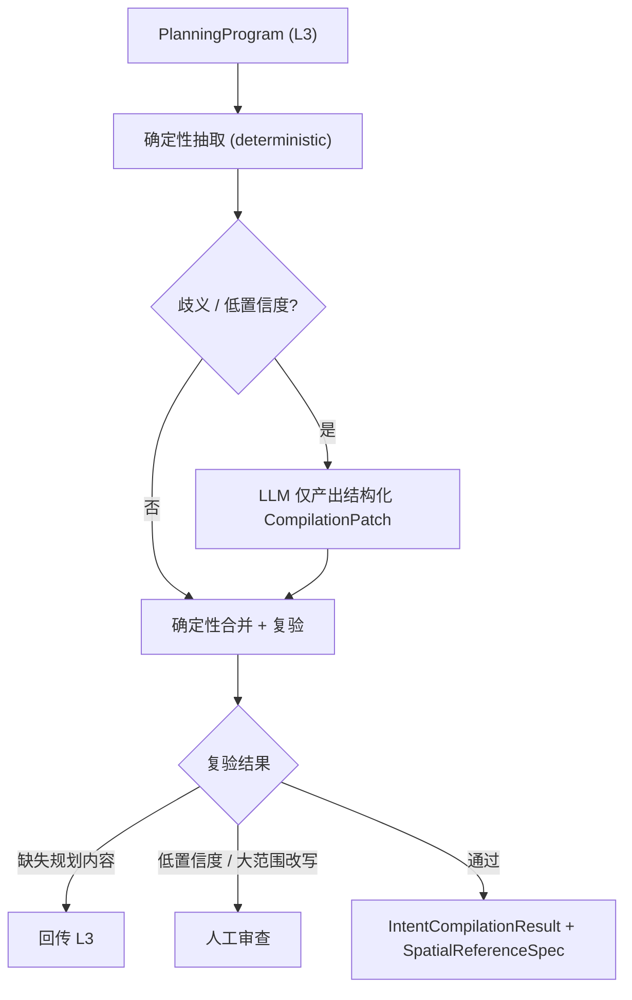

# 工作流图：当前实现与目标子图

## 1. 当前主图（代码事实，2026-08-10）

当前入口为 `backend/app/agent/bootstrap/graph.py:create_unified_planning_graph`。根图有 **20 个显式业务节点**，另有 `END_DIAGNOSTIC` 终止诊断节点；LangGraph 可视图中的隐式 `START` 不计入业务阶段。

```text
START -> conversation ─┬-> execute_tools -> conversation
                     ├-> l1_worker | l2_worker | l3_worker
                     │      -> layer_completion_check -> layer_aggregate -> advance_phase
                     └-> bootstrap_context -> parse -> ground -> select -> execute -> validate -> reconcile -> deliver -> END

任一 post-L3 Gate 可回退到前置阶段，或进入：
human_review_prepare -> human_review_publish -> human_review_wait -> human_review_apply
```

20 个显式业务节点（按加入顺序）：
`conversation`、`execute_tools`、`l1_worker`、`l2_worker`、`l3_worker`、`advance_phase`、`layer_completion_check`、`layer_aggregate`、`bootstrap_context`、`parse`、`ground`、`select`、`execute`、`validate`、`reconcile`、`deliver`、`human_review_prepare`、`human_review_publish`、`human_review_wait`、`human_review_apply`。

其中 post-L3 的七个阶段已经是根图节点，不再由 `gis_agent` wrapper 聚合。`human_review_wait` 是 post-L3 的唯一 `interrupt()` 点；step-mode 的 `layer_completion_check` 是另一条业务频道，但两者共享 `HumanInterrupt` canonical payload。`prepare`/`publish`/`apply` 三个节点必须可重放。

### 1.1 bootstrap_context 节点（Wave M3）

`bootstrap_context` 在 `conversation` 路由到 PARSE 时执行一次，冻结上下文快照：

- 调用 `build_planning_context(session_id, village_name)` 生成 `PlanningContext`，写入 `context_version` 与 `context_fingerprint`（`sha256:` 前缀 + 16 位 hex，由 `snapshot_meta()` 排序后哈希得到）。
- `bootstrap_context_done=True` 防止后续 replay 重复构建；后续 post-L3 节点统一通过 `context_ref` 读取已冻结的上下文。
- 失败时降级为空 fingerprint，不阻断主图。

### 1.2 ref-only 状态与 `_load_ref_artifact`

post-L3 的所有节点（parse/ground/select/execute/validate/reconcile/deliver）通过 `post_l3_main_nodes._load_ref_artifact(state, key, cls)` 从 artifact store 读取 typed artifact，AgentState 不再持有完整业务对象，只保存 `artifact_refs` + `*_gate` 决策。`context_fingerprint` 随 `ArtifactRef`/`ContractMeta` 一起持久化，replay 时用于校验 artifact 身份一致性。

### 1.3 EXECUTE 子图与 HITL

- EXECUTE 子图（`build_execute_agent_graph`）在 `PlanningRuntimeService.initialize()` 中**编译一次**，与主图共享同一个 `checkpointer`，避免每次调用重建。
- HITL 由 4 个节点构成：`prepare`（收集 items + 生成稳定 `event_id`，纯函数）→ `publish`（幂等发布 `HUMAN_REVIEW_PAUSED` SSE）→ `wait`（post-L3 的 `interrupt()` 点）→ `apply`（写回 gate 决策）。step-mode 的 `layer_completion_check` 使用同一 `HumanInterrupt` contract；`_retry_or_human` 在 retry 用尽时将 `paused_stage` 写入状态后转入 `human_review_prepare`。
- canonical payload 字段是 `event_id/channel/reason/layer/phase/layer_name/paused_stage/items/error_feedback`；旧的 `human_review_items`、`human_review_event_id` 和历史 reason 只允许在 API、interrupt transport、checkpoint 兼容边界出现，不能进入新的业务逻辑。

### 1.4 Checkpoint 与 ResumePlan

LangGraph 的 `thread_id` 是恢复同一图线程的持久化游标，`checkpoint_id` 可以定位历史状态；它们不等价于业务恢复计划。每次 checkpoint 恢复前，应用层必须生成 `ResumePlan`：

```text
PregelTask.interrupts / graph.next
        + context_version / context_fingerprint
        + artifact_refs / parent checksums
        + gate / deferral revision
        ↓
ResumePlan
  ├── mode: resume_interrupt | resume_checkpoint | rerun_from_stage | completed | blocked
  ├── resume_from
  ├── reuse: 可证明身份一致的 artifact
  ├── rerun: 最早失效阶段及全部下游
  └── reason + input/output checksums
```

判定规则：pending `PregelTask.interrupts` 优先于 `next`；HUMAN 只能通过对应 `Command(resume=...)` 恢复；context 或父 artifact checksum 变化时从最早受影响阶段生成新 revision；终态和诊断终止不允许伪恢复。默认父图挂载的无独立 checkpoint 子图只能在父图粒度 time travel；若要在 EXECUTE 内部节点之间恢复，必须显式配置并审计子图 checkpoint namespace。

这部分采用 Context7 与 Exa 对官方 LangGraph 文档的交叉结果：[persistence](https://docs.langchain.com/oss/python/langgraph/persistence)、[interrupts](https://docs.langchain.com/oss/python/langgraph/interrupts)、[subgraphs](https://docs.langchain.com/oss/python/langgraph/use-subgraphs)、[time travel](https://docs.langchain.com/oss/python/langgraph/use-time-travel)。
- resolve API 的 `action` 取 `retry`/`accept`/`reject`：`accept` 按 `_STAGE_FORWARD_TARGET` 前进，`retry` 回到 `paused_stage`，`reject` 回到 `conversation`。

### 1.4 迁移期残留

`AgentState` 仍处于 ref-only 收敛期：已移除 13 个 typed 业务对象字段（如完整 `PlanningProgram`、`GroundingResult`、`SiteSelectionDecision`、`PlannedState`、`ValidationReport` 等的内联存储），改为通过 `artifact_refs` 引用；当前约 70 个字段（含 canonical `human_interrupt`、中间态/重试/HITL 兼容字段）。`layout_configs` 等少量字段仍是迁移兼容字段。

## 2. 目标主图



### 2.1 L1 子图（并行报告与并行编译）



- 保留现有 12 维报告及 `【INSTRUCTION】`，继续服务 UI、SSE、KG enrichment 和人工审查。
- fragment compiler 是共享 IntentCompiler 的 L1 profile，不是 12 个新的顶层图节点。
- 每个 worker 完成后立即编译自身 fragment；不同维度可继续并行。
- `l1_aggregate` 只合并 fragment、检查重复/冲突/证据缺口、建立 provenance 并构造 Gate 输入；
  不调用 LLM，也不重新解析 12 份报告。
- `DimensionReport.summary` 只作兼容性预览，不得直接汇聚为 `L1Snapshot`。

### 2.2 PARSE 子图（独立顶层阶段）

PARSE 是**独立的顶层阶段**，形式上不属于 L1 或 select_graph。L1 只是复用同一个 compiler core
生成维度 fragment，不表示工作流提前进入顶层 PARSE。顶层 PARSE 输入为 L3 `PlanningProgram`，
输出为 `IntentCompilationResult` + `SpatialReferenceSpec`。

共享 compiler core 提供两个 profile：

- **L1_OBSERVATION**：输入 `AnalysisReport.content`、独立 `instruction`、证据引用和 legacy summary，
  输出 `L1DimensionFragment`。
- **L3_PLANNING**：输入 `PlanningProgram`，输出 `IntentCompilationResult` + `SpatialReferenceSpec`。

三种模式：

- **COMPILE**：首次编译 L3 PlanningProgram → IntentCompilationResult + SpatialReferenceSpec。
- **REPAIR**：基于已有编译结果 + 用户局部纠正（`ParseRevisionRequest.user_revisions` / `patch_ids`）做定向修复。
- **REVISE**：大范围重写（低置信度 / 结构性变更），产出新 revision。

混合设计（hybrid repair）：



设计要点：

- 确定性抽取优先；LLM 只产出结构化 `CompilationPatch`（actor = "llm"），不直接改写 artifact。
- 补丁由确定性合并器合并，随后重新校验（`ParseTrace.steps` 记录确定性步骤日志）。
- 缺失的规划内容路由回 L3；低置信度 / 大范围改写路由到人工审查（`CompilationStatus.NEEDS_REVIEW`）。
- `CompilationPatch` 只保存 `rationale`（简要判断依据），不保存模型内部推理链。
- 诊断统一收敛为 `ParseDiagnostic`（severity/code/message），兼容字段 `compilation_errors` 保留供旧消费者。

## 3. 子图契约

| 子图 | 输入 | 输出 |
|---|---|---|
| `l1_graph` | Context + EvidenceBundle | `L1Snapshot` |
| `l2_graph` | `L1Snapshot` | `L2Strategy` |
| `l3_graph` | L1 + L2 + evidence | `PlanningProgram` |
| `parse_graph` | `PlanningProgram` | `IntentCompilationResult` + `SpatialReferenceSpec` |
| `explore_graph` | `ExplorationRequest` | `EvidenceBundle` |
| `ground_graph` | `SpatialReferenceSpec` | `GroundingResult` |
| `select_graph` | `GroundingResult` + requirements | `SiteSelectionDecision` |
| `execute_graph` | `SiteSelectionDecision` | `PlannedState` |
| `validate_graph` | artifacts + context | `ValidationReport` |

## 4. Agent 形态

- EXPLORE：工具调用 Agent。
- L1/L2/L3：专业分析 Agent 的层内 worker。
- GROUND：确定性子图，歧义时才请求 Agent/人工。
- SELECT：规则过滤 + 可选 Top-K Selection Agent。
- EXECUTE：确定性 Worker，不使用自由规划 Agent。
- VALIDATE：确定性 Evaluator。

EXPLORE 是 L1/L2/L3 共用的 session-wide evidence service。维度 worker 可以请求空间认知，
但不直接调用 KG；请求由 EXPLORE 按阶段、维度和 query purpose 从 KG、Bundle、报告、
`【INSTRUCTION】`、typed artifacts、已有证据和外部来源中渐进式检索，返回 `EvidenceBundle`。
GROUND 才将 PARSE 的 `SpatialReferenceSpec` 接到候选实体和几何；EXPLORE 不生成候选集。

目标图允许 Bootstrap 在 L1 前准备 evidence index，但不设置一个声称“证据已经充分”的固定
EXPLORE 阶段。证据充分性只能由各阶段 Gate 判断；Gate 必须能根据结构化 EvidenceGap 再次调用
EXPLORE。L1 并行 worker 不能假设同层其他报告已经可检索。

在顶层 PARSE 完成前，真实主图测试止于报告层和独立 compiler/aggregate 组件。只有
`L2Strategy`、`PlanningProgram` 成为阶段权威产物且 `L3_PLANNING` profile 接入 Parse Gate 后，
才允许把测试称为 L1→L2→L3→PARSE 端到端验证。

## 5. 状态规则

LangGraph State 只保存：`context_ref`、`context_version`、`context_fingerprint`、`bootstrap_context_done`、`active_stage`、`active_gate`（`parse_gate`/`ground_gate`/`select_gate`/`validate_gate`/`reconcile_gate`/`deliver_gate`）、`artifact_refs`、`pending_requests`、`validation_issues`、`retry_counts`、`paused_stage`、canonical `human_interrupt` 和必要的 `human_review_*` 兼容字段。完整业务对象（`PlanningProgram`、`GroundingResult`、`SiteSelectionDecision`、`PlannedState`、`ValidationReport` 等）通过 artifact store 读取，不内联进 State。

## 6. 相关文件

> 注：本结构为 2026-08 迁移后的目录归属。L1/L2/L3 子图尚未独立（L2/L3 暂借 l1_observe 实现），GROUND/SELECT/VALIDATE/RECONCILE 核心算法仍在 app/modules/spatial_ops + app/modules/kg，后续逐模块完善时再深入。

```
backend/app/agent/
├── bootstrap/          # 主图工厂、阶段机、artifact loader、主阶段节点
│   ├── graph.py            # create_unified_planning_graph + HITL 4 节点
│   ├── context_bootstrap.py # bootstrap_context 节点（Wave M3）
│   ├── post_l3_main_nodes.py # parse/ground/select/execute/validate/reconcile/deliver + _load_ref_artifact
│   ├── layer_aggregate_node.py
│   └── layer_router.py     # l1/l2/l3 worker + advance_phase
├── execute/            # EXECUTE compiled subgraph（当前独立编译；目标是父图持久化挂载）
├── conversation_router/ # 中央路由 (node.py + edges.py)
├── l1_observe/         # L1 现状分析 (analysis_node.py + pipeline.py + formatters.py)
├── l2_strategize/      # L2 策略推导 (占位, 暂借 l1_observe)
├── l3_plan/            # L3 详细规划 (占位, 暂借 l1_observe)
├── explore/            # EXPLORE 认知引擎 (横向能力)
├── ground/             # GROUND 空间接地 (format_bound_intent.py)
├── select/             # SELECT 聚合与 Gate
├── validate/           # VALIDATE (占位)
├── plan_state/         # PLAN_STATE (state.py + completion_node.py)
├── reconcile/          # RECONCILE (占位)
├── deliver/            # DELIVER (gis_pipeline_state.py)
└── tools/              # 主图工具调度 (execute_node.py)
```
