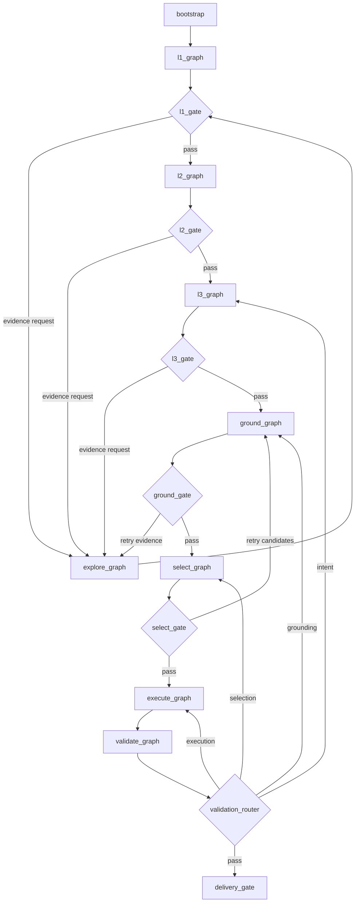

# 工作流图：当前实现与目标子图

## 1. 当前主图

当前入口为 `backend/app/agent/graph.py:create_unified_planning_graph`，包含 conversation、execute_tools、analyze_dimension、layer_completion_check、explore 和 gis_agent 六类节点。`gis_agent` 内部继续调用 `layout_pipeline`，因此顶层图看似简单，实际把 PARSE、KG、EXECUTE、VALIDATE、EXPORT、RENDER 聚合在一个节点中。

当前主要路径：

```text
conversation
  → analyze_dimension (Send 并行)
  → layer_completion_check
  → explore
  → gis_agent
  → END
```

当前路径仅适合作为迁移兼容层，不是目标边界。

## 2. 目标主图



## 3. 子图契约

| 子图 | 输入 | 输出 |
|---|---|---|
| `l1_graph` | Context + EvidenceBundle | `L1Snapshot` |
| `l2_graph` | `L1Snapshot` | `L2Strategy` |
| `l3_graph` | L1 + L2 + evidence | `L3PlanningIntent` |
| `explore_graph` | `ExplorationRequest` | `EvidenceBundle` |
| `ground_graph` | `SpatialReferenceSpec` | `GroundingResult` |
| `select_graph` | `GroundingResult` + requirements | `PlacementDecision` |
| `execute_graph` | `PlacementDecision` | `PlannedState` |
| `validate_graph` | artifacts + context | `ValidationReport` |

## 4. Agent 形态

- EXPLORE：工具调用 Agent。
- L1/L2/L3：专业分析 Agent 的层内 worker。
- GROUND：确定性子图，歧义时才请求 Agent/人工。
- SELECT：规则过滤 + 可选 Top-K Selection Agent。
- EXECUTE：确定性 Worker，不使用自由规划 Agent。
- VALIDATE：确定性 Evaluator。

## 5. 状态规则

LangGraph State 只保存：`context_ref`、`active_stage`、`active_gate`、`artifact_refs`、`pending_requests`、`validation_issues` 和 `human_review`。完整报告、KG、地块和图层通过 artifact store 读取。
