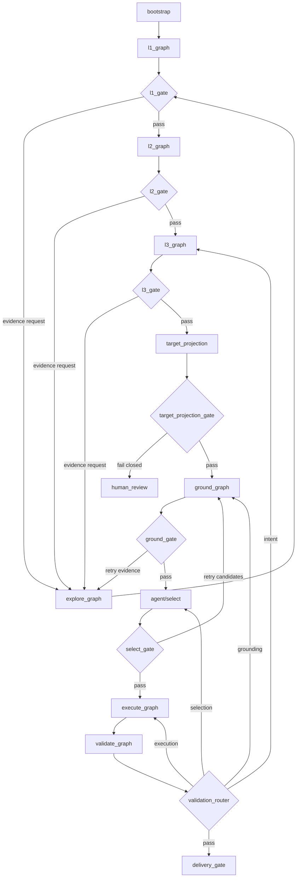
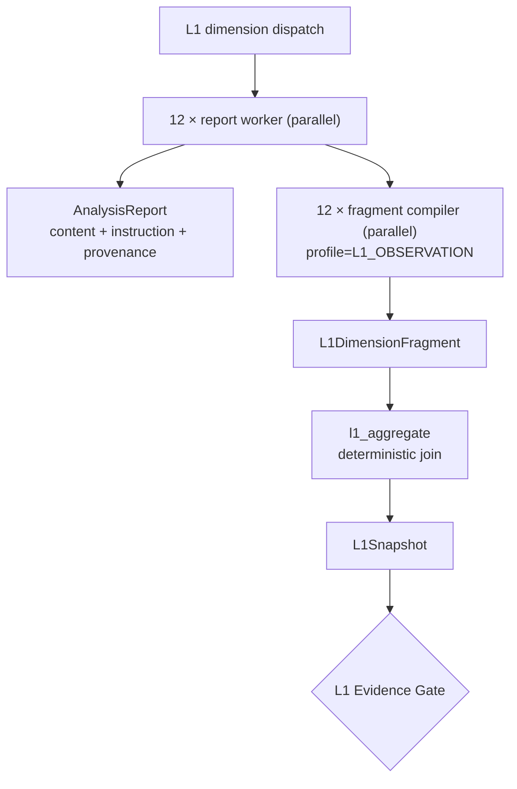

# 工作流图：当前实现与目标子图

## 1. 当前主图（代码事实，2026-08-10）

当前入口为 `backend/app/workflow/root_graph.py:create_unified_planning_graph`。根图有 **20 个显式业务节点**，另有 `END_DIAGNOSTIC` 终止诊断节点；LangGraph 可视图中的隐式 `START` 不计入业务阶段。post-L3 的 DELIVER 实现位于 `backend/app/workflow/stages/deliver.py`。

```text
START -> conversation ─┬-> execute_tools -> conversation
                     ├-> l1_worker | l2_worker | l3_worker
                     │      -> layer_completion_check -> layer_aggregate -> advance_phase
                     └-> bootstrap_context -> parse -> ground -> select -> execute -> validate -> reconcile -> deliver -> END

任一 post-L3 Gate 可回退到前置阶段，或进入：
human_review_prepare -> human_review_publish -> human_review_wait -> human_review_apply
```

20 个显式业务节点（按加入顺序）：
`conversation`、`execute_tools`、`l1_worker`、`l2_worker`、`l3_worker`、`advance_phase`、`layer_completion_check`、`layer_aggregate`、`bootstrap_context`、`target_projection`、`ground`、`select`、`execute`、`validate`、`reconcile`、`deliver`、`human_review_prepare`、`human_review_publish`、`human_review_wait`、`human_review_apply`。

其中 post-L3 的七个阶段已经是根图节点，不再由 `gis_agent` wrapper 聚合。`human_review_wait` 是 post-L3 的唯一 `interrupt()` 点；step-mode 的 `layer_completion_check` 是另一条业务频道，但两者共享 `HumanInterrupt` canonical payload。`prepare`/`publish`/`apply` 三个节点必须可重放。

### 1.1 bootstrap_context 节点（Wave M3）

`bootstrap_context` 在任何模型/worker 执行前运行一次，冻结数据上下文快照：

- 调用 `build_planning_context(session_id, village_name)` 生成 `PlanningContext`，写入 `context_version` 与 `context_fingerprint`（`sha256:` 前缀 + 16 位 hex，由 `snapshot_meta()` 排序后哈希得到）。
- `bootstrap_context_done=True` 防止后续 replay 重复构建；后续 post-L3 节点统一通过 `context_ref` 读取已冻结的上下文。
- 失败时降级为空 fingerprint，不阻断主图。

### 1.2 ref-only 状态与 artifact loader

post-L3 的所有节点（target_projection/ground/select/execute/validate/reconcile/deliver）通过
`workflow.stages.support._load_ref_artifact(state, key, cls)` 从 CAS 的 `ArtifactDescriptor`
读取 typed artifact，AgentState 不再持有完整业务对象，只保存 `artifact_refs` + `*_gate` 决策。
`digest`、`descriptor_digest`、`parent_digests` 和 `branch_id` 在 replay 时校验 artifact 身份一致性；
不查询 latest。

### 1.3 EXECUTE 子图与 HITL

- EXECUTE 子图（`build_execute_agent_graph`）在 `PlanningRuntimeService.initialize()` 中**编译一次**，但不接入主图 checkpointer。它是 stage-local worker workspace；主图是唯一真实 resume/checkpoint owner，EXECUTE 只通过 adapter 返回可序列化的 artifact refs/results，避免 `ExecuteAgentState` 泄漏到主图 checkpoint。
- HITL 由 4 个节点构成：`prepare`（收集 items + 生成稳定 `event_id`，纯函数）→ `publish`（幂等发布 `HUMAN_REVIEW_PAUSED` SSE）→ `wait`（post-L3 的 `interrupt()` 点）→ `apply`（写回 gate 决策）。step-mode 的 `layer_completion_check` 使用同一 `HumanInterrupt` contract；`_retry_or_human` 在 retry 用尽时将 `paused_stage` 写入状态后转入 `human_review_prepare`。
- canonical payload 字段是 `event_id/channel/reason/layer/phase/layer_name/paused_stage/items/error_feedback`；旧的 `human_review_items`、`human_review_event_id` 和历史 reason 只允许在 API、interrupt transport、checkpoint 兼容边界出现，不能进入新的业务逻辑。

### 1.4 Checkpoint 与 ResumePlan

LangGraph 的 `thread_id` 是恢复同一图线程的持久化游标，`checkpoint_id` 可以定位历史状态；它们不等价于业务恢复计划。每次 checkpoint 恢复前，应用层必须生成 `ResumePlan`：

```text
PregelTask.interrupts / graph.next
        + context_version / context_fingerprint
        + artifact_refs / parent checksums
        + gate / deferral revision
        ↓
ResumePlan
  ├── mode: resume_interrupt | resume_checkpoint | rerun_from_stage | completed | blocked
  ├── resume_from
  ├── reuse: 可证明身份一致的 artifact
  ├── rerun: 最早失效阶段及全部下游
  └── reason + input/output checksums
```

判定规则：pending `PregelTask.interrupts` 优先于 `next`；HUMAN 只能通过对应 `Command(resume=...)` 恢复；context 或父 artifact checksum 变化时从最早受影响阶段生成新 revision；终态和诊断终止不允许伪恢复。默认父图挂载的无独立 checkpoint 子图只能在父图粒度 time travel；若要在 EXECUTE 内部节点之间恢复，必须显式配置并审计子图 checkpoint namespace。

这部分采用 Context7 与 Exa 对官方 LangGraph 文档的交叉结果：[persistence](https://docs.langchain.com/oss/python/langgraph/persistence)、[interrupts](https://docs.langchain.com/oss/python/langgraph/interrupts)、[subgraphs](https://docs.langchain.com/oss/python/langgraph/use-subgraphs)、[time travel](https://docs.langchain.com/oss/python/langgraph/use-time-travel)。

恢复策略的应用层入口是 `app/services/resume_service.py`。API 只向它提交快照并取得
`ResumePlan`；它不执行图、不读取完整业务 payload。HUMAN resume 的 token 校验也由
该服务定义，并在 `PlanningRuntimeService` 的 session execution lock 内再次执行，避免
并发请求在 API 预检都通过后重复触发 LLM。checkpoint resume、进程重启 replay 和
HUMAN resume 后续必须继续复用此服务，不能在路由中新增独立判定。
- resolve API 的 `action` 取 `retry`/`accept`/`reject`：`accept` 按 `_STAGE_FORWARD_TARGET` 前进，`retry` 回到 `paused_stage`，`reject` 回到 `conversation`。

### 1.4 迁移期残留

`AgentState` 仍处于 ref-only 收敛期：已移除 typed 业务对象字段（如完整 `PlanningProgram`、
`GroundingResult`、`SiteSelectionDecision`、`PlannedState`、`ValidationReport` 等的内联存储），
改为通过 `artifact_refs` 引用；当前仍有较多 L1-L3、HUMAN、重试和路由 channels。`layout_configs`
已经是 EXECUTE artifact，不得重新加入父图状态。

## 2. 目标主图



### 2.1 L1 子图（并行报告与并行编译）



- 保留现有 12 维报告及 `【INSTRUCTION】`，继续服务 UI、SSE、KG enrichment 和人工审查。
- fragment compiler 是共享 IntentCompiler 的 L1 profile，不是 12 个新的顶层图节点。
- 每个 worker 完成后立即编译自身 fragment；不同维度可继续并行。
- `l1_aggregate` 只合并 fragment、检查重复/冲突/证据缺口、建立 provenance 并构造 Gate 输入；
  不调用 LLM，也不重新解析 12 份报告。
- `DimensionReport.summary` 只作兼容性预览，不得直接汇聚为 `L1Snapshot`。

### 2.2 Target projection 边界（确定性阶段）

Target projection 是**确定性空间投影边界**，不是自然语言解析器，也不属于 L1 或 agent/select。
输入为 L3 `PlanningProgram`，输出为 `IntentCompilationResult` + `SpatialReferenceSpec`，供
GROUND 查询候选。该阶段不调用 LLM、不生成规划分类、不读取原始 GeoJSON。

共享 compiler core 只服务 L1/L2 的报告片段；target projection 不再复用文本解析 profile：

- **L1_OBSERVATION**：输入 `AnalysisReport.content`、独立 `instruction`、证据引用和 legacy summary，
  输出 `L1DimensionFragment`。
Target projection 只有一个模式：确定性投影 `PlanningProgram → IntentCompilationResult + SpatialReferenceSpec`。
旧的 COMPILE/REPAIR/REVISE、LLM patch、merge 和 review 子图已删除；无法投影或空间证据不足时由
TARGET_PROJECTION/GROUND gate 进入 HUMAN，不通过另一次模型调用“修复”规划事实。

设计要点：

- 只接受已由领域层组装并通过 L3 Gate 的 `PlanningProgram`。
- 不读取原始文本或 GeoJSON，不调用 LLM，不重新生成分类、BSM 或几何。
- 输出只有 typed intent、空间引用、项目要求、绑定表和诊断；没有补丁、兼容 intent 字段或隐藏修复状态。
- 诊断统一为 `ParseDiagnostic`（severity/code/message）；缺失证据由 GROUND/VALIDATE 负责人工路由。

## 3. 子图契约

| 子图 | 输入 | 输出 |
|---|---|---|
| `l1_graph` | Context + EvidenceBundle | `L1Snapshot` |
| `l2_graph` | `L1Snapshot` | `L2Strategy` |
| `l3_graph` | L1 + L2 + evidence | `PlanningProgram` |
| `target_projection` | `PlanningProgram` | `IntentCompilationResult` + `SpatialReferenceSpec` |
| `explore_graph` | `ExplorationRequest` | `EvidenceBundle` |
| `ground_graph` | `SpatialReferenceSpec` | `GroundingResult` |
| `agent/select` | `GroundingResult` + requirements | `SiteSelectionDecision` |
| `execute_graph` | `SiteSelectionDecision` | `PlannedState` |
| `validate_graph` | artifacts + context | `ValidationReport` |

## 4. Agent 形态

- EXPLORE：工具调用 Agent。
- L1/L2/L3：专业分析 Agent 的层内 worker。
- GROUND：确定性子图，歧义时才请求 Agent/人工。
- SELECT：规则过滤 + 可选 Top-K Selection Agent。
- EXECUTE：确定性 Worker，不使用自由规划 Agent。
- VALIDATE：确定性 Evaluator。

EXPLORE 是 L1/L2/L3 共用的 session-wide evidence service。维度 worker 可以请求空间认知，
但不直接调用 KG；请求由 EXPLORE 按阶段、维度和 query purpose 从 KG、Bundle、报告、
`【INSTRUCTION】`、typed artifacts、已有证据和外部来源中渐进式检索，返回 `EvidenceBundle`。
GROUND 才将 target projection 的 `SpatialReferenceSpec` 接到候选实体和几何；EXPLORE 不生成候选集。

目标图允许 Bootstrap 在 L1 前准备 evidence index，但不设置一个声称“证据已经充分”的固定
EXPLORE 阶段。证据充分性只能由各阶段 Gate 判断；Gate 必须能根据结构化 EvidenceGap 再次调用
EXPLORE。L1 并行 worker 不能假设同层其他报告已经可检索。

在 target projection 完成前，真实主图测试止于报告层和独立 domain projection 组件。只有
`L2Strategy`、`PlanningProgram` 成为阶段权威产物且 GROUND/SELECT/EXECUTE/DELIVER 也完成后，
才允许把测试称为完整规划端到端验证。

## 5. 状态规则

LangGraph State 只保存：`context_ref`、`context_version`、`context_fingerprint`、`bootstrap_context_done`、`active_stage`、`active_gate`（`target_projection_gate`/`ground_gate`/`select_gate`/`validate_gate`/`reconcile_gate`/`deliver_gate`）、`artifact_refs`、`pending_requests`、`validation_issues`、`retry_counts`、`paused_stage`、canonical `human_interrupt` 和必要的 `human_review_*` 控制字段。完整业务对象（`PlanningProgram`、`GroundingResult`、`SiteSelectionDecision`、`PlannedState`、`ValidationReport` 等）通过 artifact store 读取，不内联进 State。

## 6. 相关文件

> 注：本结构为 2026-08 迁移后的目录归属。L1/L2/L3 子图尚未独立（L2/L3 暂借 l1_observe 实现），GROUND/SELECT/VALIDATE/RECONCILE 核心算法仍在 app/modules/spatial_ops + app/modules/kg，后续逐模块完善时再深入。

```
backend/app/
├── workflow/
│   ├── root_graph.py       # 根图、HITL 四节点和 post-L3 路由
│   ├── state.py            # ref-only WorkflowState application projection
│   ├── stage_adapter.py    # typed stage command/completion + CAS persistence
│   ├── stage_audit.py      # StepReport/evidence audit wrapper
│   └── stages/             # target_projection/ground/select/execute/validate/reconcile/deliver
├── agent/bootstrap/        # L1-L3 phase machine, context bootstrap, layer workers
├── agent/execute/          # EXECUTE stage-local compiled worker subgraph
├── agent/conversation_router/ # conversation routing
├── agent/l1_observe/       # L1 observation workers and aggregate
├── agent/l2_strategize/    # L2 strategy workers and aggregate
├── agent/l3_plan/          # L3 program workers and aggregate
├── agent/explore/          # cross-stage evidence exploration
├── agent/plan_state/       # legacy root graph schema during migration
├── agent/deliver/          # delivery renderer/export/validator adapters
├── modules/evidence/       # StepReport persistence and Markdown projection
├── modules/data/           # SessionDataSnapshot and SpatialWorkspace
└── infrastructure/artifacts/ # immutable CAS descriptors and blobs
```

## 7. 交叉能力的实现映射

自动迭代与多模态的目标规范见
[`docs/design/13_AUTOREPAIR_MULTIMODAL.md`](../design/13_AUTOREPAIR_MULTIMODAL.md)。
本文件只记录当前代码事实：

| 能力 | 当前代码入口 | 当前状态 |
|---|---|---|
| 校验问题 | `app/agent/validate/gate.py`、`review.py` | 已有确定性检查、责任归因和 retry route |
| 自动调整执行 | `ValidationReport.adjustments` 及 post-L3 worker | 尚未形成统一 adjustment consumer |
| 修订恢复 | `app/services/resume_service.py`、`revision_impact_tree` | 有恢复/修订基础，自动产出修复尚未闭合 |
| 图片输入 | `app/api/schemas.py`、`PlanState.image_ids` | 有字段和引用，未证明已进入 MiniMax 图像消息 |
| 图片证据 | artifact store / L1 / VALIDATE | 尚无统一 ImageEvidence/VisualReview 正式链路 |

因此本文件中的“目标主图”不能作为当前能力证明；当前状态以
[`docs/design/10_IMPLEMENTATION_STATUS.md`](../design/10_IMPLEMENTATION_STATUS.md)
和可重复测试为准。
