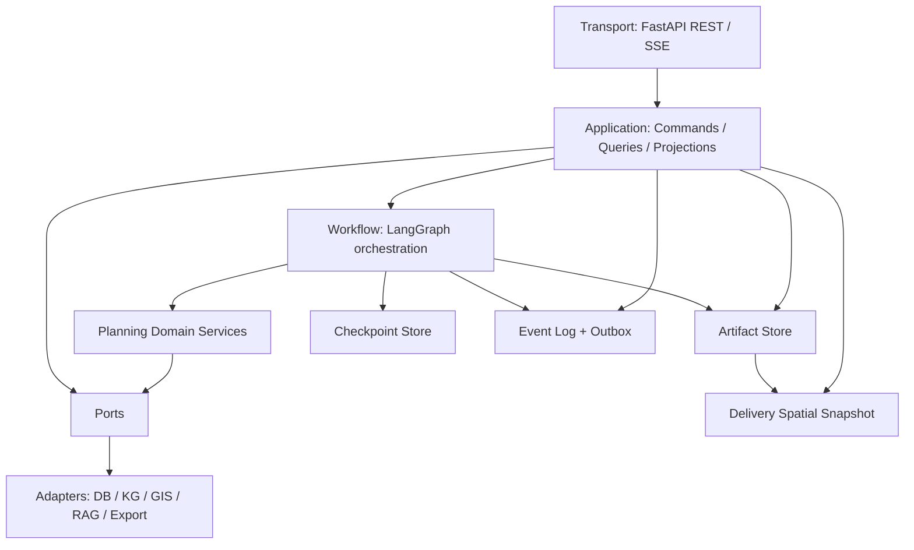

# 后端模块、状态与同步机制深度审查及理想设计

日期：2026-08-11  
性质：代码事实审查 + 目标设计，不是已完成实现声明。

## 1. 结论

当前后端业务能力丰富，契约化、空间算法、Artifact Store、Human Review 和交付快照
方向正确，但实现仍然明显过度复杂。问题不在 506 个 Python 文件本身，而在于：

1. 少数中心模块同时承担编排、转换、持久化、恢复和副作用；
2. 图状态、阶段状态、领域产物、事件缓存和 Artifact Store 之间存在重复表达；
3. 同一事实存在“当前值、artifact、checkpoint、SSE cache、API projection”多份副本；
4. 目录按历史迁移过程形成，而不是完全按稳定的业务边界形成；
5. 设计文档同时混合 North Star、当前实现和已过期迁移说明，容易把历史兼容路径重新实现。

理想方案不是继续增加 facade，而是建立四条硬边界：

- Checkpoint 只保存工作流控制状态；
- Artifact Store 只保存不可变阶段产物；
- Event Log 只保存对外可重放的运行事件；
- DeliverySpatialSnapshot 只保存交付空间事实。

## 2. 审查证据

### 2.1 规模与热点

本地静态扫描结果：

| 项目 | 当前值 |
|---|---:|
| `backend/app` Python 文件 | 506 |
| `modules/schema` | 66 |
| `modules/data` | 63 |
| `modules/spatial_ops` | 56 |
| `modules/kg` | 40 |
| `agent/execute` | 26 |
| `AgentState` 字段 | 76 |
| `ExecuteAgentState` 字段 | 42 |
| `GISPipelineState` 字段 | 43 |

最大文件：

| 文件 | 行数 | 判断 |
|---|---:|---|
| `spatial_ops/road/planning_nodes.py` | 3185 | 道路领域、算法步骤和流水线节点混合 |
| `agent/bootstrap/graph.py` | 1397 | 根图、HITL、恢复、路由和终态混合 |
| `services/sse.py` | 1276 | 事件缓存、格式、同步和运行状态混合 |
| `agent/bootstrap/post_l3_main_nodes.py` | 1271 | 七阶段 adapter 仍集中在同一模块 |
| `kg/builder/layer1.py` | 1379 | 摄取、规范化和图构建混合 |
| `kg/queries/semantic.py` | 1228 | 查询解释与执行策略混合 |
| `database/operations.py` | 1209 | 多业务域数据库操作聚集 |

Graphify 的历史对比显示，Agent 最大 god-node degree 已从 43 降到 32、环减少 22，
说明之前拆分有效；但 post-L3 仍是主要 hub，Spatial Ops 的道路 god node 仍为 93，
Data+KG 的高耦合整体没有实质下降。

### 2.2 已确认的重复或失效结构

- `GISPipelineState` 在生产调用中没有实际消费者，只被 `ExecuteAgentState` 文档提及，
  是典型迁移残留。
- `deliver.aggregate._build_planned_view()` 已退出正式交付路径，仅剩测试直接调用，
  应进入删除队列。
- `artifact_runtime` 仍保留 legacy ref 字段迁移和旧 checksum 兼容；必须设置明确退役条件。
- `modules/spatial_ops/output/export_package.py` 反向导入
  `app.agent.deliver.render_layers`，违反 `modules → agent` 禁止依赖规则。
- `services → api.schemas` 的反向依赖在历史 Graphify 报告中仍存在，应由 application
  contract 或 port 取代。
- `SessionProjection`、SSE cache 和 checkpoint 都能表达运行状态，当前缺少单一的
  projection builder/version 规则。

### 2.3 状态和同步的根因

LangGraph 官方把 checkpoint 定义为线程范围的图状态快照，把 Store 定义为应用数据；
子图还拥有独立 checkpoint namespace。大对象或跨图业务事实放入 state，会扩大每个
super-step 的 checkpoint，并让父子图可见性与 reducer 语义变复杂。官方也明确建议生产
使用持久 checkpointer并设置保留策略。[LangGraph persistence](https://docs.langchain.com/oss/python/langgraph/persistence)

当前系统虽然已开始 artifact-ref-only，但仍有三类同步压力：

- 控制同步：父图与 EXECUTE 子图何时认为阶段完成；
- 事实同步：checkpoint ref 是否与 Artifact Store 最新 revision 一致；
- 展示同步：SSE 是否与 REST projection、DeliveryManifest 和 Snapshot 同步。

继续给 reducer、兼容字段和 replay helper 打补丁不能根治；需要先明确每类数据的 owner。

## 3. 理想总体架构



依赖只能向内：

```text
transport -> application -> workflow/domain -> ports <- adapters
```

领域层不得导入 FastAPI、LangGraph、SSE manager、Artifact Store 实现、文件系统或
Agent 节点。Workflow 可以依赖领域 service 和 port，但不能实现空间算法。

## 4. 六种数据及唯一 Owner

| 数据类型 | 唯一 Owner | 保存位置 | 可变性 |
|---|---|---|---|
| 工作流控制 | Workflow | Checkpoint | 每 super-step 更新 |
| 阶段业务结果 | 对应 Domain Stage | Artifact Store | 不可变 revision |
| 会话原始资料 | Session Context | Context Repository | 版本化不可变 snapshot |
| 对外事件 | Event Publisher | Event Log | 仅追加 |
| 前端查询模型 | Projection Service | 按需构建/可重建缓存 | 可重建 |
| 完整交付空间状态 | Delivery | Snapshot files + ref | 不可变 revision |

严格禁止：

- 同一个业务结果同时完整保存在 checkpoint 和 artifact；
- 通过 SSE cache 推断权威终态；
- 用“latest artifact”替代图中显式引用；
- 导出器、渲染器或 API 自行重建 planned land use；
- KG 或 crosswalk 生成规划分类决定。

## 5. 最小 RootWorkflowState

目标不是零状态，而是只保留恢复图所需的控制信息：

```python
class RootWorkflowState(TypedDict, total=False):
    session_id: str
    run_id: str
    context_ref: ArtifactRef
    context_fingerprint: str

    phase: WorkflowPhase
    active_stage: StageName
    status: RunStatus
    stage_revision: int

    artifact_refs: dict[ArtifactKey, ArtifactRef]
    current_gate: GateDecision
    retry_budget: RetryBudget
    human_interrupt: HumanInterrupt | None

    terminal: TerminalState | None
```

目标字段数约 12–16，而不是 76。历史 gate、诊断、阶段审计和错误详情进入 artifact/event；
会话配置进入不可变 `PlanningContextRef`。`messages` 若必须保留，应使用独立 conversation
state 或 delta channel，不与规划业务状态混合。

Reducer 仅允许：

- `artifact_refs`：按 key 替换为更高 revision；
- `retry_budget`：显式计数器更新；
- conversation messages：append/delta；
- 其他字段默认覆盖，禁止通用 list/dict merge。

## 6. 阶段统一协议

每个阶段实现同一种接口：

```python
class StageCommand(BaseModel):
    run: RunIdentity
    context_ref: ArtifactRef
    input_refs: dict[ArtifactKey, ArtifactRef]
    retry: RetryContext | None = None

class StageCompletion(BaseModel):
    stage: StageName
    output_refs: dict[ArtifactKey, ArtifactRef]
    gate: GateDecision
    events: tuple[DomainEvent, ...] = ()
```

节点固定流程：

```text
load refs -> validate parent checksums -> call stage service
-> atomically persist outputs -> append outbox events -> return StageCompletion patch
```

所有阶段都必须：

- 幂等键为 `(run_id, stage, revision, input_checksums)`；
- 同一输入重复执行返回同一语义 checksum；
- 不读取隐式 latest；
- 不直接发布 SSE；
- 不在 artifact 成功前更新 checkpoint ref。

## 7. 理想模块定义

### 7.1 `api/`：Transport Adapter

只负责 HTTP/SSE、认证、输入解析、状态码和公开 DTO。一个资源一个 router：

```text
api/v1/
  sessions.py
  session_state.py
  events.py
  human_review.py
  delivery.py
  map_layers.py
  contracts/
  dependencies.py
```

Route 通过依赖注入获取 application service，不允许实例化 Artifact Store 或 Runtime
Service。FastAPI 官方推荐用 APIRouter 拆分大应用；原生 SSE 已提供 JSON 编码、ping、
`id`、`retry` 和 `Last-Event-ID` 机制。[FastAPI bigger applications](https://fastapi.tiangolo.com/tutorial/bigger-applications/)
[FastAPI SSE](https://fastapi.tiangolo.com/tutorial/server-sent-events/)

### 7.2 `application/`：用例和查询模型

新增明确应用层：

```text
application/
  commands/
    create_session.py
    submit_review.py
    resume_run.py
  queries/
    get_session_projection.py
    get_delivery_projection.py
    get_map_snapshot.py
    sync_events.py
  projections/
  transactions/
```

它负责一次用户请求的事务边界与多个 port 的协调，但不包含规划算法。

### 7.3 `workflow/`：LangGraph 编排

将 `agent/bootstrap` 改为明确 workflow package：

```text
workflow/
  root_graph.py
  state.py
  stage_adapter.py
  routing.py
  human_interrupt.py
  terminal.py
  stages/
```

每个复杂阶段是独立 subgraph，父子 state 不同则使用显式 wrapper 映射。LangGraph
官方也把这种 wrapper 作为不同 state schema 的标准通信方式；子图团队只需遵守输入输出
schema。[LangGraph subgraphs](https://docs.langchain.com/oss/python/langgraph/use-subgraphs)

### 7.4 `domain/planning/`

目标领域服务：

| 模块 | 输入 | 唯一输出 |
|---|---|---|
| observe | Context/Evidence | `L1Snapshot` |
| strategize | L1 | `L2Strategy` |
| program | L1/L2 | `PlanningProgram` |
| intent | Program | `IntentCompilationResult` |
| grounding | Intent + spatial ports | `GroundingResult` |
| selection | Grounding + constraints | `SiteSelectionDecision` |
| execution | Decision | `ExecutionResult` |
| validation | Execution refs | `ValidationReport` |
| reconciliation | Intent + execution | `ReconciliationReport` |
| delivery | all validated refs | `DeliveryManifest` |

`ExecutionResult` 应成为 EXECUTE 的唯一根产物，内部引用 `ParcelChangeSet`、
`PlannedState`、`DeferralLedger` 和 `ExecutionDiagnostics`，避免四个 refs 在调用方重复配对。

### 7.5 `spatial/`

按稳定能力而不是历史 feature 拆分：

```text
spatial/
  model/          # CRS、geometry、feature、parcel value objects
  query/          # index、predicate、distance、overlay
  grounding/      # SpatialReferenceSpec -> resolved refs
  allocation/     # parcel/zone allocation
  network/        # road graph and routing
  change/         # GeometryOperation -> ParcelChange
  validation/     # topology、area、constraint checks
  delivery/       # snapshot builder only
```

道路 `planning_nodes.py` 必须拆为 domain pipeline、算法 primitives、配置和 adapter；
3185 行的单文件不是可接受的长期边界。所有面积计算统一经过 `AreaService`，携带 CRS、
算法、单位和精度 provenance。

面向外部的空间读取未来可逐步采用 OGC API Features 的 collection/items/CRS 语义，
而当前前端 Snapshot API 保持产品级聚合。[OGC API Features](https://ogcapi.ogc.org/features/)

### 7.6 `kg/`

只保留四类职责：

- BaseFacts ingestion；
- DerivedRelations materialization；
- SemanticQuery port implementation；
- Evidence index。

删除“规划决策 helper”。KG 返回 evidence/ref/confidence/provenance，不返回规划编码、
ParcelChange 或 SiteSelectionDecision。`builder/layer1.py` 和 query god files 按实体摄取、
关系构建、查询计划、结果映射拆分。

### 7.7 `contracts/`

从“大量可见模型”收敛为分层 contract：

```text
contracts/
  domain/       # value objects and root artifacts
  workflow/     # StageCommand/Completion/Gate/Interrupt
  public/v1/    # REST/SSE only
  ports/        # repository/provider interfaces
```

Root artifact 必须统一拥有：schema version、artifact id、run id、revision、parent refs、
semantic checksum、provenance 和 created_at。禁止在不同 contract 中重复手写这些字段。

### 7.8 `infrastructure/`

将当前 `services`、`data providers`、`tools` 中的实现归入 adapter：

```text
infrastructure/
  persistence/
  artifacts/
  events/
  gis/
  kg/
  rag/
  llm/
  export/
```

`database/operations.py` 按 repository 拆分；连接、session、事务由 application unit of
work 管理。

## 8. 同步与一致性的理想实现

### 8.1 Artifact + Checkpoint

一次阶段完成采用“持久化后引用”协议：

1. 计算产物；
2. 以幂等键写 artifact；
3. 写 stage completion event/outbox；
4. 节点返回 artifact ref；
5. LangGraph checkpoint 持久化 patch。

若步骤 5 失败，replay 根据相同幂等键获得已有 artifact，不重复副作用。

### 8.2 Event Log + SSE

当前 SSE manager 不应同时成为运行状态、事件历史和连接管理器。目标拆为：

- `EventRepository`：持久、append-only、按 `(session_id, seq)` 唯一；
- `OutboxPublisher`：事务提交后发布；
- `SSEConnectionHub`：仅管理在线订阅；
- `EventProjection`：内部 DomainEvent -> PublicEvent；
- `EventRetentionPolicy`：窗口和 resync 判定。

Event Sourcing 的价值在于事件可重放，但本系统不需要把所有领域状态完全 event-source；
只需对运行事件使用 append-only log，阶段事实继续使用不可变 artifact。这是受控的混合
模型。[Martin Fowler: Event Sourcing](https://martinfowler.com/eaaDev/EventSourcing.html)

### 8.3 Human Review

`HumanInterrupt` 是唯一协议，`event_id` 是幂等键。提交采用 compare-and-set：只有当前
pending event_id 能消费一次。审核决定写不可变 `HumanDecision` artifact/event，恢复命令
只携带 decision ref。

### 8.4 Projection

`SessionProjection` 不应在 route 中零散读取 runtime、manifest 和 SSE manager。由
`SessionProjectionService` 基于 checkpoint metadata、当前 artifact refs 和 event cursor
一次构建，并返回 projection version。这样 REST 与 SSE resync 使用同一投影逻辑。

## 9. 功能不丢失矩阵

| 当前能力 | 目标归属 | 保证方式 |
|---|---|---|
| L1/L2/L3 专业分析 | domain + stage subgraphs | golden artifact tests |
| Explore/RAG/KG 证据 | evidence service + ports | provenance contract tests |
| PARSE/GROUND/SELECT | planning domain | input/output contract tests |
| 多 worker EXECUTE | execution subgraph | deterministic replay tests |
| 道路/设施/分区算法 | spatial domain | fixture + property tests |
| VALIDATE/RECONCILE | pure domain services | pure function tests |
| Human Review | workflow/application | interrupt/resume idempotency tests |
| Artifact replay | artifact repository | checksum/parent/ref tests |
| HTML/PNG/GIS export | delivery adapters | snapshot checksum tests |
| SSE/reconnect | event infrastructure | gap/duplicate/retention tests |
| 前端 v1 | public projections | OpenAPI/schema snapshots |

任何重构 PR 必须先建立对应 characterization test，再移动代码；不能以“架构更干净”
为理由删除业务分支。

## 10. 文档的理想功能与权威层级

当前文档的主要问题是目标、现状和历史说明互相覆盖。理想结构：

| 文档 | 唯一功能 | 更新触发 |
|---|---|---|
| `00_SYSTEM_DESIGN.md` | 稳定 North Star 与原则 | 架构决策变化 |
| `CURRENT_ARCHITECTURE.md` | 当前真实模块、主流程、已知偏差 | 每次结构重构 |
| `MODULE_BOUNDARIES.md` | 允许/禁止依赖、owners | 新模块或移动模块 |
| `STATE_MODEL.md` | checkpoint/artifact/event/projection owner | 状态字段变化 |
| `ARTIFACT_LIFECYCLE.md` | revision、checksum、retention、replay | 持久化变化 |
| `WORKFLOW.md` | 图节点、subgraph、Gate、HITL | 图结构变化 |
| `SPATIAL_DOMAIN.md` | CRS、面积、地块变化、Snapshot | 空间契约变化 |
| `KG_EVIDENCE.md` | KG 与规划决策边界 | KG schema/query 变化 |
| `PUBLIC_API.md` | 前端稳定接口 | OpenAPI/SSE 变化 |
| `OPERATIONS.md` | 部署、监控、恢复、保留策略 | 基础设施变化 |
| ADR | 单一不可逆决策及背景 | 决策批准时新增 |
| `IMPLEMENTATION_STATUS.md` | North Star 差距和迁移进度 | 每个迁移 PR |

规则：

- 每个事实只能有一个 canonical 文档，其他文档链接而不复制；
- 历史文档移动到 `docs/archive/`，不能与当前文档并列；
- 代码生成的 OpenAPI/JSON Schema 不手工编辑；
- 每个目标文档顶部必须标记 `TARGET`、`CURRENT` 或 `HISTORICAL`；
- CI 检查链接、过期路径和文档中已删除 endpoint。

## 11. 迁移方案

### Phase A：删除无风险残留（1–2 周）

- 删除未使用的 `GISPipelineState/Input/Output`；
- 删除 `_build_planned_view` 及旧测试；
- 移除 modules/output -> agent 反向导入；
- 给 legacy artifact/checksum migration 设置版本和截止日期；
- 建立 import-linter/AST architecture tests；
- 给所有状态字段生成 owner 清单。

退出门槛：无 modules -> agent/services/api 导入；AgentState 不超过 50 字段。

### Phase B：状态与事件收敛（2–4 周）

- 引入 `StageCommand/StageCompletion`；
- 建立 `ExecutionResult` 根 artifact；
- 将 gate history、stage audit、diagnostics 移出 checkpoint；
- 拆分 EventRepository、SSEConnectionHub 和 EventProjection；
- SessionProjection 改为 application query service。

退出门槛：AgentState 不超过 20 字段；断线、重复、重放、HITL 测试全通过。

### Phase C：拆 god files（4–8 周）

- `post_l3_main_nodes.py` 按 stage adapter 拆分；
- `graph.py` 拆 root graph/routing/HITL/terminal；
- 道路 3185 行模块按领域步骤拆分；
- KG builder/query、database operations 按 bounded context 拆分；
- `services` 按 application 与 infrastructure 重新归属。

退出门槛：生产文件建议 <500 行；编排文件 <300 行；god-node degree 持续下降。

### Phase D：文档与长期治理

- 建立上述 canonical 文档集；
- archive 旧迁移文档；
- CODEOWNERS 按 bounded context；
- PR 模板要求 contract、state owner、event、migration、tests；
- 每次发布生成架构依赖报告与 OpenAPI diff。

## 12. 最终判断

当前系统不是“应该重写”，而是“需要停止继续扩展现有中心状态和中心文件”。最优路线是
保留成熟的空间算法、契约和阶段逻辑，通过 strangler 式迁移把它们放入清晰边界。

最优先的三个动作：

1. 把 76 字段 AgentState 降到控制状态，明确六类数据 owner；
2. 拆 Event Log/SSE/Projection，解决展示同步的结构性问题；
3. 修复 output -> agent 反向依赖并拆道路/post-L3/根图三个 god modules。

完成这三项后，文件数量即使仍然较多，也会从“难以判断真相的复杂”转为“按业务边界
可局部理解、独立测试和安全演进的复杂”。

## 13. 研究来源

- [LangGraph Persistence](https://docs.langchain.com/oss/python/langgraph/persistence)
- [LangGraph Subgraphs](https://docs.langchain.com/oss/python/langgraph/use-subgraphs)
- [FastAPI Bigger Applications](https://fastapi.tiangolo.com/tutorial/bigger-applications/)
- [FastAPI Server-Sent Events](https://fastapi.tiangolo.com/tutorial/server-sent-events/)
- [Martin Fowler: Event Sourcing](https://martinfowler.com/eaaDev/EventSourcing.html)
- [OGC API Features](https://ogcapi.ogc.org/features/)
