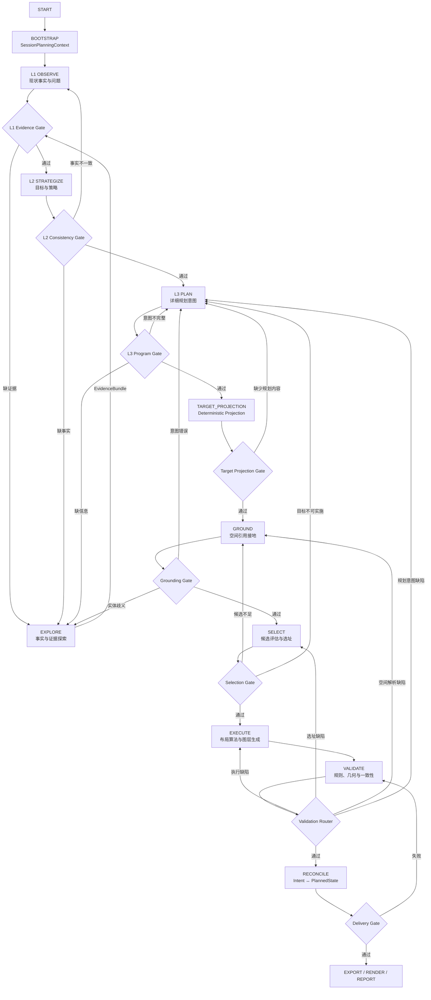

# 村庄规划智能系统：总体设计（North Star）

> **状态：TARGET DESIGN** · 本文档定义目标架构。当前实现状态见 [10_IMPLEMENTATION_STATUS.md](10_IMPLEMENTATION_STATUS.md)。

## 0. 设计结论

系统不是“文本 Agent 生成报告，再由 GIS Agent 接管”的串联流程，而是一个由规划阶段子图、空间决策子图和证据探索能力组成的闭环系统。

核心原则只有一句话：

> 每一个阶段只生产一种权威产物；后续阶段通过类型化契约消费它；失败沿产生原因返回，而不是回到一个巨大的总路由器。

## 1. 目标图结构



EXPLORE 是横向能力，不是固定的“L3 后桥接节点”。L1、L2、L3、GROUND 和 VALIDATE 都可以提交
`ExplorationRequest`。EXPLORE 的检索范围覆盖整个 session：`BaseFacts`、`DerivedRelations`、
VillageBundle、各层 AnalysisReport、`【INSTRUCTION】`、typed artifacts、既有 EvidenceBundle、
用户修订记录和允许的外部来源。KG 只是其中一个来源，不是 EXPLORE 的全部输入。

L1/L2/L3 都可以消费空间认知，但不直接持有 KG 实例或维护维度专属 KG 查询；它们按
`stage + dimension_key + query_purpose + evidence_gap` 提交请求，由 EXPLORE 返回带 provenance 的
`EvidenceBundle`。EXPLORE 只返回事实、证据和空间认知，不返回最终候选地块，也不直接改变规划意图。

Bootstrap 可以在 L1 前准备 KG、Bundle 和 artifact 的 evidence index，但该动作不代表探索完成。
实际证据是否充分由各阶段 Gate 判断；worker 和 Gate 按问题、维度及 EvidenceGap 发起增量检索。
因此系统中不存在“一次预设搜索即可满足 L1/L2/L3”的假设。

## 2. 三类权威产物

| 产物                        | 生产者                 | 消费者                        | 语义                                                    |
| --------------------------- | ---------------------- | ----------------------------- | ------------------------------------------------------- |
| `L1Snapshot`              | L1 子图                | L2、L3、Explore               | 已核验的现状事实、约束、问题和证据缺口                  |
| `L2Strategy`              | L2 子图                | L3、Select、Explore           | 目标、定位、策略和策略冲突                              |
| `PlanningProgram`         | L3 子图                | TARGET_PROJECTION、L2、Explore | 项目、设施、道路、保护修复等规划干预及其依赖            |
| `IntentCompilationResult` | TARGET_PROJECTION      | Ground、Select、Execute       | 从 PlanningProgram 确定性投影得到的类型化目标和空间引用 |
| `GroundingResult`         | Ground 子图            | Select                        | 空间引用对应的实体、候选及查询证据                      |
| `SiteSelectionDecision`   | Select 子图            | Execute                       | 经过硬约束、评分和冲突分配后的最终选址决定              |
| `PlannedState`            | Execute 子图           | Validate、Reconcile、Delivery | 实际生成的规划图层和派生关系                            |

Markdown 报告、SSE 事件和 UI 展示都是这些产物的视图，不是新的事实源。

## 3. Agent 与确定性子图边界

| 能力                   | 目标形态                                  | 允许做什么                                                                             | 不允许做什么                       |
| ---------------------- | ----------------------------------------- | -------------------------------------------------------------------------------------- | ---------------------------------- |
| EXPLORE                | session evidence service / 工具调用 Agent | 按阶段和维度检索 KG、Bundle、报告、typed artifacts、RAG 和外部资料，整理证据与空间认知 | 生成候选 BSM、修改意图、选最终位置 |
| L1/L2/L3 分析          | 专业分析 Agent                            | 解释事实、推导策略、生成规划文本草案                                                   | 绕过 Gate 直接写空间成果           |
| TARGET_PROJECTION       | 确定性领域投影节点                        | `PlanningProgram` 转 typed target、`SpatialReferenceSpec`                             | 读取原文、查询地块或决定最终选址   |
| GROUND                 | 确定性子图，可含歧义处理节点              | 实体解析、KG 候选、几何精化                                                            | 评价候选优劣                       |
| SELECT                 | 混合决策子图                              | 硬过滤、评分、可选模型排序、冲突分配                                                   | 直接生成坐标或绕过约束             |
| EXECUTE                | 算法 Worker 子图                          | MIP、设施、道路、分区和图层生成                                                        | 静默改变规划意图                   |
| VALIDATE               | Evaluator 子图                            | 规则、几何、拓扑、文本/成果一致性校验                                                  | 把失败吞掉后继续交付               |

## 4. 依赖方向

```text
Schema contracts
    ↑
Data adapters / repositories
    ↑
Spatial query and geometry services
    ↑
KG semantic services
    ↑
Planning domain services (intent / grounding / selection / execution)
    ↑
Application subgraphs and API routes
```

应用层可以调用领域层；领域层不能反向导入 Agent、Service、API 或 UI。`tools` 只能是外部能力适配器，不能成为规划算法的第二实现。

## 5. 名称约定

规划阶段 L1/L2/L3 与知识图谱生命周期不再共用相同编号。KG 内部使用以下名称：

| KG 名称              | 内容                           |
| -------------------- | ------------------------------ |
| `BaseFacts`        | 现状实体、几何、编码和来源     |
| `DerivedRelations` | 预计算空间关系、约束和认知摘要 |
| `IntentGraph`      | 当前规划周期内的类型化意图实体 |
| `PlannedState`     | 执行后产生的规划成果实体       |

## 6. 当前实现边界

上图是目标设计。当前唯一主图已经拆出独立的 L1/L2/L3 worker、层级 aggregate 和七个顶层阶段节点，运行顺序为：

```text
TARGET_PROJECTION → GROUND → SELECT → EXECUTE → VALIDATE → RECONCILE → DELIVER
```

当前 EXECUTE 已接入 `workflow/stages/execute.py`、`domain/materialization/` 和 `spatial/` 的多 worker 路径；
项目、分区、设施、道路和轴线 worker 的统一 contract、规划变化和真实交付验收仍以
`10_IMPLEMENTATION_STATUS.md` 为准。本文不把目标 worker 顺序当作完成证明。

离线核心链覆盖 TARGET_PROJECTION 到 DELIVER 的阶段边界；真实 provider 运行和 checkpoint 关闭/重开
验收仍需配置 provider key，当前缺 key 时 acceptance 明确 skip，不把 fixture 运行当作真实证明。

实现状态以 [10_IMPLEMENTATION_STATUS.md](10_IMPLEMENTATION_STATUS.md) 为准；目录迁移和重复实现清理记录在
[09_INTEGRATION_BREAKPOINTS.md](09_INTEGRATION_BREAKPOINTS.md)。

## 7. 理想运行时契约（优先于当前兼容实现）

本节是目标设计，不因当前代码的分歧而降低目标。当前实现只能通过兼容层逐步靠拢，不能反向把兼容字段升级为正式设计。兼容别名可以在 API、interrupt transport 和 checkpoint 读取边界短期存在，但不得成为新的状态或业务分支依据。

### 7.1 HUMAN interrupt 必须只有一个协议

step-mode 层完成审核和 post-L3 Gate 审核是两个业务频道，但必须共享同一传输契约：

```json
{
  "event_id": "stable-idempotency-key",
  "channel": "step_mode | post_l3_review",
  "reason": "human_review_required",
  "layer": 1,
  "phase": "layer1",
  "layer_name": "现状分析",
  "paused_stage": "validate",
  "items": [],
  "error_feedback": {}
}
```

`event_id` 是一次 HUMAN checkpoint 的幂等键；`channel` 表示业务来源；`items`、`paused_stage` 和 `error_feedback` 不能因频道不同而改名。恢复值也只有一个入口，使用 `{action, feedback, dimensions, images, deferred_target_ids}`，API 边界可接受 `accept` 作为旧客户端别名，但进入图后必须规范化为 `approve`。

中断前的节点只能计算并写入可重放的状态；发布 SSE 必须是幂等操作；真正的副作用放在恢复之后。这个约束来自 LangGraph 官方 interrupt 语义：恢复会从中断节点开始重放，且 checkpoint 必须与相同的 `thread_id` 一起使用。参考 [LangGraph interrupts](https://docs.langchain.com/oss/python/langgraph/interrupts) 和 [LangGraph persistence](https://docs.langchain.com/oss/python/langgraph/persistence)。

### 7.2 持久化、生命周期和并发边界

- 主图、EXECUTE 子图和恢复请求必须使用同一个持久化线程身份；目标态是父图直接挂载可持久化子图，不能以“另编译、另调用、另套状态”模拟嵌套。
- FastAPI 资源初始化和释放归属 `lifespan`；SSE 流在客户端断开后必须取消生产任务，并在 `finally` 中释放订阅。参考 [FastAPI lifespan](https://fastapi.tiangolo.com/advanced/events/) 和 [StreamingResponse](https://fastapi.tiangolo.com/advanced/stream-data)。
- SQLAlchemy `AsyncSession` 是单并发任务边界内的工作单元；禁止在并发 worker 之间共享 session，提交由业务事务显式控制，释放由依赖作用域负责。参考 [SQLAlchemy asyncio ORM](https://docs.sqlalchemy.org/en/20/orm/extensions/asyncio.html)。

这些是“闭环可用”的基础约束，而不是初期可牺牲项。当前实现的偏差、兼容字段和迁移顺序见 [10_IMPLEMENTATION_STATUS.md](10_IMPLEMENTATION_STATUS.md) 与 [backend-official-practice-2026-08-10.md](../audits/backend-official-practice-2026-08-10.md)。

## 8. 相关文档

- [01_LAYERED_ARCHITECTURE.md](01_LAYERED_ARCHITECTURE.md)：模块层和依赖规则
- [02_DATA_PERSISTENCE.md](02_DATA_PERSISTENCE.md)：上下文、产物和版本持久化
- [03_KG_SEMANTIC_BRIDGE.md](03_KG_SEMANTIC_BRIDGE.md)：KG 四类数据边界
- [04_PLANNING_PIPELINE.md](04_PLANNING_PIPELINE.md)：L1/L2/L3 及空间子图
- [05_EXPLORE_BRIDGE.md](05_EXPLORE_BRIDGE.md)：EXPLORE 证据探索能力
- [06_TARGET_PROJECTION_EXECUTE.md](06_TARGET_PROJECTION_EXECUTE.md)：TARGET_PROJECTION、GROUND、SELECT、EXECUTE 契约
- [07_VALIDATION_FEEDBACK.md](07_VALIDATION_FEEDBACK.md)：Gate 与定向反馈
- [10_IMPLEMENTATION_STATUS.md](10_IMPLEMENTATION_STATUS.md)：当前代码与目标态差距
- [12_PLACE_NAME_RESOLUTION.md](12_PLACE_NAME_RESOLUTION.md)：地点证据与地名解析
- [13_AUTOREPAIR_MULTIMODAL.md](13_AUTOREPAIR_MULTIMODAL.md)：自动修复与多模态证据
- [14_BACKEND_MODULE_BLUEPRINT.md](14_BACKEND_MODULE_BLUEPRINT.md)：后端模块、目录与并行落地总蓝图
