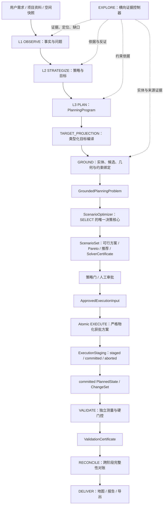

# Village Planning Agent System Design

> Status: TARGET
> Authority: Normative target architecture; implementation claims belong in `../architecture/CURRENT_RUNTIME.md`.

## 1. Product outcome and non-goals

系统的产品结果不是一段“看起来合理”的规划文本，而是一组可以从需求、证据、空间对象、候选方案一直追溯到地图和导出物的规划成果。系统必须：

- 将自然语言需求编译为可检查的规划问题；
- 为每项规划主张绑定可定位的证据，显式报告冲突和缺口；
- 将语义地点绑定到有身份、快照、坐标参考系和来源的空间对象；
- 生成多个可行方案、Pareto 方案和有理由的推荐方案；
- 只执行经过批准且内容冻结的方案；
- 独立验证执行结果，并对规划意图、求解、物化和交付做跨阶段对账；
- 在证据不足、问题不可行或执行不完整时给出可诊断结果，而不是伪造成功。

非目标：

- 不承诺开放世界中的“所有相关证据”，只承诺在声明的来源、查询计划、预算和停止原因内实现 **bounded completeness**；
- 不允许 LLM 直接创造坐标、GIS 成员身份、硬约束通过结论或最终方案；
- 不把单一加权最高分、单一向量相似结果或现状图复制视为完整规划；
- 不让检索、GROUND、EXECUTE、VALIDATE 或 DELIVER 越权重新做方案选择；
- 不以文档存在、模型输出成功或局部单元测试替代端到端验收。

## 2. Bounded completeness

系统对完整性的承诺必须带边界。每次运行都要记录：

- 需要回答的 `EvidenceRequirement` 集合；
- 检索过的来源族、查询变体、过滤条件和时间范围；
- 实际召回并采用的证据标识及定位；
- 候选生成范围、数据快照和排除原因；
- 未解决、冲突、不可用和需要人工裁决的项目；
- 停止原因：`sufficient`、`source_exhausted`、`human_required` 或 `budget_exhausted`。

“完整”只能表示：在上述声明边界内，必需证据覆盖、候选域、硬约束和 lineage 达到验收条件。系统不得声称已经穷尽互联网、所有数据库或现实世界全部可能地点。

向量嵌入只是 dense recall 的可选增强。嵌入服务失效时，结构化查询、词法检索、报告定位、KG/entity resolution 和空间查询必须继续工作，并显式记录 dense 通道不可用及其召回风险。

## 3. Three-plane architecture

系统分为三个职责平面。平面是能力边界，不等同于 LangGraph 节点或代码目录。

### Evidence plane

Evidence plane: requirements, retrieval, provenance, contradiction, sufficiency

它把自然语言问题编译为证据要求，按来源族检索，保留页码、段落、feature ID、artifact ref 等定位，构造 claim-evidence 关系，并判断每项要求为 `supported`、`contradicted`、`ambiguous` 或 `unavailable`。`EXPLORE` 是该平面的横向能力，可被 L1/L2/L3、TARGET_PROJECTION、GROUND 和诊断流程调用，但不能直接选择方案或写入最终几何。

### Decision plane

Decision plane: grounded candidates, hard/soft constraints, alternatives, optimization

它把 L3 规划意图投影为类型化目标，由 GROUND 绑定真实实体、候选域、几何、网络和约束因子，再由 ScenarioOptimizer 在封闭问题中生成多个可行方案、Pareto 前沿、推荐方案和 SolverCertificate。GROUND 负责召回和绑定，求解器负责组合与比较，两者不得互相越权。

### Execution plane

Execution plane: approval, immutable scenario, materialization, validation, reconciliation

它将被批准方案冻结为 `ApprovedExecutionInput`，在临时状态中原子物化，独立验证结果，并通过 RECONCILE 对账整个 lineage。任何硬约束失败、版本漂移或物化缺失都会阻止正式交付。

## 4. End-to-end planning loop



正常主链是：

```text
L1 / L2 / L3
→ TARGET_PROJECTION
→ GROUND
→ GroundedPlanningProblem
→ ScenarioOptimizer（现有 SELECT 的目标内核）
→ ScenarioSet
→ Approval Gate
→ ApprovedExecutionInput
→ Atomic EXECUTE
→ ExecutionStaging → committed PlannedState
→ VALIDATE
→ ValidationCertificate
→ RECONCILE
→ DELIVER
```

当 SELECT/HUMAN 明确延期一个或多个目标时，主链不直接沿用旧方案进入 EXECUTE：
`DeferralLedger → scoped GroundedPlanningProblem → ScenarioOptimizer → fresh ScenarioSet`
，随后重新生成 `ApprovedExecutionInput`。scoped problem 必须保存父问题 fingerprint、延期
目标 IDs、scope reason 和 source refs；只有新 ScenarioSet 中的可行推荐才可进入执行。

`GroundedPlanningProblem`、`ScenarioSet`、`ApprovedExecutionInput` 和 `ValidationCertificate` 是阶段间权威契约，不要求各自成为新的顶层图节点。失败必须返回最早负责阶段：证据缺口回 EXPLORE，意图缺失回 L3，实体或候选缺失回 GROUND，不可行或目标冲突回 SELECT/L3，物化偏差回 EXECUTE，跨阶段遗漏由 RECONCILE 定位。

## 5. Stage responsibilities

| 阶段 | 权威职责 | 主要产物 | 明确禁止 |
|---|---|---|---|
| L1 | 唯一读取并分析原始输入；在每个维度内通过有界 observe→validate→report 循环建立带 source span 的 typed facts、问题和不确定性 | `L1Snapshot`（含 `L1SourceIndex`、typed facts、pass diagnostics） | 把推测写成空间事实，或让 L2/L3/Project Bank/GROUND 重新解析 `village_data` |
| L2 | 形成策略、偏好、目标方向及其依据 | strategy/objective view | 直接选地点或创建约束计算结果 |
| L3 | 将事实、指标、约束、目标、方案原型和项目包分层，定义“规划什么、为何规划、什么算好” | `PlanningProgram` / `PlanningProblemSpec` / project packages | 把每条规划主张自动变成空间任务，或决定最终候选成员/坐标 |
| TARGET_PROJECTION | 只将通过执行准入的空间干预编译为原子、类型化、可接地目标 | admitted typed target specs / `IntentCompilationResult` | 把证据陈述、指标、目标或非空间行动机械投影为空间目标 |
| EXPLORE | 按证据要求检索、定位、融合和报告缺口 | evidence claims/coverage | 生成最终候选、几何或方案 |
| GROUND | 解析实体，绑定数据快照、候选域、几何、网络和约束因子 | `GroundedPlanningProblem` | 最终选择方案或用评分替代求解 |
| SELECT | 通过 ScenarioOptimizer 生成可行替代、Pareto 和推荐；显式延期后按 scoped problem 重求解 | `ScenarioSet` + `SolverCertificate`；必要时新的 scoped `GroundedPlanningProblem` | 创建坐标、改变来源成员、隐藏不可行或沿用旧问题/审批 |
| Approval | 冻结被批准方案、问题、baseline 和审批身份 | `ApprovedExecutionInput` | 批准后静默换方案或换快照 |
| EXECUTE | 由细分 materializer worker 在 staging 状态严格物化获批候选/几何并原子提交 | `ExecutionStaging` → `PlannedState` / `ChangeSet` | 重新选址、比较候选、规划路径/布局，或把未声明 deferred 的失败任务混入正式提交 |
| VALIDATE | 独立重算硬约束、覆盖和 lineage | `ValidationReport` + `ValidationCertificate` | 自动修改方案来让检查通过 |
| RECONCILE | 对账意图、问题、方案、执行、验证和交付覆盖 | `ReconciliationReport` | 吞掉遗漏或用人工审批抹去事实错误 |
| DELIVER | 从同一 run-root 和 snapshot lineage 生成成果视图 | `DeliveryManifest` | 再检索、再规划或替换方案 |

目标向量由 L2/L3 定义方向和优先级，TARGET_PROJECTION 编译指标，GROUND 绑定可测量数据，ScenarioOptimizer 计算各方案实际值。求解器不能自行发明目标或权重。

`SolverCertificate` 只证明给定形式化问题的求解状态，不证明 L3 已完整理解人类意图，也不证明 GROUND 召回了开放世界全部候选。`ValidationCertificate` 只证明执行状态与获批方案、硬约束及 lineage 一致。RECONCILE 负责发现阶段转换中的遗漏、替换和串版。

### Planning content hierarchy and target admission

一个村庄可以有大量事实、政策条款、问题和建议，但这些内容不等于同等数量的可执行空间目标。L3 必须保留以下层级，而不是把每条非行动 claim 一对一转换成空间干预：

```text
PlanningProgram
├── evidence statements / current-state facts
├── indicators
├── constraints
├── objectives
├── scenario archetypes
├── project packages
│   ├── spatial interventions
│   └── non-spatial actions
└── executable target candidates
```

只有明确属于项目包中的空间干预，并且具有规划语义、来源依据、位置要求或候选生成规则、预期物化类型和可验证完成条件时，才可以通过 target admission。指标、目标、证据陈述、约束文本和非空间行动继续作为上游依据或下游检查项，不得因其看起来具有行动性就自动创建几何任务。

### Raw input ownership

`village_data` 和显式上传原始文档在输入层保持不透明，只保存内容、来源和 digest；任务描述与约束属于控制上下文，不是 L1 事实源。L1 是唯一允许读取并结构化其中表格/段落的阶段。L1 worker 先建立 source index，再由各维度通过有界结构化调用确认本维度直接支持的 typed facts；模型不能覆盖 source index 的 `source_ref` 或 `source_span`。最终输出 `L1SourceIndex`、typed observations、pass cursor 和检索 trace。后续阶段只能消费 `L1Snapshot.fact_records` 与 typed observations；Project Bank/RAG 可以检索这些 facts，TARGET_PROJECTION/GROUND 只能使用其来源引用，前端只展示 L1 facts。任何下游重新扫描原文、从人口总数猜 demand point、从叙述恢复数量或位置，都属于越权并必须 fail-closed。旧 `current_status` 键不再是第二个事实源；若旧状态仍携带它，L1 source index 只记录忽略诊断而不进入 prompt 或 source segments。结构化调用的 schema 合法不等于来源语义正确，缺失/冲突必须通过 deterministic validator 和有界 repair 记录为诊断。

### Algorithm and worker ownership

`ScenarioOptimizer` 是 SELECT 的决策门面，不要求用一种通用算法解决所有规划任务。它按问题类型路由到受约束的求解后端，并将结果统一封装为 `ScenarioSet`：

| 任务类型 | GROUND | SELECT / solver portfolio | EXECUTE |
|---|---|---|---|
| 单设施选址 | 生成并测量候选 | 硬过滤、排序、Pareto 比较 | 物化获批候选 |
| 多设施覆盖 | 候选、需求点、距离/容量矩阵 | facility-location / CP-SAT | 物化获批设施集合 |
| 用地组合 | 地块、兼容性、面积和政策因子 | MILP / CP-SAT / bounded enumeration；当前已接入 `parcel_assignment_bounded` 处理闭合的共享 BSM 容量组合 | 写入获批地块组合及属性 |
| 道路连通 | 网络、端点、禁入区、成本 | 图搜索、最短路、Steiner/network heuristic | 物化获批 route geometry |
| 分区布局 | 可用面、邻接关系和拓扑因子 | adjacency/topology constraint solver | 物化获批分区几何 |
| 生态避让 | 生态图层和 hard exclusion overlay | 可行域裁剪及方案比较 | 物化获批且已裁剪的结果 |
| 线性走廊 | 网络/栅格成本面和端点 | network/corridor algorithm | 物化获批走廊 |
| 小规模人工候选比较 | 候选及指标 | 确定性 Pareto | 物化人工批准项 |
| 开放性空间构思 | 真实底图和约束上下文 | LLM 生成方案原型，随后重新 grounding 和确定性检查 | 只物化通过检查并获批的原型 |

边界判定规则是：只要一个算法会比较替代、改变候选成员、选择路线或改变规划结果，它就属于批准之前的 GROUND/SELECT；EXECUTE worker 只允许在冻结容差内做确定性的格式转换、切片、拓扑修复、序列化和写入。worker 的细分是工程并行与物化职责，不赋予规划决策权。

### Parcel availability, sub-parcel allocation, and adjacency

地块可用性必须区分“源地块本身不可用”和“本次只分配源地块的一部分”，不能用单一 `available` 布尔值替代面积与几何分割：

- `fully_unavailable`：`eligible_area_ha=0`，不得生成正式候选、ScenarioSet 成员或 EXECUTE task；
- `partially_available`：只有一部分源地块通过硬约束，候选必须携带裁切后的 eligible geometry、`excluded_area_ha`、排除依据和同一 `source_bsms`；
- `fully_available`：源地块整体可用，但 `coverage_ratio<1` 仍可能表示本次项目只分配一个 footprint。EXECUTE 必须生成获批 footprint 与同源 preserve/remainder，不能把整个源 BSM 改写成规划用地；
- `unknown`：面积、几何或排除原因无法闭合时 fail-closed，不得降级成普通单点选址。

大地块的候选切割属于 GROUND/SELECT 的候选与方案语义；EXECUTE 只能按已批准的 candidate geometry 和面积预算确定性物化。候选必须保留精确 suitability source area，避免用粗粒度合并面积覆盖精确 BSM 面积。邻接地块默认只是证据和上下文，不因“相邻”自动合并或写入周围地块；只有 typed adjacency/topology relation、明确的邻地成员/几何、对应 evidence refs 和获批的额外 worker task 同时存在时，EXECUTE 才能联动处理周围地块。

## 6. Human authority and fail-closed behavior

以下情况必须进入人工裁决或产生显式的不完整结果：

- 必需来源互相矛盾且规则无法决定权威性；
- 语义地点只能得到多个高风险实体或推断几何；
- 候选域为空，或所有方案均违反硬约束；
- Pareto 方案之间涉及未编码的政策、伦理或社区偏好；
- 获批后问题、方案、baseline 或数据快照 fingerprint 发生变化；
- 原子物化、独立验证或 lineage 对账失败。

人工可以：澄清目标、批准降级证据、选择 Pareto 方案、调整软偏好、明确修改硬约束或放弃任务。人工批准不能把缺失几何、错误身份、违反硬约束或串版结果变成技术上有效。

系统必须 fail closed：未通过 `ValidationCertificate` 和 `ReconciliationReport` 的运行只能产生诊断性成果，不得标记为正式规划交付。

## 7. Completion definition

完成状态是逐级门控，不是一个模糊的 `success`：

| 状态 | 最低条件 |
|---|---|
| `evidence_sufficient` | 所有必需 EvidenceRequirement 已支持或获明确降级批准；范围和缺口已记录 |
| `candidate_complete` | 每个可执行目标都有闭合集、身份、几何、快照、CRS 和排除记录；无未批准的关键 unresolved |
| `scenario_feasible` | 至少一个方案满足全部硬约束，或以冲突解释正式返回 infeasible |
| `scenario_optimal_or_bounded` | 已给出最优、可证明界限、Pareto 前沿或明确的预算终止状态 |
| `execution_complete` | 获批方案全部物化、无意外对象、原子提交成功 |
| `validation_passed` | 硬约束违规为零，selected-to-materialized coverage 为 100%，快照 lineage 一致 |
| `delivery_complete` | 同一 run-root/snapshot 的地图、报告、导出和证书都进入 `DeliveryManifest` |

如果规划问题被证明不可行，系统可以完成“诊断任务”，但不能把它标记为 `scenario_feasible` 或正式交付。有效的 infeasible 结果必须携带冲突约束、涉及目标、证据引用和可供人工选择的最小放宽建议。

## 8. Explicitly retired designs

以下设计不再具有规范权威：

- 以单次向量检索或单一 top-k 文本集合代表完整证据；
- 将 professional RAG 与 session 本地报告检索混成一个隐式 fallback；
- 让 LLM、KG 模糊命中或报告文字直接产生坐标和 GIS 几何；
- 把 GROUND 的候选评分当作最终选址；
- 同时以 `SiteSelectionDecision`、聚合选择和 `PlanningScenario` 作为多个权威选择结果；
- 只生成一个加权 winner，且不报告可行替代、Pareto 或不可行原因；
- 把每条非行动 claim 一对一投影为可执行空间目标；
- 让 EXECUTE worker 执行候选比较、设施选址、道路寻路或分区布局等规划决策；
- 允许 EXECUTE 在运行时重选地点或部分提交正式状态；
- 以 ValidationReport 中零散 findings 代替可门控的 `ValidationCertificate`；
- 用日期状态页、实施台账或模块蓝图重新定义总体主链；
- 把 clone-only、旧 snapshot 或现状复制结果描述为默认 live 完成。

历史材料保存在 `../_archive/`，只用于追溯。目标与当前实现差距统一记录在 `05_MIGRATION.md`。
