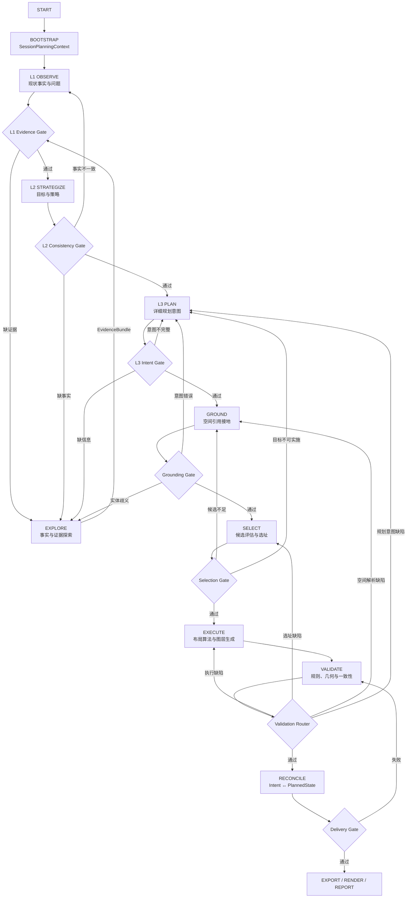

# 村庄规划智能系统：总体设计（North Star）

> **状态：TARGET DESIGN** · 本文档定义目标架构。当前实现状态见 [10_IMPLEMENTATION_STATUS.md](10_IMPLEMENTATION_STATUS.md)。

## 0. 设计结论

系统不是“文本 Agent 生成报告，再由 GIS Agent 接管”的串联流程，而是一个由规划阶段子图、空间决策子图和证据探索能力组成的闭环系统。

核心原则只有一句话：

> 每一个阶段只生产一种权威产物；后续阶段通过类型化契约消费它；失败沿产生原因返回，而不是回到一个巨大的总路由器。

## 1. 目标图结构



EXPLORE 是横向能力，不是固定的“L3 后桥接节点”。L1、L2、L3、GROUND 和 VALIDATE 都可以提交 `ExplorationRequest`；EXPLORE 只返回证据和事实，不返回最终候选地块，也不直接改变规划意图。

## 2. 三类权威产物

| 产物 | 生产者 | 消费者 | 语义 |
|---|---|---|---|
| `L1Snapshot` | L1 子图 | L2、L3、Explore | 已核验的现状事实、约束、问题和证据缺口 |
| `L2Strategy` | L2 子图 | L3、Select、Explore | 目标、定位、策略和策略冲突 |
| `L3PlanningIntent` | L3 子图 / IntentCompiler | Ground、Select、Execute | 类型化的 Zone、Facility、Road、Project 和空间引用 |
| `GroundingResult` | Ground 子图 | Select | 空间引用对应的实体、候选及查询证据 |
| `PlacementDecision` | Select 子图 | Execute | 经过硬约束和评分后的最终选址决定 |
| `PlannedState` | Execute 子图 | Validate、Reconcile、Delivery | 实际生成的规划图层和派生关系 |

Markdown 报告、SSE 事件和 UI 展示都是这些产物的视图，不是新的事实源。

## 3. Agent 与确定性子图边界

| 能力 | 目标形态 | 允许做什么 | 不允许做什么 |
|---|---|---|---|
| EXPLORE | 工具调用 Agent | 查询 KG、RAG、报告和外部资料，整理证据 | 生成候选 BSM、修改意图、选最终位置 |
| L1/L2/L3 分析 | 专业分析 Agent | 解释事实、推导策略、生成规划文本草案 | 绕过 Gate 直接写空间成果 |
| PARSE / IntentCompiler | 类型化编译节点 | 文本转 Target、Constraint、`SpatialReferenceSpec` | 查询地块或决定最终选址 |
| GROUND | 确定性子图，可含歧义处理节点 | 实体解析、KG 候选、几何精化 | 评价候选优劣 |
| SELECT | 混合决策子图 | 硬过滤、评分、可选模型排序、冲突分配 | 直接生成坐标或绕过约束 |
| EXECUTE | 算法 Worker 子图 | MIP、设施、道路、分区和图层生成 | 静默改变规划意图 |
| VALIDATE | Evaluator 子图 | 规则、几何、拓扑、文本/成果一致性校验 | 把失败吞掉后继续交付 |

## 4. 依赖方向

```text
Schema contracts
    ↑
Data adapters / repositories
    ↑
Spatial query and geometry services
    ↑
KG semantic services
    ↑
Planning domain services (intent / grounding / selection / execution)
    ↑
Application subgraphs and API routes
```

应用层可以调用领域层；领域层不能反向导入 Agent、Service、API 或 UI。`tools` 只能是外部能力适配器，不能成为规划算法的第二实现。

## 5. 名称约定

规划阶段 L1/L2/L3 与知识图谱生命周期不再共用相同编号。KG 内部使用以下名称：

| KG 名称 | 内容 |
|---|---|
| `BaseFacts` | 现状实体、几何、编码和来源 |
| `DerivedRelations` | 预计算空间关系、约束和认知摘要 |
| `IntentGraph` | 当前规划周期内的类型化意图实体 |
| `PlannedState` | 执行后产生的规划成果实体 |

## 6. 设计状态

本文描述目标结构；代码当前仍保留旧的 6 节点主图、EXPLORE→GIS 直连和大型 `layout_pipeline`。这些差异集中记录在 [10_IMPLEMENTATION_STATUS.md](10_IMPLEMENTATION_STATUS.md)，迁移顺序记录在 [09_INTEGRATION_BREAKPOINTS.md](09_INTEGRATION_BREAKPOINTS.md)。

## 7. 相关文档

- [01_LAYERED_ARCHITECTURE.md](01_LAYERED_ARCHITECTURE.md)：模块层和依赖规则
- [02_DATA_PERSISTENCE.md](02_DATA_PERSISTENCE.md)：上下文、产物和版本持久化
- [03_KG_SEMANTIC_BRIDGE.md](03_KG_SEMANTIC_BRIDGE.md)：KG 四类数据边界
- [04_PLANNING_PIPELINE.md](04_PLANNING_PIPELINE.md)：L1/L2/L3 及空间子图
- [05_EXPLORE_BRIDGE.md](05_EXPLORE_BRIDGE.md)：EXPLORE 证据探索能力
- [06_PARSE_EXECUTE.md](06_PARSE_EXECUTE.md)：PARSE、GROUND、SELECT、EXECUTE 契约
- [07_VALIDATION_FEEDBACK.md](07_VALIDATION_FEEDBACK.md)：Gate 与定向反馈
- [10_IMPLEMENTATION_STATUS.md](10_IMPLEMENTATION_STATUS.md)：当前代码与目标态差距
