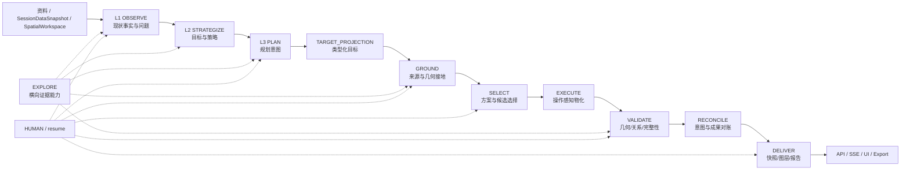

# 村庄规划智能系统：当前设计基线

> **核验日期：2026-08-18** · 本文是 `docs/design/` 的唯一总体设计入口。
> 它同时记录目标不变量和当前实现边界，不把“契约存在、单元测试通过或 clone-only
> replay 有产物”写成默认 live 已完成。当前证据以
> [10_IMPLEMENTATION_STATUS_CURRENT_20260818.md](10_IMPLEMENTATION_STATUS_CURRENT_20260818.md)、
> [RELATION_AWARE_MODIFICATION_LEDGER.md](RELATION_AWARE_MODIFICATION_LEDGER.md) 和
> [GIS 事实绑定审计](modules/spatial-execution/30_GIS_FACT_COLLECTION_BINDING_GAP_AUDIT.md) 为准。

## 1. 设计结论

系统是一条可恢复、可审计、以证据和空间几何为边界的规划工作流：认知层形成事实和规划意图，
空间链把意图编译为候选、方案和几何，校验与交付再把结果投影为前端可读的成果。

核心原则：

> 每个阶段只生产一种权威产物；后续阶段通过类型化契约消费它；失败沿产生原因返回，
> 而不是回到一个可以随意改写状态的总路由器。

必须坚持的边界：

- LLM 负责解释、检索请求和闭集意图编译，不直接决定坐标、候选成员或最终图层。
- GIS、KG、约束求解、网络分析和几何校验负责可重复的空间事实与计算。
- 规划文本、SSE、Markdown、PNG、HTML 和 UI 都是权威产物的视图，不是新的事实源。
- 缺少来源 ID、快照、digest、几何类型或 lineage 时，结果必须保持 `PARTIAL`、`GAP`、
  `deferred` 或进入 HUMAN，不能用数量相等、文本猜测或现状复制来补齐。

## 2. 运行主链

当前代码的工作流入口是 `backend/app/workflow/root_graph.py`，FastAPI 入口是
`backend/app/main.py`。根图由 `intent_loop`、`cognitive`、`spatial_chain` 和 `hitl` 四个
子图组成；空间链的阶段顺序固定为：

```text
BOOTSTRAP
  → L1 OBSERVE → L2 STRATEGIZE → L3 PLAN
  → TARGET_PROJECTION → GROUND → SELECT → EXECUTE
  → VALIDATE → RECONCILE → DELIVER
  → API / SSE / map-layers / export
```



`EXPLORE` 是横向能力，不是固定的 L3 后置节点。它可以读取 session 内的报告、结构化
observations、VillageBundle、KG、typed artifacts、历史决定和允许的外部资料，并返回带
provenance 的 `EvidenceBundle`。它不能直接生成候选地块、修改规划意图或写入最终几何。

### 2.1 多源 Evidence 的统一边界

多源检索不是若干 prompt 片段的简单拼接，而是一个按来源和作用分栏的证据编排层。所有
来源先投影为 `EvidenceFact`/`EvidenceSource`，再汇入 `EvidencePacket`；但来源的权威性、
可定位能力和下游用途不能被统一类型抹平：

| 来源 | 主要回答 | 对规划 LLM 的作用 | 能否直接定位/进入 GROUND |
|---|---|---|---|
| `bundle` | 当前有哪些真实要素、属性和 canonical BSM | 当前数据背景、要素身份 | 只有通过 bundle feature ref；几何权威在 bundle |
| `KG` | 实体、别名、行政范围和拓扑关系 | 语义消歧、关系约束、候选解释 | 只能给实体/关系引用；不能替代 bundle 几何 |
| `L1` | 报告抽取出的地点、设施、道路和空间提示 | 语义到村庄/实体范围的桥 | 不能单独定位；必须经 KG + bundle 验证 |
| `L1/L2/L3 报告` | 现状事实、策略依据、详细规划意图 | 规划背景和可审计文字片段 | 文字不能生成几何；引用必须保留层级/版本/span |
| `local_text` | 对上述 session-owned 文本做无向量句段检索 | 向量服务失效时仍提供语义背景 | 不产生几何，只保留 source locator |
| `professional RAG` | 外部专业规范、政策、案例和技术文本 | 补充规划决策背景 | 永远不能产生 BSM、坐标或候选几何 |
| `external web` | 经策略允许的外部事实 | 最新/缺口补充 | 只作为外部文本引用，不能直接落地 |

`professional RAG` 与 `local_text` 必须是两个不同的 retriever：前者只查专业向量库，
服务到期时显式记录 `external_rag_unavailable`；后者对当前 session 的 bundle 输入文本和
L1 source span 做有界确定性检索，L1/L2/L3 报告由 bundle manifest 驱动的 report retriever
按需展开，不依赖向量服务。规划 LLM 可同时看到两类
背景，但 prompt 中必须区分 `evidence_role`（规划背景/语义范围/空间事实）和
`source_kind`，不能把外部规范当作村内现状，也不能把报告语句当作已验证几何。

bundle 是 session 的唯一检索投影，而不是长文本的第二份仓库：空间对象、L1 fact、KG/
EvidenceGraph 引用、输入文档引用和 `documents.report_refs` 清单进入 bundle；L1/L2/L3
正文只在 `ReportStore` 保留一份，由 bundle 中的 `report_id` 显式展开。旧的
`VillageBundle.layer_reports`、`DocumentGroup.l3_reports` 和 bundle→ReportStore fallback
不再存在。这样 GROUND/SELECT/EXECUTE 看到的是同一个可审计引用边界，内存和快照不会因
报告全文重复而膨胀。

统一的空间落地链为：

```text
文本/事实检索 → L1 semantic scope → KG entity/relationship candidates
  → bundle feature identity/geometry refs → topology verification
  → GROUND candidate domain → SELECT → EXECUTE → VALIDATE → RENDER
```

## 3. 阶段职责与权威产物

| 阶段 | 只负责 | 权威产物/输入输出 | 当前完成度 |
|---|---|---|---|
| L1/L2/L3 | 事实观察、策略推导、详细规划意图 | `L1Snapshot`、策略报告、`PlanningProgram` | `PARTIAL` |
| TARGET_PROJECTION | 把已编译的规划意图变成类型化目标和空间引用 | `IntentCompilationResult` / typed specs | `PARTIAL` |
| GROUND | 解析实体、绑定来源、形成候选几何和约束输入 | `GroundingResult` / `GroundedPlanningProblem` | `PARTIAL` |
| SELECT | 在闭集候选中处理必选成员、备选成员、容量和关系 | `PlanningScenario` | `PARTIAL` |
| EXECUTE | 按已选方案和操作物化几何，不重新选址 | `PlannedState` / execution results | `PARTIAL` |
| VALIDATE | 校验几何、来源、成员完整性、关系和跨阶段一致性 | `ValidationReport` | `CLONE_ONLY`，默认 live 未验收 |
| RECONCILE | 对账规划意图、候选、方案、执行和交付覆盖 | `ReconciliationReport` | `PARTIAL` |
| DELIVER | 生成可审计的交付快照、图层、报告和导出物 | `DeliveryManifest` / `DeliverySpatialSnapshot` | `CLONE_ONLY/PARTIAL` |

### 3.1 权威数据流

```text
L1 fact + source snapshot
  → L3 goal（必须引用 source_fact_refs）
  → TARGET_PROJECTION（单目标、单操作、显式空间引用）
  → SourceFeatureSetBinding / CandidateGeometry
  → GroundedPlanningProblem（required / alternative cardinality）
  → PlanningScenario（只选择候选，不重写事实）
  → ExecutionPlan / WorkerResult
  → PlannedState（完整 source / scenario / operation lineage）
  → ValidationReport + ReconciliationReport
  → DeliverySpatialSnapshot / map-layers
```

`WorkflowState` 只保存控制字段、checkpoint 需要的轻量上下文和 artifact refs；完整业务结果由
typed contracts 和 artifact store 持有。阶段之间不得通过自由 dict、隐式 `latest`、静态文件名
或重新解析报告正文来传递权威状态。

## 4. GIS 事实和规划操作的设计规则

### 4.1 数量不是身份

必须区分以下五种数量：报告中的业务数量、GIS source feature 数、KG canonical feature 数、
网络拓扑 edge 数和最终 planning output feature 数。它们只有在定义、快照和粒度完全一致时
才可以比较。

当前金田样例的 `roads_current=131` 是 GIS source feature 数，不是规划文本中的人工道路数量
`275`。`275` 来自旧 KG 类型/裸 RDF 计数污染，不能作为绑定依据；该旧结论已经
`DEPRECATED`。详见 [GIS 事实绑定审计](modules/spatial-execution/30_GIS_FACT_COLLECTION_BINDING_GAP_AUDIT.md)。

### 4.2 来源集合必须显式绑定

来源几何只有同时具备以下信息时，才允许进入真实规划线要素：

- `source_feature_ids` 或等价的显式成员集合；
- source snapshot ref、feature digest 和同快照的 geometry lineage；
- 支撑它的 `L1Fact.fact_id` 或已审计的语义决定；
- 与目标操作和几何类型相容的语义。

`preserve`、`harden`、`repair`、`widen`、`reference` 和 `new_corridor` 是不同操作。现有几何
可以作为事实或改造对象，但不能被复制后标记成新建；新建走廊不能从现有线直接冒充。缺少
可靠成员范围时，保留 `candidate/deferred`，不以数量相等或模型置信度自动兜底。

### 4.3 必选集合和备选集合不能混淆

GROUND 输出的候选域必须区分：

- `all_members`：来源事实要求全部保留的成员；
- `choose_one`：从候选中选择一个；
- `choose_subset`：只有目标明确有容量或子集目标时才允许选择子集。

SELECT 必须保留全部 `all_members`，只对备选/子集进行求解；EXECUTE 必须为每个选中成员
产生可追踪的执行结果。把 131 条 source lines 当成 131 个互斥候选，会导致合法来源在
GROUND/SELECT 中被错误丢弃。

## 5. Agent、确定性服务和依赖方向

| 边界 | 可以做什么 | 明确禁止 |
|---|---|---|
| LLM / Agent | 解释报告、请求证据、在闭集 schema 内编译目标和关系候选 | 直接写坐标、source ID、几何、候选成员或最终成果 |
| EXPLORE / Evidence | 按问题检索 session 证据，返回 provenance 和 sufficiency 信息 | 把裸 entity count 包装成业务事实；直接改意图 |
| TARGET_PROJECTION | 读取 typed `PlanningProgram`，生成单目标、单操作的空间规范 | 读取原始规划文本猜 geometry；自行选址 |
| GROUND | KG/空间查询、来源绑定、候选几何和约束准备 | 以评分决定最终位置；合并不同快照 |
| SELECT | 硬约束、关系、容量和确定性方案求解 | 生成新坐标；重新解释 source membership |
| EXECUTE | 消费 `PlanningScenario`，按 worker/DAG 物化几何和 lineage | 静默改写目标、重新选址或丢弃选中成员 |
| VALIDATE/RECONCILE | 发现失败、归因责任阶段并 fail-closed | 吞掉 finding、把空集合当成功 |

依赖方向保持为：

```text
contracts
  ↑
data / artifact / event adapters
  ↑
spatial query / geometry / KG services
  ↑
planning domain services
  ↑
workflow / application / API projections
```

领域层不能反向依赖 API、UI、Agent 编排或第二套旧 service 实现。

## 6. 当前可见能力和完成门槛

截至 2026-08-18，source-aware clone/replay 已证明部分 Point、Polygon 和 delivery overlay
可以贯通，但 `exact Line=0`、154 个目标 deferred，且没有 fresh default-live 的完整验收。
当前状态覆盖页记录的关键数字是：42 exact Point、1802 parcel candidates、329 corridor
candidates、16 placed、16 worker tasks、16 final features、15 render layers、122 个非 baseline
planning overlays。这些是 `PARTIAL/CLONE_ONLY` 证据，不是 `COMPLETE`。

只有以下条件全部满足，系统才能把默认 live 规划闭环标为 `COMPLETE`：

1. L1 事实有来源、快照、计数口径和可审计的 GIS/KG 对齐；
2. L3 每个空间目标引用有效 L1 fact，并且拆成单一操作；
3. GROUND 能表达来源集合的 exact members 及 required/alternative cardinality；
4. SELECT 保留全部 required members，并对备选关系和硬约束做确定性求解；
5. EXECUTE 为每个选中成员生成非 baseline、带完整 lineage 的 planning feature；
6. VALIDATE/RECONCILE 证明几何、来源、成员完整性、关系和跨阶段覆盖；
7. `/api/v1/sessions/{id}/map-layers` 能读到同一 run-root 的可审计交付快照；
8. fresh default-live replay 与第二次 resume 的 scenario/final-validation fingerprint 不变，
   且没有新增 LLM/worker 执行；
9. 失败、deferred、HUMAN 和空规划层都以可诊断状态呈现，不能伪装成成功。

## 7. 文档权威和阅读顺序

默认阅读顺序只有三层：

1. 本文：总体设计、不变量、阶段边界和完成门槛；
2. [当前架构实现](../architecture/README.md)：代码入口、调用链、API、SSE、resume 和实际状态边界；
3. [当前状态覆盖页](10_IMPLEMENTATION_STATUS_CURRENT_20260818.md)、
   [关系实现台账](RELATION_AWARE_MODIFICATION_LEDGER.md) 和专题审计：可复核证据与待办差距。

模块专题只补充本模块的契约和决策，不得重新定义总体主链或完成度。历史设计、旧迁移计划、
旧审计和周报统一放在 `docs/_archive/`，只用于追溯，不能作为当前实现依据。

### 相关专题

- [L1/L2/L3 认知层](modules/cognition/README.md)
- [EXPLORE / 证据检索](modules/explore/README.md)
- [KG / 地名解析](modules/kg-place/README.md)
- [空间决策链](modules/spatial-execution/README.md)
- [校验与反馈](modules/validation/README.md)
- [成果交付](modules/delivery/README.md)
- [持久化](modules/persistence/README.md)
- [LLM 工具绑定](modules/llm-tools/README.md)
