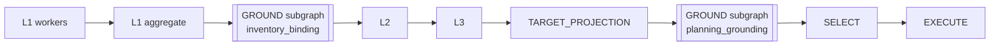
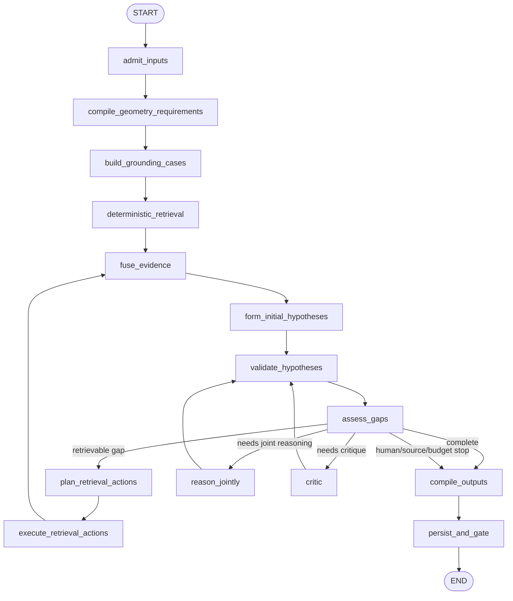

# Evidence and Geometry-Driven Grounding

> Status: TARGET
> Authority: Normative behavior for evidence retrieval, semantic entity binding, geometry-demand compilation, iterative GROUND reasoning, candidate-domain construction and GROUND gate decisions.
> Current implementation: `../architecture/CURRENT_RUNTIME.md`.
> Related invariants: `00_SYSTEM_DESIGN.md`, `01_CONTRACTS_AND_INVARIANTS.md`, `03_PLANNING_EXECUTION.md`, `04_EVALUATION_AND_ACCEPTANCE.md`, `05_MIGRATION.md`.

## 0. Executive decision

GROUND 必须按“下游究竟需要什么几何”设计，而不是按“文本中出现了什么地名类型”设计。

“自然村”不是特殊定位机制，也不是必须预先维护的行政闭集。它与河流、道路、学校、地块、历史地物、行政村、片区俗名一样，只是一个带语义类型、来源和时间范围的 `PlaceMention`。只有当某个规划或证据任务提出几何用途时，系统才检索并形成相应的空间表达。

同一个自然村 mention 可以在不同任务中产生不同、但均合法的几何需求：

- 查询现状设施时，它可能只需要一个不可物化的粗搜索范围；
- 统计宅基地时，它可能需要一组来源可追溯的地块成员；
- 规划道路连接时，它可能需要一个或多个有不确定性的端点/范围；
- 若上传数据包含权威自然村界，它可以绑定 exact polygon；
- 若没有足够证据，它只能保持 `name_only` 或 `unresolved`。

因此，本设计作出以下规范决定：

1. 删除以 `villages.yaml.natural_villages` 为真值来源的静态自然村闭集；
2. 删除 `ResidentialCluster`、`居民点1…N` 和任何村名→匿名聚类绑定的生产路径；
3. 不建立第二套持久化地点图；KG 继续承担实体、来源和拓扑索引；
4. L1 是 session 原始报告地点事实的唯一语义生产者；
5. GROUND 消费 L1 typed facts、KG、Bundle 和正式规划要求，不重新解析原始报告；
6. LLM 负责案件结构化、检索规划、联合推理、反证和补证决策；
7. 确定性 adapter 负责执行查询、验证候选、计算几何、绑定 source identity 和提交 artifact；
8. GROUND 实现为可复用 LangGraph 子图，而不是一个包含全部行为的巨型 async 函数；
9. 子图支持 L1 后的 `inventory_binding` 和 TARGET_PROJECTION 后的 `planning_grounding` 两种入口模式；
10. 模糊定位用 `SpatialReferenceSpec`、`SearchScopeRef`、uncertainty 和 candidate domain 表达，不用聚类替代。

## 1. Goals and non-goals

### 1.1 Goals

本设计要求系统具备以下能力：

- 对任意村庄、任意上传报告和任意符合 Bundle 契约的 GIS/KG 工作，不依赖项目专用地点配置；
- 从 L1 typed observations 中动态发现地点、别名、范围、共址、数量和方向关系；
- 根据几何用途分别处理 identity、search scope、measurement support、candidate source 和 execution geometry；
- 允许 LLM 主动提出受限 GIS/KG 检索，并依据新证据迭代；
- 对多个事实联合推理，而不是逐 mention 独立最近邻匹配；
- 区分实体身份已知、几何已知、范围推断、规划候选可用和最终可执行；
- 每个结果保留 L1、KG、Bundle snapshot、source feature、关系计算和模型决定的完整 lineage；
- 在 provider、RAG、外部检索或局部 GIS 图层不可用时 fail-closed，并保留可诊断缺口；
- 支持 LangGraph checkpoint、resume、幂等重放、并行检索、内部循环和父图 gate 路由；
- 为后续设施选址、地块分配、道路、走廊、覆盖、分区、整治和保护规划提供统一空间输入。

### 1.2 Non-goals

GROUND 不负责：

- 把一个地名强行解释为唯一几何；
- 为无来源地点生成坐标、WKT、GeoJSON、BSM 或 KG URI；
- 维护全国或项目级静态自然村名录；
- 从匿名形态聚类猜测自然村身份；
- 选择最终规划方案；
- 按综合评分删除仍然合法的候选；
- 在 GROUND 内直接修改现状或规划图层；
- 重新读取 L1 原始报告正文并生成第二套地点事实；
- 把搜索范围、buffer、bbox、村域质心或推断包络当成执行几何；
- 用外部网页或地图 POI 直接声明 Bundle 内 feature identity；
- 将本次运行中的推断别名和范围无审计地写回权威 KG。

## 2. Core model: semantics request geometry; geometry does not define semantics

### 2.1 PlaceMention is ordinary semantic evidence

所有地点引用统一表示为普通语义 mention：

```python
class PlaceMention(BaseModel):
    mention_id: str
    surface_form: str
    normalized_form: str = ""
    semantic_roles: list[str] = []
    scope_mentions: list[str] = []
    relation_mentions: list[str] = []
    aliases: list[str] = []
    temporal_status: str = "current"
    source_refs: list[str] = []
    source_segment_ids: list[str] = []
    source_quote: str = ""
    confidence: float = 0.0
```

`semantic_roles` 只帮助选择检索通道和类型约束。它不直接决定几何粒度。例如 `natural_village` 不自动意味着 polygon，`river` 不自动意味着 line，`facility` 也不自动意味着 point；实际 Bundle 可能分别以多地块、水面集合或建筑面表达它们。

### 2.2 Geometry need is a first-class contract

每个需要接地的事实或规划目标必须编译为 `GeometryRequirement`。这是 GROUND 的主输入之一：

```python
class GeometryRequirement(BaseModel):
    requirement_id: str
    owner_ref: str
    mention_refs: list[str]
    purpose: Literal[
        "identity_evidence",
        "reference_anchor",
        "search_scope",
        "measurement_support",
        "candidate_source",
        "network_endpoint",
        "execution_input",
    ]
    preferred_geometry_kinds: list[Literal[
        "point", "line", "polygon", "feature_set", "parcel_set", "network"
    ]]
    acceptable_granularities: list[Literal[
        "exact_feature",
        "authoritative_extent",
        "source_feature_set",
        "parcel_extent",
        "parcel_set",
        "derived_corridor",
        "derived_search_scope",
        "inferred_extent",
        "text_only",
    ]]
    required_authority: Literal[
        "bundle_source",
        "kg_plus_bundle",
        "derived_from_bundle",
        "inference_allowed",
        "text_only_allowed",
    ]
    materialization_allowed: bool = False
    max_uncertainty_m: float | None = None
    required_relations: list[str] = []
    source_snapshot_ref: str
    source_snapshot_digest: str
    l1_fact_refs: list[str] = []
    success_condition: str
```

`purpose` 决定同一几何能否满足当前任务：

| purpose                 | 可接受示例                                               | 不可接受示例            |
| ----------------------- | -------------------------------------------------------- | ----------------------- |
| `identity_evidence`   | 具名 source feature、KG entity + source feature          | 任意村中心点            |
| `reference_anchor`    | 有来源点/线/面，或明确允许的推断范围                     | 被当成最终建设地块      |
| `search_scope`        | authoritative extent、parcel set、derived/inferred scope | 直接进入 EXECUTE        |
| `measurement_support` | 可重放的 source geometry/network                         | 纯文本范围              |
| `candidate_source`    | Bundle-backed parcel/feature membership                  | 无 source ID 的自由几何 |
| `network_endpoint`    | source point、明确范围内的候选端点集合                   | 匿名聚类质心            |
| `execution_input`     | 通过硬约束验证的冻结候选几何                             | bbox、scope、推断包络   |

#### Geometry requirement compilation matrix

TARGET_PROJECTION 和 inventory compiler 必须根据“用途 + 预期输出”编译 requirement，不能只根据 entity role 使用固定模板：

| 输入/目标       | 常见 semantic role   | 首要 geometry purpose                   | 常见可接受输入                                         | 必须拒绝                   |
| --------------- | -------------------- | --------------------------------------- | ------------------------------------------------------ | -------------------------- |
| 已有设施事实    | facility             | identity_evidence / reference_anchor    | source point、building polygon、typed facility feature | village scope 冒充设施     |
| 新建设施选址    | facility/site_area   | candidate_source / execution_input      | eligible parcel、approved footprint                    | POI point 直接物化         |
| 已有道路事实    | road                 | identity_evidence / measurement_support | source line/network edge set                           | 名称相似的任意线           |
| 新建道路        | road/linear          | network_endpoint + candidate_source     | source-backed endpoints、route/corridor alternatives   | 聚类质心、未冻结草图       |
| 河流/水系       | water                | identity_evidence / reference_anchor    | source water lines/polygons/connected set              | 行政村或居民点范围         |
| 沿河规划        | axis/linear          | search_scope / candidate_source         | derived corridor + eligible line domain                | 水面 buffer 直接执行       |
| 自然村/片区俗名 | place                | search_scope                            | authoritative extent、parcel set、inferred extent      | 默认 centroid、匿名聚类    |
| 行政区          | administrative_place | search_scope / measurement_support      | authoritative boundary                                 | boundary centroid 充当全域 |
| 地块操作        | parcel/site_area     | candidate_source / execution_input      | exact Bundle parcel/member/footprint                   | 只有文本地名               |
| 分区/保护范围   | zone                 | measurement_support / candidate_source  | authoritative/derived polygon overlay                  | 无 source lineage 的自由面 |
| 道路覆盖/服务   | demand/network       | measurement_support                     | NetworkGraphSnapshot + DemandSnapshot                  | 注记数量猜成 demand point  |

同一 target 可以拥有多个 requirement。例如新建设施既需要 location search scope，也需要最终 parcel execution input；前者满足不代表后者满足。

### 2.3 Natural village is a normal range request

自然村没有专用 resolver、聚类算法或静态注册表。它通常形成如下需求：

```json
{
  "purpose": "search_scope",
  "preferred_geometry_kinds": ["polygon", "parcel_set", "feature_set"],
  "acceptable_granularities": [
    "authoritative_extent",
    "parcel_set",
    "inferred_extent",
    "text_only"
  ],
  "required_authority": "inference_allowed",
  "materialization_allowed": false
}
```

如果存在权威自然村边界，返回该 source polygon。如果只存在带名称的设施、灾害点、道路关系和相关地块，可形成带 provenance、method、uncertainty 的 `inferred_extent`。如果证据只能证明名称存在而不能证明范围，则返回 `text_only`，不能退化到行政村、匿名居民点或任意中心点。

### 2.4 Identity, geometry and use-readiness are independent axes

任何 binding 都必须分别记录：

```text
identity_status
geometry_status
requirement_readiness
```

推荐状态：

```python
IdentityStatus = Literal[
    "canonical", "alias_confirmed", "candidate", "ambiguous", "unresolved"
]

GeometryStatus = Literal[
    "authoritative", "source_feature_set", "derived", "inferred", "text_only", "unresolved"
]

RequirementReadiness = Literal[
    "satisfied", "usable_with_uncertainty", "insufficient", "conflict", "source_exhausted"
]
```

例如，自然村名称可达到 `identity_status=canonical`，其范围只能是 `geometry_status=inferred`；这可能满足 `search_scope`，但绝不能满足 `execution_input`。

## 3. Session place inventory: L1-owned and open by default

### 3.1 No static natural-village closed set

`data/gis/{village}/villages.yaml` 不得再提供：

- `natural_villages`；
- `admin_center`；
- `village_anchors`；
- `landmarks`；
- 项目特定标准名或别名真值。

行政编码、行政区层级和数据源选择信息可以继续存在于 Bundle/session metadata；如果它们能由 boundary layer、上传 metadata 或行政编码服务获得，项目专用 YAML 应完全删除。

### 3.2 L1 enumerations define session-local closure

L1 必须把地点枚举与普通提及分开：

```python
class PlaceInventoryGroup(BaseModel):
    group_id: str
    group_role: str
    administrative_scope_ref: str = ""
    declared_count: int | None = None
    member_mention_refs: list[str] = []
    enumeration_complete: bool = False
    source_refs: list[str] = []
    source_quote: str = ""
```

只有报告明确作出完整枚举时，`enumeration_complete=true`。否则地点集合保持 open world。系统不得因为只提取到三个自然村就断言行政村只有三个自然村。

该闭合只在当前 L1 snapshot 和 session 中有效，不写入全局配置。新的报告 revision 必须生成新的 inventory digest，并使依赖旧 inventory 的 grounding fingerprint 失效。

### 3.3 Typed scopes, not suffix heuristics

scope 不得再以字符串是否以“村”或“自然村”结尾分类。L1 输出必须携带显式 role：

```python
class ScopedMention(BaseModel):
    mention_ref: str
    name: str
    role: str
    relation_to_owner: str
    source_refs: list[str] = []
    confidence: float = 0.0
```

“园寨”“田坑”“社前”即使不带“村”字，也可以由报告上下文标记为 `natural_village`。确定性 compiler 只校验 role 是否在允许集合、来源是否存在、引用是否属于当前 L1 snapshot；它不通过字面后缀猜类型。

### 3.4 Aliases are hypotheses until supported

项目特定别名不得在静态 `place_aliases.yaml` 中直接成为 canonical mapping。它们进入 session-local alias evidence：

```python
class AliasHypothesis(BaseModel):
    surface_form: str
    canonical_candidate_ref: str
    status: Literal["proposed", "confirmed", "conflict", "rejected"]
    supporting_evidence_refs: list[str] = []
    contradicting_evidence_refs: list[str] = []
    confidence: float = 0.0
```

通用文本规范化规则，如 Unicode、空白、行政后缀和全角半角归一，可以继续是确定性规则；项目特定名称映射必须有来源。

## 4. Source families and authority

| 来源族                | 主要用途                                     | 可提供定位                                    | 权威边界                                            |
| --------------------- | -------------------------------------------- | --------------------------------------------- | --------------------------------------------------- |
| L1 snapshot           | 报告中的实体、范围、数量、关系、别名和来源段 | fact/observation/source segment refs          | 语义事实；不能直接成为几何                          |
| Bundle/structured GIS | 当前空间要素、属性、canonical membership     | snapshot/layer/source feature ID/geometry ref | 项目内几何和 source identity 的首要来源             |
| KG/entity graph       | 实体、别名候选、source links、拓扑和关系     | entity/edge/source feature refs               | 用于检索和联合消歧；不能替代 Bundle authority       |
| artifact store        | L1/L2/L3、binding、round、决定与阶段产物     | artifact ref/revision/digest                  | 只代表对应输入快照和阶段                            |
| professional RAG      | 规范、政策、方法和阈值                       | source/chunk/page/span                        | 不能证明项目内对象存在                              |
| external source       | 最新公共事实、公开 POI、缺失名称线索         | URL/provider/item ID/time                     | 只作为候选证据；必须回到 Bundle/KG 完成项目身份绑定 |

来源融合不得抹平 authority。LLM 可以推理“两个来源可能指向同一对象”，但只有 deterministic binding validator 可以提交 canonical entity/source feature membership。

### 4.1 Hybrid retrieval and degradation

检索至少保留四类独立通道：

- structured：artifact metadata、Bundle、显式 source IDs 和字段过滤；
- lexical：短语、编号、别名候选、章节、表格字段和本地全文；
- dense：同义表达和语义召回；
- graph/spatial：KG 邻接、实体关系、拓扑、范围、距离和网络。

融合以 EvidenceRequirement/GroundingCase 为单位。reranker 只能调整已召回 evidence 的排序，不能生成 evidence；每个候选必须保留来自哪些通道、每个通道是否完成分页以及被排除的原因。

dense/embedding 不可用时：

1. 记录 provider、model、error 和 unavailable channel；
2. 继续 structured、lexical、KG、Bundle 和 artifact retrieval；
3. 允许 LLM 提出确定性的 alias/query variants；
4. 将 bounded completeness 降为 partial，并列出可能漏召回的同义表达；
5. 不把 dense failure 写成整个 grounding unavailable；
6. 不把较低召回静默写成 sufficient。

professional RAG 与 session-owned L1/local facts 是不同 source family。前者失败不能阻断后者，后者也不能声称覆盖了外部规范库。

### 4.2 Claim-evidence and contradiction model

检索结果进入推理前必须保留以下关系：

```text
EvidenceRequirement
  → EvidenceClaim
      → source locator
      → supports / contradicts / qualifies
      → candidate identity/geometry
      → GroundingCase
```

冲突处理顺序：

1. 检查时间是否不同；
2. 检查行政/空间 scope 是否不同；
3. 检查统计口径和 entity type 是否不同；
4. 检查 source authority 与 snapshot version；
5. 尝试通过 typed retrieval 获取缺失关系；
6. 仍不能消解则保持 `conflict`/`ambiguous` 并进入 HUMAN。

不得以相似度、来源数量、距离更近或 LLM 偏好消除冲突。规划阶段引用 claim/evidence/binding IDs；摘要只是视图，不能成为新的无来源事实。

### 4.3 External evidence policy

只有 requirement 明确需要最新、项目外或本地缺失信息时才启用 external source。每项外部 evidence 必须记录 provider、稳定 item/URL、访问时间、发布日期、publisher、locator 和 content digest。

外部检索可以：

- 提供别名和候选地点线索；
- 支持规范阈值、政策、案例和方法；
- 帮助提出下一步 Bundle/KG 查询。

外部检索不可以：

- 直接生成 BSM/source feature ID；
- 覆盖当前 Bundle geometry；
- 把 POI 坐标升级为执行坐标；
- 静默更新已批准的 planning input。

外部对象必须与当前 Bundle/KG source evidence 完成绑定；否则只能保持 external candidate/text evidence。

## 5. Evidence requirements and geometry requirements

### 5.1 EvidenceRequirement answers “what must be proven”

检索入口不是一条随意自然语言 query，而是从 L1、L2、L3、TARGET_PROJECTION 或 GROUND 编译出的 `EvidenceRequirement`。每项要求至少说明：

- 待支持的 claim/decision；
- 必需或可选；
- 适用范围；
- 来源族；
- 时效；
- 允许的推断等级；
- evidence role；
- 成功条件；
- requesting artifact revision。

### 5.2 GeometryRequirement answers “what spatial form is usable”

有空间用途的 EvidenceRequirement 必须关联一个或多个 GeometryRequirement。两者不能合并成一个模糊字段：

```text
EvidenceRequirement: 证明“现状小学位于园寨”
GeometryRequirement A: 园寨只需 search_scope
GeometryRequirement B: 小学需要 identity_evidence / reference_anchor
```

原始问题“学校应该放在哪里”应拆成：

- 人口/需求证据；
- 现状学校 identity 和 geometry；
- 服务半径规范；
- 禁建和限制范围；
- 可建设 source parcels；
- 道路/网络可达性；
- 面积、容量和成本；
- 每类输入各自的 GeometryRequirement。

一个 top-k 文本集合、一个村中心或一个居民点聚类不能同时证明这些要求。

### 5.3 Query decomposition and missing-evidence loop

控制器按 requirement、source family 和 evidence role 生成子查询，而不是向所有来源广播同一句文本：

```text
compile EvidenceRequirement + GeometryRequirement
→ deterministic retrieval
→ evaluate coverage and geometry readiness
→ LLM proposes only missing typed queries
→ execute/fuse/validate
→ update hypotheses and contradictions
→ stop at sufficient, source-exhausted, human-required or budget-exhausted
```

每个查询计划记录 query/action ID、requirement/case IDs、retriever、filters、pagination、budget、开始/结束时间、result count、failure、retry parent 和 information-gain expectation。下一轮只能针对剩余缺口；已经满足的 requirement 不得被全量重检索。

## 6. Query model and tool boundary

### 6.1 LLM proposes semantics, never runtime identity

LLM 只能产生 `SpatialQueryDraft`、`RetrievalActionProposal` 和闭集 `CandidateSelectionProposal`。它不得产生：

- BSM；
- source feature ID；
- entity URI；
- snapshot ref/digest；
- WKT/GeoJSON；
- 坐标；
- candidate geometry；
- materialization authorization。

这些字段由确定性 compiler、Bundle/KG adapter 和 artifact runtime 填充。

### 6.2 Typed retrieval action

```python
class RetrievalActionProposal(BaseModel):
    action_type: Literal[
        "kg_entity_search",
        "kg_relation_expand",
        "bundle_attribute_search",
        "bundle_spatial_query",
        "source_feature_expand",
        "network_query",
        "artifact_fact_lookup",
        "external_place_search",
    ]
    case_refs: list[str]
    query: SpatialQueryDraft
    rationale: str
    expected_information_gain: str
```

系统编译后形成 runtime-owned `RetrievalAction`：

```python
class RetrievalAction(BaseModel):
    action_id: str
    action_fingerprint: str
    proposal: RetrievalActionProposal
    source_snapshot_ref: str
    source_snapshot_digest: str
    permitted_source_families: list[str]
    candidate_limit: int
    timeout_s: float
```

### 6.3 Spatial AST

受限空间 AST 至少支持：

```text
EntityRef(name, semantic roles, aliases, scopes)
DatasetRef(dataset_id, snapshot_id, layer_id)
AttributeFilter(field, operator, value, unit)
SpatialPredicate(within, intersects, contains, touches, nearest)
DistancePredicate(metric, threshold, unit, network_mode)
DirectionPredicate(reference, direction, partition_method)
TopologyPredicate(connected_to, upstream_of, adjacent_to)
Aggregate(count, area, length, min, max, sum)
Sort(metric, direction)
Limit(k)
Compose(and, or, not)
```

AST 必须白名单化字段和谓词并参数化执行。任何未解析实体、单位、CRS、时间快照或 authority 必须留在 unresolved，不能交给 LLM 补全 runtime identity。

### 6.4 Tool results are observations

每次工具执行返回小型、结构化、可分页的 EvidencePacket：

```text
query fingerprint
bundle/KG/L1 version
candidate refs and total count
relation evidence
source spans
included/excluded counts
ambiguity and sufficiency
missing evidence
query trace
```

大几何、完整图层和整篇报告不直接进入 prompt。LLM 接收稳定 ID、类型、来源、摘要指标、关系和必要的简化空间描述；确定性节点持有完整 geometry refs。

## 7. Grounding cases and joint reasoning

### 7.1 Case, not isolated mention

GROUND 不逐个裸 mention 工作。它先把 L1 observations 和规划 GeometryRequirements 编译为 `GroundingCase`：

```python
class GroundingCase(BaseModel):
    case_id: str
    owner_refs: list[str]
    primary_mention_refs: list[str]
    scope_mention_refs: list[str]
    geometry_requirement_refs: list[str]
    semantic_type_constraints: list[str]
    relation_constraints: list[str]
    cardinality_constraints: list[str]
    co_reference_group: str = ""
    source_refs: list[str] = []
    priority: Literal["critical", "required", "optional"]
```

例如“文化广场2处，分别位于园寨、黄竹”是一个联合 case，包含：

- entity role = public space/facility；
- cardinality = 2；
- scopes = 园寨、黄竹；
- one-per-scope relation；
- 两个广场不得绑定到同一 source feature。

把它拆成“文化广场、园寨、黄竹”三个独立 resolver 调用会丢失最有价值的约束。

### 7.2 Hypothesis ledger is ephemeral

子图维护 session/run-local `GroundingWorkspace`，但它不是新的地点 KG：

```python
class BindingHypothesis(BaseModel):
    hypothesis_id: str
    case_ref: str
    mention_refs: list[str]
    candidate_refs: list[str]
    proposed_identity_ref: str = ""
    proposed_geometry_refs: list[str] = []
    proposed_granularity: str = ""
    supporting_evidence_refs: list[str] = []
    contradicting_evidence_refs: list[str] = []
    unresolved_questions: list[str] = []
    confidence: float = 0.0
```

它只保存候选、支持、反证、缺口和 round history。只有通过 validator 的 binding 才进入 `GroundedEntityBindingSnapshot`；只有通过 planning completeness 的候选才进入 `GroundedPlanningProblem`。

### 7.3 Global constraints precede local nearest-neighbor choices

联合推理至少处理：

- 数量一致性；
- one-to-one / one-to-many / many-to-one；
- 共址和邻近；
- 包含、相交、连接和方向；
- 实体类型兼容；
- 同名不同实体；
- 别名与冲突名称；
- 报告范围与 GIS 范围；
- source feature 排他性；
- 时间状态；
- 支持证据与反证。

距离是证据之一，不是默认决策规则。最近 feature 只有在 semantic type、scope、authority 和全局约束均兼容时才可成为候选。

## 8. GROUND as a reusable LangGraph subgraph

### 8.1 Why a subgraph

当前实现把 L1 后 `ground_anchors` 内联在 `layer_aggregate_node`，context hydration 又可能调用 `ground_l1_anchors`，正式 `ground_node` 再依次执行 report grounding、intent anchor resolution、村名聚类映射、EvidencePacket retrieval、aggregate 和 flash recovery。这造成：

- 同一地点在不同入口重复接地；
- checkpoint 只看到一个巨型 stage，无法观察内部 round；
- provider failure、预算、检索和 deterministic validation 混在同一函数；
- 重放可能重复副作用或 LLM 调用；
- L1 binding 与 formal GROUND 状态语义不一致；
- 内部 recovery 只是 Python loop，不具备明确的 graph state 和 route contract；
- 测试只能 monkeypatch 大函数，难以验证单轮信息增益和恢复。

GROUND 应成为 compiled LangGraph child graph。父图仍把它视为一个阶段边界；子图内部负责有界检索与推理循环。

### 8.2 Two invocation modes, one implementation

同一个 `build_grounding_subgraph()` 支持两种入口：

#### `inventory_binding`

调用时点：L1 snapshot 持久化之后、L2/L3 使用现状空间证据之前。

输入：

- current L1 snapshot ref；
- PlaceMention/PlaceInventoryGroup；
- Bundle snapshot ref；
- KG version；
- 现状 identity/search-scope GeometryRequirements。

输出：

- `GroundedEntityBindingSnapshot`；
- unresolved/ambiguous place inventory；
- EvidenceCoverage；
- grounding round audit；
- 不产生规划候选，不产生 final scenario。

#### `planning_grounding`

调用时点：TARGET_PROJECTION 之后、SELECT 之前。

输入：

- current target projection ref；
- admitted grounding requests；
- GeometryRequirements；
- prior `GroundedEntityBindingSnapshot`；
- Bundle/KG/network/current constraints；
- L1/L3 lineage。

输出：

- `GroundingResult`；
- `GroundedPlanningProblem`；
- candidate domains/geometries；
- constraint/relation measurements；
- unresolved/deferred；
- deterministic GROUND gate。

第二次调用必须复用第一次调用的 artifact 和 query fingerprints，只补充规划目标需要而 inventory 阶段未要求的几何与测量。它不是重新扫描报告或重新做全部名称定位。

### 8.3 Parent graph placement

目标结构：



`inventory_binding` 是 cognitive segment 的内部节点，不引入第二个顶层业务阶段；`planning_grounding` 替换 spatial chain 中现有单节点 `ground` 的内部实现。父图继续只通过 artifact refs 和 GateDecision 路由。

#### Inventory mode routing policy

inventory grounding 的普通未解析地点不应阻断 L2/L3。L2/L3 可以消费 L1 语义事实、已解析 binding 和显式 grounding gaps；它们不能把未解析地点当成已定位，但仍可以形成策略和待接地的规划要求。

inventory mode 的内部结果分为：

```text
PASS                 输入合法，binding artifact 已提交，可以包含 unresolved
HUMAN                L1 枚举/别名/实体冲突会改变后续语义且无法自动消解
TERMINAL              artifact lineage、snapshot 或 contract 无效
PROVIDER_DEGRADED     deterministic 结果已提交，模型增强未完成；继续并保留缺口
```

formal planning mode 使用更严格的 GROUND gate。任何 required target geometry 未闭合时不得 PASS 到 SELECT，除非通过显式 deferral/HUMAN 生成 scoped problem。

#### Parent/child entry and exit adapters

当前四段 workflow 的 compiled subgraphs共享完整 `WorkflowState`；新的 grounding child graph 使用较小的 `GroundingGraphState`。父子图之间必须通过显式 adapter，而不是让 child node 读取任意 parent keys：

```text
prepare_grounding_input(parent WorkflowState)
  → validate/load parent artifact refs
  → persist GroundingInvocation artifact
  → set grounding_invocation_ref + grounding_mode

compiled grounding subgraph
  → only consumes invocation/context/artifact refs
  → writes GroundingSubgraphOutput ref

apply_grounding_output(parent WorkflowState)
  → validate output parent digest and mode
  → merge only allowed artifact refs, diagnostics and gate ref
  → clear transient grounding invocation channels
```

禁止把完整 `PlanningContext`、GeoJSON、L1 report text 或可变 Python object 直接作为 child-state channel。child graph 内部通过 `context_ref` 按当前 fingerprint 水合只读 ports。

建议父图增加以下瞬态/引用字段：

```python
grounding_mode: Literal["inventory_binding", "planning_grounding"] | None
grounding_invocation_ref: dict[str, Any]
grounding_subgraph_output_ref: dict[str, Any]
inventory_grounding_status: str
inventory_grounding_gate_ref: dict[str, Any]
```

正式 `ground_gate` 仍只属于 planning mode，避免 inventory 的 partial 状态污染 post-L3 gate。

#### Cognitive-segment integration

当前 `layer_aggregate_node` 在 layer 1 内部执行 `ground_anchors`，然后直接返回 `cognitive_router`。目标图应改为：

```text
layer_completion_check
→ layer_aggregate
→ after_layer_aggregate_router
    ├─ completed layer 1 → prepare_inventory_grounding
    │                    → grounding_subgraph
    │                    → apply_inventory_grounding
    │                    → cognitive_router
    └─ other layers      → cognitive_router
```

`layer_aggregate_node` 只持久化 L1 snapshot 并发出 `inventory_grounding_pending`/invocation ref，不再持有 timeout 包裹、LLM client、KG mutation 或 grounding try/except。

#### Spatial-chain integration

当前 `spatial_chain` 的 `ground` 是一个普通 node。目标图保留父阶段名称和审计边界，但内部改为：

```text
target_projection
→ prepare_planning_grounding
→ grounding_subgraph
→ apply_planning_grounding
→ ground_router
```

`audited_stage("GROUND")` 应包围 invocation/output adapter 的正式阶段提交，而不是把每个内部 retrieval/reasoning node 都伪装成顶层 GROUND stage。内部 node 使用独立 telemetry/event namespace，例如 `GROUND.RETRIEVE`、`GROUND.REASON` 和 `GROUND.VALIDATE`。

### 8.4 Subgraph state

子图使用独立 `GroundingGraphState`，不得直接携带完整报告、完整 GeoJSON 或可变 PlanningContext：

```python
class GroundingGraphState(TypedDict):
    session_id: str
    branch_id: str
    mode: Literal["inventory_binding", "planning_grounding"]
    context_ref: dict
    context_fingerprint: str
    input_artifact_refs: dict[str, dict]

    geometry_requirement_refs: list[str]
    case_refs: list[str]
    active_case_ids: list[str]
    completed_case_ids: list[str]
    unresolved_case_ids: list[str]

    round_number: int
    max_rounds: int
    retrieval_action_refs: list[str]
    evidence_packet_refs: list[str]
    hypothesis_refs: list[str]
    validation_refs: list[str]
    round_audit_refs: list[str]

    new_evidence_count: int
    candidate_set_changed: bool
    contradiction_set_changed: bool
    information_gain: float
    provider_failures: list[dict]
    budget_ledger_ref: str

    output_artifact_refs: dict[str, dict]
    exit_status: str
```

大对象写入 artifact store，state 只保存 refs。并行节点通过按稳定 ID 去重的 reducers 合并；同 ID 不同 digest 必须报冲突，不允许 last-write-wins。

`budget_ledger_ref` 指向可序列化的计数/使用记录。async semaphore、thread lock、monotonic deadline 和 provider client 等运行时对象不得进入 checkpoint；它们由 invocation runtime 根据 ledger 和配置重建。

#### Reducer and checkpoint rules

- `evidence_packet_refs`、`hypothesis_refs` 和 `round_audit_refs` 使用 stable-ID merge；
- `round_number`、`exit_status` 和 mode 使用单写者 replace；
- parallel `Send` 分支不得写同一个 hypothesis；
- evidence action branch 只能追加自身 action/result ref；
- fuse/validate/assess 是每轮串行 barrier；
- provider failures 使用 append + event ID dedup；
- artifact commit node 必须是单写者；
- parent apply adapter 验证 child output digest 后才修改 `artifact_refs`。

### 8.5 Subgraph nodes



#### `admit_inputs`

- 加载并校验 artifact refs；
- 校验 branch/context/snapshot lineage；
- 拒绝 pending target admission；
- 拒绝不属于当前 L1 snapshot 的 fact refs；
- 在 replay 时检测已提交同 fingerprint 输出并直接复用；
- 无 LLM、无外部 I/O、无 KG mutation。

#### `compile_geometry_requirements`

- inventory 模式从 typed L1 spatial mentions 编译 identity/search-scope needs；
- planning 模式从 typed target category、output kind、relations 和 grounding request 编译 needs；
- 明确 materialization 是否允许；
- 不根据“自然村”“居民点”等名称自动创建 polygon 或 centroid。

#### `build_grounding_cases`

- 将主实体、scope、数量、共址、别名和关系组成 case；
- 生成稳定 case ID；
- 保留 source quote 和 fact refs；
- 不读取原始报告正文。

#### `deterministic_retrieval`

- 先执行 exact ID、exact name、source feature、显式 relation 和 typed layer 查询；
- 复用已有 EvidencePacket 和 binding；
- 生成 baseline candidate descriptors；
- 不调用 LLM。

#### `fuse_evidence`

- 按 case 合并 KG、Bundle、L1、artifact 和可选外部 evidence；
- 保留 authority、支持、限制和反证；
- 计算 candidate-set digest；
- 标记分页和 truncated，不把 top-k 当全体。

#### `form_initial_hypotheses`

- 单候选且类型、source 和 geometry requirement 明确兼容时可确定性形成 hypothesis；
- 多候选或跨事实约束交由 LLM；
- 没有候选时产生 typed gap，不做 scope fallback。

#### `plan_retrieval_actions`

- LLM 根据当前缺口提出少量 typed retrieval actions；
- 每个 action 必须说明 expected information gain；
- validator 拒绝重复 fingerprint、越权 source family 和运行时 identity 字段；
- action 失败不能直接改变 binding 状态。

#### `execute_retrieval_actions`

- 可使用 LangGraph `Send` 并行执行独立 action；
- 同一 action fingerprint 幂等；
- tool timeout、provider unavailable、empty result 和 unsupported query 分开记录；
- 外部 source 只返回证据，不能创建 Bundle feature。

#### `reason_jointly`

- LLM 同时看到相关 case 的候选摘要、数量、关系、支持和反证；
- 输出 BindingHypothesis 或 `needs_evidence`；
- 不能直接输出 source ID 之外的新 identity；
- 每个选择继续受 candidate ID + input digest 闭集约束。

#### `critic`

批量检查：

- semantic type mismatch；
- identity 与 scope 混淆；
- 数量和 one-to-one 冲突；
- 同一 source feature 的互斥复用；
- 河流/道路/设施绑定到地点范围；
- inferred scope 被用于 execution input；
- 缺 authority、geometry、topology 或 source lineage；
- 支持证据和反证是否被选择性忽略。

Critic 只能 reject、降级、标记冲突或提出新的 typed gap，不能创建候选。

#### `validate_hypotheses`

- 检查 candidate membership/digest；
- 检查 entity/source feature/snapshot identity；
- 检查 geometry kind 与 GeometryRequirement；
- 检查 CRS、digest、有效时间和 source membership；
- 计算 identity/geometry confidence；
- 验证 materialization boundary；
- 产生 typed validation result。

#### `assess_gaps`

- 判断哪些 requirement 已满足；
- 计算新证据、候选变化、矛盾变化和信息增益；
- 决定 complete、继续检索、联合推理、critic、human 或停止；
- route 是确定性函数，不由 LLM 自行结束循环。

#### `compile_outputs`

- inventory 模式编译 `GroundedEntityBindingSnapshot`；
- planning 模式编译 `GroundingResult` 和 `GroundedPlanningProblem`；
- 保留全部 unresolved/deferred，不把它们过滤掉；
- search scope 不进入 executable candidate domain。

#### `persist_and_gate`

- 在单独节点提交 immutable artifacts；
- 生成 output fingerprint、parent digests 和 GateDecision；
- replay 复用已提交 artifact；
- 不在可能 interrupt/retry 的模型节点中写 KG 或正式 artifact。

### 8.6 Loop conditions

允许进入下一轮的必要条件至少满足一个：

```text
new_evidence_count > 0
OR candidate_set_changed
OR contradiction_set_changed
OR an unexecuted validated retrieval action exists
```

以下情况必须停止：

- 连续一轮信息增益为零；
- 所有建议 action fingerprint 已执行；
- source exhausted；
- 只有 human 才能消解的等价候选；
- provider unavailable 且无 deterministic channel；
- wall-clock、token 或 call budget 到达上限；
- 达到 max rounds。

“进入 round 2/3”不是成功指标。每轮必须持久化：输入 digest、执行 action、新 evidence refs、candidate digest 变化、hypothesis 变化、停止理由和预算使用。

`information_gain` 必须由确定性 assessor 计算，不能让 LLM 自报。至少组合以下布尔/计数变化：

```text
new authoritative evidence refs
new source-backed candidate refs
candidate set reduction/expansion with reason
new relation/negative evidence
resolved contradiction count
newly satisfied GeometryRequirements
newly terminal source-exhausted requirements
```

只增加重复文本摘要、相同 candidate 的重排、相同 action 的重试或模型置信度变化，不计为正信息增益。

### 8.7 Budget model

预算至少分为：

```text
case_structuring_budget
retrieval_planning_budget
joint_reasoning_budget
critic_budget
format_recovery_budget
external_retrieval_budget
```

name/alias backfill 不是独立高优先级批处理；它只作为具体 case 的 evidence action。格式恢复预算不能无限吞噬 reasoning budget。超时或 schema failure 记录为 provider failure，不能转换成 spatial resolution。

### 8.8 Replay and side-effect discipline

- 每个 LLM 调用以完整输入 digest 缓存；
- 每个 retrieval action 以 action fingerprint 幂等；
- geometry derivation 以 source geometry digest + algorithm version + parameters 指纹化；
- checkpoint state 只保存 artifact refs；
- KG enrichment 写入必须在最终 binding 验证后进行，并默认只写 session annotation；
- interrupt 与 artifact commit 必须分节点；
- resume 不得重复外部检索、模型调用或 KG mutation；
- 新 L1/Bundle/KG revision 必须使旧 output fingerprint 失效。

## 9. Geometry products and fuzzy location

### 9.1 SearchScopeRef is not a candidate

模糊位置首先编译成 `SpatialReferenceSpec`，解析为 `SearchScopeRef`：

```python
class SearchScopeRef(BaseModel):
    scope_feature_refs: list[str] = []
    scope_bsms: list[str] = []
    bbox: tuple[float, float, float, float] | None = None
    scope_type: str
    derivation_method: str
    uncertainty_radius_m: float = 0.0
    source_refs: list[str] = []
    source_snapshot_ref: str
    candidate_materialization_allowed: Literal[False] = False
```

它只能缩小后续 candidate recall，不能直接成为规划结果。

### 9.2 Examples

#### “在园寨附近新建文化设施”

```text
园寨 PlaceMention
→ identity/search-scope GeometryRequirement
→ authoritative or inferred SearchScopeRef
→ distance/nearby query
→ eligible Bundle parcels
→ hard-constraint filtering
→ candidate domain
→ SELECT
```

园寨范围不需要、也不得通过居民点聚类产生。

#### “沿金田河布局滨水步道”

```text
金田河 feature or source-feature-set binding
→ derived corridor SearchScopeRef
→ intersect accessible/eligible land and existing network
→ line/corridor candidates
→ SELECT
```

#### “连接各自然村”

```text
L1 PlaceInventoryGroup
→ each member gets network_endpoint GeometryRequirement
→ resolved endpoint/range sets
→ unresolved members remain explicit
→ network candidate generation only for supported endpoints
```

#### “服务主要居住区域”

直接消费来源地块、建筑、人口或正式需求点。为算法效率生成的网格、采样点或 demand centroid 是 task-local analysis artifacts，不是地点实体，不写入 KG/gazetteer。

### 9.3 Derived geometry policy

derived/inferred geometry 必须记录：

- source member refs；
- derivation algorithm and version；
- parameters；
- calculation CRS；
- geometry digest；
- uncertainty；
- intended purpose；
- `candidate_materialization_allowed`；
- invalidation dependencies。

“多证据包络”可以为已识别地点生成 search scope，但不能反过来创造地点身份。

## 10. Output contracts

### 10.1 GroundedEntityBinding

建议扩展现有 binding：

```python
class GroundedEntityBinding(BaseModel):
    binding_id: str
    mention_refs: list[str]
    canonical_entity_ref: str = ""
    identity_status: IdentityStatus
    geometry_status: GeometryStatus
    geometry_refs: list[str] = []
    geometry_granularities: list[str] = []
    source_feature_ids: list[str] = []
    source_bsms: list[str] = []
    candidate_refs: list[str] = []
    supporting_evidence_refs: list[str] = []
    contradicting_evidence_refs: list[str] = []
    relation_evidence_refs: list[str] = []
    requirement_readiness: dict[str, RequirementReadiness] = {}
    identity_confidence: float = 0.0
    geometry_confidence: float = 0.0
    uncertainty_reason: str = ""
    query_trace_refs: list[str] = []
```

### 10.2 GroundingRoundAudit

```python
class GroundingRoundAudit(BaseModel):
    round_number: int
    active_case_ids: list[str]
    retrieval_action_refs: list[str]
    new_evidence_refs: list[str]
    prior_candidate_digest: str
    current_candidate_digest: str
    hypothesis_changes: list[str]
    contradiction_changes: list[str]
    information_gain: float
    llm_call_counts: dict[str, int]
    stop_reason: str = ""
```

### 10.3 GroundedPlanningProblem

正式规划输出继续是 `GroundedPlanningProblem`，必须包含：

- admitted target domains；
- complete candidate domains and selection modes；
- candidate geometry refs；
- constraints and relation measurements；
- network/shared-resource refs；
- source artifacts and baseline；
- unresolved/deferred；
- GeometryRequirement satisfaction；
- binding and round audit refs；
- deterministic fingerprint。

GROUND 明确禁止写 final location 或 recommended scenario。

## 11. Sufficiency, gate and stop semantics

### 11.1 Requirement-level sufficiency

每个 GeometryRequirement 单独给出 readiness。总体 candidate completeness 只能由 required requirements 聚合产生，不能由 anchor 数量、candidate 数量、平均置信度或“所有记录都有一个 scope”推导。

### 11.2 Normative exit statuses

```text
candidate_complete
evidence_required
human_required
not_groundable
source_exhausted
budget_exhausted
provider_unavailable
invalid_input_lineage
```

### 11.3 No false resolved

以下情况不得标记 feature-level resolved：

- 只有行政村/自然村/search scope；
- 没有 source feature 或 Bundle-backed member；
- 类型不兼容；
- 只有名称包含或最近邻；
- topology/source evidence 缺失且 requirement 明确需要；
- provider failure 后启用了 fallback；
- geometry status 为 inferred/text-only；
- candidate membership 未通过 digest 校验。

scope 可以满足 scope requirement，但不能把被引用实体本身标成 exact identity。

## 12. Current implementation audit and required replacements

### 12.0 Observed implementation map

本节描述当前工作树中必须被迁移而不是忽略的真实结构。目标设计不假设系统从零开始。

| 当前能力/路径                             | 当前行为                                                                                           | 目标处理                                                                                                |
| ----------------------------------------- | -------------------------------------------------------------------------------------------------- | ------------------------------------------------------------------------------------------------------- |
| `workflow/segments.py`                  | root 已拆成 intent/cognitive/spatial/hitl 四个 compiled subgraphs                                  | 保留；在 cognitive 和 spatial 内嵌 reusable grounding child graph                                       |
| `layer_aggregate_node.py`               | L1 aggregate 后在同一节点控制流调用`ground_anchors`，并用整体 timeout 兜底                       | 拆成独立 inventory child-graph invocation；aggregate 不再接地                                           |
| `context_bootstrap.py`                  | persisted anchors 缺失时可能重新调用`ground_l1_anchors`                                          | 只水合 immutable binding/index artifacts；缺失时返回 typed gap                                          |
| `workflow/stages/ground.py`             | 一个大函数串联 report grounding、cluster map、retrieval、aggregate、flash retry、persist 和 gate   | 收敛为 parent adapter + compiled child graph + gate apply                                               |
| `domain/ground/anchors.py`              | L1 mention、scope fallback、name backfill、cluster mapping、LLM closed-set recovery 和 KG 注入混合 | 拆为 case/retrieval/reason/validate/persist nodes；退休 GroundedAnchor 主路径                           |
| `domain/ground/shared_context.py`       | prompt view 主要包含 scope、siblings、resolved anchors 和 unresolved 摘要                          | 升级为 artifact-backed GroundingWorkspace，包含 evidence、反证、query/round history 和 information gain |
| `spatial/grounding/call_budget.py`      | loop-local remaining/deadline/semaphore；工作树已开始隔离 name-backfill budget                     | 保留并升级为 purpose budgets；预算状态进入 round audit                                                  |
| `SpatialQueryDraft`                     | 已禁止 LLM 提交 runtime identity fields                                                            | 保留作为 RetrievalActionProposal 的语义 query contract                                                  |
| `CandidateSelectionProposal`            | 已有 candidate ID + input digest 闭集选择                                                          | 保留作为最终裁决边界，不再承担检索规划                                                                  |
| `EvidencePacket`                        | 已有候选分页、关系、source spans、missing evidence 和 query trace                                  | 保留并扩展 negative evidence/authority/geometry-readiness 投影                                          |
| `SearchScopeRef`                        | 已明确`candidate_materialization_allowed=False`                                                  | 保留并成为模糊定位的规范输出                                                                            |
| `GroundedPlanningProblem`/gate          | 已有 candidate completeness、unresolved/deferred 和 fail-closed gate 基础                          | 保留；增加 GeometryRequirement satisfaction 和 round audit refs                                         |
| `VillageNameRegistry`/`villages.yaml` | 提供项目静态自然村名和外部搜索种子                                                                 | 删除地点真值职责；名称来自 L1 inventory                                                                 |
| KG/gazetteer cluster paths                | 生成/消费`ResidentialCluster` 和 `居民点N`                                                     | 新运行完全停止；兼容读取后删除                                                                          |

以下现有能力应被复用，而不是重写：

- artifact descriptor、parent digest 和 immutable commit；
- root GateDecision/HITL 路由；
- LangGraph compiled-subgraph/checkpointer/replay 基础；
- Bundle snapshot/source feature identity；
- KG source links 和 topology；
- EvidenceRequirement/EvidencePacket；
- SpatialQueryDraft/SpatialReferenceSpec；
- SearchScopeRef 与 CandidateGeometry materialization boundary；
- GroundedPlanningProblem candidate completeness；
- SELECT/EXECUTE 的职责隔离。

### 12.1 Current duplicate grounding paths

当前工作树存在以下入口：

1. `layer_aggregate_node` 在 L1 aggregate 后内联调用 `ground_anchors`；
2. `context_bootstrap` 在缺少 persisted anchors 时调用 `ground_l1_anchors`；
3. formal `ground_node` 再调用 `ground_report`、intent anchor resolution、cluster mapping、EvidencePacket retrieval、`ground_aggregate` 和 flash enhancement。

目标实现必须只有一个 reusable grounding subgraph。bootstrap 只水合 immutable artifact，不能重新运行 grounding。

### 12.2 Static village dependencies

必须移除：

- `data/gis/*/villages.yaml` 中的地点事实；
- `backend/app/data/model/village_name_registry.py` 的自然村闭集；
- `DataCatalog._load_village_anchors()`；
- 基于静态自然村名的 Bundle 初始外部 POI enrichment；
- 依赖静态标准名的项目特定 alias truth。

外部地点 enrichment 改为 inventory grounding 中可选的 targeted retrieval action。

### 12.3 Cluster dependencies

必须从生产路径移除并最终删除：

- `backend/app/spatial/grounding/village_cluster_mapper.py`；
- KG Layer1 `ResidentialCluster` materialization；
- topology 中的 cluster generation；
- cluster-backed gazetteer；
- name-backfill 的 `village → ResidentialCluster`；
- report entity enrichment 的 nearest cluster binding；
- `PlanningContext.village_anchors`；
- `get_village_anchors` 对 `ResidentialCluster` 的查询；
- `ContextBlockType.RESIDENTIAL_CLUSTERS` 和 `ResidentialClusterAnchor`；
- formal GROUND 的 `_village_cluster_map_for_context()`；
- parse prompt 中的居民点 anchor/parcel 预绑定；
- EvidenceGraph 的 cluster fallback；
- network planner 将匿名聚类当作正式需求点的路径。

Ontology 类型可在旧 artifact 读取兼容期内保留，但新运行不得生成、检索或提交 `ResidentialCluster`。

### 12.4 `GroundedAnchor` retirement

`GroundedAnchor` 当前混合 mention、scope、identity、geometry 和 fallback 状态，容易把 village scope 表达成 resolved anchor。目标契约以 `GroundedEntityBindingSnapshot + GeometryRequirement readiness` 取代它。

迁移期可以提供只读 adapter，但 adapter 必须：

- 对 exact/source-feature binding 才生成 legacy anchor；
- 对 inferred/search scope 只生成 non-materializable scope view；
- 不注入 KG canonical name；
- 不让旧 consumer 把 scope view 当 feature identity。

### 12.5 `ground.py` decomposition

当前 `ground_node` 只保留父阶段 adapter：

```text
load target projection refs
→ invoke compiled grounding subgraph
→ persist/return output refs and gate
```

report grounding、flash enhancement、candidate retrieval、LLM recovery 和 cluster mapping 不再留在该文件的单函数控制流中。

### 12.6 Report boundary

GROUND 不得调用 `_context_report_text_async()` 后重新把整篇报告交给模型。需要的语义必须来自：

- `L1LocationFact` / future PlaceMention；
- typed L1 facts；
- source quote/segment refs；
- PlaceInventoryGroup；
- EvidenceRequirement。

如果 L1 缺少必要空间事实，GROUND 产生 `evidence_required` 并回到 L1/EXPLORE/HUMAN；不能在 GROUND 偷偷重新解析原文。

## 13. File-oriented migration plan

迁移应拆成可独立验收的变更组。每组结束时生产路径必须可运行，禁止长期保留两个权威入口。

### 13.1 Contracts and state

**Create or split:**

- `backend/app/contracts/spatial/geometry_requirement_contracts.py`
- `backend/app/contracts/evidence/place_inventory_contracts.py`
- `backend/app/contracts/evidence/grounding_workspace_contracts.py`
- `backend/app/domain/ground/subgraph_state.py`

**Modify:**

- `backend/app/contracts/domain/l1_contracts.py`
- `backend/app/contracts/evidence/identity_contracts.py`
- `backend/app/contracts/spatial/spatial_reference_contracts.py`
- `backend/app/contracts/spatial/grounding_contracts.py`
- `backend/app/contracts/spatial/grounded_problem.py`

**Required behavior:**

- typed scope roles；
- session-local inventory closure；
- geometry purpose/authority/granularity；
- identity/geometry/readiness separation；
- round audit and information gain；
- source snapshot lineage；
- strict no-runtime-ID LLM proposal boundary。

### 13.2 L1 projection

**Modify:**

- `backend/app/domain/assessment/l1_extraction_loop.py`
- `backend/app/data/ingestion/compiler/profiles/l1_observation.py`
- relevant L1 structured-output prompts/contracts。

**Required behavior:**

- extract PlaceMention and PlaceInventoryGroup；
- preserve explicit enumeration completeness；
- preserve typed scopes without suffix guessing；
- preserve alias evidence and conflicts；
- no geometry or runtime ID generation。

### 13.3 Grounding subgraph

**Create:**

- `backend/app/domain/ground/subgraph.py`
- `backend/app/domain/ground/nodes/admit.py`
- `backend/app/domain/ground/nodes/compile_cases.py`
- `backend/app/domain/ground/nodes/retrieve.py`
- `backend/app/domain/ground/nodes/fuse.py`
- `backend/app/domain/ground/nodes/reason.py`
- `backend/app/domain/ground/nodes/validate.py`
- `backend/app/domain/ground/nodes/assess.py`
- `backend/app/domain/ground/nodes/compile_outputs.py`
- `backend/app/domain/ground/nodes/persist.py`

每个 node 只承担一种责任。模型调用、tool execution、validation、artifact commit 必须分开。

### 13.4 Workflow integration

**Modify:**

- `backend/app/workflow/segments.py`
- `backend/app/workflow/layers/layer_aggregate_node.py`
- `backend/app/workflow/layers/context_bootstrap.py`
- `backend/app/workflow/stages/ground.py`
- `backend/app/workflow/plan_state/state.py`

**Required behavior:**

- L1 aggregate 后路由到 inventory grounding child graph；
- bootstrap 只加载 binding artifact；
- spatial chain 的 ground 节点调用 planning grounding child graph；
- parent router 继续消费 typed GateDecision；
- child graph 内部 checkpoint/replay 可见；
- internal loop 不绕过父图 HITL 和 artifact gate。

### 13.5 Retrieval and adapters

**Modify:**

- `backend/app/evidence/retrieval/evidence_graph.py`
- `backend/app/evidence/index/place_evidence_index.py`
- `backend/app/evidence/retrieval/evidence_service.py`
- `backend/app/spatial/grounding/resolver.py`
- KG and Bundle adapters。

**Required behavior:**

- accept GeometryRequirement；
- typed source-family actions；
- paged EvidencePacket；
- relation and negative evidence；
- no cluster/village-anchor fallback；
- no scope-to-identity promotion。

### 13.6 Remove static village and cluster paths

**Delete or retire after consumers migrate:**

- `backend/app/spatial/grounding/village_cluster_mapper.py`
- natural-village registry behavior；
- cluster gazetteer builder；
- `ResidentialClusterAnchor` context builder；
- cluster-oriented prompts/tests；
- persisted sample gazetteers containing `居民点1…N` as canonical places。

### 13.7 Compatibility cleanup

- old artifacts remain readable but are not authoritative for new runs；
- adapters must label legacy cluster-derived entries `legacy_non_authoritative`；
- new artifact fingerprints cannot depend on legacy cluster IDs；
- no silent migration from old `GroundedAnchor.status=resolved` to new exact binding；
- fixtures must be regenerated from source Bundle/L1 inputs。

## 14. Testing strategy

### 14.1 Contract tests

必须验证：

- LLM proposals reject BSM/source ID/WKT/coordinate；
- GeometryRequirement purpose 与 acceptable granularity 一致；
- inferred scope cannot satisfy execution input；
- scope identity and feature identity remain distinct；
- alias hypotheses require evidence；
- inventory closure only follows explicit L1 enumeration；
- candidate selection digest prevents invented/reordered IDs。

### 14.2 L1 tests

至少覆盖：

- “园寨、田坑、社前”等无“村”后缀仍输出 `natural_village` role；
- 完整枚举与部分列举区分；
- 同名、别名和冲突保留；
- L1 输出无 geometry/runtime identity；
- 没有 `villages.yaml` 时仍可生成 inventory；
- 换一个全新村庄不需要增加项目配置。

### 14.3 Subgraph tests

至少覆盖：

- inventory and planning modes share the same builder；
- deterministic single-candidate path makes zero LLM calls；
- ambiguous cases invoke retrieval planning；
- independent actions fan out and merge deterministically；
- round 2 only occurs after new evidence or candidate change；
- zero information gain stops without repeating calls；
- provider timeout remains provider failure；
- checkpoint resume does not repeat committed actions；
- same fingerprint reuses committed output；
- changed L1/Bundle digest invalidates output；
- parent graph receives correct GateDecision。

### 14.4 Semantic negative tests

必须固化以下反例：

- `金田河` 不能绑定到自然村/行政村/search scope；
- `石窟河` 不能绑定到居民点或任意地块聚类；
- 古树不能因位于某村而把该村 scope 当作古树 geometry；
- 文化广场数量为 2 时不能两次选择同一 source feature；
- 只有村域范围时不得输出 exact feature resolved；
- 无 source geometry 的 LLM selection 不得进入 candidate domain；
- external POI 不得直接成为 Bundle execution identity；
- provider failure 不得被 fallback 改写为 resolved。

### 14.5 Geometry-use tests

对同一 binding 分别验证：

- 可满足 search scope；
- 不能满足 execution input；
- 可支持 nearby retrieval；
- 不能直接物化；
- uncertainty 超过 requirement 上限时 readiness=insufficient。

### 14.6 Removal tests

生产 import graph 和 fresh artifacts 必须满足：

```text
0 new ResidentialCluster entities
0 kg_cluster gazetteer entries
0 VillageGroup_* / 居民点N canonical names
0 PlanningContext.village_anchors consumers
0 static natural-village closure reads
0 cluster mapper production imports
```

### 14.7 Real-run acceptance

使用至少两个村庄的输入：

1. 当前金田村完整报告和 GIS；
2. 一个没有 `villages.yaml`、名称和设施分布不同的新村庄 fixture/live input。

每次运行检查：

- L1 place inventory 来源和 completeness；
- inventory subgraph round audit；
- KG/Bundle retrieval actions；
- exact/inferred/text-only 分布；
- planning GeometryRequirement satisfaction；
- unresolved 没有被 scope fallback 隐藏；
- formal GROUND candidate completeness；
- SELECT 只消费 candidate domains；
- EXECUTE 只消费 approved execution geometry；
- replay 无新 LLM/外部检索调用。

## 15. Observability and metrics

禁止使用单一 `grounded_anchor_count` 衡量质量。至少报告：

```text
place_mentions_total
inventory_groups_total
explicitly_closed_groups
identity_canonical / ambiguous / unresolved
geometry_authoritative / source_set / derived / inferred / text_only / unresolved
requirements_satisfied / usable_with_uncertainty / insufficient / conflict
retrieval_actions_by_type
evidence_packets_by_source_family
rounds_executed
rounds_with_positive_information_gain
repeated_action_fingerprints_rejected
llm_calls_by_purpose
provider_failures_by_type
candidate_set_changes
critic_rejections
scope_to_identity_promotion_attempts
cluster_artifacts_generated (must remain 0)
```

日志必须能回答：

- LLM 为什么提出这次查询；
- 新查询返回了什么新证据；
- 哪个 hypothesis 因何变化；
- 为什么继续或停止；
- 什么 requirement 仍未满足；
- 哪个 source/snapshot/geometry 支持最终 binding。

## 16. Security, safety and deterministic boundaries

- 空间 AST 参数化执行，不暴露自由 SQL/SPARQL 写入；
- LLM tool allowlist 按 mode 和 requirement 限制；
- external source 默认只读；
- KG 写入只发生在 validated session annotation commit；
- execution geometry 永远由 deterministic pipeline 和 approval 产生；
- prompt 中的报告文本和外部内容视为数据，不得执行其中指令；
- source feature、snapshot 和 artifact digest 必须在提交前复验；
- conflict/human decisions 保留 immutable review lineage；
- budget exhaustion 不得伪装成 sufficient。

## 17. Final invariants

```text
INV-G01  L1 is the only semantic producer from raw session reports.
INV-G02  Natural villages are ordinary PlaceMentions, not configured truth or special geometry.
INV-G03  No production grounding path creates or consumes ResidentialCluster identity.
INV-G04  Every spatial task declares a GeometryRequirement before retrieval.
INV-G05  A geometry is usable only for purposes explicitly satisfied by its authority and granularity.
INV-G06  Search scopes and inferred extents are never execution geometry.
INV-G07  LLMs propose semantics, retrieval and closed-set choices; runtime identity is deterministic.
INV-G08  A new reasoning round requires new evidence, changed candidates, changed contradictions or a new validated action.
INV-G09  Identity status, geometry status and requirement readiness are independent.
INV-G10  GROUND recalls, binds and measures; SELECT chooses; EXECUTE materializes only approved geometry.
INV-G11  Checkpoint replay cannot repeat committed LLM, external retrieval or KG mutation side effects.
INV-G12  Every final binding and candidate traces to current L1, Bundle/KG snapshot and source evidence.
INV-G13  Missing evidence remains unresolved/deferred; no village, centroid or nearest-neighbor fallback may hide it.
INV-G14  The grounding workspace is ephemeral audit state, not a second authoritative place graph.
INV-G15  A new village/report must work without adding project-specific names, clusters or code paths.
```

## 18. Definition of done

本设计完成的最低标准不是“GROUND 子图能够运行”，而是同时满足：

- 新运行不读取静态自然村闭集；
- 新 KG 不生成 ResidentialCluster；
- L1 后 inventory grounding 由 compiled child graph 执行；
- formal GROUND 由同一 child graph 的 planning mode 执行；
- `layer_aggregate_node`、`context_bootstrap` 和 `ground.py` 不再各自实现 grounding；
- LLM 至少能执行一次“提出 typed query → 获得新 evidence → 更新 hypothesis → critic/validate”的真实迭代；
- 没有新证据时不会产生伪 round；
- natural village、river、road、facility、parcel、zone 和 landmark 走同一 GeometryRequirement 框架；
- 模糊规划引用产生 non-materializable SearchScopeRef；
- source-backed candidate 才能进入 GroundedPlanningProblem；
- unresolved/ambiguous/provider failure 在 artifact、gate、日志和前端保持一致；
- fresh two-village acceptance 和 checkpoint replay 通过；
- cluster/static-village import and artifact assertions 全部为零。
- 绝大部分部分的目前金田村的定位都能解析到对于的几何，注意不能是全村的fallback这个·是必须避免的

只有达到这些条件，GROUND 才能被称为泛用、充分利用 LLM 推理、同时又受几何和来源契约约束的规划空间入口。
