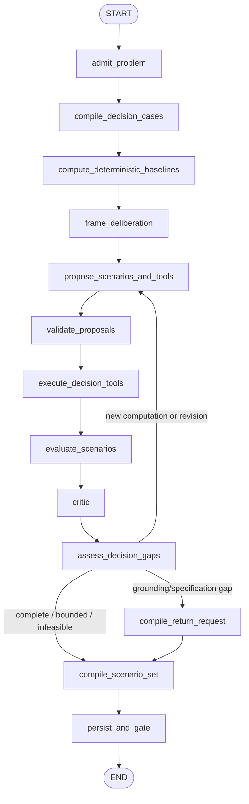
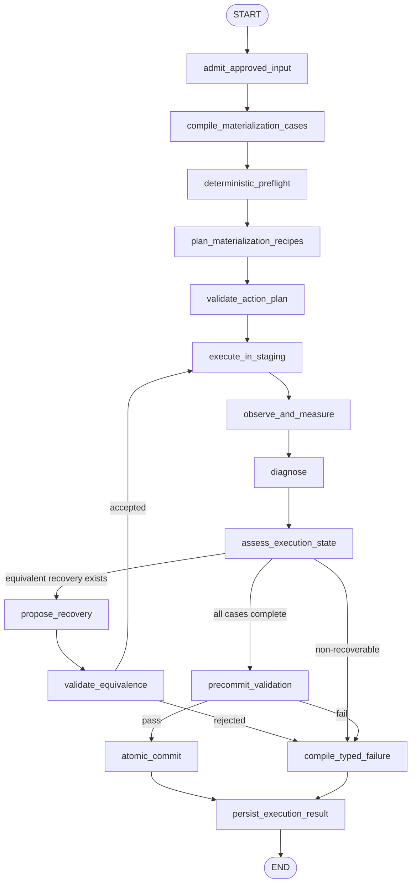

# LLM-Native Planning Deliberation and Constrained Execution

> Status: TARGET
> Authority: Normative SELECT deliberation, solver/tool orchestration, approval, constrained materialization, execution recovery, validation, reconciliation and delivery behavior.
> Current implementation: `../architecture/CURRENT_RUNTIME.md`.
> Related invariants: `00_SYSTEM_DESIGN.md`, `01_CONTRACTS_AND_INVARIANTS.md`, `02_EVIDENCE_AND_GROUNDING.md`, `04_EVALUATION_AND_ACCEPTANCE.md`, `05_MIGRATION.md`.

## 0. Executive decision

SELECT 和 EXECUTE 必须继承 GROUND 的核心范式：充分使用 LLM 的结构化理解、方案构思、联合推理、反证、工具规划和错误诊断能力，同时把运行时身份、精确计算、硬约束、几何写入和正式提交留给确定性组件。

旧设计把 SELECT 近似等同于 `ScenarioOptimizer`，把 EXECUTE 近似等同于无认知能力的 materializer DAG。该边界虽然避免了模型直接写 GIS，却产生了新的问题：

- 求解器只能回答已经被完整形式化的问题，不能主动发现目标遗漏、关系冲突、方案结构和工具选择不合理；
- 固定 optimizer facade 难以覆盖设施、道路、用地组合、分区、生态和开放性构思等异质任务；
- 方案解释被放在求解之后，无法反向触发受控补算、重组或 critic；
- EXECUTE 遇到真实数据形态、拓扑异常或 worker 失败时，只能机械失败，或把恢复逻辑藏进 worker；
- planner、solver、worker 和 recovery 的责任散落在 Python 分支中，checkpoint 看不到真实认知轮次。

因此，本设计作出以下规范决定：

1. SELECT 实现为 `PlanningDeliberationGraph`，而不是一次 `ScenarioOptimizer.solve()` 调用；
2. solver portfolio、GIS analysis、network analysis 和 scenario evaluator 都是 SELECT 可调用的确定性工具；
3. LLM 负责 decision case framing、方案原型、工具计划、跨目标联合推理、trade-off 审议、critic 和推荐理由；
4. LLM 只能引用当前 `GroundedPlanningProblem` 中的闭集 IDs，不能创造候选、坐标、约束通过结论或 source identity；
5. 确定性 validator 负责 candidate membership、硬约束、指标、几何、资源容量、fingerprint 和 SolverCertificate；
6. SELECT 的权威输出仍是一个 `ScenarioSet`，但必须增加 deliberation trace、方案来源和有界完整性说明；
7. EXECUTE 实现为 `ConstrainedMaterializationGraph`，在获批 outcome envelope 内允许 LLM 规划物化 recipe、解释 observation、诊断失败并提出等价恢复；
8. EXECUTE 的恢复只能改变“如何物化”，不能改变“物化什么”；任何候选替换、路线变化、面积变化、语义变化或硬约束放宽都必须回 SELECT/GROUND/HUMAN；
9. 所有模型调用、tool execution、validation、artifact commit 和 graph routing 必须是分离节点；
10. SELECT 与 EXECUTE 都必须具备 information-gain/equivalence gate、预算、checkpoint、resume、幂等和 typed stop semantics。

## 1. Stage ownership and authority

### 1.1 SELECT answers “what coherent plan should be approved?”

SELECT 消费已经接地的闭合问题，但它不是简单地为候选打分。它必须：

- 理解目标、项目包、关系、情景和政策偏好的整体结构；
- 判断哪些目标应联合决策，哪些可以独立求解；
- 选择最小充分的 tool/solver 组合；
- 形成多个结构不同且有意义的方案原型；
- 对每个原型执行确定性可行性和指标计算；
- 根据工具 observation 修订方案，而不是凭语言自信宣称可行；
- 让独立 critic 检查遗漏、单一化、目标替代、证据误用和不公平 trade-off；
- 保留 Pareto alternatives、推荐政策、反事实和不可行解释；
- 在缺失接地输入时提出 typed return request，而不是自行补造事实。

### 1.2 EXECUTE answers “how can the approved outcome be materialized faithfully?”

EXECUTE 消费不可变的 `ApprovedExecutionInput`。它可以智能地选择受允许的物化 recipe、排序依赖、解释工具错误和提出等价修复，但不得重新规划。

审批冻结的是结果语义和允许的变换包络，而不是把每个底层库调用提前写死。只要恢复动作可被确定性证明与获批结果等价，EXECUTE 可以在 staging 内重试；无法证明等价就停止并返回最早责任阶段。

### 1.3 Deterministic authority remains non-delegable

以下权威不得交给 LLM：

- runtime candidate/source feature identity；
- WKT、GeoJSON、坐标和精确 geometry membership；
- hard constraint truth、面积/距离/容量/拓扑计算；
- solver feasible/optimal/bound 状态；
- approved input、scenario、snapshot 和 artifact digest；
- execution equivalence、pre-commit integrity 和 atomic commit；
- ValidationCertificate、ReconciliationReport 和正式 DeliveryManifest。

“充分使用 LLM”不等于让模型替代计算；它意味着让模型持续决定下一步应该问什么、组合什么、调用什么、质疑什么，以及如何解释 observation。

## 2. SELECT contracts

### 2.1 GroundedPlanningProblem admission

SELECT 只接收通过 planning GROUND gate 的 `GroundedPlanningProblem`。输入至少包含：

- admitted targets and project/package relations；
- candidate domains、selection modes 和 candidate geometry refs；
- Bundle/KG/network/demand/shared-resource snapshot refs；
- hard constraints、soft preferences、objectives 和 evaluator refs；
- relation/constraint measurements；
- GeometryRequirement satisfaction；
- uncertainty、unresolved、deferred 和 grounding round refs；
- stable problem fingerprint。

required candidate、geometry、constraint factor 或 relation 未闭合时，不得进入正式 deliberation。允许生成 diagnostic decision case，但不得产生 feasible scenario、推荐或 approval input。

### 2.2 DecisionCase

SELECT 先把问题编译为可审议案件，而不是直接调用一个通用求解器：

```python
class DecisionCase(BaseModel):
    case_id: str
    target_refs: list[str]
    project_package_refs: list[str]
    candidate_domain_refs: list[str]
    relation_refs: list[str]
    constraint_refs: list[str]
    objective_refs: list[str]
    shared_resource_refs: list[str]
    decision_shape: Literal[
        "independent_choice",
        "joint_assignment",
        "network_design",
        "spatial_layout",
        "corridor_design",
        "scenario_composition",
        "mixed",
    ]
    required_tool_capabilities: list[str]
    uncertainty_refs: list[str]
    success_condition: str
    input_digest: str
```

case grouping 可以由 LLM 提议，但必须由 deterministic compiler 验证：共享容量、互斥候选、显式关系或同一项目包不能被错误拆开；无耦合的案件也不得因语言相似被强行合并。

### 2.3 Closed-set ScenarioPrototype

```python
class ScenarioPrototype(BaseModel):
    prototype_id: str
    case_refs: list[str]
    selected_candidate_ids: list[str]
    relation_realization_refs: list[str]
    allocation_intents: list[dict]
    tool_action_refs: list[str]
    scenario_archetype: str
    design_rationale: str
    expected_tradeoffs: list[str]
    unresolved_questions: list[str]
    input_digest: str
```

`ScenarioPrototype` 不是可行方案，也不能进入审批。只有 deterministic evaluator 校验 membership、完成全部工具计算、满足硬约束并生成稳定 fingerprint 后，才能升级为 `PlanningScenario`。

### 2.4 ScenarioSet remains the sole authoritative decision artifact

```text
ScenarioSet
├── PlanningScenario[]
├── feasible_scenario_ids
├── pareto_scenario_ids
├── recommended_scenario_id
├── recommendation_policy and rationale
├── objective definitions and vectors
├── trade-off / counterfactual explanations
├── infeasibility/conflict explanation
├── DecisionDeliberationAudit refs
├── bounded-search statement
└── SolverCertificate[]
```

`SiteSelectionDecision`、worker projection 或自然语言推荐都不是第二权威结果。一个方案可以由多个异质工具共同证明；每个 certificate 必须绑定 problem/scenario/tool/model/version/input digest。

## 3. SELECT as a deliberation subgraph

### 3.1 Parent graph and state


```python
class PlanningDeliberationState(TypedDict):
    invocation_ref: str
    problem_ref: str
    problem_fingerprint: str
    decision_case_refs: list[str]
    round_number: int
    prototype_refs: list[str]
    tool_action_refs: list[str]
    tool_observation_refs: list[str]
    evaluated_scenario_refs: list[str]
    critic_finding_refs: list[str]
    return_request_refs: list[str]
    decision_audit_refs: list[str]
    scenario_set_ref: str | None
    information_gain: float
    budget_ledger_ref: str
    exit_status: str
```

state 只保存 refs。完整 geometry、网络图和大矩阵由工具节点按 ref 水合，不进入 prompt 或 checkpoint；同 stable ID 不同 digest 是冲突，不能 last-write-wins。

### 3.2 Nodes and loop



#### `admit_problem`

- 校验 artifact、branch、snapshot、candidate 和 problem fingerprint；
- 拒绝 provisional/incomplete problem 进入正式路径；
- replay 命中已提交相同 fingerprint 时直接复用；
- 不调用 LLM。

#### `compile_decision_cases`

- deterministic compiler 按 shared resource、relation、project package 和 selection mode 形成 baseline groups；
- LLM 可提出 merge/split proposal 并说明原因；
- validator 确认显式耦合未被拆散、无依据耦合未被引入。

#### `compute_deterministic_baselines`

- 执行 hard filtering、单目标基线、现状/不行动基线和显然 dominated 检查；
- 计算 case size、组合复杂度和可用 tool capabilities；
- 不因 baseline 排名删除仍合法的多样化候选。

#### `frame_deliberation`

LLM 识别目标冲突与协同、scenario archetypes、需要的 solver/GIS/network/simulation tool、上游缺口，以及必须留给人工的价值判断。输出是结构化 framing proposal，不能改变输入契约。

#### `propose_scenarios_and_tools`

- LLM 从闭合 candidate IDs 组合少量有区分度的 `ScenarioPrototype`；
- 同时产生 allowlisted `DecisionToolActionProposal`；
- 每个 action 声明 question、tool capability、input refs 和 expected information gain；
- 不允许自由代码、自由 SQL、坐标、source ID 或未注册 evaluator；
- 方案多样性来自不同空间结构/政策取向，不是同一 winner 的文字改写。

#### `validate_proposals`

验证 candidate membership/input digest、cardinality、all_members、共享容量、关系、tool schema、预算、allowlist 和 idempotency fingerprint。无效 proposal 只返回 typed finding，不执行工具。

#### `execute_decision_tools`

对独立 action 并行执行。工具只消费冻结 refs，返回结构化 observation；区分 infeasible、timeout、provider unavailable、unsupported 和 internal error；结果只增加测量/证明，不静默改写 prototype。

#### `evaluate_scenarios`

- 重算全部 hard constraints、relations、objective vector 和 resource ledger；
- 验证 GIS/network/solver 产物的 geometry/source/snapshot lineage；
- 只有验证通过的 prototype 才升级为 `PlanningScenario`；
- 计算 Pareto、dominance、bound 和反事实；
- 生成一个或多个 `SolverCertificate`。

#### `critic`

critic 独立检查目标/关系/群体/场景遗漏、proxy metric 偷换、方案同质化、选择性忽略反证与不确定性、软硬约束混淆、未探索的结构性替代，以及推荐理由是否由 observation 支持。

critic 可以 reject、要求新工具计算、新 prototype 或 return request；不能宣告 hard constraint 通过，也不能创造 candidate。

#### `assess_decision_gaps`

deterministic assessor 决定下一轮、完成或返回上游。正信息增益至少来自：

```text
new validated scenario structure
new deterministic metric/certificate
new feasible/infeasible result
new Pareto or dominance relation
resolved critic finding
newly isolated upstream grounding/specification gap
```

只有语言理由变化、相同候选重排、重复 tool action 或模型置信度变化不计为信息增益。

#### `compile_return_request`

返回请求必须为以下 typed contract：

- `grounding_required`：candidate、geometry、network、measurement 或 source gap；
- `specification_required`：目标、关系、数量、hard/soft 语义不完整；
- `human_preference_required`：Pareto 之间存在未编码价值判断；
- `problem_infeasible`：带冲突集、搜索边界和最小放宽建议；
- `budget_exhausted` / `provider_unavailable`：保留 bounded-search state。

#### `compile_scenario_set` and `persist_and_gate`

- 编译唯一权威 `ScenarioSet`；
- 推荐只能指向 feasible + validated + Pareto/bounded 集合成员；
- recommendation 可以由 LLM 综合解释，但 membership 与数值必须确定性验证；
- 持久化 rounds、tool observations、critic findings 和 certificates；
- gate 是确定性函数，LLM 不自行结束阶段。

### 3.3 Solver/tool portfolio

`ScenarioOptimizer` 保留为兼容 facade 时，只能路由确定性工具，不能继续代表完整 SELECT：

| 决策形态 | LLM 的认知职责 | 确定性工具 |
|---|---|---|
| 单设施选址 | 识别有意义替代、解释 trade-off、检查 proxy | hard filter、ranking、Pareto |
| 多设施覆盖 | 构造覆盖策略原型、发现公平性遗漏 | facility-location、CP-SAT、distance matrix |
| 用地组合 | 形成项目组合和分期原型、检查共享资源 | MILP/CP-SAT/bounded enumeration |
| 道路连通 | 提出网络策略原型、比较服务与生态影响 | graph search、shortest path、Steiner/heuristic |
| 分区布局 | 提出 layout archetype、识别关系冲突 | topology/adjacency solver、overlay |
| 生态避让 | 解释保护目标与收益代价 | exclusion overlay、constraint evaluator |
| 线性走廊 | 提出 corridor strategy 和对比维度 | cost surface、network/corridor algorithm |
| 混合规划 | 分解/联合 case、协调跨工具 observation | 多工具编排 + cross-case resource validator |
| 开放性构思 | 生成 source-grounded 原型并主动自我批判 | closed-set validation、GIS/solver evaluation |

工具选择由问题形态驱动，不为形式统一强造多目标模型。LLM 可以规划工具序列，但不能伪造 observation。

### 3.4 Budgets and replay

预算至少分为 `case_framing_budget`、`scenario_synthesis_budget`、`decision_tool_budget`、`critic_budget`、`explanation_budget` 和 `format_recovery_budget`。

每个 LLM 调用按完整 input digest 缓存；每个 tool action 按 action fingerprint 幂等；每个 PlanningScenario 按 problem + selections + observations + evaluator versions 指纹化。resume 不得重复已提交的模型或昂贵工具调用。

## 4. Deferral, infeasibility and human authority

显式延期不能对旧方案打补丁。系统必须从原问题生成新的 scoped `GroundedPlanningProblem`，记录 `parent_problem_fingerprint`、`deferred_target_ids`、scope reason 和 source refs，再完整运行 SELECT。旧 ScenarioSet、推荐和 approval 均失效。

infeasible 是正式、可接受的决策结果。它必须包含冲突约束、相关目标、证据引用、solver termination、搜索边界和可选最小放宽；它不能进入审批执行。

人工可以选择 Pareto 方案、声明政策偏好、批准显式证据降级、修改 soft preference、明确修改 hard constraint 或延期目标。人工不能把 invalid candidate、缺失执行几何、solver infeasible 或 stale fingerprint 变成技术有效。

## 5. Approval freezes an outcome envelope

审批从 `ScenarioSet` 选择一个 scenario，生成 `ApprovedExecutionInput`，并冻结：

- selected candidate/source IDs；
- exact approved geometry refs/digests；
- relations、quantities、attributes、land-use semantics 和 resource allocations；
- allowed deterministic materialization recipes；
- allowed topology/precision repair classes；
- numeric/geometry tolerances；
- forbidden substitutions；
- required worker outputs and coverage；
- problem/scenario/snapshot/evaluator fingerprints。

该集合称为 `ApprovedOutcomeEnvelope`。它使 EXECUTE 可以智能选择等价实现路径，同时不能越过批准语义。任何 envelope 内容漂移都使 approval `stale`。

## 6. EXECUTE as a constrained materialization subgraph

### 6.1 Cognitive role

真实 GIS 物化会遇到 multipolygon、invalid ring、precision mismatch、字段差异、拓扑冲突、driver 限制或可恢复 worker error。把恢复散落为 if/else 会不断形成隐式第二规划器。

LLM 在 EXECUTE 中是“受批准包络约束的操作规划者和诊断者”：它读取紧凑 observation，选择注册 recipe，解释失败并提出 typed recovery；确定性 validator 决定 recovery 是否与获批结果等价。

### 6.2 Execution contracts

```python
class MaterializationCase(BaseModel):
    case_id: str
    approved_task_refs: list[str]
    approved_candidate_ids: list[str]
    approved_geometry_refs: list[str]
    required_output_specs: list[str]
    allowed_recipe_ids: list[str]
    equivalence_contract_ref: str
    dependency_refs: list[str]
    input_digest: str

class MaterializationActionProposal(BaseModel):
    case_ref: str
    recipe_id: str
    input_refs: list[str]
    parameter_profile_ref: str
    expected_outputs: list[str]
    rationale: str
    input_digest: str

class ExecutionObservation(BaseModel):
    action_ref: str
    status: Literal["succeeded", "failed", "retryable", "unsupported"]
    output_refs: list[str]
    metrics: dict[str, float]
    diagnostics: list[dict]
    side_effect_digest: str

class RecoveryProposal(BaseModel):
    failed_action_ref: str
    recovery_class: str
    replacement_recipe_id: str
    parameter_adjustments: dict
    expected_equivalence: str
    return_stage_if_rejected: str
```

LLM 不得在 proposal 中携带新坐标、自由 geometry、candidate/source ID 或写操作 body。

### 6.3 Nodes and recovery loop



#### `admit_approved_input`

验证 ScenarioSet/member、problem、approval、baseline、snapshot 和 ApprovedOutcomeEnvelope。stale/missing/provisional 输入在任何 worker 或 LLM 调用前失败；committed fingerprint replay 直接复用。

#### `compile_materialization_cases`

从获批 outcome 形成 facility/road/site/zone/axis/action cases，显式构建依赖和共享 source parcel ledger。同一 source BSM 的多 footprint 可以组成一个资源 case；compiler 不新增 planning member。

#### `deterministic_preflight`

水合并重验 source/geometry/snapshot、面积、CRS、有效性、availability 和 envelope tolerance，枚举 recipe capabilities。单一明确路径允许零 LLM 调用直达 staging。

#### `plan_materialization_recipes`

LLM 依据 case shape、依赖和 capability 选择注册 recipe/顺序；复杂 mixed-worker 批次可被分成 staging waves，但仍只有一次正式原子提交。输出 only IDs + refs + profile，不生成自由执行代码。

#### `validate_action_plan`

验证 recipe allowlist、参数 profile、dependency DAG、幂等 key，以及计划是否覆盖全部且仅覆盖 approved tasks。拒绝 candidate substitution、未批准输出或语义变化。

#### `execute_in_staging` and `observe_and_measure`

tool adapter 在 clone/staging 执行 recipe；每个 action 返回 typed observation、output refs、metrics 和 side-effect digest。异常文本视为数据，完整 geometry 留在 deterministic store，LLM 只看摘要、指标和稳定 refs。

#### `diagnose` and `propose_recovery`

LLM 可以区分 driver/schema/topology/precision/dependency 等失败类别，选择已注册的等价 repair recipe，在 tolerance 内建议精度、切片顺序或序列化 profile，并解释为什么必须返回上游。

LLM 不可以：

- 选择 second-best candidate；
- 改 route/layout/footprint、用途、数量、容量或 target；
- 扩大 approved geometry envelope；
- 放松 hard constraint；
- 从邻接地块、scope、bbox 或 centroid 创建新成员；
- 通过语言重写把不等价恢复描述为等价。

#### `validate_equivalence`

恢复动作必须由确定性 checker 证明：

```text
same approved member identity
same semantic output type and attributes
geometry within approved digest/tolerance policy
same relation and resource allocation
no new side-effect target
all hard constraints remain satisfied
```

任一项无法证明就拒绝恢复并返回 typed failure。

#### `assess_execution_state`

只有新 worker observation、新 validated recovery class、新 dependency resolution 或新 preflight measurement 允许新一轮。重复错误、相同 recovery fingerprint 或纯语言解释变化不构成进展。

#### `precommit_validation` and `atomic_commit`

- 独立检查 selected-to-staged coverage、unexpected outputs、geometry validity、resource ledger 和 lineage；
- 所有 approved tasks 必须在同一正式批次完整成功；
- 一次性提交 `PlannedState` / `ChangeSet`；
- 失败时 staging 标记 `aborted`，不得投影正式结果；
- commit node 不含 LLM 调用，不处于可重复 interrupt 节点。

### 6.4 Budgets and replay

预算至少区分 `recipe_planning_budget`、`diagnosis_budget`、`recovery_budget`、`format_recovery_budget` 和 worker retry budget。模型调用按 observation digest 缓存，recipe/repair action 按 fingerprint 幂等。resume 不得重复已成功的 staging side effect 或正式 commit。

## 7. Validation, reconciliation and repair routing

VALIDATE 从 `ApprovedExecutionInput` 和 committed state 独立重算 hard constraints、关系、数量/容量、selected-to-materialized coverage、unexpected outputs、geometry validity、source/scenario lineage 和 snapshot 一致性。

VALIDATE 不修复结果，只定位责任：

| Finding | Return stage |
|---|---|
| artifact/serialization/topology 物化偏差，获批 outcome 未变 | EXECUTE |
| candidate identity、geometry、measurement 或 source 错误 | GROUND |
| 方案成员、路线、布局或 trade-off 错误 | SELECT |
| 目标、关系、数量或 hard/soft 编译错误 | TARGET_PROJECTION / L3 |
| 无法编码的价值判断或批准变化 | HUMAN |

RECONCILE 对账 PlanningProgram、GroundedPlanningProblem、ScenarioSet、ApprovedExecutionInput、PlannedState 和 ValidationCertificate。DELIVER 只投影同一 run-root、通过验证和对账的成果。

## 8. Worked boundary examples

### 8.1 Facility near a named place

```text
GROUND
  → SearchScopeRef + source-backed eligible parcels
SELECT LLM
  → compact-service / low-impact / balanced prototypes over parcel IDs
SELECT tools
  → accessibility, capacity, exclusion and Pareto observations
SELECT critic
  → rejects proxy-only recommendation and requests fairness metric
ScenarioSet
  → validated alternatives + recommendation rationale
EXECUTE LLM
  → chooses registered facility-footprint recipe
EXECUTE validator
  → proves output equals approved parcel subgeometry
```

LLM 从未创造地点或坐标，但实质参与了方案结构、补算决策、反证和解释。

### 8.2 Road connection

LLM 可以提出“最短连接”“避让优先”“多村公平连接”等 route strategy prototypes，并规划 shortest-path/cost-surface/network tools。实际端点、禁入边、route geometry 和 cost 由冻结网络快照与确定性算法产生。EXECUTE 只能物化获批 route ref；若 driver 无法写入曲线，可在 tolerance 内使用已批准的 densify/segment recipe，不能重新寻路。

### 8.3 Shared source parcel

LLM 可以联合审议同一 BSM 上两个项目 footprint 的分期、组合和公共空间取舍；共享容量和不重叠由 solver 证明。EXECUTE 可以调整切片/写入顺序，但必须生成两个获批 footprint 与统一 preserve remainder，不能恢复成完整 BSM 或吞掉剩余面。

## 9. Stop semantics

SELECT：

```text
scenario_set_complete
scenario_set_bounded
problem_infeasible
grounding_required
specification_required
human_preference_required
provider_unavailable
budget_exhausted
invalid_input_lineage
```

EXECUTE：

```text
committed
aborted_recoverable
aborted_return_ground
aborted_return_select
aborted_human_required
provider_unavailable
budget_exhausted
stale_approval
invalid_input_lineage
```

budget/provider failure 不能伪装成 infeasible、可行、已执行或已验证。

## 10. Observability and metrics

SELECT 至少报告：

```text
decision_cases_total
scenario_prototypes_total
validated_scenarios_total
distinct_scenario_archetypes
decision_tool_actions_by_type
tool_observations_reused
hard_constraint_rejections
critic_findings_total / resolved
rounds_with_positive_information_gain
pareto_scenarios_total
upstream_return_requests_by_type
llm_calls_by_purpose
```

EXECUTE 至少报告：

```text
materialization_cases_total
deterministic_fast_path_cases
recipe_planning_calls
worker_actions_by_recipe
execution_observations_by_status
recovery_proposals_total / accepted / rejected
equivalence_check_failures
repeated_recovery_fingerprints_rejected
selected_to_staged_coverage
unexpected_staged_outputs
atomic_commit_status
```

日志必须能回答：为什么构造这个方案、为什么调用这个工具、observation 如何改变下一轮、critic 拒绝了什么、为什么推荐该 scenario、为什么某次恢复等价或不等价，以及最终由哪个 stage 负责失败。

## 11. Testing strategy

### 11.1 SELECT

- LLM proposal 含未知 candidate/source ID、坐标或 WKT 时拒绝；
- same candidate IDs + changed input digest 时拒绝；
- coupled targets 不得被拆成独立 case；
- alternatives 必须结构不同，除非可证明唯一；
- tool observation 之前不得宣告 hard constraint 通过；
- critic 可触发新计算，但不能创建 candidate；
- identical round 不产生正信息增益；
- feasible、Pareto、recommended 和 certificate membership 一致；
- upstream gap 不生成 formal ScenarioSet；
- checkpoint replay 不重复模型或 solver/tool 调用。

### 11.2 EXECUTE

- deterministic single-recipe case 允许零 LLM 调用；
- complex case 可由 LLM 选择 allowlisted recipe；
- 自由代码、自由 geometry 或未注册 recipe 拒绝；
- candidate substitution、route change、footprint expansion 和 hard-constraint relaxation 拒绝；
- precision/topology repair 只有通过 equivalence checker 才可重试；
- 相同 failure/recovery fingerprint 不重复执行；
- worker 部分成功不生成正式 PlannedState；
- aborted staging 不被 VALIDATE/DELIVER 消费；
- replay 不重复 staging side effect 或 atomic commit；
- selected-to-materialized coverage 为 100%，unexpected count 为 0。

### 11.3 Real-run acceptance

至少使用单设施、多设施/共享地块、道路、分区/生态和 mixed-worker 五类 fixture，并在两个不同村庄运行。每类必须展示真实 LLM framing/prototype/critic 回合（简单 fast path 除外）、真实 deterministic observation、observation-driven revision、同一 lineage、一个可恢复异常和一个必须返回上游的非等价异常，以及无重复副作用的 replay。

## 12. Current implementation replacement map

| Current concept | Target replacement |
|---|---|
| `ScenarioOptimizer` 作为 SELECT 全部智能 | 保留为 deterministic tool facade；新增 `PlanningDeliberationGraph` |
| 固定 task-type 分支直接产出推荐 | LLM framing/prototype/tool plan → deterministic evaluation → critic loop |
| 单个 `SolverCertificate` | 支持多 tool certificate，由 ScenarioSet 汇总 |
| explanation after solver | explanation/critic 成为 observation-driven loop |
| `ExecutionPlan` 作为完全机械投影 | ApprovedOutcomeEnvelope 下的 validated recipe plan |
| worker 内隐式 recovery | observation → diagnosis → typed recovery → equivalence validation |
| worker 决策或静默 fallback | 删除；不等价变化返回 GROUND/SELECT/HUMAN |
| static per-worker fan-out | 统一 scheduler/tool registry 按 dependency cases 调度 |

目标文件组织：

```text
backend/app/domain/select/subgraph.py
backend/app/domain/select/subgraph_state.py
backend/app/domain/select/nodes/{admit,cases,frame,propose,tools,evaluate,critic,assess,compile,persist}.py
backend/app/domain/select/tools/{registry,solver,gis,network,simulation}.py
backend/app/domain/execute/subgraph.py
backend/app/domain/execute/subgraph_state.py
backend/app/domain/execute/nodes/{admit,cases,preflight,plan,validate,execute,observe,diagnose,recover,equivalence,commit,persist}.py
backend/app/domain/execute/recipes/{registry,geometry,parcel,road,facility,zone}.py
```

## 13. Final invariants

```text
INV-S01  SELECT is a deliberation graph; no single solver or LLM call is the whole decision stage.
INV-S02  LLM scenario proposals reference only current closed candidate IDs and input digests.
INV-S03  Only deterministic evaluators establish hard-constraint, metric, geometry and solver truth.
INV-S04  Every formal PlanningScenario descends from a validated prototype and tool observations.
INV-S05  ScenarioSet is the sole authoritative SELECT artifact and preserves alternatives, critique and bounds.
INV-S06  A new deliberation round requires new computation, validated structure, resolved critique or typed upstream gap.
INV-S07  LLM may recommend only among deterministically feasible scenarios; approval remains explicit authority.
INV-S08  Deferral creates a new scoped problem and invalidates old scenarios and approval.
INV-X01  EXECUTE may choose and repair method only inside ApprovedOutcomeEnvelope.
INV-X02  EXECUTE never changes approved member, geometry semantics, route/layout, quantity, capacity or hard constraints.
INV-X03  Every recovery is typed, allowlisted, fingerprinted and deterministically proven equivalent.
INV-X04  Model calls, tool execution, equivalence validation and commit are separate nodes.
INV-X05  Formal PlannedState requires one atomic commit after 100% approved-task coverage.
INV-X06  Repeated failure/recovery fingerprints cannot create fake progress or repeated side effects.
INV-X07  Non-equivalent recovery returns to the earliest responsible stage; it is never hidden in a worker fallback.
INV-X08  Replay cannot repeat committed model, solver, worker, external or atomic-commit side effects.
```

## 14. Definition of done

- SELECT 真实执行 framing → prototype/tool planning → deterministic observation → evaluation → critic/assess 的有界循环；
- LLM 能发现遗漏、提出结构不同方案、选择工具、根据新 observation 修订并解释 trade-off；
- 所有候选身份、坐标、硬约束和证书仍由确定性边界控制；
- solver portfolio 是工具层，不再等同于 SELECT；
- ScenarioSet 保留 prototype/round/tool/critic lineage 和 bounded-search statement；
- ApprovedOutcomeEnvelope 明确冻结结果语义和允许恢复包络；
- EXECUTE 对复杂批次真实执行 recipe planning、observation、diagnosis 和等价 recovery；
- deterministic happy path 可以零 LLM 调用；
- 不等价恢复全部返回上游，没有 worker 内重新选址、重新寻路、自由 geometry 或静默 fallback；
- staging、atomic commit、validation、reconcile 和 replay 完整性测试通过；
- 至少两个村庄、五类规划任务和 mixed-worker fresh run 证明该架构不是金田村专用流程。

只有达到这些条件，SELECT 和 EXECUTE 才能像新的 GROUND 一样，既真正使用 LLM 的智能，又不牺牲空间身份、可计算约束和正式交付的可审计性。
