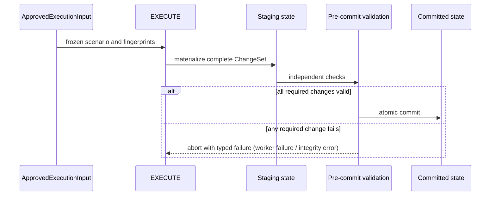

# Planning and Execution

> Status: TARGET
> Authority: Normative planning, optimization, approval, materialization, validation, reconciliation and delivery behavior.

## 1. From evidence to formal planning problem

L3 的 `PlanningProgram` 定义目标、理由、关系、数量、优先级和期望结果；TARGET_PROJECTION 将它编译成原子 typed targets 和可计算要求；GROUND 绑定真实候选、几何、网络、约束因子和证据，形成求解器的封闭输入 `GroundedPlanningProblem`。

形式化问题必须区分：

- decision variables：选择哪些候选、分配多少容量、建立哪些关系；
- hard constraints：任何正式可行方案都必须满足；
- soft preferences：允许权衡并以 penalty/score 表达；
- objectives：需要最小化或最大化的可解释指标；
- uncertainty：数据误差、推断几何或情景参数；
- scope：候选全集、baseline、snapshot、时间与空间范围。

求解器不能读取未绑定的自由文本并自行补充问题定义。

### 1.1 Planning content hierarchy and executable admission

L3 不是“把报告里的每句话变成任务”的解析器。`PlanningProgram` 必须区分 evidence statement、indicator、constraint、objective、scenario archetype、project package、spatial intervention 和 non-spatial action。项目包是规划管理单元，空间干预才是候选的执行单元。

TARGET_PROJECTION 只接收通过 target admission 的空间干预。准入至少要求：

- 指回项目包和原始 claim/source refs；
- 明确干预类型及其是否需要 point/line/polygon/network materialization；
- 有位置要求、候选生成规则或已知空间对象引用；
- 有可验证的数量、关系或完成条件；
- 与单纯事实、指标、约束、目标和非空间治理行动明确区分。

未通过准入的内容不是被丢弃，而是继续作为证据、目标函数、约束依据、情景说明或非空间交付项。系统不得采用“所有非 action claim 都是 spatial intervention”的默认规则。

## 2. Candidate generation and ownership

候选召回和身份归 GROUND；候选组合和方案选择归 ScenarioOptimizer。GROUND 可以按确定性硬前提排除不可能成员，但必须记录排除原因。对需要整体保留的 `all_members`，求解器不能将成员误当成互斥备选；`choose_subset` 必须有明确 cardinality 或容量依据。

候选闭合后生成 problem fingerprint。此后任何成员、几何、属性、constraint factor 或 snapshot 改变都形成新问题版本，并使旧 ScenarioSet 和批准失效。

### 2.1 Parcel availability and subgeometry invariant

候选必须把“源地块身份”和“规划可用面”分开表达：

- `fully_unavailable`：源地块在当前约束、避让或 setback 下没有可执行面积；不得只因为仍有源 BSM 就进入 EXECUTE；
- `partially_available`：源地块只有一部分可用，候选几何必须是裁切后的 footprint，同时保留 `source_area_ha`、`eligible_area_ha`、`excluded_area_ha`、`planning_area_ha`、`coverage_ratio` 和 remainder 诊断；
- `fully_available`：整块源地块可作为候选，但仍不能把候选身份与源 BSM 混为一谈；
- `unknown`：没有足够的裁切/约束事实时只能诊断或等待补证，不能假定整块可用。

面积契约还必须满足 `0 <= planning_area_ha <= eligible_area_ha <= source_area_ha`（当对应字段存在）；`excluded_area_ha` 不得超过 `source_area_ha`。这不是展示字段，而是 SELECT 共享容量和 EXECUTE 子几何物化的硬边界，任何违反都必须在候选契约处拒绝，不能交给 worker 兜底。

大地块的候选切割属于 GROUND/SUITABILITY 的确定性几何派生，不得在 EXECUTE 恢复成完整 BSM。EXECUTE 只物化获批 footprint，并把剩余面作为同一源地块的 preserve/remainder 变更；邻接 BSM 和邻接证据随任务、变更集和 PlannedState 传递，但“相邻”本身不是合并或改写授权。只有显式的 typed adjacency/topology relation 和对应 worker task 才能把周围地块纳入同一执行范围，并且必须在 SELECT/approval 中冻结其成员与几何。

## 3. Hard constraints, soft preferences, and objectives

硬约束来源可以是有证据的法规、L3 明确不可违反的业务要求或可验证的空间/容量条件。软偏好表达成本、美观、便利、公平、复用等可权衡目标。每个 ConstraintSpec 必须引用语义来源、证据和 evaluator，不得仅凭 prompt 文字决定是否满足。

objective vector 的定义来自 L2/L3，指标编译来自 TARGET_PROJECTION，可测数据来自 GROUND，方案值由 ScenarioOptimizer 计算。权重只用于声明的推荐策略，不能抹去原始多维值和 Pareto 关系。

## 4. ScenarioSet and Pareto alternatives

ScenarioOptimizer 是现有 SELECT 阶段的目标内核，不是并列的新顶层阶段。它只消费 `GroundedPlanningProblem`，输出：

```text
ScenarioSet
├── PlanningScenario[]
├── feasible_scenario_ids
├── pareto_scenario_ids
├── recommended_scenario_id
├── recommendation_policy
├── objective definitions and vectors
├── infeasibility/conflict explanation
└── SolverCertificate
```

每个 PlanningScenario 保存 target selections、feature intents、relation satisfaction、objective vector、findings、status 和 fingerprint。`ScenarioSet` 是 SELECT 唯一权威产物；`SiteSelectionDecision` 不属于目标架构，迁移完成后必须删除，不能长期作为第二决策结果或 worker 输入。

当 SELECT/HUMAN 明确把目标写入 `DeferralLedger` 时，系统不得只修改旧的
`SiteSelectionDecision` 或 `ExecutionPlan`。SELECT 必须从原始问题生成一个新的 scoped
`GroundedPlanningProblem`：移除已延期目标及其候选域、几何、绑定和相关关系，保留
`parent_problem_fingerprint`、`deferred_target_ids`、`scope_reason` 与 source refs，再以
该 scoped problem 重新运行 `ScenarioOptimizer`。新的 `ScenarioSet`、`PlanningScenario`
和 `ApprovedExecutionInput` 必须绑定新的 problem fingerprint；旧 approval 不能沿用。
这一步是“剩余目标可独立规划和执行”的必要条件，不是对旧方案的局部打补丁。

A single weighted winner is not a sufficient planning product. 系统至少要保留非支配替代、关键 trade-off、推荐策略和未推荐原因。规模受限时可返回有界子集，但必须说明枚举/搜索范围、截断规则和 bound status。

An infeasible result is a valid outcome when it carries a constraint-conflict explanation. 它应包含冲突约束、相关目标、证据引用、是否存在最小放宽和求解终止状态；不可行结果不得进入审批执行。

## 5. Solver and external critics

ScenarioOptimizer 可以使用穷举、MILP/CP-SAT、图算法、启发式或组合流程，但必须提供稳定输入、确定性 seed 或可重放设置、模型 digest、solver version、停止状态和可行性复核。

外部模型或 LLM critic 可以解释 trade-off、检查目标遗漏和生成供人工阅读的对比，不得：

- 覆盖硬约束 evaluator；
- 创造 candidate 或 coordinates；
- 删除“不好看”的可行方案；
- 把无可行解改写成推荐方案；
- 修改 SolverCertificate。

SolverCertificate 证明的是“给定问题和模型怎样被求解”，不证明需求或候选在开放世界绝对完整。

### 5.1 Solver portfolio and materializer boundary

ScenarioOptimizer 是稳定的决策门面和结果汇总器，不是要求所有村庄、所有目标都运行同一个多目标优化模型。它根据问题结构选择最小充分后端：

| 问题 | 主要决策后端 | 进入求解器前必须由 GROUND 提供 |
|---|---|---|
| 单设施选址 | hard filtering + deterministic ranking / Pareto | 候选、指标、排除原因 |
| 多设施覆盖 | facility-location / CP-SAT | 候选、需求点、容量和距离矩阵 |
| 用地组合 | MILP / CP-SAT / bounded enumeration | 地块身份、面积、兼容性和政策因子 |
| 道路连通 | graph search、shortest path、Steiner/network heuristic | 网络快照、端点、成本和禁入边 |
| 分区布局 | adjacency/topology constraint solver | 可用面、邻接矩阵和拓扑规则 |
| 生态避让 | GIS overlay + hard exclusion，再做方案比较 | 生态敏感图层、缓冲规则和可用域 |
| 线性走廊 | network/corridor algorithm | 端点、网络或成本面、避让因子 |
| 小规模人工候选 | deterministic Pareto | 有限候选和可解释指标 |
| 开放性空间构思 | LLM 方案原型，随后重新 grounding 和确定性求解/校验 | 真实底图、约束、已有要素和可用范围 |

LLM 适合提出方案原型、发现遗漏目标和解释 trade-off；它不能代替候选身份、硬约束 evaluator、最短路/覆盖/拓扑计算或可重复的可行性证明。多目标优化只在存在真实冲突的多个可测目标时启用；简单问题使用过滤、排序或单一确定性算法，不为形式统一强造 objective vector。

当前网络关系的最小生产输入约定为：`PlanningContext` 从权威 `roads_current` 构建 `network:road:current` 的 `NetworkGraphSnapshot`；road typed claim 的 `road_parameters.connects` 由 TARGET_PROJECTION 编译为 `typed_road_endpoint` relation，GROUND 只有在该快照存在时才绑定 `ConnectParameters`，不能用邻近线或文本路名猜端点。L3/GROUND 仍必须产出可执行的 typed endpoint/reference 和（coverage 时）`DemandSnapshot`，并在参数中显式引用相同 ref。Context 只接受明确命名的 `demand_points`/`population_demand` 图层，且每个点必须有 `demand_id`、数值 `demand_value` 与 `demand_unit`；现状注记、人口表和设施数量不会被猜成需求点。`network_relation_bounded` 只消费这些冻结输入，缺任何一项就保持 `unknown/diagnostic-only`，不得退化成单设施选址。

任何会比较替代、选择 candidate membership、决定 route/layout 或改变规划结果的算法都必须在批准之前完成。EXECUTE 内的 facility、road、site-area 等 worker 必须重构为 materializer：输入是已冻结的 candidate IDs 和 geometry refs，输出是可审计的 ChangeSet；它们不得自行选址、寻路或布局。

## 6. Approval and immutable execution input

审批门从 ScenarioSet 选择一个 scenario，冻结为 `ApprovedExecutionInput`。该契约至少绑定：PlanningProgram、GroundedPlanningProblem、ScenarioSet、selected PlanningScenario、被选 candidate IDs、获批 geometry refs/digests、baseline/snapshots、允许的确定性物化容差、approval actor/time/policy 和各自 fingerprints/digests。

批准后出现任何内容漂移都使输入 `stale`，必须重新求解或重新批准。审批可以选择 Pareto 方案或改变政策偏好，但不能批准违反硬约束的方案。

EXECUTE 只接受 `ApprovedExecutionInput`。`ExecutionPlan` 是从该输入机械投影出的 materializer DAG，不是独立的规划决策源；无法从获批候选和几何完整生成 DAG 时，必须在 worker 启动前失败。

## 7. Atomic materialization

EXECUTE 在 staging/clone 状态中准备批准输入允许的 ChangeSet，materializer worker 逐项报告 approved candidate/geometry 输入引用、输出 feature 和失败。只有当所有获批任务均可物化且 pre-commit 检查通过时，才一次性提交正式 PlannedState。若业务决定延期目标，必须先形成新的 scoped problem、ScenarioSet 和 ApprovedExecutionInput；EXECUTE 不接受包含 deferred task 的正式批次。

生产执行图只保留 `approval_boundary → route_tasks → prepare_inputs → task_scheduler → merge_worker_results → geometry_materialize → planned_state_builder → execution_review` 八个可达节点。`task_scheduler` 按 `ExecutionPlan` 的依赖批次调用 site/zone/facility/axis/road/action materializer；同一源 BSM 的获批 `site_footprint` 任务可在一个 worker 调用内合并，以便只生成一个容量/剩余面账本，其他 worker 类型保持任务隔离并在 merge 阶段汇合。旧的“每类 worker 一个 LangGraph 节点/静态并行 fan-out”不再是生产路径，避免形成第二执行入口。

staging 必须持久化为 `ExecutionStaging` artifact：它记录 approved input、ExecutionPlan、各个 `staged_*` child refs、worker 成败、commit ID 和诊断。`status=committed` 才能把 child refs 投影到正式 `ExecutionResult`；`status=aborted` 只能供诊断和恢复审计，不能被 VALIDATE/DELIVER 当作正式 PlannedState 输入。



EXECUTE explicitly forbids re-selecting a location（禁止重新选址）, substituting a second-best candidate, changing objectives, retrieving new planning evidence or partially committing an official state. 无法物化时返回 typed failure，由路由送回 GROUND、SELECT 或人工门。

## 8. Independent validation and repair routing

VALIDATE 从获批输入和已物化状态独立重算：硬约束、关系、数量/容量、selected-to-materialized coverage、意外产物、geometry validity、source/scenario lineage 和 snapshot 一致性。它同时生成详细 `ValidationReport` 和简洁可门控的 `ValidationCertificate`。

ValidationCertificate 至少关联 approved input、scenario、baseline、PlannedState digests，并报告 hard violation count、覆盖率、lineage consistency 和 accepted/rejected。VALIDATE 不得直接修复结果；它只定位最早责任阶段：物化偏差回 EXECUTE，候选/测量错误回 GROUND，模型约束错误回 TARGET_PROJECTION/L3，方案错误回 SELECT。

RECONCILE 对账 PlanningProgram、GroundedPlanningProblem、approved scenario、PlannedState 和 ValidationCertificate，发现目标遗漏、成员丢失、版本串联或未经批准的替换。SolverCertificate、ValidationCertificate 和 ReconciliationReport 分别证明求解、物化和跨阶段覆盖，不能互相替代。

## 9. Delivery and replay

DELIVER 只投影已通过验证和对账的同一 run-root 成果，生成地图图层、报告、导出和 `DeliveryManifest`。正式 manifest 必须引用 approval、scenario、PlannedState、ValidationCertificate 和 ReconciliationReport。缺失/失败证书、任何仍在获批执行集合中的 deferred task，或未通过对账的运行只能产生 diagnostic-only manifest，不能产生正式或 `partial` 交付。业务延期必须先回到 scoped problem，重新求解并审批一个本身完整的新批次；延期目标被排除在这个新批次之外时，剩余批次可以形成受控的 `partial` 交付，但必须明确 `statutory_complete=false`，并且不能把延期目标计入已规划成果。

Replay 在相同输入、solver 设置、baseline 和 snapshot 下必须保持关键 fingerprints 稳定。恢复执行不得调用旧的隐式 `latest`，不得混用其他 run 的 artifact，也不得在没有新批准时重新执行已提交 worker。

## 10. Forbidden shortcuts

- GROUND 直接输出 final location 或 recommended scenario；
- SELECT 同时维护多个相互覆盖的权威选择对象；
- 只返回单一加权 winner，不保留 Pareto/trade-off；
- 求解器创建 coordinates 或静默改变 source membership；
- 将 unresolved hard constraint 降级为 warning 后继续执行；
- EXECUTE 从 `SiteSelectionDecision`、自由 dict 或旧 artifact 猜测执行输入；
- EXECUTE 失败后自行 re-select / 重新选址；
- 用未显式 deferred 的部分 worker 成功构造正式 PlannedState；受控 partial 批次只能包含 scoped problem 中明确保留、且在同一 approved task set 内完整成功的 worker，不能把未纳入批次的延期目标伪装成已完成；
- VALIDATE 修改几何或方案使自己通过；
- DELIVER 拼接不同 snapshot/run-root 的地图、报告和导出。
