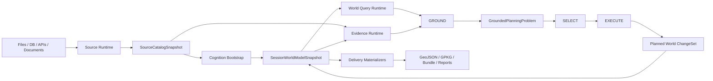
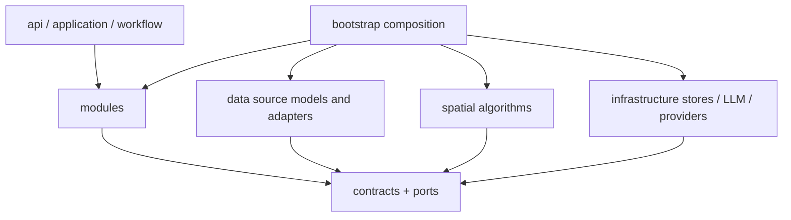
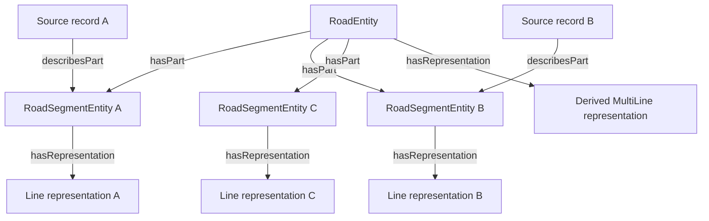

# 07 认知世界模型与动态 GIS 语义架构

> Status: TARGET
>
> Authority: 本文件是 Source Data、GIS 语义认知、实体解析、多空间表示、Session KG、实体检索和 GROUND 重构的专项详细设计。`00_SYSTEM_DESIGN.md` 继续拥有业务主链；`01`—`06` 继续拥有各规划阶段语义。本文件对其中涉及 Bundle/KG/GIS Feature identity、空间检索和接地实现边界的内容提供更具体的规范；发生冲突时，本专项范围内以本文件为准。

## 1. 目标与核心决策

系统必须能够接受未知文件名、未知图层名、未知字段名、混合几何、多几何字段和多个来源版本，在不要求用户预先准备 KG、不要求数据符合 `VillageBundle`、不要求存在 BSM 的前提下，形成可查询、可追溯、可修订的会话世界模型。

核心决策如下：

1. 预建 KG 可以不存在；一次规划会话进入 L1 以前，必须建立 `SessionWorldModelSnapshot`。KG 是该快照的主要语义存储实现，不是 Bundle 的索引副本。
2. GIS 文件中的一条记录是 `SourceFeatureRecord`，不是默认等同于现实实体。现实或规划世界中的道路、地点、设施、地块、河流等是 `WorldEntity`。
3. Geometry 不是实体身份。一个实体可以有多个 `SpatialRepresentation`；多个源记录可以描述同一个实体；一个源记录可以描述实体部件或提供一种空间表示。
4. Bundle、BSM、固定 layer key 和固定字段名只能作为兼容来源信息，不能出现在新的核心查询、身份或业务模块契约中。
5. LLM 负责候选语义排序、字段/图层含义提议和闭集消歧；源身份、实体合并、几何、拓扑、约束和 KG 提交由确定性校验与事务控制。
6. Evidence 负责“依据是什么”；Cognition 负责“世界中有什么、它们是什么关系”；GROUND 负责“规划语言中的对象应绑定到哪个实体及哪种空间表示”。三者不得再次混为一个巨型索引。

## 2. 术语与禁止混用

### 2.1 核心术语

| 术语 | 定义 | 稳定身份 |
|---|---|---|
| `SourceDatasetSnapshot` | 一次读取的数据集版本，例如 GPKG、GDB、GeoJSON、数据库或 OGC API 数据集 | `source-dataset://.../{digest}` |
| `SourceCollectionSnapshot` | 数据集中的表、图层、Collection 或逻辑记录集 | `source-collection://.../{collection_id}` |
| `SourceFeatureRecord` | Collection 中的一条不可变源记录，保留源字段和源记录号 | `source-record://.../{source_feature_id}` |
| `SourceGeometryRecord` | 源记录某个几何字段中的几何值；记录字段、CRS、digest 和来源 | `source-geometry://.../{geometry_field}` |
| `SemanticAssertion` | 对类型、属性、关系、身份或表示角色的有来源陈述 | `assertion://.../{uuid}` |
| `WorldEntity` | 现实世界或规划世界中被系统认知的对象 | `entity://.../{stable_uuid}` |
| `EntityPart` | 一个实体具有独立拓扑或表示的组成部分，例如道路段 | 独立 `entity_ref`，并以 `partOf` 关联整体 |
| `SpatialRepresentation` | 实体在特定用途、时间、比例尺或精度下的空间表示 | `representation://.../{uuid}` |
| `SessionWorldModelSnapshot` | 当前 session 已接受实体、表示、关系、断言和来源链的不可变视图 | `world-model://{session}/{version}/{digest}` |

`SourceFeatureRecord` 在代码中不得简称为 `Entity`；`WorldEntity` 在代码中不得使用 `feature_bsm` 作为主键。需要引用 OGC 术语时，`WorldEntity` 可建模为 `geo:Feature`，`SpatialRepresentation` 可建模为 `geo:Geometry`；源记录仍是本系统单独定义的 provenance 对象。

### 2.2 身份层级

```text
source_record_ref  = 数据来源内身份，只在 source snapshot 内稳定
representation_ref = 空间表示身份，可被替换、派生、版本化
entity_ref          = 世界实体身份，不依赖某个文件、图层或几何
artifact_ref        = 工作流产物身份，不等于以上任何一种身份
```

BSM、FID、OBJECTID、文件行号和第三方 POI ID 都记录为 `SourceIdentifier`。只有明确的权威标识规则可以把它们提升为实体解析强特征；任何一个来源标识都不能无条件成为 `entity_ref`。

### 2.3 禁止使用 `owl:sameAs` 作为普通合并操作

实体解析必须使用可撤销的断言：

```text
candidateDescribes
describes
describesPart
candidateEquivalent
partOf
hasRepresentation
derivedFrom
conflictsWith
supersedes
```

两个来源记录被接受为描述同一实体时，保留两个 Source Record 和两条 `describes` 断言，不破坏性合并源节点。身份判断被推翻时，只需 supersede 对应断言并重建世界模型快照。

## 3. 当前实现证据与结构性问题

本节是对当前工作树的 Observed 记录，不代表目标设计已经实现。

### 3.1 Data 层

| 当前事实 | 代码证据 | 影响 |
|---|---|---|
| `SessionDataSnapshot` 必须从 Bundle 生成 | `data/model/snapshot.py:82-105` | 非 Bundle 来源不能成为一等 session 输入 |
| Snapshot 固定识别 landuse、road、water、annotation 等输出名 | `data/model/snapshot.py:13-50`、`:139-174` | Collection 发现并非开放世界 |
| `SpatialFeature` 只有一个 `geometry` 字段 | `data/model/base.py:8-24` | 无法表达一个源记录的多个几何字段 |
| 未知 layer 被路由为 `inferred`，未知几何默认落到 polygons | `data/model/canonical.py:72-98` | 未知不再是“未识别”，而被提前赋予容器语义 |
| Bundle 将 BSM 描述为跨 GIS、KG、GROUND、SELECT 的身份 | `data/model/canonical.py:376-405` | 来源标识、世界实体和求解资源身份耦合 |
| ingestion 需要固定 `_CLASS_MAP` | `data/ingestion/ingest.py:486-529` | 新图层通常需要修改 Python 类和映射 |
| 非地类 Feature 只保留 label-bearing 的有限属性 | `data/ingestion/ingest.py:554-578` | 任意业务字段在认知前已经丢失，LLM 无法再判断 |

现有 `GIS_LAYER_REGISTRY`、typed spatial models、编码字典和 crosswalk 仍有价值，但其目标角色应调整：它们是“已知 Source Profile 和领域映射提示”，不是 ingestion 接纳清单或世界本体。

### 3.2 KG 层

| 当前事实 | 代码证据 | 影响 |
|---|---|---|
| `ensure_session_kg` 从 Bundle 恢复/构建 | `infrastructure/kg/session_kg.py:160-209` | KG 无法从通用来源目录建立 |
| 没有 `landuse_current` 时拒绝注册 Session KG | `infrastructure/kg/session_kg.py:193-205` | 道路、设施或其他专题会话无法进入认知主链 |
| `KGBuilder.build_from_bundle` 直接调用固定专题 builder | `infrastructure/kg/builder/builder.py:31-42`、`:125-156` | KG 是 Bundle 语义的复制，而不是来源认知结果 |
| `EntityIdPolicy`、`EntityTypes`、`BusinessFeatureSelector` 是 Python 闭集 | `infrastructure/kg/ontology.py:90-224`、`:331-389` | 新实体概念需要代码发布 |
| `SpatialKGEntity` 只有一个 `geometry_wkt` | `infrastructure/kg/spatial_store.py:21-35` | 同实体多表示无法成为一等模型 |

当前 KGManager 的 session 隔离、version bump、查询缓存、RDFLib 本地实现和 PostGIS adapter seam 应保留；需要替换的是 Layer-1 的构建输入、实体/几何数据模型及 mutation 边界。

### 3.3 Evidence 与 GROUND

| 当前事实 | 代码证据 | 影响 |
|---|---|---|
| Retriever 路由以 `KG`、`BUNDLE` 等技术来源为一等枚举 | `evidence_runtime/retriever_router.py:15-109` | 业务查询仍知道存储技术 |
| Bundle retriever 固定 scope→layer 别名 | `evidence_runtime/retrievers/bundle_retriever.py:17-24` | 新 layer 无法动态参与空间检索 |
| Feature contract 的核心身份仍叫 `BundleFeatureIdentity` | `contracts/evidence/feature_identity_contracts.py:13-43` | Source Record 与 Entity 未彻底分离 |
| source semantic 只收集 facility/road/water | `evidence_runtime/source_semantic_runtime.py:144-177` | LLM 语义识别仍是专题闭集 |
| PlaceEvidenceIndex 会原地合并名称、坐标、BSM、几何与 evidence | `evidence_runtime/index/place_evidence_index.py:1684-1971` | 候选召回、实体解析和证据融合不可独立审计或回退 |
| SpatialResolver 强制接收同时含 workspace 与 kg 的 PlanningContext | `spatial/grounding/resolver.py:225-264` | GROUND 依赖具体运行容器而不是端口 |
| Ground 多处把最终候选过滤回 current parcel BSM | `spatial/grounding/resolver.py:804`、`:2970-2997` | 非地块、多表示、道路拓扑目标不能自然接地 |

复杂度也已经成为重构依据，而不是单纯代码风格问题：当前 `evidence_graph.py` 约 4083 行、`place_evidence_index.py` 约 2714 行、`ground/application.py` 约 1938 行、`spatial/grounding/resolver.py` 约 3054 行、Evidence facade 约 1802 行。这些文件混合多个独立事务，无法用继续增加 alias 和条件分支保证泛用性。

### 3.4 已发现的依赖倒置问题

当前代码中还存在以下跨层导入：

- Data ingestion adapters 导入 `infrastructure.kg.dlq`；Data 的失败模型因此由 KG infrastructure 拥有。
- `data/ingestion/compiler/spec_mapper.py` 导入 Evidence Runtime 的 source binding 实现。
- `modules/target_projection/requirement_compilation.py` 导入 Data ingestion compiler。
- `modules/ground/reference_resolution.py` 直接导入 Evidence Runtime stores。
- `spatial/grounding/resolver.py` 直接导入 EvidenceGraph 实现。
- EXECUTE 多个 worker 直接取得 `KGManager` 或调用 KG layer builder。

目标架构必须通过 contracts/ports 解决这些依赖，不能仅把文件搬到新目录。

## 4. 目标系统上下文



### 4.1 启动顺序

```text
Session source registration
→ SourceCatalogSnapshot freeze
→ schema/profile discovery
→ initial semantic mapping
→ entity resolution and representation assembly
→ SessionWorldModelSnapshot commit
→ PlanningContextRef commit
→ L1 and downstream stages
```

世界模型允许部分认知：某些 Collection、字段或记录可以处于 unresolved；但 session 必须有可追溯的 source graph 和 world-model snapshot。是否允许进入某个业务阶段由 capability gate 决定，不再用“是否存在 landuse_current”作为全局 gate。

例如只有道路数据时，系统可以提供道路实体检索和网络能力，但 `parcel_assignment` solver capability 明确缺失。

## 5. 依赖方向与所有权



规则：

1. `contracts/cognition/` 拥有 Source、Entity、Representation、Assertion、Query、Commit 和 Snapshot 的跨边界契约。
2. `modules/cognition/` 拥有 schema understanding、entity resolution、representation assembly 和 world commit 的业务规则。
3. `data/` 拥有来源读取、原始记录保存、结构剖析和 source snapshot；它不导入 KG、Evidence 或 GROUND。
4. `spatial/` 拥有几何校验、拓扑、聚合和空间运算；它接受 geometry/representation ports，不接受 VillageBundle。
5. `infrastructure/cognition_runtime/` 实现 KG/RDF/PostGIS 存储、索引和事务；它不拥有实体解析业务决策。
6. `modules/evidence/` 拥有证据需求、coverage、sufficiency；`infrastructure/evidence_runtime/` 实现 provider 执行。
7. `modules/ground/` 只依赖 EvidenceFacade、WorldModelQueryPort、RepresentationSelectionPort 和 SpatialOperationPort。
8. 只有 composition root 可以同时认识 module port 和 infrastructure implementation。

## 6. Source Data 目标模型

### 6.1 SourceCatalogSnapshot

Data 层必须从任意 reader 生成统一目录：

```python
class SourceCollectionProfile(BaseModel):
    collection_ref: str
    source_name: str
    field_profiles: tuple[SourceFieldProfile, ...]
    geometry_fields: tuple[SourceGeometryFieldProfile, ...]
    feature_count: int
    crs_refs: tuple[str, ...]
    bounds: tuple[float, float, float, float] | None
    schema_digest: str
    content_digest: str

class SourceFeatureRecord(BaseModel):
    source_record_ref: str
    collection_ref: str
    source_feature_id: str
    attributes_ref: str
    geometry_refs: tuple[str, ...]
    content_digest: str
```

完整原始属性存入 `SourceAttributeStore`，`SourceFeatureRecord` 只保存 `attributes_ref`，避免当前把每个大属性字典复制进 Pydantic feature 的内存问题。字段 profile 保存类型、空值率、唯一率、长度/数值范围、枚举样本和可能的标识特征。语义 classifier 按需读取受限样本，但检索仍可访问全部原始属性。

### 6.2 多几何字段

```python
class SourceGeometryRecord(BaseModel):
    geometry_ref: str
    source_record_ref: str
    geometry_field: str
    geometry_kind: str
    crs: str
    geometry_digest: str
    storage_ref: str
    valid: bool
    validation_findings: tuple[str, ...]
```

一个源记录允许零个、一个或多个 `geometry_ref`。Geometry 缺失不导致属性记录被丢弃；Geometry 无效也只隔离该表示，不销毁源属性。

### 6.3 Queryables

每个 Source Collection 发布运行时 `CollectionQueryables`：

```text
property name
physical type
nullable / unique
observed range or enum sample
semantic mappings and their states
indexed capabilities
geometry fields and CRS
```

调用者可以使用 canonical property，也可以显式检索未提升的 raw property。查询不存在的字段必须返回 `unknown_property`，不能静默映射到另一个固定字段。

### 6.4 既有 Data 能力的去向

| 当前能力 | 目标角色 |
|---|---|
| `GIS_LAYER_REGISTRY` | Known Source Profile registry；为候选语义提供先验，不阻止未知 Collection |
| `spatial_types.py` | 已确认概念的可选 typed projection，不再是所有 ingestion 的入口类型 |
| encodings/crosswalks | 确定性语义校验器与候选映射，不在读取时丢弃不认识的值 |
| `VillageBundle` | `BundleSourceAdapter` 和 `BundleMaterializer`；不再是 canonical model |
| `SessionDataSnapshot` | 演进为通用 SourceCatalog manifest；digest 覆盖所有 Collection、属性和几何字段 |
| `SpatialWorkspace` | 演进为 geometry/representation workspace；不得暴露 points/lines/polygons 固定组 |

## 7. Cognition 认知流水线

### 7.1 两个必须分开的任务

Schema understanding 解决：

- Collection 是实体记录、实体部件、关系、观测、栅格还是辅助表；
- 字段对应名称、类型、代码、时间、量值、关系或来源标识中的哪一个概念；
- Geometry 字段更可能承担 locator、extent、centerline、boundary 或其他表示角色。

Entity resolution 解决：

- 两条 Source Record 是否描述同一实体；
- 一条记录是否描述另一个实体的部件；
- 多条线段是否组成同一道路；
- 点定位和多个面是否属于同一地点实体。

两者使用不同 contract、candidate set、validator 和 decision snapshot，不能由一个 source-label classifier 同时完成。

### 7.2 Schema understanding

```text
SourceCollectionProfile
→ deterministic known-profile matching
→ ontology/property candidate retrieval Top-K
→ LLM closed-set rank / abstain
→ type/value/geometry consistency validators
→ SourceSemanticMappingSnapshot
```

LLM 输出只能引用输入中的 `collection_ref`、`field_name`、`candidate_concept_ref` 和 `candidate_property_ref`。输出未知引用、与物理类型冲突或把 geometry 字段当普通标量时，proposal 被拒绝。

每个决定保存：

```text
source snapshot digest
profile digest
candidate vocabulary digest
prompt version
model id and effective parameters
raw response digest
validator findings
accepted / ambiguous / unresolved / rejected
```

### 7.3 Entity resolution

候选生成按强到弱使用：

1. 权威外部 ID 和已接受的 SourceIdentifier mapping；
2. 行政范围内的规范编号；
3. concept-compatible 的规范名/别名；
4. 空间 blocking；
5. 拓扑与关系上下文；
6. 时间版本兼容性。

候选判断按组进行，并在提交前进行全局一致性检查。LLM 可以输出 `same_entity`、`part_of`、`different`、`ambiguous`、`abstain`；不能输出新的 entity ID。`IdentityService` 只在 accepted cluster 没有既有实体时生成稳定 UUID。

实体解析结果保留为 assertion，实体 cluster 是 assertion 的可重建 projection。不能原地把两个 PlaceEvidenceEntry 混成一个不可逆对象。

### 7.4 道路实体装配



线段属于同一道路需要名称/编号/类型兼容、端点连通或有证据支持。简单空间相邻不够。聚合表示必须记录 member representation refs、排序、容差、CRS 和 aggregation method。

道路整体、道路段、道路中心线、道路用地面、道路红线、道路路线和路网边是不同概念；允许它们以 relation 连接，禁止因为共享名称或部分几何就合并。

### 7.5 同一地点的多表示

```text
PlaceEntity
├── representation(role=locator, kind=Point)
├── representation(role=label_anchor, kind=Point)
├── representation(role=physical_extent, kind=Polygon)
├── representation(role=administrative_extent, kind=MultiPolygon)
└── representation(role=service_extent, kind=Polygon)
```

表示附带：

```text
role
geometry kind
source/derived status
authority
valid time
scale/resolution/accuracy
CRS
source record refs
derivation activity ref
validation state
```

只有验证通过且跨多数用途确有稳定首选时才声明 default representation。业务计算必须声明 purpose 或 representation requirement。

## 8. Session World Model 与 KG

### 8.1 图分区

一个 Session KG 至少包含五个逻辑分区或 Named Graph：

| Graph | 内容 | 允许状态 |
|---|---|---|
| `source` | Dataset、Collection、Source Record、raw attribute refs、source geometry refs | observed |
| `assertion` | schema、identity、type、property、relation proposals 和验证结果 | proposed/accepted/ambiguous/rejected/superseded |
| `world` | accepted 的实体、部件、表示和关系 projection | accepted |
| `intent` | L3/TARGET_PROJECTION 的规划目标、需求与约束 | accepted/pending |
| `planned` | EXECUTE 提交的规划实体、规划表示和变更关系 | staged/accepted/superseded |

来源 graph 不因为 assertion 状态变化而被改写。World graph 由 accepted assertions 投影生成，可以确定性重建。

### 8.2 存储边界

`PlanningKG`/RDFLib 可以演进为本地 `WorldModelStore` adapter；PostGIS 保留生产空间索引实现。新的存储端口至少提供：

```python
class WorldModelQueryPort(Protocol):
    def query_entities(self, query: EntityQuery) -> EntityQueryResult: ...
    def get_entity(self, entity_ref: str) -> WorldEntity | None: ...
    def get_representations(
        self, entity_ref: str, requirement: RepresentationRequirement
    ) -> tuple[SpatialRepresentation, ...]: ...
    def query_relations(self, query: RelationQuery) -> RelationQueryResult: ...
    def trace_sources(self, refs: tuple[str, ...]) -> SourceTraceResult: ...

class WorldModelCommitPort(Protocol):
    def commit(self, changeset: WorldModelChangeSet) -> SessionWorldModelSnapshot: ...
```

Business module 不得取得裸 RDF graph、KGManager 或执行 SPARQL string。SPARQL 是 adapter 内部实现。

### 8.3 Snapshot 和事务

一次 commit 的 parent 必须同时包含：

```text
source_catalog_digest
previous_world_model_digest
semantic_mapping_snapshot_digest
entity_resolution_snapshot_digest
changeset_digest
```

并发写使用 session-scoped single writer；读者只读取 immutable snapshot。commit 成功后再 bump world-model version 并使 entity、relation、representation 查询缓存失效。失败不得留下部分 accepted graph。

### 8.4 能力而不是固定实体类型

稳定的 upper ontology 只包含 `Entity`、`EntityPart`、`SpatialRepresentation`、`Observation`、`Assertion`、`Relation`、`PlanningIntent`、`PlannedEntity` 等少量概念。道路、设施、风险点、控制范围等通过可扩展 `ConceptRef` 表达。

业务模块按 capability 查询：

```text
network_edge
distance_source
candidate_site
legal_extent
prohibited_overlap
service_origin
terrain_surface
```

未知概念可以成为 provisional concept；在被映射到已知 capability 前，它仍可按 raw 属性、名称和空间范围检索，但不能参与要求该 capability 的确定性业务计算。

## 9. 检索模块重构

### 9.1 两个查询平面

检索必须拆成两个明确平面：

1. `WorldModelQuery`：查实体、关系、属性和合适的空间表示。
2. `SourceEvidenceQuery`：查原文、源记录、raw 字段、报告、外部资料及 provenance。

EvidenceFacade 可以编排两个平面并形成统一 packet，但不能再把 `BUNDLE`、`KG` 暴露为业务 source family。内部 provider 路由可保留 `RetrieverKind`，它只属于 infrastructure。

### 9.2 查询契约

```python
class EntityQuery(BaseModel):
    query_text: str = ''
    concept_refs: tuple[str, ...] = ()
    required_capabilities: tuple[str, ...] = ()
    names: tuple[str, ...] = ()
    spatial_filter: SpatialFilter | None = None
    relation_filters: tuple[RelationFilter, ...] = ()
    valid_time: str = ''
    limit: int = 20

class RepresentationRequirement(BaseModel):
    purpose: str
    roles: tuple[str, ...]
    geometry_kinds: tuple[str, ...]
    valid_time: str = ''
    target_crs: str = ''
    accepted_only: bool = True
```

返回结果以 `entity_ref` 聚合，每个 entity candidate 携带 representation candidates、supporting assertion refs 和 source refs。Source records 不因为名称相同直接折叠为一个 candidate。

### 9.3 动态字段检索

Canonical property 查询优先使用 accepted semantic mappings；raw property 查询使用 SourceAttributeIndex。查询结果必须标记：

```text
canonical_match
raw_property_match
proposed_mapping_match
full_text_match
spatial_match
relation_match
```

`proposed_mapping_match` 不能单独满足法定约束或执行输入。

### 9.4 索引拆分

当前 EvidenceGraph/PlaceEvidenceIndex 应拆成：

```text
EntityNameIndex
EntityPropertyIndex
SourceAttributeIndex
RepresentationIndex
TopologyIndex
AssertionIndex
ProvenanceIndex
```

索引都是 world-model snapshot 的 projection，不在查询时改变 entity cluster。所有索引以 `world_model_digest` 和对应 source/index digest 为 cache key。

### 9.5 Evidence Packet V2

空间证据 packet 至少包含：

```text
world_model_snapshot_ref
source_catalog_snapshot_ref
entity_candidates
representation_candidates
relation_evidence
source_record_refs
source_spans
assertion_refs
candidate_total / cursor
coverage / sufficiency
ambiguity and missing capabilities
query trace
```

`bundle_snapshot_digest`、`bundle_feature_bsm` 和 `geometry_authority=bundle` 仅保留在 V1 adapter 输出，不能进入 V2 canonical contract。

## 10. GROUND 彻底重构

### 10.1 GROUND 的新边界

GROUND 不负责：

- 从源文件构建世界实体；
- 合并两个 Source Record；
- 决定字段/图层语义；
- 选择 KG 或 Bundle provider；
- 创建 source ID、entity ID 或 geometry；
- 把任意地点强制转成 parcel BSM。

GROUND 负责：

1. 把 mention 或 planning target 编译为 `EntityQuery` 与 `RepresentationRequirement`；
2. 从已版本化世界模型召回实体候选；
3. 基于当前目标语义闭集消歧；
4. 为具体 operation 选择表示；
5. 校验 relation、constraint、geometry 和 capability；
6. 形成可供 SELECT 消费的候选闭集和显式 unresolved 状态。

### 10.2 两个入口共享同一核心

```text
L1 LocationMention
→ EntityGroundingService
→ GroundedEntityBindingSnapshot

Planning GroundingRequest
→ EntityGroundingService
→ RepresentationSelectionService
→ RelationGroundingService
→ CandidateDomainAssembler
→ GroundedPlanningProblem
```

L1 入口只提交 mention-to-entity binding；它不会构造规划候选。Planning 入口可以复用 L1 binding，但必须按当前 world-model version 验证，不能把旧 binding 当永久真值。

### 10.3 表示选择算法

`RepresentationSelectionService` 按以下确定性顺序排序：

1. representation role 与 purpose 的兼容性；
2. assertion 是否 accepted；
3. authority；
4. valid time；
5. geometry kind；
6. CRS 转换可用性；
7. accuracy/scale/resolution；
8. topology completeness；
9. derived representation penalty；
10. stable representation ref 作为最后排序键。

角色不明确时，LLM 只能从请求已给的 role candidates 中选择或 abstain。它不能根据视觉合理性修改几何。

### 10.4 Ground 状态机

每个 subject 独立记录：

```text
unresolved_query
entity_candidates
entity_ambiguous
entity_selected
representation_candidates
representation_ambiguous
representation_selected
constraint_checked
grounded
deferred
rejected
```

迭代 key 为：

```text
subject_ref
world_model_digest
entity_query_fingerprint
representation_requirement_fingerprint
candidate_set_digest
```

新 Evidence 不能直接改变 Ground 结果。若新来源足以改变世界认知，应先通过 Cognition 提交新的 world-model snapshot，GROUND 再对未闭合 subject 重查。这样能明确区分“证据增加”和“实体世界发生更新”。

### 10.5 Ground 目标文件职责

```text
modules/ground/
├── application.py                 # 两个入口和 artifact transaction
├── request_compiler.py            # GroundingRequest → query contracts
├── entity_grounder.py             # mention/target entity selection
├── representation_selector.py     # purpose-aware geometry representation
├── relation_grounder.py           # relation and topology requirements
├── constraint_evaluator.py        # hard/soft constraint result
├── candidate_domain_assembler.py  # GroundedPlanningProblem
├── recovery.py                    # bounded unresolved-only retry
├── validation.py                  # artifact invariants
├── ports.py
└── projections.py
```

`spatial/grounding/` 只保留纯空间算法，例如方向、拓扑和 geometry operation helper；不再持有 PlanningContext、EvidenceGraph、KG 或 LLM。

### 10.6 Ground 输出身份

新的 binding 和 candidate 至少包含：

```text
entity_ref
representation_ref
source_record_refs
assertion_refs
world_model_snapshot_ref
selection decision ref
relation evidence refs
constraint findings
uncertainty and status
```

Parcel BSM 可以出现在 `source_identifiers` 或兼容字段中，但 SELECT 的核心资源键改为 `representation_ref` 或显式 `resource_ref`。只有 parcel solver adapter 可以要求某个来源体系的 parcel identifier。

## 11. 对规划阶段的影响

| 阶段 | 新输入/输出边界 |
|---|---|
| L1 | 事实的 subject 可以是已知 `entity_ref` 或 unresolved mention；事实可触发新的 assertion proposal，但 L1 不直接改 world graph |
| L2 | 通过 capability/entity query 获取道路、设施、约束、地形等；不得读取固定 layer |
| L3 | 只表达规划语义、目标、关系和 representation purpose；不创建几何 |
| TARGET_PROJECTION | 编译 EntityQuery/RepresentationRequirement；通过 intent changeset 写 intent graph，不直接调用 KG builder |
| GROUND | 选择实体和表示，形成 closed candidate domain |
| SELECT | 消费 resource refs、representation refs 和约束结果；特定 solver adapter 才读取来源 alias |
| EXECUTE | 产生 PlannedEntity、PlannedRepresentation、PlannedRelation 的 changeset；不直接调用 KGManager |
| VALIDATE | 校验 planned graph、world graph、source lineage、geometry 和约束的一致性 |
| DELIVERY | 从 representation/materialization registry 输出 GeoJSON/GPKG/Bundle；输出格式不反向约束模型 |

## 12. PlanningContext 重构

当前 PlanningContext 同时持有 Bundle、KG、Gazetteer、ConstraintIndex、EvidenceGraph 和各类 mutable sidecar。目标 Context 只保存稳定引用和 ports：

```python
@dataclass(frozen=True)
class PlanningContext:
    session_id: str
    version: int
    source_catalog_snapshot_ref: str
    source_catalog_digest: str
    world_model_snapshot_ref: str
    world_model_digest: str
    capability_snapshot: CapabilitySnapshot
    ports: PlanningPorts
```

大对象和 mutable index 由 runtime 生命周期管理，通过 snapshot ref 访问。Workflow checkpoint 持有 context ref，不序列化裸 KG 或 Bundle。

Context bootstrap 的 fail condition 改为：

- source snapshot 无法建立；
- world-model transaction 无法提交；
- snapshot digest 不一致；
- 当前阶段声明的 required capability 缺失。

“Bundle 缺失”和“landuse_current 缺失”不再是全局失败条件。

## 13. LLM 使用边界

### 13.1 允许的 LLM transaction

| Transaction | 输入闭集 | 输出 |
|---|---|---|
| schema mapping | collection/field profile + Top-K concept/property candidates | candidate ref 或 abstain |
| entity matching | blocked source-record groups + existing entity candidates | same/part/different/ambiguous |
| Ground entity selection | target semantics + entity candidates | selected refs/ambiguous/abstain |
| representation-role selection | purpose + representation candidates | selected representation ref/abstain |

### 13.2 统一校验

所有 transaction 必须：

- `extra='forbid'`；
- exact candidate membership；
- source/world snapshot digest；
- normalized input digest；
- raw output digest；
- prompt/model/version；
- provider failure和 abstain 明确区分；
- 无法重放时不进入 accepted graph。

LLM 禁止生成 ID、坐标、WKT、geometry、source field、未经输入的 concept 或执行参数。

## 14. 性能与可扩展性

### 14.1 避免大对象复制

- 原始属性使用 attribute store + ref；
- Geometry 使用 geometry store + ref；
- Prompt 只读取 profile、候选和受限属性样本；
- KG 不复制完整 GeoJSON properties；
- Evidence Packet 不嵌入 geometry body；
- GROUND 只在执行空间运算时按 representation ref 取 geometry。

### 14.2 索引与 blocking

- Collection schema index；
- raw attribute inverted index；
- entity name/alias index；
- concept/capability index；
- representation bbox/R-tree 或 PostGIS GiST；
- topology adjacency index；
- source-to-entity reverse index；
- assertion status/provenance index。

所有 cache key 必须含 snapshot digest。LLM entity resolution 只能处理 blocking 后的小候选组，不允许全量两两比较。

## 15. 兼容边界

迁移期保留三种 adapter：

```text
BundleSourceAdapter:
    VillageBundle → SourceCatalogSnapshot

LegacyEvidenceAdapter:
    V2 Entity/Representation result → V1 FeatureEvidenceRef

BundleMaterializer:
    WorldModelSnapshot → VillageBundle / legacy GeoJSON keys
```

adapter 必须显式标记 `compatibility_projection=true`。核心模块不得通过 adapter 反向取得 Bundle。兼容输出可以继续包含 BSM；world model 必须能追溯生成该输出的 entity/representation/source refs。

## 16. 验收不变量

### 16.1 Data 和 cognition

1. 随机修改图层与字段名后，SourceCatalog 仍完整保存结构与原始值。
2. 未知 Collection 不落入 `inferred polygons`；其状态保持 unknown/unresolved。
3. 一个源记录的多个几何字段全部保留。
4. 无预建 KG、无 Bundle、无 BSM 时仍能生成 SessionWorldModelSnapshot。
5. LLM 不可用时 source graph 可建立，未确认语义保持 unresolved。

### 16.2 实体和表示

6. 多个连续线段可解析为一个道路整体及多个 RoadSegment 部件。
7. 同名但空间/编号冲突的道路不自动合并。
8. 一个地点可以同时绑定点、多个面和不同时间表示。
9. 表示选择按 purpose 变化，不能总是取第一个 geometry。
10. 身份合并可撤销，Source Record 永不丢失。

### 16.3 Retrieval 和 Ground

11. 业务 request 不包含 `bundle`/`kg` provider selector。
12. 任意 raw 属性可检索，并能区分 raw match 与 accepted semantic match。
13. Ground 结果含 entity_ref、representation_ref、world-model snapshot 和 lineage。
14. Ground 不依赖 `current_parcels()`，道路/点/多面目标可走同一核心。
15. 新证据先形成新的 world-model snapshot，再改变未闭合 Ground 结果。
16. ambiguous/unresolved 不会被 SELECT 当作 executable candidate。

### 16.4 依赖和退场

17. `data/` 不导入 `infrastructure.kg` 或 `infrastructure.evidence_runtime`。
18. `modules/ground/` 和 `spatial/` 不导入 EvidenceGraph、KGManager 或 Bundle。
19. EXECUTE 通过 WorldModelCommitPort 写 planned graph。
20. 删除 V1 Bundle reader 后，核心 session→GROUND→SELECT 流程仍能运行；Bundle 仅在兼容测试中出现。

## 17. 外部设计依据

- [OGC GeoSPARQL 1.1](https://opengeospatial.github.io/ogc-geosparql/geosparql11/document.html)：Feature/Geometry 分离、一个 Feature 多个 Geometry、空间查询与 SHACL validation。
- [OGC CityGML 3.0 Conceptual Model](https://docs.ogc.org/is/20-010/20-010.html)：现实对象、组成部件、拓扑关系、多 LOD/多空间表示。
- [GDAL Vector Data Model](https://gdal.org/en/stable/user/vector_data_model.html) 与 [RFC 41](https://gdal.org/en/stable/development/rfc/rfc41_multiple_geometry_fields.html)：运行时 Schema、任意字段和多个 Geometry field。
- [OGC API Features Part 3](https://docs.ogc.org/is/19-079r2/19-079r2.html)：Queryables 的动态属性发现。
- [W3C PROV-O](https://www.w3.org/TR/prov-o/)：来源实体、处理活动、派生和责任链。
- [ReMatch](https://arxiv.org/abs/2403.01567)：检索缩小 Schema candidate space，再由 LLM 排序。
- [GER-LLM 官方实现](https://github.com/luck-seu/GER-LLM)：空间 blocking、LLM group matching、图一致性冲突消解。

## 18. 完成定义

本设计完成不是指新目录存在，而是：

```text
任意来源被无损注册
→ schema/field semantics 可提议、校验、持久化
→ Source Record 与 World Entity 严格分离
→ 多来源、多部件、多表示进入 Session KG
→ Evidence 按实体与来源两个平面检索
→ Ground 按实体和表示 purpose 接地
→ SELECT/EXECUTE 不依赖 Bundle/BSM/KG 实现细节
→ 所有结果可按 snapshot 和 assertion 回溯、重放、撤销
```

具体文件迁移、双轨发布、测试和退出条件见 `08_COGNITIVE_WORLD_MODEL_MIGRATION.md`。

## 19. 三 Provider 外源证据采集约束

行政基线和 L1 地名检索必须分别保存，且按 provider 隔离缓存：

```text
output/map_validation/<provider>/<stage>/
├── cache/
├── raw_responses/
└── runs/<run_id>/
    ├── attempts.jsonl
    ├── requests.jsonl
    ├── normalized_all.jsonl
    ├── retained_candidates.jsonl
    └── rejected_candidates.jsonl
```

外源请求状态必须区分：

- `success_nonempty`：接口执行成功并返回记录；
- `success_empty`：接口执行成功、响应可解析且明确返回零条记录；
- `missing_capability`：已确认公开接口不提供该能力，例如任意底图文字标签枚举；
- `not_attempted`：本次按计划跳过，或因凭证/前置条件不足没有发起请求；
- `failed`：已尝试但发生网络、限流、HTTP、服务或参数错误。

`failed` 必须保留 attempt 轨迹并进行有界重试；`success_empty`、`missing_capability` 和 `not_attempted` 都不得被解释为实体不存在。成功响应默认按 endpoint、脱敏参数和 provider/stage 复用缓存；失败响应不能阻塞后续重新尝试。

坐标规则为：AMap 请求/返回点按 GCJ-02 保存，并只转换一次到 WGS84 后参与本地空间判断；腾讯按官方 `lat,lng` 请求顺序并显式使用 `coord_type=wgs84`，归一化为 GeoJSON 的 `[lon,lat]`；天地图搜索/WFS 按官方 lon/lat 与 CGCS2000/WGS84-compatible 约定保存。Polygon 请求使用 provider 要求的坐标系，本地 boundary/bundle 判断统一使用 WGS84。

三家 provider 的外源返回只属于 Source Evidence。它们可以为道路、水系、设施和地点候选提供观测、行政、名称、类型、路线或 WFS 证据，但不能单独创建 WorldEntity、完整道路几何或完整河流几何。Evidence 只能在范围过滤后的闭集候选中排序或弃权；GROUND 只能绑定已有实体/表示，外源证据若改变世界认知，必须先提交新的 world-model snapshot。

详细官方能力矩阵见 `docs/design/three-provider-external-evidence-capability-matrix.md`。

## 20. 外源缓存迁移与额度保护

旧版外源采集缓存迁移到统一格式时，迁移器只能做离线投影，不得因为字段格式变化重新请求 provider。迁移必须保留：

- 原始 `response_json`，包括 provider 错误码和空结果；
- 脱敏后的 URL、参数、请求键和来源运行；
- `success_nonempty`、`success_empty`、`missing_capability`、`not_attempted`、`failed` 五态；
- 正式运行与无 manifest 的中断运行之间的完成度差异；
- GCJ-02 原始点与只转换一次得到的 WGS84 本地判断点。

统一 cache envelope 必须包含统一采集器读取所需的 `status`、`record_count`、`coordinate_contract` 和 `raw_response`，使同一 provider、endpoint 和脱敏参数可以直接复用旧响应。迁移过程的 `api_calls` 必须为 `0`。

旧缓存没有覆盖的新统一请求只能进入 gap 报告，不得在迁移过程中隐式补发。后续补采集必须由明确的请求计划驱动，并在成功缓存、失败重试和成功空响应之间继续遵守五态规则；失败不能改写成缺失，未发起也不能改写成缺失，缺失也不能证明实体不存在。筛选后的候选可以写入 Evidence，但不能由外源响应直接创建 WorldEntity 或 GROUND 几何。

## 21. 外源检索的未来融合架构

外源地图服务的价值不应被压缩为“给 LLM 看的文本”，但也不能让 provider 响应越过 Data、Evidence 和 Cognition 边界直接变成 KG 实体或 GROUND 几何。它们应被建模为有坐标、有范围、有接口语义、有时间和有失败状态的外部观测源。注意要充分利用api的参数和字段不要遗漏官方文档中的功能实现，保持缓存机制，避免浪费额度。

### 21.1 四种对象，不混用职责

```text
ExternalCollectionPlan
    ↓ provider adapter / cache / retry
ExternalObservationSnapshot       Data 层
    ↓ 脱敏、坐标归一化、范围分类、字段保全
ExternalCandidateRecord            Data → Evidence 投影
    ↓ 闭集 blocking、规则校验、可选 LLM 排序
ExternalEvidenceClaim              Evidence 层
    ↓ 与本地 SourceCatalog/KG/文档关系联合认知
EntitySupportProposal              Cognition 层
    ↓ 仅提交经过验证的支持关系
WorldEntity / SpatialRepresentation
    ↓
GROUND 绑定已有 representation，不创建 provider 几何
```

四类对象的边界如下：

| 对象 | 所属层 | 可以表示 | 不可以表示 |
|---|---|---|---|
| `ExternalCollectionPlan` | Data 输入契约 | 要查的 endpoint、参数、stage、范围和 query plan digest | 现实实体已经存在、接口一定支持某能力 |
| `ExternalObservationSnapshot` | Data 持久化 | raw response、HTTP/API 状态、retry、原始坐标、脱敏参数、请求来源 | `金田河` 已经等于某个水面、POI 一定是项目实体 |
| `ExternalEvidenceClaim` | Evidence | “provider 在某请求范围返回了某名称/类型/点”“逆地理在某采样点返回某道路名”“路线步骤经过某道路名” | 完整道路/河流几何、跨 provider 主键、不可撤销的身份合并 |
| `EntitySupportProposal` | Cognition/World Model 写入前 | 支持、别名、冲突、候选成员、待人工核验及置信度向量 | 没有本地候选时凭空创建 BSM/geometry |

Data 层应该保存外源的全量可审计响应；Evidence 层只建立可检索的结构化投影；Cognition 层才判断外源观测如何支持本地实体；GROUND 不应该直接调用地图 API，也不应该依赖 provider 的请求格式。

### 21.2 行政基线和 L1 的可信度不是同一个问题

第一阶段行政基线可以具有很高的 `acquisition_confidence` 和 `administrative_observation_confidence`，例如结构化地理编码明确返回“广东省—梅州市—平远县—泗水镇—金田村”，且请求和返回坐标符合 provider 契约。这足以作为高质量的行政与范围证据。还有本地的数据是缺乏地名到几何的构造的，这一步可给实体提供足够的名称供LLM理解。

但它不等于本地 GIS 边界的 `geometry_authority`。本地 `boundary.geojson` 仍是项目几何的权威来源；外源行政响应最多作为边界解释、范围过滤和坐标锚点。坐标归一化后，返回的名称别名等应该是可信的，同一坐标（范围内）应该是同一实体。

第二阶段 L1 地名检索也可以对以下命题给高 `semantic_observation_confidence`：

```text
某 provider 在某个梅州市范围请求中返回了名称 N；
返回记录具有类型 T、地址 A、坐标 P 或道路/路线字段 R。
```

但它对以下命题不能自动给高置信：

```text
N 就是当前文档中的那个现实实体；
P 就是该实体边界或质心；
某个 POI 点就是一条完整道路或一条完整河流；
一次路线 polyline 就是道路实体的全部几何。
```

所以不能给行政阶段和 L1 阶段各自设置一个单独的“可信/不可信”总分，更不能因为 API 是官方 provider 就直接等同于本地 GIS。至少要分开记录：

1. `acquisition_confidence`：请求是否成功、是否有完整 raw、是否经历失败/重试、坐标和参数是否符合契约；
2. `semantic_observation_confidence`：返回是否明确表达名称、类型、层级、道路或水系关系；
3. `entity_binding_confidence`：与本地 source feature、文档约束、KG 关系、空间位置和其他 provider 的一致程度；
4. `geometry_authority`：该几何是本地/规划矢量权威，还是 API 代表点、最近道路点、路线观测或无几何的底图文字。

推荐的证据等级为：

| 观测 | `semantic_observation_confidence` | `entity_binding_confidence` 的默认起点 | `geometry_authority` |
|---|---|---|---|
| 结构化行政编码与行政树 | 高 | 中；仍需与本地项目边界核对 | 外源行政解释，不替代本地边界 |
| 精确 POI ID、类型、地址和坐标 | 中高至高 | 中；同名、范围和时间仍需核验 | 代表点/POI 几何 |
| 输入提示或地理编码的地点名称 | 中高 | 低至中；父级命中不能绑定子地点 | 地址/名称锚点 |
| 逆地理道路名/最近道路点 | 高（对查询点附近道路命题） | 中；多个采样点和本地走廊才能聚合 | 道路观测，不是完整线 |
| 路线步骤和 polyline | 中高（对一次路线经过命题） | 中；只能验证连通/经过 | 路线观测，不是道路全集 |

### 21.3 高德最大化公开 API 采集边界

高德 POI 2.0 官方明确限制同一组参数最多通过分页获取 200 条记录，单页最多 25 条。因此 AMap 的“最大化采集”不是一个行政 Polygon 请求，而是一个可审计的自适应查询计划：

```text
行政树/结构化地址
    → 项目及外扩 Polygon
    → 顶级 typecode 分片
    → 达到 200 条时细类型分片
    → 仍达到上限时空间网格分片
    → POI ID 去重、范围分类和详情补充
```

Polygon、Around 和文本搜索都必须记录 `provider_limit`、分页数量、是否触及 200 条上限及 `coverage_status`。达到上限而未完成子类型或空间分片时，只能标记 `partial_requires_type_sharding` 或 `partial_requires_spatial_sharding`，不能标记为全量。Around 请求可以使用 `region=441400&city_limit=true` 减少梅州市外记录占用返回名额，但项目 Polygon 和本地 WGS84 边界仍必须进行二次过滤。

高德结构化地理编码、输入提示、逆地理和路线接口属于不同语义的观测：输入提示和地理编码提供名称/地址锚点，逆地理的 `roads`、`roadinters`、`pois`、`aois` 提供采样点附近的结构化观测，路线步骤和 polyline 只证明一次路线的经过关系。它们不能枚举任意底图文字，也不能直接生成完整道路、河流或村界几何。

高德响应的 Data adapter 必须保留完整 raw payload 和可选字段；Evidence 只读取经范围过滤的 `ExternalCandidateRecord`。高德请求/返回坐标按 GCJ-02 保存，只有在 Data→本地空间判断边界转换一次到 WGS84；详情接口每次最多 10 个 ID，并使用官方规定的 `|` 分隔。失败重试和成功空响应都必须在 `ExternalObservationSnapshot` 中可审计，不能用 `success` 布尔值替代状态机。

### 21.4 天地图全量采集器的实现边界

天地图专用采集器位于 `scripts/collect_tianditu_full.py`，输出到：

```text
output/map_validation/tianditu_full/<stage>/
```

它按官方地名搜索 V2.0 的能力组织请求，而不是把一个关键词循环误称为全量搜索：

```text
行政编码/行政边界发现
    → queryType=14 统计基线
    → queryType=12 行政区划搜索
    → queryType=13 行政区 + bbox + 分类搜索
    → queryType=10 Polygon 分类搜索
    → queryType=1/2/7 局部普通、视野、地名补漏
    → WFS GetCapabilities / DescribeFeatureType / GetFeature
    → 本地 WGS84 边界裁剪与覆盖对账
```

天地图官方文档明确规定搜索分页 `count` 最大 300，服务端总数据超过 500 条会返回数据量溢出；多边形输入超过 20 个经纬度点会返回参数越界。因此新采集器先按类别、行政范围和空间分片，再分页，并将超过限制的任务记录为 `partial_requires_sharding`，不能把一次 300 条响应宣称为全量。[天地图地名搜索服务 V2.0](https://lbs.tianditu.gov.cn/server/search2.html)

Polygon 查询使用 WGS84-compatible 经纬度，复杂本地边界先保拓扑简化到 20 点以内作为 provider 查询面，精确边界仍由本地 WGS84 Polygon 做二次过滤。简化查询面只是请求覆盖工具，不改变本地边界权威性。

WFS 不等于底图注记枚举。采集器先发现公开图层和字段，再按 bbox 读取公开矢量要素；未公开为 WFS 要素、仅在视觉底图中渲染的文字，仍只能作为人工/半自动 `LabelObservation`，不能通过该采集器伪造为 POI 或几何。

旧版 `scripts/collect_three_provider_validation.py` 在 provider 为 `tianditu` 时转发到该专用采集器；旧天地图缓存只按完全相同的脱敏请求键离线复用，未命中请求才进入新计划。这样可以让三 provider 统一命令保持可用，同时不把旧版不完整的行政查询结果冒充新采集器的完整覆盖。
| 多 provider 同名同点 | 观测交叉支持 | 中高的候选排序特征，不能当主键 | 仍由本地几何决定 |
| 底图可见文字但无公开结构化返回 | 仅观测 | 低至中，取决于本地锚点和文档 | 无几何主张 |

### 21.5 两阶段的依赖顺序

行政阶段应可以在 L1 之前运行，因为它只需要行政输入、项目边界和 bundle 采样点。它产生的是稳定的 `scope_snapshot` 和 provider capability baseline。

L1 阶段产生地点 mention 后，才可以生成名称级 `ExternalCollectionPlan`。这在架构上是合适的，但必须通过不可变 artifact/port 传递，而不是让 Data 模块反向 import L1 或让 GROUND 临时拼接字符串：

```text
已知行政输入
  → 行政 ExternalCollectionPlan
  → scope ExternalObservationSnapshot
  → L1Snapshot.location_mentions
  → 名称 ExternalCollectionPlan（plan digest + name provenance）
  → L1 外源 ObservationSnapshot
  → Evidence CandidateRecord
```

这意味着“L1 后再检索 API”是合适的，但它是一次有审计输入的外源 enrichment，不是 GROUND 的即时工具调用。L1 名称来源、规范化名称、原文引用和 query 版本必须进入 plan digest；否则同一个地点在不同轮次的外源结果无法复现和比较。

### 21.6 外源如何真正帮助道路、水系和地点认知

外源响应进入 Evidence 后，不能只做文本相似度。应形成可解释的结构化 claim：

```json
{
  "claim_type": "supports_nearby_road_name",
  "query_name": "122乡道",
  "provider": "amap",
  "observation_ref": "map-observation://...",
  "observed_name": "122乡道",
  "observed_location_wgs84": [0, 0],
  "scope_bucket": "project_local",
  "geometry_semantics": "nearest_road_point_only",
  "confidence": {
    "acquisition": 0.99,
    "semantic_observation": 0.90,
    "entity_binding": 0.55
  }
}
```

对于 `122乡道`，Evidence 应把多个逆地理采样点、道路名一致性、路线步骤和本地道路线段端点连续性送入道路 corridor 聚合器，形成候选成员集合；不能把单个 POI 或最近道路点交给 GROUND 直接命名。

对于 `金田河/公王河`，Evidence 应把名称观测与 `DLBM=3100` 水域源、空间连通分量、上下游/汇入口文档关系组合，形成 `watercourse feature_set` 候选；不能把外源点最近的一个水面升级成河流实体。

对于 `公王下、长塘仔、马头段`，外源点只能缩小地点搜索范围和提供别名/地址观察；本地建筑群、宅基地群、道路节点和文档关系才决定是地点代表点、聚落范围还是道路局部段。

### 21.7 Evidence 和 GROUND 的依赖约束

Evidence Runtime 可以读取已经缓存并筛选好的 `ExternalCandidateRecord`，也可以在明确的外源 capability policy 下请求一个新的 observation plan；但它不能把未经范围过滤的 provider 原始列表直接暴露给模型。推荐流程是：

```text
本地 SourceCatalog/KG/bundle 先做 blocking
  → 读取 project/township/county 范围内的外源 claim
  → 组合本地属性、文档关系和 provider 支持/冲突
  → LLM 只在闭集 candidate group 中排序、解释或弃权
  → EvidencePacket 记录 claim refs 和 confidence vector
  → GROUND 只选择已有 Entity/Representation
```

GROUND 可以利用外源证据提高一个已有本地 representation 的选择置信度，例如把多个道路 source feature 聚合成 `road_corridor` 后选择现有的本地线段集合；可以利用外源道路名、行政层级或路线经过关系消除候选；也可以因为外源冲突而保持 `ambiguous`。但 GROUND 不得：

- 自己调用 provider；
- 从 POI 点创建道路、水系或村界几何；
- 因 provider 返回了新名称就创建 BSM 或 WorldEntity；
- 因 `missing` 就断言文档实体不存在；
- 用一次路线 polyline 替换本地道路几何。

若本地没有可绑定的 Entity/Representation，正确结果是 `source_gap`、`inferred_scope` 或 `unresolved`，并把外源 claim 作为后续认知和人工核验的输入，而不是创造一个看似完整的对象。

### 21.8 未来实现的最小契约

后续 provider adapter 不应把返回值直接映射成 `amap_poi`。建议统一为：

```text
ExternalObservationSnapshot
  observation_id
  provider / endpoint / request_plan_digest
  stage: admin | l1
  status: success_nonempty | success_empty | missing_capability | not_attempted | failed
  attempted / retry_history / cache_origin
  request_params_sanitized
  response_ref
  coordinate_contract
  scope_classification
  observed_records[]

ExternalCandidateRecord
  candidate_id
  observation_ref
  observed_name / aliases / observed_type
  observed_point_gcj02? / observed_point_wgs84?
  geometry_semantics: point_observation | road_nearest_point | route_observation | none
  source_admin_fields
  raw_record_ref

ExternalEvidenceClaim
  claim_id
  claim_type
  candidate_ref
  local_block_refs[]
  supporting_observation_refs[]
  contradiction_refs[]
  confidence_vector
  review_state
```

`ExternalObservationSnapshot` 属于 Data，可全量缓存；`ExternalCandidateRecord` 是 Data 到 Evidence 的稳定投影；`ExternalEvidenceClaim` 属于 Evidence；只有经过 cognition/人工策略确认的支持关系才允许写入 WorldModel snapshot。这样既不会浪费外源检索得到的结构化字段，也不会把 provider 的有限、带范围的观测误当成本地现实世界的完整几何。
