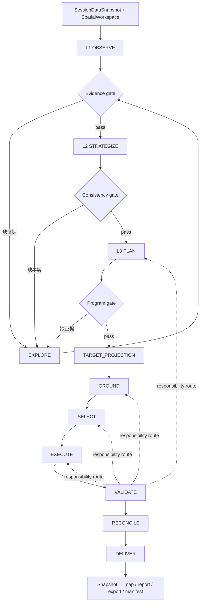

# 后端模块蓝图

> 状态：`TARGET DESIGN`。本文回答“系统应该怎样分工”，不回答“当前代码已经完成多少”。
> 当前代码和状态分别见 [`../architecture/structure.md`](../architecture/structure.md) 与
> [`10_IMPLEMENTATION_STATUS.md`](10_IMPLEMENTATION_STATUS.md)。不要把本文件中的目录、
> 产物或验收门槛当作实现证明。

## 1. 设计结论

系统由认知分析、证据探索、空间决策和交付校验组成一条可恢复闭环。每个阶段只生产一种
权威 artifact；下游通过类型化 contract 和显式 refs 消费；失败沿责任阶段回退，不能由
一个总路由器、LLM 自由文本或导出器猜出业务事实。



`EXPLORE` 是横向证据能力，不是一次性固定阶段；任何 gate 都可以按
`stage + dimension + purpose + evidence_gap` 发起查询。它返回带 provenance 的证据，
不直接决定候选地块、规划编码或最终位置。

## 2. 目标模块与唯一职责

| 模块 | 目标目录 | 唯一职责 | 目标产物 |
|---|---|---|---|
| M0 Contracts & Artifacts | `contracts/`、`infrastructure/artifacts/` | schema、digest、parent refs、CAS 和 artifact identity | `ArtifactDescriptor` / named ref |
| M1 Data | `data/` | 摄取、来源、CRS/schema、快照和质量 | `SessionDataSnapshot` |
| M2 Spatial | `spatial/` | geometry、query、topology、overlay、面积和空间质量 | typed spatial result |
| M3 Evidence & KG | `evidence/`、`infrastructure/kg/` | 证据、地点语义、KG 查询和 EXPLORE | `EvidenceBundle` / resolution |
| M4 Planning Domain | `domain/` | demand、suitability、program、allocation 和规划决定 | typed planning artifacts |
| M5 Workflow | `workflow/` | 编排、路由、gate、interrupt、resume、dispatch | `WorkflowState` patch |
| M6 Materialization | `domain/materialization/`、`spatial/allocation/` | 项目、分区、设施、道路、轴线和合并 | `ExecutionPlan` / `ExecutionResult` |
| M7 Validate & Reconcile | `domain/validation/`、`workflow/stages/` | 检查、责任归因、对账和有界调整 | typed reports / adjustments |
| M8 Delivery | `domain/delivery/`、`spatial/delivery/` | 从唯一空间快照生成所有交付物 | `DeliverySpatialSnapshot` / manifest |
| M9 Application & API | `application/`、`api/v1/` | command、query、projection、HTTP、SSE 和生命周期边界 | public DTO / event |
| M10 Adapters | `infrastructure/` | DB、checkpoint、LLM、RAG、KG、GIS、媒体和搜索 provider | port implementation |

模块通过 contracts 和 ports 通信。模块名是职责，不是允许任意导入的层级；每个模块仍需
通过静态架构测试约束实际依赖方向。

## 3. 认知视图与业务主链

L1/L2/L3 是面向分析、审查和报告的认知视图，不等于 KG 的数据层级，也不直接等于空间
执行结果：

| 视图 | 权威产物 | 允许回答 |
|---|---|---|
| L1 OBSERVE | `L1Snapshot` / `AssessmentSnapshot` | 现状事实、问题、约束和证据缺口 |
| L2 STRATEGIZE | `L2Strategy` / `ObjectivePortfolio` | 目标、定位、策略和冲突 |
| L3 PLAN | `PlanningClaimSet` → `PlanningProgram` | 需求、干预候选、依赖和规划程序 |

LLM 可以生成带 evidence refs 的 claims 或草案，但不能直接写入分类、坐标、地块变化、
`ExecutionPlan` 或 `PlannedState`。这些结果必须由领域服务、空间算法和 gate 形成。

## 4. 目标阶段契约

```text
SessionDataSnapshot + EvidenceBundle
  → L1Snapshot
  → L2Strategy
  → PlanningProgram
  → IntentCompilationResult + SpatialReferenceSpec
  → GroundingResult
  → SiteSelectionDecision / PortfolioDecision
  → ExecutionPlan
  → ExecutionResult
  → ParcelChangeSet / PlannedState
  → ValidationReport / ReconciliationReport
  → DeliverySpatialSnapshot
```

阶段边界：

- `TARGET_PROJECTION` 只把已组装的 `PlanningProgram` 投影为空间目标，不读 Markdown、不猜分类、不直接选地。
- `GROUND` 解析实体、地点、几何和查询证据；歧义必须可见，不得取第一个候选。
- `SELECT` 应用硬约束、评分、冲突分配和可解释的未安置原因。
- `EXECUTE` 只消费显式决策，生成 worker 结果、变化集和 planned state。
- `VALIDATE` 进行规则、几何、拓扑、覆盖和文本/成果一致性检查，并按责任阶段路由。
- `RECONCILE` 对照 claims、targets、candidates、selection、changeset 和 planned state，
  不把渲染修饰当成规划修复。
- `DELIVER` 只从一个 `DeliverySpatialSnapshot` 生成 current、planned、change、project、
  facility、road、axis、土地平衡、HTML、PNG、GeoJSON 和 manifest。

## 5. 状态、artifact 和恢复

根图 state 只保存：run/session/branch identity、阶段和状态、context refs、artifact refs、
gate/interrupt/terminal refs、retry 和必要的控制消息。完整业务 payload 必须在 artifact
store 中以 schema、digest、parents、producer、run 和 provenance 关联。

目标不变量：

- blob `create-if-absent`，named ref `compare-and-set`；历史 descriptor 不覆盖；
- resume 先计算 `ResumePlan`，识别真实 interrupt、最早失效阶段、可复用 refs 和新 branch；
- HUMAN transport 只有一个 contract，用 `channel` 区分 step-mode 与 post-L3 review；
- interrupt 前不执行不可幂等副作用；恢复使用同一 thread/checkpoint 语义；
- SSE 是事件视图，不是第二个状态仓库；断线 replay 不触发 graph resume。

## 6. 依赖与禁止事项

```text
contracts
  ↑
data / spatial / evidence
  ↑
domain
  ↑
workflow / application
  ↑
api / UI
```

目标约束：

- domain 不能导入 API、UI、workflow runtime 或具体 provider；
- API 不能直读 checkpoint、artifact store、runtime 或在线 SSE 队列内部状态；
- tools 只能是外部能力适配器，不能成为规划算法的第二实现；
- provider 失败、空结果、不可行和证据不足必须显式表达，不得静默 fallback、默认 approve 或制造空成功；
- 不得从名称、现状 `dlbm`、crosswalk 或导出文件推断规划编码；
- 不得把裸 GIS、完整报告或全部 worker 结果塞进 `WorkflowState`。

## 7. 完成定义

一个模块只有同时满足以下条件才可在状态台账中标记 `CURRENT`：

1. owner、输入、输出和依赖方向唯一；
2. contract tests 覆盖成功、空结果、unresolved、冲突、超时和 provider 不可用；
3. artifact 有 schema、digest、parents、provenance，重放和重试幂等；
4. 至少有 fake adapter 集成证据和一条真实数据链路证据；
5. 失败不会被转换成空集合、默认成功或猜测值；
6. API/OpenAPI、状态台账和实现映射同步；
7. 影响地图的模块有实际产物和视觉检查；
8. 交付的所有输出都能由同一 `DeliverySpatialSnapshot` 重建。

多模态、外部搜索、自动修复和地点解析还必须满足各自专题文档的额外验收门槛。

## 8. 与其他文档的关系

| 内容 | 唯一维护位置 |
|---|---|
| 当前完成度和未实现清单 | `10_IMPLEMENTATION_STATUS.md` |
| 当前代码入口和文件位置 | `../architecture/` |
| 详细持久化、KG、pipeline、地点和多模态设计 | `02`、`03`、`04`、`12`、`13` |
| 工具绑定的 TARGET/CURRENT 对照 | `17_LLM_TOOL_BINDING.md` |
| 带日期的审计和真实运行 | `../audits/` |
| 一次性执行步骤 | `../superpowers/plans/` |

专题文档不得复制本文件的完整目录树或迁移清单。若目标设计与当前代码冲突，保留冲突并
在状态台账中标记 `PARTIAL/GAP`，不要修改设计文字来伪造完成。
