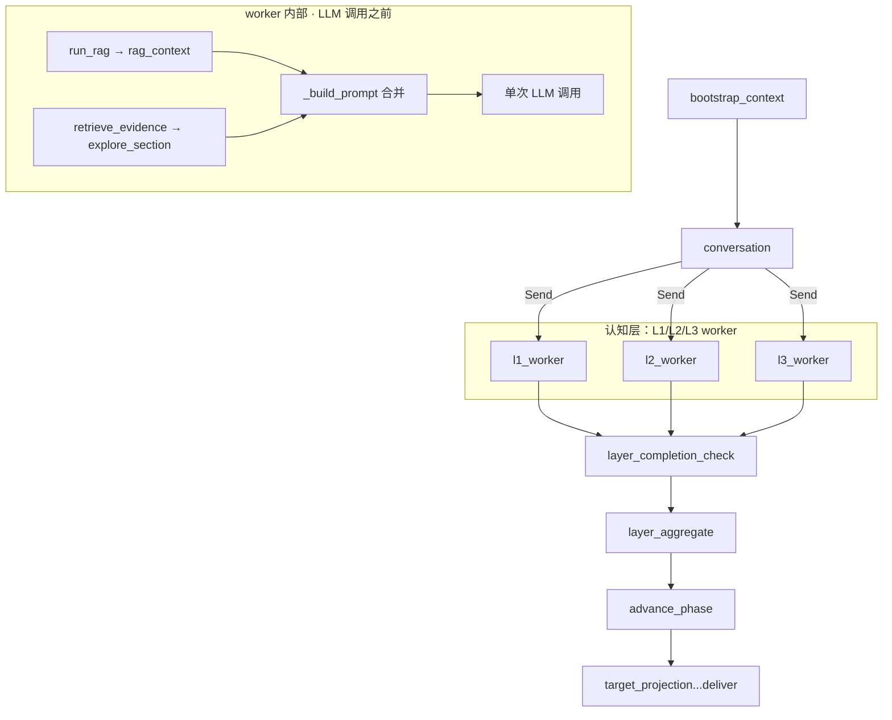
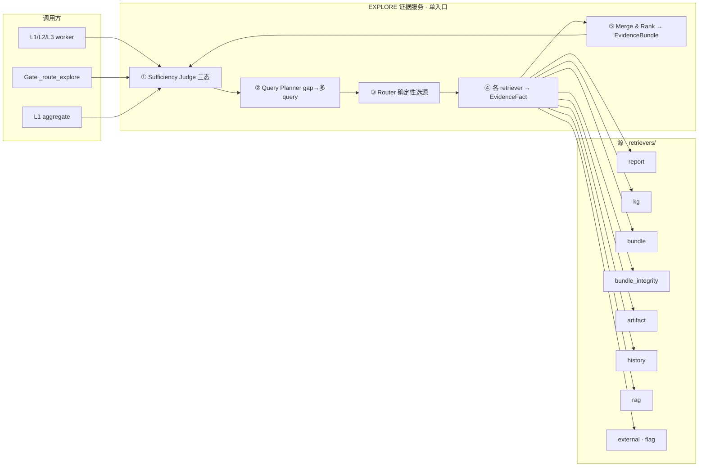

# 23. EXPLORE 检索体系重构：现状、设计、目标最佳

> 状态：`TARGET`（目标设计）。本文综合 `05_EXPLORE_BRIDGE.md` 的定位、代码真实调用链（逐行核实）、
> Exa + Context7 调研结论，给出从现状到目标最佳的实施路径。
> 相关：`05_EXPLORE_BRIDGE.md`（能力定位）。当前实现以 `backend/app/evidence/`、`backend/app/infrastructure/rag/` 为准。

---

## 0. TL;DR

- **现状**：EXPLORE 不是图节点，是 L1/L2/L3 worker 内部、单次 LLM 调用之前的**确定性证据预取钩子**；
  RAG（`run_rag`）与 EXPLORE（`retrieve_evidence`）是**两套并行证据**；gate 的 EXPLORE 路由是"假闭环"
  （`pending_requests` 生成后被丢弃）；`ExploreService` / `ExploreFlashAgent` / `retrieve_evidence_for_gate` **全是死代码**。
- **目标**：单一 `retrieve_evidence()` 入口 = 确定性路由（D1）+ 缺口驱动多 query（D4）+ sufficiency 三态 +
  RAG / typed artifact / 历史修订 / bundle 实际数据校验全部作为"源"并入 + KG 查询 L0/L1/L2 阶梯 + 缺口闭环账本。
- **原则**：确定性基线永不被破坏；LLM 全部走 flag；query 由证据缺口构造，不再"维度名 → 泛查"。

---

## 1. 现状：EXPLORE 的真实调用链（已核实）

### 1.1 图视角：EXPLORE 不在图里



`root_graph.py:692` 注释："explore_node removed (EXPLORE is now gate-driven horizontal service)"——
但实际实现里 EXPLORE **不是横向服务**，而是每个 worker 内联的确定性预取。

### 1.2 Worker 内部时序（L1/L2/L3 同一模板）

```text
l1_worker → analyze_dimension (domain/assessment/analysis_node.py:120)
  1. run_rag()                     → rag_context        ← RAG 向量库（独立于 EXPLORE）
  2. retrieve_evidence()           → explore_section    ← EXPLORE（确定性，无 LLM）
  3. _build_prompt(rag_context, deps, professional_data, explore_section)
  4. 单次 LLM 调用（report_body + observations）
  5. save_report_immediate / step report
```

| 调用点 | 位置 | 用途 |
| --- | --- | --- |
| L1 worker | `domain/assessment/analysis_node.py:250` | 证据注入 prompt |
| L2 worker | `domain/objectives/worker.py:145` | 证据注入 prompt |
| L3 worker | `domain/program/worker.py:326` | 证据注入 prompt |
| L1 aggregate | `domain/assessment/aggregate.py:220` | `purpose="snapshot_fact_production"`，把 KG 事实提升进 L1Snapshot |
| GROUND（同名不同函数） | `domain/ground/aggregate.py:209` | GROUND 专用轻量证据复查，**不走** evidence_service |
| Gate 重查 | `retrieve_evidence_for_gate`（evidence_service.py:169） | **零调用，死代码** |

### 1.3 Gate 的 EXPLORE 路由：假闭环

```text
evaluate_l1_gate() → feedback_route="EXPLORE" + PendingRequest{stage:"explore",
                       request_type:"evidence_gap", context:{gap_id, dimension, required_fact}}
  → _route_explore (workflow/conversation/edges.py:286)
      ├─ L3 的 EXPLORE        → 直接 HUMAN
      ├─ 同层重试 ≥ 2 次       → HUMAN
      └─ 否则                 → 重新 Send 该层全部维度（重跑 worker 内联钩子）
```

**断点**：`pending_requests`（缺口 ID + required_fact）生成后**只用来计数**，从未进入检索；
`retrieve_evidence_for_gate()` 无调用者。所以 Gate EXPLORE 重试 = 原样重跑同一批 worker，
query 仍是 `context_injection` + 维度名，缺口没有驱动任何目标化检索。

### 1.4 死代码清单

| 代码 | 位置 | 现状 |
| --- | --- | --- |
| `retrieve_evidence_for_gate` | evidence_service.py:169 | 零调用，gate 缺口未接线 |
| `ExploreService` | explore_service.py | 零调用（本地索引 + 外部搜索增强层） |
| `ExploreFlashAgent` / `explore_planning_text` | agent.py | 零调用（文本切分→领域分类 agent） |
| `EvidenceGapResolution` | evidence_contracts.py | 契约存在，无人使用 |
| Gate `pending_requests` | domain/*/gate.py | 生成后只计数，不消费 |
| `query_session_sparql` | infrastructure/kg/interface.py | 裸 SPARQL 逃生口，无校验 |
| `external_search` 端口 | contracts/ports/external_search.py | 无生产端口实现接线 |

### 1.5 其他已核实事实

1. **EvidenceFact 重复字段**：`fact_type/fields/evidence_span/source_locator/support_relation/status` 定义 3 遍（已修复，Pydantic 当前版本容忍了）。
2. **bundle 只读计数**：`bundle_retriever` 只调 `group_stats()`（各分组 count + 标签 top-8），**读不到实际要素**；
   坐标系（CRS）声明错、地类码非法、几何损坏都不可见——"输入数据错了系统不知道"的根因。
3. **KG 查询纯模板**：`sparql.py::QUERY_TEMPLATES` 注册表 + 填参，覆盖有限；裸 SPARQL 无校验。
4. **向量库**：Chroma + 阿里云 `text-embedding-v4`（1024 维）；`RagService` 在 MiniMax provider 下默认禁用
   （需 `RAG_DASHSCOPE_ENABLED=true`），与 EXPLORE 无交集。
5. **run_id == session_id**（state_factory 未设置 run_id），typed artifact 可按 `runs/{session}/branches/main/refs/{key}.json` 读取——D2 无阻塞。

---

## 2. 问题诊断（根因）

| # | 根因 | 对应 |
| --- | --- | --- |
| 1 | RAG（向量库）与 EXPLORE（session 证据）**两套并行**，互不相认 | 核心 |
| 2 | query = 维度名 → 泛查，无目标化 | D4 |
| 3 | 无 sufficiency 判断，`unresolved` 照抄 `request.questions` | D4 |
| 4 | gate 缺口闭环缺失：`pending_requests` 被丢弃 | D4 |
| 5 | typed artifacts（L1Snapshot/L2Strategy/PlanningProgram/GroundingResult）未入检索 | D2 |
| 6 | 历史报告版本 / 用户修订记录未入检索 | D3 |
| 7 | bundle 实际数据不可读，CRS/地类/几何错误系统不可知 | D3 |
| 8 | 向量库依赖远程 API，更新/重建成本高 | D3 |
| 9 | `ExploreService` / `ExploreFlashAgent` / `retrieve_evidence_for_gate` 死代码 | D5 |
| 10 | KG 查询纯模板覆盖有限；裸 SPARQL 无校验 | KG 阶梯 |
| 11 | 多源结果无合并/总结（只拼接前 12 条） | D6 |

---

## 3. 调研结论（Exa + Context7）

### 3.1 检索编排（D1 的根）

| 方案 | 出处 | 机制 | 结论 |
| --- | --- | --- | --- |
| RouterQueryEngine + PydanticMultiSelector | Context7（LlamaIndex 官方） | LLM/selector 一次选多工具引擎，各自查询后聚合 | 多源聚合成熟；selector 是 LLM，非确定性 |
| **ToolRetrieverRouterQueryEngine** | Context7（LlamaIndex 官方） | 先 retriever 选出候选工具 → 逐个执行 → TreeSummarize 合并 | **设计 05 引用的正是它**：每源一工具 + 按查询选源 + 多结果合并 |
| 自定义确定性路由（我们的 D1） | 本次设计 | 纯函数按 `entity_scope/purpose/required_facts/stage` 选源 | 可测、可审计、零 LLM、fail-closed |
| Agentic decide-then-retrieve | Exa（SoK Agentic RAG / 多篇） | LLM 决定查不查、查几次 | 灵活但**成本最高（最多 3.6×）**、query 常比人写的差、易空转 |
| 自适应路由基准 | Exa（RAGRouter-Bench, arXiv 2602.00296） | 7,727 查询 × 5 范式评测 | **没有任何单一范式全局最优**，适用性由 query-corpus 交互决定 |
| Enhanced RAG（路由+重排） vs Agentic | Exa（arXiv 评测） | 路由 + 显式重排 vs 动态工具调用 | 窄领域 Agentic 好；宽领域 Enhanced 更可靠；Agentic 系统性更贵 |

**结论**：`ToolRetrieverRouterQueryEngine` = "确定性工具选择 + 多源执行 + 可插拔合并"。
咱们的 D1 是它的**确定性实例化**（选择器用纯函数不用 LLM）；合并先确定性、TreeSummarize 留 flag（D6）。

### 3.2 Query 生成（query 质量的正解）

| 方案 | 出处 | 做法 | 结论 |
| --- | --- | --- | --- |
| 维度名泛查（现状） | — | `query=dim_name` | 病根 |
| **Evidence-gap 驱动（S2G-RAG）** | Exa（ACL 2026, aclanthology 2026.acl-long.1185） | Judge 判断证据够不够 → 输出结构化 gap（category/target/slot/description）→ gap 翻译成下一条 query | 迭代检索控制最优：HotpotQA BM25 下 F1 43.3→56.5；gap 四字段 = 咱们 `required_fact+description+dimension+entity_scope` |
| 子问题分解 / multi-query | Exa（GraphTRACE / SchemaForge） | 复杂 query 拆成多条子 query，各自检索聚合 | 与 gap 驱动互补："一个 gap 一条 query" |
| LLM query 改写 | Exa（Switchboard / agentic RAG） | 首次检索弱才改写 | **"rewrite as a fallback, not a default"** |
| 多路召回 + RRF + 重排 | Exa（hybrid-rag / Ingestible） | BM25 稀疏 + 向量稠密 + RRF + CrossEncoder | 解决"召回"不是"query 质量"；作为兜底 |

**结论**：**gap 驱动 + 每缺口一条子 query** 是 query 质量的正解；LLM 改写只做弱召回兜底。

### 3.3 KG 查询（模板 vs LLM 生成）

| 方案 | 出处 | 机制 | 结论 |
| --- | --- | --- | --- |
| 纯模板（现状） | 本仓库 `QUERY_TEMPLATES` | 固定 SPARQL + 填参 | 稳定但覆盖有限 |
| **LLM 选模板 + 填参（L1）** | Exa（OpenSearch QueryPlanningTool） | LLM 只产 `{template_id, params}` | "Most of the DSL provided by template, only placeholders by LLM"——一致性好、幻觉面最小 |
| **Schema-grounded 生成 + 校验（L2）** | Exa（SchemaForge, arXiv 2508.01815） | 选 schema 切片 → 约束生成 → 符号校验 + 反事实答案集校验 | 比最强 agent 基线平均 **+11.5 执行准确率**；去掉 schema 路由是最大单项损失（-29.46） |
| LLM 裸写 SPARQL | Exa（sparql_mcp） | LLM 直接产 SPARQL 串 | "convenient and unsafe"——不推荐 |
| 模板注册 + 校验复用（L2b） | 本次设计 | LLM 生成新模板 → 校验 + dry-run → 进注册表 | 一次生成变可复用资产 |

**结论**：L1（选模板+填参）最佳性价比；生成级必须走 schema grounding + 校验，不裸写 SPARQL。

### 3.4 RAG 融合（向量库在体系里的位置）

| 方案 | 出处 | 结论 |
| --- | --- | --- |
| 独立并行注入（现状） | 本仓库 `run_rag` | 两套证据、互不相认 |
| **RAG 作为 retriever 源并入** | 本次设计 + LlamaIndex "wrap retrieval in one function" | 单一入口、统一 EvidenceFact/EvidenceSource 契约、吃同一个 gap 驱动 query |
| **混合检索（BM25+向量+RRF+重排）+ 增量索引** | Exa（hybrid-rag / Ingestible / 增量索引） | 只有静态政策/标准语料进向量库；manifest 只重建变更文件——"老更新向量库"问题消失 |
| 本地 embedding（Ollama bge-m3） | Exa（LocalAIMaster / D-Central） | 1024 维兼容现有 collection；零 API 依赖；dense+sparse 三合一 |

### 3.5 充分性判断（闭环收口）

| 方案 | 出处 | 做法 |
| --- | --- | --- |
| S2G-Judge（LLM） | Exa（S2G-RAG） | 判断 (q, 证据) 够不够，输出结构化 gap |
| SURE-RAG（三态验证） | Exa | `SUPPORTED / REFUTED / INSUFFICIENT` 集合级聚合 |
| **确定性覆盖检查（我们的 ①）** | 本次设计 | 关键词/实体命中 + 来源可信度，零 LLM，Gate 直接消费 |

### 3.6 本地 embedding 模型（笔记本可用）

| 模型 | 体积 | 维度 | 特点 | 适配 |
| --- | --- | --- | --- | --- |
| **Ollama bge-m3** | 1.2GB | 1024 | MIT、100+ 语言、8K 上下文、dense+sparse+ColBERT | ★★★ 兼容现有 collection |
| Ollama qwen3-embedding:0.6b | 639MB | 32–1024 | Apache-2.0、32K 上下文、小模型质量最高 | ★★★ 需换 collection |
| Ollama nomic-embed-text | 274MB | 768 | 英文最强、CPU 37 chunks/s | ★★ 中文一般 |
| sentence-transformers bge-small-zh-v1.5 | ~100MB | 512 | 中文专用、纯 CPU | ★★ 需换 collection |
---

## 4. 目标架构（最佳方案）

### 4.1 全景图



### 4.2 模块职责

| 模块 | 位置 | 职责 |
| --- | --- | --- |
| `route_plan` | `retrieval/router.py` | 纯函数：request → RoutePlan{sources, artifact_keys, kg_templates}（D1） |
| `query_planner` | `retrieval/query_planner.py` | 缺口 → targeted 多 query（D4）；每个 gap 一条，含 entity_scope 派生的 KG 模板选择 |
| `sufficiency` | `retrieval/sufficiency.py` | 确定性三态：required_fact 是否被现有 facts 覆盖（D4） |
| `artifact_retriever` | `retrievers/artifact_retriever.py` | 按 stage/dimension 读 typed artifacts 摘要（D2） |
| `history_retriever` | `retrievers/history_retriever.py` | ReportStore 历史版本 + revision_trigger（D3） |
| `bundle_integrity` | `retrievers/bundle_integrity.py` | 读实际要素：CRS drift / 几何 valid / 地类合法 / 缺 BSM → needs_review（D3） |
| `rag_retriever` | `retrievers/rag_retriever.py` | 向量库并入：吃 planner 的 query，产 EvidenceFact，兼容 RAG_RESULT SSE（D3） |
| `kg_query_layer` | `infrastructure/kg/query_layer.py` | L0 填参模板 / L1 LLM 选模板+填参 / L2 schema-grounded 生成+校验 / L2b 模板沉淀 |
| `evidence_service` | `retrieval/evidence_service.py` | 编排上述模块；缓存 key 纳入新字段；`retrieve_evidence_for_gate` 接线 |
| `explore_enhance` | `retrieval/explore_service.py` | D5 flag：ExploreService/FlashAgent 作为增强层 |
| `merge` | `retrieval/merge.py` | D6 flag：LLM TreeSummarize 式合并；默认确定性排序+去重 |

### 4.3 关键机制

**① Sufficiency Judge（确定性三态）**

```text
对每个 required_fact / gap：
  facts 中存在覆盖该缺口关键词/实体 且 来源可信度 ≥ 阈值 → SUPPORTED
  facts 中存在与之矛盾的陈述                            → REFUTED
  否则                                              → INSUFFICIENT
  SUPPORTED   → 写 EvidenceGapResolution{gap_id, resolution, evidence_ref}
  INSUFFICIENT → 进 query_planner 生成下一条 query；最终仍缺 → 留在 bundle.unresolved 账本
```

**② Query Planner（gap → 多 query）**

```text
模板：f"{dimension}：{required_fact}（{description}），现状如何？位置/规模/约束/服务对象？"
entity_scope 派生确定性 KG 模板：roads→get_road_network；waters→get_water_bodies；parcels→get_village_parcels ...
一个 gap 一条 query（并行），LLM 改写只在首轮全空/低分时兜底（flag）。
```

**③ Router 决策表（D1，向后兼容）**

```text
context_injection → report + kg + bundle（现状等价）
spatial_lookup    → bundle + kg + integrity
fact_check        → bundle + report + artifact + integrity
gap_resolution / 有 required_facts / 有 evidence_gaps_to_resolve → + artifact + history + rag
rag 源是否启用       → 按 request.stage 的 layer_rag_config（默认 L1/L3 开，L2 关）
bundle_integrity    → entity_scope 非空或 purpose 含校验意图时启用
```

**④ Gap 闭环账本**

```text
EvidenceBundle.unresolved = 本轮未解决缺口（ID + 描述），可追溯
EvidenceBundle.gap_resolutions = 已解决缺口（EvidenceGapResolution，现有契约接线）
Gate 消费"哪些缺口解决/未解决 + evidence_ref"，而不是一坨事实
```

**⑤ KG 查询阶梯（flag 控制，默认 L0）**

```text
L0  确定性填参 → query_session_template            （默认，零风险）
L1  LLM 选模板 + 填参 → 校验 → 同上                 （flag；template ∈ QUERY_TEMPLATES，params 类型/枚举校验）
L2  LLM 结构化 QueryPlan → schema grounding + 符号校验 + LIMIT/只读 → 渲染 SPARQL（flag）
L2b LLM 新模板 → 语法 + allowlist + dry-run 三重校验 → 注册进 QUERY_TEMPLATES（离线/触发式）
失败一律 fail-closed 回 L0；生成的 query/plan 必须落日志（最诊断性字段）
```

**⑥ 本地 embedding provider**

```text
EMBEDDING_PROVIDER = aliyun | ollama | sentence_transformers（默认 ollama/bge-m3）
OllamaEmbeddings / SentenceTransformerEmbeddings 实现与 AliyunEmbeddings 相同接口
换模型 = 换 CHROMA_COLLECTION_NAME（维度不同）
混合检索：BM25 稀疏 + 向量稠密 + RRF（后续），session 证据不进向量库
```

**⑦ bundle_integrity（CRS drift 检测，来自 GIS 工程实践）**

```text
双信号校验：声明 CRS vs 坐标 bounds
  声明 EPSG:4326 但 bounds 超出 ±180/±90 → 实为投影坐标（Web Mercator 等）→ drift
  声明缺失 / pyproj.CRS.from_user_input 失败 → drift
  bounds 退化（span < 1e-6）→ 疑似未投影的投影坐标
配套：shapely is_valid / 空几何 / NaN / 未知地类标签 / 缺 BSM
产出 fact_type="bundle_integrity", status="needs_review" 的 EvidenceFact
```

### 4.4 接线改造

| 改造点 | 现状 | 目标 |
| --- | --- | --- |
| worker | `run_rag()` + `retrieve_evidence()` 并行注入 | **只调 `retrieve_evidence()` 一次**；rag 成为其中一个源；`run_rag` 保留为迁移期 flag 兜底 |
| gate | `_route_explore` 重发全维度 | **先调 `retrieve_evidence_for_gate(pending_requests)` 做目标化重查**；解决缺口→PASS；仍缺→HUMAN/重跑 |
| L1 aggregate | 二次调用提升 KG 事实 | 复用同一服务（purpose=snapshot_fact_production），行为不变 |
| GROUND | 独立的轻量 retrieve_evidence | 保留（职责不同），但缺口走同一 EvidenceBundle 账本 |
---

## 5. 实施计划

| 阶段 | 内容 | 验收 |
| --- | --- | --- |
| P0 基线 | 契约修正（EvidenceFact 去重，已做）；`RoutePlan` / `GapResolution` 契约落地 | 现有测试全绿 |
| P1（P0 项） | `router.py` + `evidence_service` 接入（D1） | 路由纯函数单测；现有调用结果不变 |
| P1（P1 项） | `artifact_retriever`（D2） | 按 stage/dimension 读取 4 类 artifact 摘要单测 |
| P1（P1 项） | `history_retriever` + `bundle_integrity`（D3） | 版本/修订证据 + CRS drift/地类/几何校验单测 |
| P1（P1 项） | `query_planner` + `sufficiency` + worker/gate 接线（D4） | gap→query 单测；`retrieve_evidence_for_gate` 接线测试 |
| P2（可选） | `rag_retriever` 并入 + 本地 embedding provider（D3） | RagService 走新 provider；worker 单入口 |
| P2（可选） | ExploreService/FlashAgent 接入（D5）+ LLM merge（D6） | flag 默认关；行为不变 |
| P2（可选） | KG 查询 L1/L2/L2b 阶梯 | 校验器 + 模板沉淀测试 |
| 收尾 | 更新 `05_EXPLORE_BRIDGE.md` / retrievers README / RAG README / `10_IMPLEMENTATION_STATUS.md` | 文档与代码一致 |

**顺序原则**：先确定性可测的骨架（router/query_planner/sufficiency/artifact/history/integrity），
再接 flag 增强（rag 并入 / LLM / 外部搜索 / KG 生成），最后接 gate 闭环。

---

## 6. 决策点（待拍板）

1. **路由默认行为**：现有 `context_injection` 保持"三源全查"兼容，还是按 scope 精确路由？（倾向兼容优先）
2. **闭环轮数**：单轮 + unresolved 账本（倾向），还是两轮重查？
3. **Sufficiency**：确定性三态先行（倾向），LLM judge 作为 flag 升级？
4. **本地模型**：默认 Ollama bge-m3（1024 维兼容），sentence-transformers 作为备选实现？
5. **KG 阶梯**：L1（选模板+填参）本次做？L2b 离线沉淀？校验器用 rdflib + PLN allowlist（轻）而非 QueryPlan IR（重）？
6. **D5/D6**：本次只做接口 + flag + 文档，不接真实 LLM 调用？（倾向）

---

## 7. 出处

- S2G-RAG（ACL 2026）：https://aclanthology.org/2026.acl-long.1185.pdf
- SURE-RAG：证据充分性三态验证（SUPPORTED/REFUTED/INSUFFICIENT）
- SchemaForge（arXiv 2508.01815）：schema-grounded Text-to-SPARQL + 反事实校验
- sparql_mcp：LLM 生成查询用严格 QueryPlan IR，禁裸 SPARQL
- OpenSearch QueryPlanningTool：LLM 选模板 + 填参
- LlamaIndex RouterQueryEngine / ToolRetrieverRouterQueryEngine：developers.llamaindex.ai
- RAGRouter-Bench（arXiv 2602.00296）：无单一范式全局最优
- SoK Agentic RAG（arXiv 2603.07379）：agentic 成本最高 3.6×
- hybrid-rag / Ingestible：BM25+向量+RRF+增量索引
- Ollama embedding 评测：LocalAIMaster / D-Central
- Geospatial Orchestration Hub：CRS drift 双信号校验
