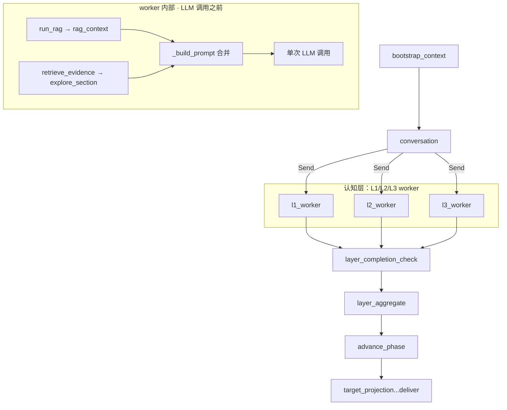
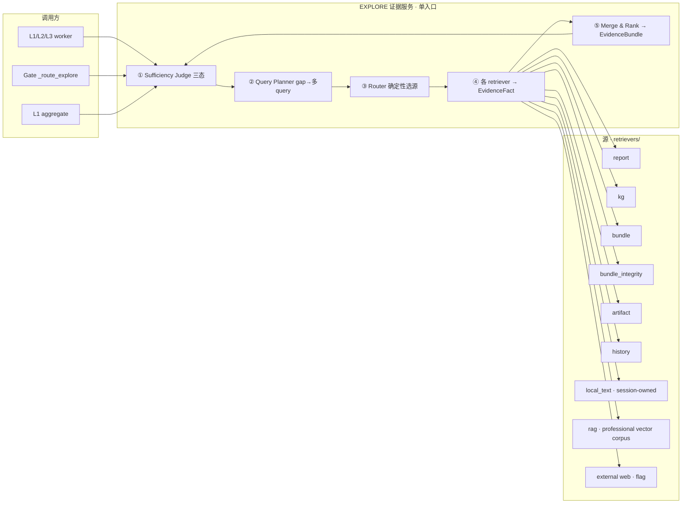

# 23. EXPLORE 检索体系重构：现状、设计、目标最佳

> 状态：`PARTIAL`（设计与实现对照；仍保留 TARGET/NORTH STAR 段落）。2026-08-17 的代码复核显示统一
> EvidenceBundle/RAG adapter、scoped query、sufficiency、artifact/history/integrity retriever 和 gate
> pending retrieval 已接入，但真实 provider/主 workflow 的完整证据验收仍未完成。本文综合 `05_EXPLORE_BRIDGE.md` 的定位、代码真实调用链（逐行核实）、
> Exa + Context7 调研结论，给出从现状到目标最佳的实施路径。
> 相关：`05_EXPLORE_BRIDGE.md`（能力定位）。当前实现以 `backend/app/evidence/`、`backend/app/infrastructure/rag/` 为准。

> **2026-08-18 新鲜度纠正：** 第 1 节保留的是 2026-08-17 之前的调用链审计，不能再作为
> 当前 gate 接线事实。当前 `run_rag()` 是 unified `retrieve_evidence()` 适配器；
> `retrieve_evidence_for_gate_sync()` 已由 `workflow/conversation/edges.py` 的
> `_route_explore()` 调用，并把 pending evidence 合并到下一次 canonical request。
> bundle retriever 现已在有 scope/query 时返回有界的 feature identity facts（BSM、source layer、bundle
> feature ref），并保留分组统计；source-feature geometry/干预级证据和真实主链空间图层验收仍未完成。
> 外源 provider 现已有 fake、typed unavailable 和可配置的 Exa HTTP adapter；
> 真实远程请求仍必须在部署环境用真实 key 做受控验收，模拟测试不等同于远程服务验收。

> **2026-08-19 多源边界纠正：** `rag` 仅表示专业外部向量语料，不是本地会话文本的
> 总索引，也不能在向量服务到期后伪装成 bundle/KG/L1/L2/L3 证据。会话内的确定性语义
> 片段由独立的 `local_text` retriever 检索；两者都进入统一 EvidenceBundle，但必须保留
> `source_kind`、`evidence_role`、`source_locator` 和 `retrieval_mode`，且只有 bundle
> / EvidenceGraph 的验证引用才能产生空间定位或进入 GROUND。

> **2026-08-19 bundle 检索边界收敛：** bundle 是唯一的 session retrieval projection，持有
> 空间对象、L1 facts、KG/evidence 引用、输入文档引用和 `documents.report_refs` 报告清单；
> 不再持有 `layer_reports`/`l3_reports` 全文。报告正文仍只有一个权威存储位置，由
> `report_id` 显式展开；报告检索必须先从 bundle manifest 选出引用，不能绕过 bundle 直接
> 扫描整个 ReportStore。这样统一了检索入口，同时避免每个空间快照复制长报告。

> **2026-08-19 geometry authority 收紧：** `PlaceEvidenceIndex` 只负责语义候选和身份索引，
> 只输出 BSM 与 `bundle://feature/<BSM>` opaque ref，不缓存 KG/annotation 的 WKT。对没有
> 具体名称的“某村的道路/水体/设施”类 scope-only 查询，EvidenceGraph 可从 bundle-backed
> semantic entries 返回有界候选；GROUND 再按 ref 回读 bundle 几何。KG 坐标只能参与语义/邻近
> 绑定，不能直接成为执行几何。

> **2026-08-19 村级使用边界：** 一个会话只有一个行政村/项目规划范围。报告中的园寨、社前、
> 炉池等“自然村/聚落”是 L1 语义锚点，用于设施、道路、水体和地块的范围消歧，不建模为村内
> 多级行政区划。`金田村祠堂` 的正确结果可以是多个祠堂 BSM 或明确 ambiguous；只有报告/L1/KG
> 拓扑能把它约束到社前等具体语义锚点时，才可缩小候选，不能因行政层级假设直接选一个。

---

## 0. TL;DR

- **历史断点（2026-08-17 前）**：EXPLORE 曾是 L1/L2/L3 worker 内部的确定性预取钩子；
  RAG（`run_rag`）与 EXPLORE（`retrieve_evidence`）曾是两套并行证据，gate 缺口曾被丢弃。以下第 1 节保留该断点作为审计记录。
- **当前实现**：`run_rag` 已降为 unified EvidenceBundle adapter；router/query planner/sufficiency、RAG、typed artifact、历史和完整性 retriever 已接入，gate pending request 会触发 scoped retrieval。外源 provider 已通过 `ExternalSearchPort` 注入，fake provider 与“本地不足才外查”回归已通过；真实远程 provider 和真实空间规划图层仍需单独受控验收，不能把模块测试当作生产证据。
- **目标**：单一 `retrieve_evidence()` 入口 = 确定性路由（D1）+ 缺口驱动多 query（D4）+ sufficiency 三态 +
  RAG / typed artifact / 历史修订 / bundle 实际数据校验全部作为"源"并入 + KG 查询 L0/L1/L2 阶梯 + 缺口闭环账本。
- **原则**：确定性基线永不被破坏；LLM 全部走 flag；query 由证据缺口构造，不再"维度名 → 泛查"。

---

## 1. 现状：EXPLORE 的真实调用链（已核实）

### 1.1 图视角：EXPLORE 不在图里



`root_graph.py:692` 的旧注释仍称 EXPLORE 不是横向服务；当前实现应以
`evidence_service.retrieve_evidence()` 为统一入口，worker 通过 `run_rag()` 适配器调用，
gate 则通过 `retrieve_evidence_for_gate_sync()` 做缺口驱动的有界补查。下述旧时序保留作迁移审计，
不要据此判断当前 gate 未接线。

### 1.2 Worker 内部时序（L1/L2/L3 同一模板）

```text
l1_worker → analyze_dimension (domain/assessment/analysis_node.py:120)
  1. run_rag()                     → unified EvidenceBundle
       ├─ session-owned: local_text + report + KG + bundle
       └─ optional external: professional RAG（显式 source:rag，服务不可用则 typed status）
  2. render_evidence_prompt_section() → 按 evidence_role/source_kind 分栏的背景
  3. _build_prompt(evidence_background, deps, professional_data)
  4. 单次 LLM 调用（report_body + observations）
  5. save_report_immediate / step report
```

| 调用点                 | 位置                                                      | 用途                                                                |
| ---------------------- | --------------------------------------------------------- | ------------------------------------------------------------------- |
| L1 worker              | `domain/assessment/analysis_node.py:250`                | 证据注入 prompt                                                     |
| L2 worker              | `domain/objectives/worker.py:145`                       | 证据注入 prompt                                                     |
| L3 worker              | `domain/program/worker.py:326`                          | 证据注入 prompt                                                     |
| L1 aggregate           | `domain/assessment/aggregate.py:220`                    | `purpose="snapshot_fact_production"`，把 KG 事实提升进 L1Snapshot |
| GROUND（同名不同函数） | `domain/ground/aggregate.py:209`                        | GROUND 自有 resolver 复查；retry patch 才请求 evidence service，不等同于 worker 的统一预取 |
| Gate 重查              | `retrieve_evidence_for_gate`（evidence_service.py:319） | 由 `edges.py:_route_explore` 的同步适配器调用；结果进入有界 gate evidence cache |

### 1.3 Gate 的 EXPLORE 路由：假闭环

```text
evaluate_l1_gate() → feedback_route="EXPLORE" + PendingRequest{stage:"explore",
                       request_type:"evidence_gap", context:{gap_id, dimension, required_fact}}
  → _route_explore (workflow/conversation/edges.py:286)
      ├─ L3 的 EXPLORE        → 直接 HUMAN
      ├─ 同层重试 ≥ 2 次       → HUMAN
      └─ 否则                 → 重新 Send 该层全部维度（重跑 worker 内联钩子）
```

**历史断点（已部分修复）**：旧版本的 `pending_requests` 只用于计数，Gate EXPLORE 会原样重跑
worker。当前 `pending_requests` 已进入 `retrieve_evidence_for_gate()`，并按 required fact、
dimension、entity scope 生成 `query_purpose="gap_resolution"` 的 scoped request；结果未改变时
仍 fail-closed 进入 HUMAN。真实 provider/source geometry 的完整验收仍是未完成项。

### 1.4 死代码清单

| 代码                                              | 位置                               | 现状                                |
| ------------------------------------------------- | ---------------------------------- | ----------------------------------- |
| `retrieve_evidence_for_gate`                    | evidence_service.py:319            | 当前由 conversation edge 同步调用，结果写入有界 gate cache |
| `ExploreService` / `ExploreFlashAgent` / `explore_planning_text` | 已删除（旧 `retrieval/explore_service.py`、`agent.py`） | 零调用的第二套检索/文本扫描路径，已从公共入口移除 |
| `EvidenceGapResolution`                         | evidence_contracts.py              | 契约存在，无人使用                  |
| Gate`pending_requests`                          | domain/*/gate.py + conversation/edges.py | 当前消费并驱动 scoped gap retrieval |
| `query_session_sparql`                          | infrastructure/kg/interface.py     | 裸 SPARQL 逃生口，无校验            |
| `external_search` 端口                          | contracts/ports/external_search.py | 无生产端口实现接线                  |

### 1.5 其他已核实事实

1. **EvidenceFact 重复字段**：`fact_type/fields/evidence_span/source_locator/support_relation/status` 定义 3 遍（已修复，Pydantic 当前版本容忍了）。
2. **bundle 实际要素已接入**：`bundle_retriever` 在设施、道路、水体、地块等 scope 下按 query 返回有界的
   feature identity（BSM、source feature id、layer、bundle ref），同时保留 `group_stats()` 的分组统计；完整
   geometry payload 仍不进入 LLM 背景，最终几何通过 bundle feature ref 读取；
   坐标系（CRS）声明错、地类码非法、几何损坏都不可见——"输入数据错了系统不知道"的根因。
3. **KG 查询纯模板**：`sparql.py::QUERY_TEMPLATES` 注册表 + 填参，覆盖有限；裸 SPARQL 无校验。
4. **向量库**：Chroma + 阿里云 `text-embedding-v4`（1024 维）；RAG 通过
   `rag_retriever` 作为 unified EvidenceBundle 的可选 source，MiniMax 下仍默认禁用
   （需 `RAG_DASHSCOPE_ENABLED=true`），不能据此断言与 EXPLORE 无交集。
5. **run_id == session_id**（state_factory 未设置 run_id），typed artifact 可按 `runs/{session}/branches/main/refs/{key}.json` 读取——D2 无阻塞。

---

## 2. 问题诊断（根因）

| #  | 根因                                                                               | 对应    |
| -- | ---------------------------------------------------------------------------------- | ------- |
| 1  | RAG 作为 retriever adapter 并入统一 EvidenceBundle；旧“双轨互不相认”仅为历史断点 | 核心（历史已修复，真实覆盖仍待验收） |
| 2  | query 仍需继续加强 intervention-specific/source-feature 定向；query planner 已按缺口/实体范围生成计划 | D4 |
| 3  | sufficiency 三态已接入；真实 source geometry 的充分性仍需验收 | D4 |
| 4  | gate 缺口闭环已接线；结果不变或预算耗尽时仍进入 HUMAN | D4 |
| 5  | typed artifacts 已由 artifact retriever 接入，但当前主要返回 artifact identity，非完整 payload 事实 | D2 |
| 6  | history retriever 已接入；完整用户修订/业务内容覆盖仍需真实验收 | D3 |
| 7  | bundle 实际数据不可读，CRS/地类/几何错误系统不可知                                 | D3      |
| 8  | 向量库依赖远程 API，更新/重建成本高                                                | D3      |
| 9  | 旧 `ExploreService` / `ExploreFlashAgent` 已删除；gate retriever 直接接入统一 `retrieve_evidence()` | D5 |
| 10 | KG 查询纯模板覆盖有限；裸 SPARQL 无校验                                            | KG 阶梯 |
| 11 | 多源结果无合并/总结（只拼接前 12 条）                                              | D6      |

---

## 3. 调研结论（Exa + Context7）

### 3.1 检索编排（D1 的根）

| 方案                                      | 出处                                     | 机制                                                        | 结论                                                                 |
| ----------------------------------------- | ---------------------------------------- | ----------------------------------------------------------- | -------------------------------------------------------------------- |
| RouterQueryEngine + PydanticMultiSelector | Context7（LlamaIndex 官方）              | LLM/selector 一次选多工具引擎，各自查询后聚合               | 多源聚合成熟；selector 是 LLM，非确定性                              |
| **ToolRetrieverRouterQueryEngine**  | Context7（LlamaIndex 官方）              | 先 retriever 选出候选工具 → 逐个执行 → TreeSummarize 合并 | **设计 05 引用的正是它**：每源一工具 + 按查询选源 + 多结果合并 |
| 自定义确定性路由（我们的 D1）             | 本次设计                                 | 纯函数按`entity_scope/purpose/required_facts/stage` 选源  | 可测、可审计、零 LLM、fail-closed                                    |
| Agentic decide-then-retrieve              | Exa（SoK Agentic RAG / 多篇）            | LLM 决定查不查、查几次                                      | 灵活但**成本最高（最多 3.6×）**、query 常比人写的差、易空转   |
| 自适应路由基准                            | Exa（RAGRouter-Bench, arXiv 2602.00296） | 7,727 查询 × 5 范式评测                                    | **没有任何单一范式全局最优**，适用性由 query-corpus 交互决定   |
| Enhanced RAG（路由+重排） vs Agentic      | Exa（arXiv 评测）                        | 路由 + 显式重排 vs 动态工具调用                             | 窄领域 Agentic 好；宽领域 Enhanced 更可靠；Agentic 系统性更贵        |

**结论**：`ToolRetrieverRouterQueryEngine` = "确定性工具选择 + 多源执行 + 可插拔合并"。
咱们的 D1 是它的**确定性实例化**（选择器用纯函数不用 LLM）；合并先确定性、TreeSummarize 留 flag（D6）。

### 3.2 Query 生成（query 质量的正解）

| 方案                                   | 出处                                             | 做法                                                                                                | 结论                                                                                                                    |
| -------------------------------------- | ------------------------------------------------ | --------------------------------------------------------------------------------------------------- | ----------------------------------------------------------------------------------------------------------------------- |
| 维度名泛查（现状）                     | —                                               | `query=dim_name`                                                                                  | 病根                                                                                                                    |
| **Evidence-gap 驱动（S2G-RAG）** | Exa（ACL 2026, aclanthology 2026.acl-long.1185） | Judge 判断证据够不够 → 输出结构化 gap（category/target/slot/description）→ gap 翻译成下一条 query | 迭代检索控制最优：HotpotQA BM25 下 F1 43.3→56.5；gap 四字段 = 咱们`required_fact+description+dimension+entity_scope` |
| 子问题分解 / multi-query               | Exa（GraphTRACE / SchemaForge）                  | 复杂 query 拆成多条子 query，各自检索聚合                                                           | 与 gap 驱动互补："一个 gap 一条 query"                                                                                  |
| LLM query 改写                         | Exa（Switchboard / agentic RAG）                 | 首次检索弱才改写                                                                                    | **"rewrite as a fallback, not a default"**                                                                        |
| 多路召回 + RRF + 重排                  | Exa（hybrid-rag / Ingestible）                   | BM25 稀疏 + 向量稠密 + RRF + CrossEncoder                                                           | 解决"召回"不是"query 质量"；作为兜底                                                                                    |

**结论**：**gap 驱动 + 每缺口一条子 query** 是 query 质量的正解；LLM 改写只做弱召回兜底。

### 3.3 KG 查询（模板 vs LLM 生成）

| 方案                                        | 出处                                 | 机制                                                      | 结论                                                                                      |
| ------------------------------------------- | ------------------------------------ | --------------------------------------------------------- | ----------------------------------------------------------------------------------------- |
| 纯模板（现状）                              | 本仓库`QUERY_TEMPLATES`            | 固定 SPARQL + 填参                                        | 稳定但覆盖有限                                                                            |
| **LLM 选模板 + 填参（L1）**           | Exa（OpenSearch QueryPlanningTool）  | LLM 只产`{template_id, params}`                         | "Most of the DSL provided by template, only placeholders by LLM"——一致性好、幻觉面最小  |
| **Schema-grounded 生成 + 校验（L2）** | Exa（SchemaForge, arXiv 2508.01815） | 选 schema 切片 → 约束生成 → 符号校验 + 反事实答案集校验 | 比最强 agent 基线平均**+11.5 执行准确率**；去掉 schema 路由是最大单项损失（-29.46） |
| LLM 裸写 SPARQL                             | Exa（sparql_mcp）                    | LLM 直接产 SPARQL 串                                      | "convenient and unsafe"——不推荐                                                         |
| 模板注册 + 校验复用（L2b）                  | 本次设计                             | LLM 生成新模板 → 校验 + dry-run → 进注册表              | 一次生成变可复用资产                                                                      |

**结论**：L1（选模板+填参）最佳性价比；生成级必须走 schema grounding + 校验，不裸写 SPARQL。

### 3.4 RAG 融合（向量库在体系里的位置）

| 方案                                               | 出处                                                   | 结论                                                                             |
| -------------------------------------------------- | ------------------------------------------------------ | -------------------------------------------------------------------------------- |
| 独立并行注入（现状）                               | 本仓库`run_rag`                                      | 两套证据、互不相认                                                               |
| **RAG 作为 retriever 源并入**                | 本次设计 + LlamaIndex "wrap retrieval in one function" | 单一入口、统一 EvidenceFact/EvidenceSource 契约、吃同一个 gap 驱动 query         |
| **混合检索（BM25+向量+RRF+重排）+ 增量索引** | Exa（hybrid-rag / Ingestible / 增量索引）              | 只有静态政策/标准语料进向量库；manifest 只重建变更文件——"老更新向量库"问题消失 |
| 本地 embedding（Ollama bge-m3）                    | Exa（LocalAIMaster / D-Central）                       | 1024 维兼容现有 collection；零 API 依赖；dense+sparse 三合一                     |

### 3.5 充分性判断（闭环收口）

| 方案                                  | 出处           | 做法                                                |
| ------------------------------------- | -------------- | --------------------------------------------------- |
| S2G-Judge（LLM）                      | Exa（S2G-RAG） | 判断 (q, 证据) 够不够，输出结构化 gap               |
| SURE-RAG（三态验证）                  | Exa            | `SUPPORTED / REFUTED / INSUFFICIENT` 集合级聚合   |
| **确定性覆盖检查（我们的 ①）** | 本次设计       | 关键词/实体命中 + 来源可信度，零 LLM，Gate 直接消费 |

### 3.6 本地 embedding 模型（笔记本可用）

| 模型                                    | 体积   | 维度     | 特点                                            | 适配                       |
| --------------------------------------- | ------ | -------- | ----------------------------------------------- | -------------------------- |
| **Ollama bge-m3**                 | 1.2GB  | 1024     | MIT、100+ 语言、8K 上下文、dense+sparse+ColBERT | ★★★ 兼容现有 collection |
| Ollama qwen3-embedding:0.6b             | 639MB  | 32–1024 | Apache-2.0、32K 上下文、小模型质量最高          | ★★★ 需换 collection     |
| Ollama nomic-embed-text                 | 274MB  | 768      | 英文最强、CPU 37 chunks/s                       | ★★ 中文一般              |
| sentence-transformers bge-small-zh-v1.5 | ~100MB | 512      | 中文专用、纯 CPU                                | ★★ 需换 collection       |

---

## 4. 目标架构（最佳方案）

### 4.1 全景图



### 4.2 模块职责

| 模块                   | 位置                                 | 职责                                                                               |
| ---------------------- | ------------------------------------ | ---------------------------------------------------------------------------------- |
| `route_plan`         | `retrieval/router.py`              | 纯函数：request → RoutePlan{sources, artifact_keys, kg_templates}（D1）           |
| `query_planner`      | `retrieval/query_planner.py`       | 缺口 → targeted 多 query（D4）；每个 gap 一条，含 entity_scope 派生的 KG 模板选择 |
| `sufficiency`        | `retrieval/sufficiency.py`         | 确定性三态：required_fact 是否被现有 facts 覆盖（D4）                              |
| `artifact_retriever` | `retrievers/artifact_retriever.py` | 按 stage/dimension 读 typed artifacts 摘要（D2）                                   |
| `history_retriever`  | `retrievers/history_retriever.py`  | ReportStore 历史版本 + revision_trigger（D3）                                      |
| `bundle_integrity`   | `retrievers/bundle_integrity.py`   | 读实际要素：CRS drift / 几何 valid / 地类合法 / 缺 BSM → needs_review（D3）       |
| `local_text_retriever` | `retrievers/local_text_retriever.py` | 检索 bundle 输入文本和 L1 source span；报告正文由 bundle manifest 驱动的 `report_retriever` 按需读取；不读向量、不产几何（D3） |
| `rag_retriever`      | `retrievers/rag_retriever.py`      | 仅检索专业外部向量库 chunk；服务不可用时返回 typed unavailable，不回退伪装本地证据（D3） |
| `kg_query_layer`     | `infrastructure/kg/query_layer.py` | L0 填参模板 / L1 LLM 选模板+填参 / L2 schema-grounded 生成+校验 / L2b 模板沉淀     |
| `evidence_service`   | `retrieval/evidence_service.py`    | 编排上述模块；缓存 key 纳入新字段；`retrieve_evidence_for_gate` 接线             |
| `explore_enhance`    | 已移除                           | 不再维护第二套 EXPLORE 增强编排；外源检索由 `evidence_service` 按策略显式执行 |
| `merge`              | `retrieval/merge.py`               | D6 flag：LLM TreeSummarize 式合并；默认确定性排序+去重                             |

### 4.3 关键机制

**① Sufficiency Judge（确定性三态）**

```text
对每个 required_fact / gap：
  facts 中存在覆盖该缺口关键词/实体 且 来源可信度 ≥ 阈值 → SUPPORTED
  facts 中存在与之矛盾的陈述                            → REFUTED
  否则                                              → INSUFFICIENT
  SUPPORTED   → 写 EvidenceGapResolution{gap_id, resolution, evidence_ref}
  INSUFFICIENT → 进 query_planner 生成下一条 query；最终仍缺 → 留在 bundle.unresolved 账本
```

**② Query Planner（gap → 多 query）**

```text
模板：f"{dimension}：{required_fact}（{description}），现状如何？位置/规模/约束/服务对象？"
entity_scope 派生确定性 KG 模板：roads→get_road_network；waters→get_water_bodies；parcels→get_village_parcels ...
一个 gap 一条 query（并行），LLM 改写只在首轮全空/低分时兜底（flag）。
```

**③ Router 决策表（D1，项目级查询优先）**

```text
未指定 entity_scope 的 fact_check / evidence_gap / spatial_lookup
                  → local_text + report + kg + bundle + artifact + history
                  （检索所有项目内证据族；各 retriever 仍按查询做有界相关性过滤）
指定 entity_scope 或 source:<kind> → 按调用方明确范围路由，但不把报告/L1/KG 语义背景当几何
context_injection → report + local_text + kg + bundle（会话内规划背景）
spatial_lookup    → bundle + kg + integrity
fact_check        → bundle + report + artifact + integrity
gap_resolution / 有 required_facts / 有 evidence_gaps_to_resolve → + local_text + artifact + history
professional_reference / 显式 source:rag → + rag（只查专业外部向量语料）
rag 源是否启用       → 按 request.stage 的 layer_rag_config；向量服务不可用则 typed unavailable
bundle_integrity    → entity_scope 非空或 purpose 含校验意图时启用
```

项目级查询的“全部”指覆盖项目内所有可携带相关证据的来源族，不是把 660 个地块、全部
报告正文或全部历史版本一次性倾倒给 LLM。Bundle 无 scope 时在 points/lines/polygons 三类
集合上做有界标签命中并返回 BSM/ref；EvidenceGraph 随后返回候选、关联地块和 KG 拓扑。
Bundle 几何仍是唯一几何入口，KG 只提供实体身份/拓扑，报告和 L1 分别提供规划背景与空间
语义锚点。RAG 与外源 provider 不属于项目内本地证据，必须由 `source:rag` 或显式 external
开关启用，服务到期或额度耗尽时保留 typed unavailable/失败诊断。

**④ Gap 闭环账本**

```text
EvidenceBundle.unresolved = 本轮未解决缺口（ID + 描述），可追溯
EvidenceBundle.gap_resolutions = 已解决缺口（EvidenceGapResolution，现有契约接线）
Gate 消费"哪些缺口解决/未解决 + evidence_ref"，而不是一坨事实
```

**⑤ KG 查询阶梯（flag 控制，默认 L0）**

```text
L0  确定性填参 → query_session_template            （默认，零风险）
L1  LLM 选模板 + 填参 → 校验 → 同上                 （flag；template ∈ QUERY_TEMPLATES，params 类型/枚举校验）
L2  LLM 结构化 QueryPlan → schema grounding + 符号校验 + LIMIT/只读 → 渲染 SPARQL（flag）
L2b LLM 新模板 → 语法 + allowlist + dry-run 三重校验 → 注册进 QUERY_TEMPLATES（离线/触发式）
失败一律 fail-closed 回 L0；生成的 query/plan 必须落日志（最诊断性字段）
```

**⑥ RAG 向量服务与本地语义回退的边界**

```text
RAG 的 embedding/vector store 只服务专业外部语料；当前服务到期时保持 unavailable，
不触发外部额度消耗。会话文本由 `local_text_retriever` 做有界的句段级确定性检索，
不需要 embedding，也不把 session 文本写入专业向量库。未来若恢复 RAG，可在同一个
EvidencePacket 中并列加入 `professional_text`，但不能覆盖本地权威来源。
```

**⑦a 范围型空间查询的拓扑过滤**

```text
“甲村的道路/水体”不是把 session 内所有同类 feature 返回给 LLM。
PlaceEvidenceIndex 构建期使用 bundle 地块 STRtree 将命名线/面映射为
related_parcel_bsms；EvidenceGraph 再用 query 中的村庄 BSM 集过滤候选，
没有地块拓扑时用同一 KG 的 feature→village 关系补充。两者都只产生身份引用，
几何仍由 bundle bridge 在 GROUND 读取；若范围证据完全缺失，保留有界候选但不自动选中。
```

方向型范围（如“村西侧道路”“村北水体”）复用 `SpatialResolver` 已有的方向语义，
由 EvidenceGraph 以 gazetteer/KG anchor 生成粗 bbox，再交给 bundle parcel STRtree
返回 BSM 集。这个 bbox 只用于候选召回和排序，不是最终执行几何；大地块仍须在
GROUND/子几何阶段读取 bundle geometry 后裁切。L1 的 `spatial_hint`、`related_mentions`
和 `source_span` 与查询一并传给 KG topology scorer，用于同名对象的关系消歧。
同名对象的合并键则固定优先使用 bundle/source BSM 或 source feature id；opaque geometry
ref 不再被误当作“没有几何”，不同来源对象必须保留为 ambiguity candidates。

### 4.3.1 复杂语义定位的当前闭环（2026-08-20）

复杂空间查询不再由前端预先猜一个设施类别。HTTP、LLM tool 与 workflow 都调用同一个
`retrieve_evidence()`，查询 LLM 只在现有 `SpatialReferenceSpec` 中填写两个受限字段：

- `semantic_terms`：最多 8 个、必须逐字来自查询原文，只用于探测 L1 fact、KG 名称/别名、
  Bundle 标签或地址；不能生成 BSM、坐标或几何；
- `retrieval_scopes`：只能选 facilities/hazards/roads/waters/parcels/zones，可同时列出作为
  定位锚点和作为规划对象的多种类型。例如“炉池”只出现在灾害点地址时，hazards 负责提供
  语义锚点，Bundle/KG 的 related parcel topology 再扩展为 parcels。

当用户只给出部分名称（例如“炉池自然村在哪里”），EvidenceGraph 通过索引内部已有的
有界 n-gram 暴露 source-backed partial label probe，再沿同一 `query_facility_bsms` /
`resolve_mention` 路径加入 KG relations、L1 fact refs 和 Bundle feature identity；这不是
正则抽取，也不是按首候选回退。只读 HTTP 查询复用 session context，不强制每次刷新，避免
重复构建 KG/Bundle/L1 索引；新数据提交时仍由 context version/snapshot 触发显式刷新。

EvidenceGraph 对同名点先按 Bundle 代表点距离与相关地块重叠建立空间簇。只有一个簇时可形成
明确标注为“推断范围、非自然村法定边界”的 `village_scope`；多个相离簇时必须把查询原文、
报告/L1 source spans、KG relation、Bundle BSM/关联地块和分层检索评分交给闭集 LLM 选择。
LLM 禁用、超时、拒绝或输出 0 都保持 unresolved，禁止按首候选、最高分或同名文本静默绑定。

候选展示与接口不再使用一个混合 `confidence`。`FeatureEvidenceRef` 分别暴露
`source_authority_score`、`semantic_match_score`、`spatial_support_score`、
`external_support_score`、`retrieval_score`；`selection_confidence` 只有 GROUND 真正完成选择后
才有资格赋值。Bundle 几何权威为 1.0 不再被界面误读成“定位答案 100% 确定”。

**⑦ bundle_integrity（CRS drift 检测，来自 GIS 工程实践）**

```text
双信号校验：声明 CRS vs 坐标 bounds
  声明 EPSG:4326 但 bounds 超出 ±180/±90 → 实为投影坐标（Web Mercator 等）→ drift
  声明缺失 / pyproj.CRS.from_user_input 失败 → drift
  bounds 退化（span < 1e-6）→ 疑似未投影的投影坐标
配套：shapely is_valid / 空几何 / NaN / 未知地类标签 / 缺 BSM
产出 fact_type="bundle_integrity", status="needs_review" 的 EvidenceFact
```

### 4.4 接线改造

| 改造点       | 现状                                             | 目标                                                                                                           |
| ------------ | ------------------------------------------------ | -------------------------------------------------------------------------------------------------------------- |
| worker       | `run_rag()` + `retrieve_evidence()` 并行注入 | **CURRENT / PARTIAL**：`run_rag()` 仅作为 unified EvidenceBundle adapter，维度 worker 不再并列调用旧 RAG 与 `retrieve_evidence()`；fake/provider-injected 外源路径已验证，真实远程 provider 运行仍待验收 |
| gate         | `_route_explore` 重发全维度                    | **CURRENT / PARTIAL**：pending request 已按 scope 触发 scoped retrieval 并合并 gate evidence；主 workflow 的全量真实回放仍待核验 |
| L1 aggregate | 二次调用提升 KG 事实                             | **PARTIAL**：同一 evidence service 可复用，但调用次数/缓存键/持久化账本还没有完整替代旧路径 |
| GROUND       | 独立的轻量 retrieve_evidence                     | **CURRENT / PARTIAL**：GROUND 保留独立接地检索，并可消费目标化缺口；尚未把所有结果统一成 EvidenceBundle artifact |

---

## 5. 实施计划

| 阶段        | 内容                                                                                            | 验收                                                     |
| ----------- | ----------------------------------------------------------------------------------------------- | -------------------------------------------------------- |
| P0 基线     | EvidenceFact 去重和 `EvidenceGapResolution` 已落地；`RoutePlan` 尚未成为生产主契约       | 契约/去重回归通过；仍需补 RoutePlan 接线                 |
| P1（P0 项） | `evidence_service` 单入口、router/query planner/sufficiency 已落地                         | 路由、缺口和调用次数 focused tests 已通过；真实 provider 仍待验收 |
| P1（P1 项） | `artifact_retriever` 已接入 typed artifact 摘要                                   | stage/dimension scoped retrieval tests 已通过           |
| P1（P1 项） | `history_retriever` / `bundle_integrity` 已成为统一证据链                               | 版本/修订证据 + integrity tests 已通过              |
| P1（P1 项） | `retrieve_evidence_for_gate` 已接入 worker/gate 主流程                | gap→query、gate route/cache tests 已通过；真实回放仍待验收 |
| P2（可选）  | `rag_retriever` 并入专业向量 corpus；`local_text_retriever` 作为无向量本地回退（D3）               | 两类 source 分栏、服务到期仍可用本地证据；worker 单入口 |
| P2（可选）  | 多源证据语义合并（D6），在统一 `evidence_service` 内继续收敛                                      | 来源角色与未完成状态必须保留；不再新增独立 EXPLORE 兼容层 |
| P2（可选）  | KG 查询 L1/L2/L2b 阶梯                                                                          | 校验器 + 模板沉淀测试                                    |
| 收尾        | 更新`05_EXPLORE_BRIDGE.md` / retrievers README / RAG README / `10_IMPLEMENTATION_STATUS_CURRENT_20260818.md` | 文档与代码一致                                           |

**顺序原则**：先确定性可测的骨架（router/query_planner/sufficiency/artifact/history/integrity），
再接 flag 增强（rag 并入 / LLM / 外部搜索 / KG 生成），最后接 gate 闭环。

---

## 6. 决策点（待拍板）

1. **路由默认行为**：现有 `context_injection` 保持"三源全查"兼容，还是按 scope 精确路由？（倾向兼容优先）
2. **闭环轮数**：单轮 + unresolved 账本（倾向），还是两轮重查？
3. **Sufficiency**：确定性三态先行（倾向），LLM judge 作为 flag 升级？
4. **本地模型**：默认 Ollama bge-m3（1024 维兼容），sentence-transformers 作为备选实现？
5. **KG 阶梯**：L1（选模板+填参）本次做？L2b 离线沉淀？校验器用 rdflib + PLN allowlist（轻）而非 QueryPlan IR（重）？
6. **D5/D6**：本次只做接口 + flag + 文档，不接真实 LLM 调用？（倾向）

---

## 7. 出处

- S2G-RAG（ACL 2026）：https://aclanthology.org/2026.acl-long.1185.pdf
- SURE-RAG：证据充分性三态验证（SUPPORTED/REFUTED/INSUFFICIENT）
- SchemaForge（arXiv 2508.01815）：schema-grounded Text-to-SPARQL + 反事实校验
- sparql_mcp：LLM 生成查询用严格 QueryPlan IR，禁裸 SPARQL
- OpenSearch QueryPlanningTool：LLM 选模板 + 填参
- LlamaIndex RouterQueryEngine / ToolRetrieverRouterQueryEngine：developers.llamaindex.ai
- RAGRouter-Bench（arXiv 2602.00296）：无单一范式全局最优
- SoK Agentic RAG（arXiv 2603.07379）：agentic 成本最高 3.6×
- hybrid-rag / Ingestible：BM25+向量+RRF+增量索引
- Ollama embedding 评测：LocalAIMaster / D-Central
- Geospatial Orchestration Hub：CRS drift 双信号校验
