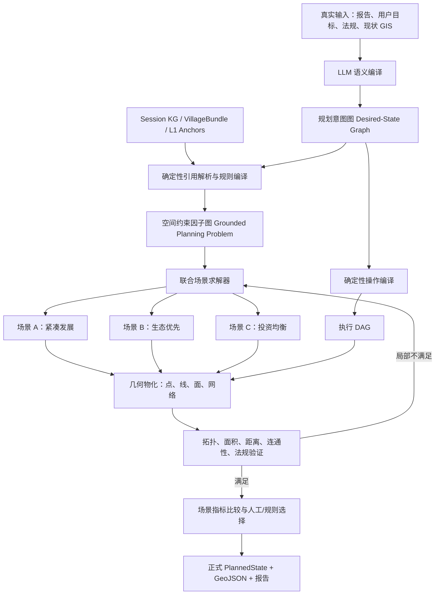

# TARGET_PROJECTION、GROUND、SELECT 与 EXECUTE

> 状态：`TARGET DESIGN`。第 6 节的旧实现表只用于迁移追溯；当前路径和完成度以
> [`10_IMPLEMENTATION_STATUS.md`](../../10_IMPLEMENTATION_STATUS.md) 与 `docs/architecture/` 为准。

> 2026-08-17 核验：`site_area` 命名、闭集 target projection、PlanningIntentGraph、
> GroundedPlanningProblem、v2 relation contracts、单方案关系感知求解和逐关系最终复测已落地；
> 主 workflow 的真实非空图层、resume 和前端 acceptance 仍是 PARTIAL，本文后半的 TARGET/NORTH STAR
> 内容不能视为已经完成。

> **2026-08-18 新鲜度纠正：** 上述“已落地”仅表示契约/模块路径和 focused tests；不表示真实金田
> 主链已有 exact point/line、SELECT 通过或非 baseline planning layer。当前 fresh replay 仍可能
> 只有 polygon/parcel-set candidate，必须以最新 `progress.md`、artifact 统计和 `10_IMPLEMENTATION_STATUS.md`
> 为准。


结论很明确：你这次判断是对的。把道路、管线拆成不同 Target 只是修正了“资产语义”，还没有形成一个真正的空间规划生成系统。

正确的核心不应是“逐个任务定位、逐个 worker 画图”，而应是：

> 先生成一张带目标、关系、约束、阶段和目标函数的规划意图图；再用真实 KG/GIS 把它编译成空间约束问题；随后联合生成若干完整规划场景；最后才把选中的场景物化为点、线、面 GIS 图斑。

几何不是交付阶段附加的外观，而是规划求解过程中的核心状态变量。一个设施选在哪里，会改变道路接入、管线长度、服务范围、分区冲突和项目实施次序；这些目标不可能作为相互独立的扁平任务得到合理结果。

这一轮我没有继续围绕旧的 `LinearAssetTarget` 修补测试，因为继续堆 Target 字段会让错误架构变得更难拆。

## Exa 检索后的关键判断

检索到的成熟实现基本支持同一个模式：

- ArcGIS GeoPlanner 的流程是现状探索、适宜性分析、多个设计场景、指标评估和场景比较，而不是一次性把文本直接画成图。[ArcGIS GeoPlanner 官方流程](https://doc.arcgis.com/en/geoplanner/latest/get-started/what-is-geodesign-for-arcgis.htm)
- OGC LandInfra 明确区分 `Project`、`Facility`、`Alignment`、`Road`、`LandFeature`、`LandDivision` 和空间表达；项目、设施、定位线和最终几何不是一个对象。[OGC LandInfra Conceptual Model](https://docs.ogc.org/is/15-111r1/15-111r1.html)
- 清华的城市空间规划研究把真实地块、边界、道路和交叉口表示为拓扑图，再在图上进行土地利用和道路规划；规划动作改变几何后，图的拓扑状态也随之更新。这说明“规划关系图”和“几何状态”必须共同演化。[Spatial planning of urban communities via deep reinforcement learning](https://www.nature.com/articles/s43588-023-00503-5)
- Spatial-Agent 把自然语言先转成带概念节点、依赖边和操作节点的 GeoFlow Graph，再映射到可执行 GIS 工具；它特别强调语言模型直接推断空间关系容易产生幻觉。[Spatial-Agent, ACL 2026](https://aclanthology.org/2026.acl-long.679/)
- Co-Layout 虽然是室内布局，但架构非常值得借鉴：LLM 生成结构化场景图和约束，整数规划器联合优化布局，再由确定性程序物化几何，而不是让 LLM 直接输出坐标。[Co-Layout](https://arxiv.org/html/2511.12474v2)
- 对 LLM 几何和拓扑推理的实测研究中，即使较强模型处理 WKT 拓扑关系，最佳结果也只有约 0.66 准确率；论文明确不建议把这种方式直接用于实际精确空间计算。[Foundation models for geospatial reasoning](https://doi.org/10.1080/13658816.2025.2511227)

因此，LLM 应该参与“规划意图形成”，不能成为“几何计算器”。

## 当前实现为什么还不健全

现在项目里的问题已经不只是线性资产分类。

### 1. 规划关系存在，但太弱，而且随后丢失

当前 `PlanningProgram` 有 `dependencies`，但关系只有：

```python
from_intervention_id
to_intervention_id
dependency_type: str
```

见 [l3_contracts.py](F:/project/Village_Planning_Agent/backend/app/contracts/domain/l3_contracts.py:119)。

它不能表达：

- 一个设施服务哪些居民点；
- 一个道路为哪些设施提供通达；
- 污水管线连接哪些服务端和处理端；
- 一个项目必须位于某个分区内；
- 两个项目应邻近还是相互避让；
- 是硬约束还是软偏好；
- 距离作用于中心点、边界、入口还是服务范围；
- 关系来自原文、规范、确定性规则还是规划推断。

这一缺口已在当前实现中由 `intent_graph_compiler.py` 部分补上：`program.dependencies` 会编译为
`PlanningIntentGraph` 的 `precedes` 关系，并随 `IntentCompilationResult.intent_graph` 持久化；
`near/serve/connect_network` 也有 evaluator/solver focused tests。仍未完成的是所有关系在真实
主链中的联合求解、source geometry/network/demand 完整供给和交付级逐条证明。真实运行中若缺
network/demand/geometry 仍会显式 deferred/not_evaluable，不得当作通过。

### 2. 当前依赖实际上主要靠第二次 LLM 临时猜

语义修复阶段允许 LLM 生成 dependencies，但给它的目录只有目标名称、类别、输出类型、阶段和粗略位置，缺少完整证据、空间实体和关系模板。[semantic_repair.py](F:/project/Village_Planning_Agent/backend/app/domain/program/semantic_repair.py:168)

当前提示只是告诉它：

> from 是前置项目，to 是后续项目。

见 [semantic_repair.py](F:/project/Village_Planning_Agent/backend/app/domain/program/semantic_repair.py:196)。

这容易产生两类问题：

- 名称看起来相关，就生成未经证据支持的依赖；
- 真正重要的空间关系没有被表达，因为这里只能生成执行前后关系。

### 3. 空间条件被扁平化，并且错误地使用 OR

历史版本的 `map_intervention_to_spec()` 把每个目标单独编译为一个
`SpatialReferenceSpec`，并曾把独立条件误合并为 `OR`。

当一个目标同时有“位于金田村、靠近道路、处于建设用地、村东”等条件时，旧代码会生成：

```python
SpatialReferenceSpec(type="composed", op="or", children=candidates)
```

见 [spec_mapper.py](F:/project/Village_Planning_Agent/backend/app/data/ingestion/compiler/spec_mapper.py:335)。

这意味着：

```text
在目标村内 OR 靠近道路 OR 属于建设用地 OR 位于村东
```

而合理语义通常应是：

```text
在目标村内
AND 属于允许用地
AND 靠近道路
AND 位于村东偏好范围
```

其中还有硬约束和软偏好的区别。当前 mapper 已将独立空间要求默认编译为 `AND`；`OR` 只应
保留在上游显式表达替代方案的闭集路径。source-backed existing facility/road/axis 则提前
走 explicit source ID 的 directional exact path，不与泛化文本条件混合。候选池过大、硬约束
失败和真实 source geometry 缺失仍是 GROUND/SELECT 的验收问题。

### 4. GROUND 在修改上游意图，而不是产生独立接地产物

历史版本的 `ground_node()` 曾把 anchors/BSM 写回 `target_projection`；当前实现已改为保持
`target_projection` immutable，GROUND 的 anchor enrichment、candidate 和 evidence 只写入
`GroundingResult/GroundedPlanningProblem` artifact。[ground.py](F:/project/Village_Planning_Agent/backend/app/workflow/stages/ground.py:135)

这混合了三种本应分离的状态：

- L3 的规划语义；
- GROUND 的现实证据；
- 某次运行得到的空间候选。

这样一来，原始意图不再是不可变的，resume 时也难以判断：

```text
这个 BSM 是 L3 本来就指定的，
还是某次 GROUND 计算出来的，
还是旧场景残留的？
```

L1 anchors 持久化本身是正确的，但它们应当作为“现状实体接地事实”被引用，而不是用来直接改写最终规划目标。

### 5. `CandidateSite` 是面状地块中心模型，无法承载完整规划几何

历史 `CandidateSite` 的主要结构是：

- `source_parcels`
- `available_geometry_wkt`
- `available_area_ha`
- `target_ref`

当前 `CandidateSite` 已增加 typed `CandidateGeometry`，但兼容字段仍保留；
`CandidateGeometry` 才是 point/line/polygon role、granularity、source refs 和 executable 边界的权威契约。
见 [grounding_contracts.py](F:/project/Village_Planning_Agent/backend/app/contracts/spatial/grounding_contracts.py:40)
与 [candidate_geometry.py](F:/project/Village_Planning_Agent/backend/app/contracts/spatial/candidate_geometry.py:26)。

这比较适合地块/面状项目，但不能充分表达：

- 点目标的入口点、服务中心点、候选落点；
- 道路的起终点、候选路径、网络接入节点；
- 管线的源点、汇点、检查井、沿线走廊；
- 分区的多个组合候选；
- 一个目标的多套几何方案；
- 候选方案对目标间关系的满足程度。

### 6. SELECT 只做了局部的“各选各的”

全局 site allocator 目前只接受：

```python
SiteTargetType = Literal["site_area", "facility"]
```

见 [global_site_allocation_contracts.py](F:/project/Village_Planning_Agent/backend/app/contracts/spatial/global_site_allocation_contracts.py:14)。

它主要约束：

- 一个目标最多选一个地块；
- 地块容量；
- 排他占用；
- 单目标适宜性分数。

它没有联合考虑：

- 设施与居民点的服务距离；
- 设施与道路的可达关系；
- 污水设施与管线的连接；
- 项目之间的邻近、避让、包含；
- 选址后所需道路/管线建设成本；
- 分区布局对项目选址的影响。

分区、项目/设施、道路和管线被不同阶段分别处理，所以即使每个局部输出都“合理”，组合起来也可能不合理。

### 7. EXECUTE 的任务依赖是顺序启发式，不是规划关系

当前 `build_execution_plan()` 按列表遍历顺序记录前面出现的项目和设施，然后规定：

```text
zone 依赖前面的 project
road 依赖前面的 project + facility
```

见 [plan_builder.py](F:/project/Village_Planning_Agent/backend/app/domain/materialization/plan_builder.py:279)。

这不是规划逻辑，只是遍历顺序。目标排序一变，执行依赖也会变。

而且这里混淆了三种完全不同的图：

- 规划语义关系图，可以有双向关系和环；
- 道路/管线物理网络图，本来就可能有环；
- 执行 DAG，才必须无环。

这些不能继续共用一个 `dependencies` 概念。

### 8. 最终几何没有成为正式场景产物

目前 workers 生成 layout layers，最后 `changeset_to_planned_state()` 再从图层里反推 PlannedState。

其中甚至存在这种兼容逻辑：

```text
图形没有 target_id 且系统只有一个对应目标
→ 自动把该图形归给唯一目标
```

见 [planned_state_builder.py](F:/project/Village_Planning_Agent/backend/app/domain/materialization/planned_state_builder.py:175)。

这会掩盖 worker 没有正确写 lineage 的问题。最终几何应当从生成时就绑定：

```text
scenario_id
target_id
relation_ids
source_geometry_refs
generation_operation
```

不能到交付阶段再猜。

## 推荐的核心架构：三张图，而不是一张任务列表



### 图一：规划意图图

这张图表达“最终希望形成什么空间状态”。

节点是规划对象：

```text
建设用地区
公共服务中心
卫生站
污水处理设施
污水管网
道路改造
河道生态修复区
产业项目
居民点
```

边是目标关系：

```text
服务中心 serves 居民点
服务中心 requires_access_to 道路
污水管网 connects 居民点 -> 污水设施
生态修复区 follows 河岸
建设项目 within 建设用地区
卫生站 near 居民点
污染设施 avoid 居住区
道路改造 precedes 项目运营
```

这张图可以有环。例如两个功能区相互邻近、道路网络闭环都不是错误。

### 图二：空间约束因子图

这张图把语义关系编译成可计算条件。

例如：

```text
“卫生站服务社前居民点”
```

不会直接变成一个坐标，而会展开为：

```text
卫生站候选地块集合
居民点真实几何
路网服务时间
最大服务距离
允许用地条件
坡度/灾害约束
道路入口可达性
```

一个污水管网目标也不是单个二元关系，而可能是一个多输入因子：

```text
输入：
  多个居民点
  候选污水设施位置
  现状道路/管线走廊
  地形
  河流和生态限制

输出：
  起点集合
  汇点
  候选走廊
  网络节点
  候选路径
  长度和冲突指标
```

因此，这一层应支持 factor/hyperedge，而不能只使用简单 `from → to`。

### 图三：执行 DAG

只有这张图要求无环。

例如某个已选择场景的执行顺序可以是：

```text
选择项目/设施地块
    ↓
生成设施点和项目图斑
    ↓
根据已选端点生成道路/管线候选
    ↓
物化道路和管线
    ↓
生成分区/覆盖层
    ↓
统一验证和渲染
```

执行 DAG 是由规划意图图和求解结果确定性编译出来的，不应该让 LLM自由生成。

## 推荐的新契约

不是让 LLM直接生成任意关系，而是让它选择闭集关系模板。

```python
class PlanEntityRef(BaseModel):
    ref_type: Literal[
        "planned_target",
        "existing_entity",
        "layer",
        "village",
    ]
    ref_id: str


class PlanRelationIntent(BaseModel):
    relation_id: str
    subject_ref: PlanEntityRef
    template_id: Literal[
        "within",
        "near",
        "avoid",
        "provide_access",
        "serve_population",
        "connect_network",
        "follow_alignment",
        "outlet_to",
        "part_of",
        "precedes",
        "co_locate",
        "exclusive_with",
    ]
    object_refs: list[PlanEntityRef]

    strength: Literal["hard", "soft"]
    geometry_scope: Literal[
        "centroid",
        "boundary",
        "footprint",
        "entrance",
        "endpoint",
        "corridor",
        "service_area",
    ]

    min_distance_m: float | None = None
    max_distance_m: float | None = None
    weight: float | None = None

    source_kind: Literal[
        "source_asserted",
        "regulation",
        "domain_template",
        "planner_preference",
    ]
    evidence_refs: list[str]
    confidence: float
```

但最好再向前走一步：LLM不逐条创造底层关系，而是选择“规划模式模板”。

例如：

```python
RelationTemplateSelection(
    template_id="sewer_service_chain",
    participant_refs=[
        "target:settlement-service-area",
        "target:wastewater-treatment",
    ],
    evidence_refs=[...],
)
```

确定性 compiler 再展开为：

```text
污水设施 avoid 居民核心区
污水设施 reachable_from 道路
管网 connects 居民点
管网 outlet_to 污水设施
管网 follow_allowed_corridor 道路/公共用地
管网 avoid 生态保护区
```

这样比让 LLM自由拼边稳定得多，也更符合你之前要求的“LLM只做闭集选择和操作”。

## LLM 到底应该做什么

| 阶段     | LLM 应做                                                  | LLM 不应做                            |
| -------- | --------------------------------------------------------- | ------------------------------------- |
| 报告理解 | 提取目标、规模、阶段、显式地点、证据引用                  | 编造缺失位置或规模                    |
| 目标形成 | 选择闭集资产类型、目标类型和操作模板                      | 自造类别或 worker                     |
| 关系形成 | 从闭集规划关系模板中选择，绑定已提供的 target/evidence ID | 自由编写拓扑谓词或虚构实体            |
| 实体消歧 | 在 KG 返回的有限候选中选择，输出候选索引                  | 自己生成 BSM、URI、坐标               |
| 场景偏好 | 选择“生态优先、紧凑发展、投资均衡”等策略档案            | 自己计算适宜性分数                    |
| GIS 求解 | 不参与精确计算                                            | 不生成 WKT、GeoJSON、路径、面积、距离 |
| 结果评估 | 根据已计算指标解释场景差异                                | 自己声称拓扑、距离或法规已经满足      |
| 修复     | 修改错误的语义选择或软偏好                                | 直接修改几何以掩盖验证错误            |

Instructor 仍然应该使用，但它只解决：

```text
输出是不是合法 Pydantic 对象
```

它不能解决：

```text
规划关系是否正确
目标引用是否真实存在
多个目标是否联合可行
几何是否有效
拓扑是否满足
最终规划是否合理
```

因此稳定链路必须是：

```text
Instructor 结构校验
→ 引用完整性校验
→ 领域关系模板编译
→ GIS 候选生成
→ 优化器求解
→ 几何验证
```

## 从定位解析到 GIS 图斑的完整生成过程

### 1. 构建现状世界模型

继续复用现有 session KG、VillageBundle 和已持久化 L1 anchors。

但分清：

```text
CurrentStateGraph
```

只包含真实现状：

- 地块；
- 河流；
- 道路；
- 建筑和设施；
- 居民点；
- 现状拓扑；
- BSM；
- 真实几何；
- 数据来源和置信度。

不要把规划方案直接混进现状 KG。规划方案应使用独立的 scenario named graph 或独立场景图对象。

### 2. LLM 生成规划意图草案

输入给 LLM 的不应是巨大原始 KG，而应是：

- 证据目录；
- 可引用 target ID；
- 可引用现状实体 key；
- 闭集目标类型；
- 闭集操作模板；
- 闭集关系模板；
- 法规和规划目标；
- 缺失信息说明。

输出：

```text
目标节点
关系模板选择
目标规模
阶段
硬约束/软偏好
证据引用
不确定性
```

### 3. 确定性编译规划意图图

编译器负责：

- 校验引用存在；
- 合并重复目标；
- 展开关系模板；
- 加入领域必需关系；
- 区分硬约束和软目标；
- 标记无证据的 planner preference；
- 生成规划意图图；
- 生成规划问题摘要。

### 4. 关系感知的 GROUND

GROUND 不再给 Target 填几个 `candidate_bsms` 就结束，而是产生：

```text
GroundedPlanningProblem
```

其中每个目标有自己的候选域：

- 面状目标：候选地块组合/候选 polygon；
- 点目标：候选地块 + 合法落点/入口点；
- 道路：现状路段引用或候选端点/候选走廊；
- 管线：服务端点、汇点、网络节点、走廊和路径候选；
- 生态覆盖层：真实河岸、缓冲带或生态空间候选；
- 非空间目标：不进入几何求解。

每一条关系也有接地状态：

```text
resolved
partially_resolved
ambiguous
unresolved
```

而不是只统计目标是否有 BSM。

### 5. 联合生成场景

不应把所有目标一次塞进一个巨型求解器，也不应完全独立求解。适合当前项目的是 coarse-to-fine：

1. 全局地块/设施/分区候选分配；
2. 根据选中的点和面生成道路、管线端点与路径；
3. 计算目标间关系和冲突；
4. 对受影响的局部子图重新求解；
5. 生成 2～3 个可解释场景。

现有技术可以继续利用：

- PuLP/CBC：地块分配、容量、排他、成对关系；
- NetworkX/pgRouting 思路：道路和管线路由；
- Shapely：缓冲、相交、包含、切割、合并和几何校验；
- KG：语义引用、现状拓扑和证据追踪；
- LLM：意图和场景说明。

现阶段不需要直接引入深度强化学习。先把确定性关系图和场景求解做正确，才能积累训练数据。

### 6. 几何物化

每个生成的 GIS feature 从出生时就必须带：

```text
scenario_id
target_id
asset_kind
operation
relation_ids
source_geometry_refs
source_bsms
generator_id
generator_version
crs
geometry
geometry_hash
```

不能依赖“只有一个目标，所以猜它属于这个目标”的兼容路径。

### 7. 验证与局部重算

验证必须覆盖：

- Geometry validity；
- CRS 一致性；
- 是否位于村域内；
- 图斑面积和数量；
- DE-9IM 拓扑；
- 道路/管线连通性；
- 设施服务距离；
- 目标间邻近、避让、包含；
- 分区排他；
- 每个关系是否满足；
- 每个目标是否有几何或明确 deferred 原因。

失败时只重新执行受影响的关系子图。QGIS Model Designer 也支持从已有中间结果运行选中步骤，这正是当前项目 resume 应采用的粒度。[QGIS Model Designer](https://docs.qgis.org/latest/en/docs/user_manual/processing/modeler.html)

## 对当前代码的迁移顺序

契约和基础关系图已经落地；下一批工作不应重复“新增”这些类型，而应完成真实主链闭环：

1. 用 fresh source-aware `VillageBundle → KG → TARGET_PROJECTION` 生成可审计 Point/Line exact refs。
2. 让 `GroundedPlanningProblem` 的 candidate-only/executable、hard constraint 和 source lineage
   在真实 GROUND→SELECT 中保持一致。
3. 完成 relation-aware scenario coordinator 与 facility/site/zone/road/utility 的跨目标联合求解。
4. 道路和管线在点/面初选后生成真实 network candidate，再进行局部回代。
5. EXECUTE 从选中场景编译 worker DAG；worker 只物化已选几何操作。
6. VALIDATE 按 relation ID 校验，而不仅按 target ID 数数量。
7. DELIVER 同时展示场景、目标、关系满足度、GIS 图层和未解决事项，并以非 baseline feature 验收。

## 真实数据验收标准

用金田村真实输入跑通时，最终不应只检查“流程没有异常”，而应至少满足：

- 所有项目目标都具有稳定 `target_id`；
- 所有关系引用的 target/KG entity 真实存在；
- 所有空间目标都有候选、已选几何或明确 unresolved/deferred；
- 所有点、线、面均来自真实 GIS 和确定性几何操作；
- 没有任何坐标、BSM、道路拓扑由 LLM 生成；
- 污水管网不会进入 road worker；
- 设施选址与道路接入关系可以被计算验证；
- 管线路径的起终点来自已选设施/居民点或现状网络；
- 分区和项目图斑没有非法排他冲突；
- 每条硬关系都有 `satisfied/violated/unresolved` 状态；
- 每个软关系都有可解释分数；
- 输出至少包含一个完整可行场景，最好包含 2～3 个备选；
- resume 后复用 L1 anchors、session KG、已完成候选和未受影响的子图；
- 修改一个设施位置时，只重算关联道路、管线和局部冲突，不重跑 L1–L3。

最后，历史聚焦测试状态（`25 passed / 4 failed`）只保留作迁移审计；当前 `selection_contracts.py`
与 plan builder 已有 `linear`/road/axis typed 路径和专项回归。当前仍不能据此宣称真实主链已产出
可交付的 line layer；应以最新 Wave 3 source geometry 和真实 replay artifact 为准。

正确的下一步不是重复创建已经存在的关系契约，而是先验证：

```text
fresh source-aware bundle/KG
→ exact target projection
→ executable GROUND/SELECT
→ EXECUTE/DELIVER non-baseline layer
```

再让现有 GROUND、SELECT、道路/设施 worker 逐步迁移到这条关系感知链路。这样最终产出的才是一套内部关系一致、具有真实几何、可以评估和复算的村庄规划成果，而不只是若干单独图层的集合。

## 1. 四个阶段的边界

```text
shared compiler core
    L1 report + evidence → L1DimensionFragment

TARGET_PROJECTION (deterministic domain boundary)
    PlanningProgram + evidence → IntentCompilationResult + SpatialReferenceSpec

GROUND
    SpatialReferenceSpec + PlaceEvidenceIndex + context → GroundingResult

SELECT
    GroundingResult + requirements → SiteSelectionDecision

EXECUTE
    SiteSelectionDecision + ExecutionPlan → Worker results → ExecutionResult
    ExecutionResult → ParcelChangeSet / PlannedState（精确子产物引用）
```

## 2. TARGET_PROJECTION

Target projection 是已组装规划程序的类型化空间投影，不是空间查询 Agent，也不是自然语言解析器。
共享 compiler core 只服务 L1/L2 报告片段；正式 target projection 只有一个确定性入口：

| Profile               | 调用位置             | 输入                                                        | 输出                                               |
| --------------------- | -------------------- | ----------------------------------------------------------- | -------------------------------------------------- |
| `L1_OBSERVATION`    | L1 worker 完成报告后 | `content`、独立 `instruction`、证据引用、legacy summary | `L1DimensionFragment`                            |
| `TARGET_PROJECTION` | L3 Program Gate 之后 | `PlanningProgram`、证据引用                               | `IntentCompilationResult + SpatialReferenceSpec` |

L1 调用 compiler core 不表示工作流进入 target projection。target projection 仍是 L3 后、GROUND 前的独立确定性边界。

`L1_OBSERVATION` 负责：

- 从报告中编译事实、约束、问题、机会、分类引用和证据缺口。
- 将每个字段追溯到 `source_report_ref`、来源段落和 evidence reference。
- 保留报告正文（report_body）和 observations 结构化 JSON（`instruction` 列），不重写现有 L1 报告。
- 输出可独立审查的 `L1DimensionFragment`。

`TARGET_PROJECTION` 负责：

- 从 `PlanningProgram` 编译 Zone、Facility、Road、Axis、SiteArea。
- 将自然语言空间关系编译为 `SpatialReferenceSpec`。
- 关联 `EvidenceItem` 和来源段落。
- 校验必填字段、枚举和目标之间的引用。

target projection 遵循以下策略：

1. 确定性抽取和 schema 校验优先。
2. 不调用 LLM，不从报告正文重新解释规划事实。
3. 缺字段或空间证据不足直接进入 GROUND/VALIDATE gate，由 HUMAN 处理。
4. 投影结果写入不可变 `target_projection` artifact，并以 parent digest 绑定 `PlanningProgram`。

实现约束：claim 的 `location_hints` 在 claim adapter 进入 `PlanningIntervention.spatial_requirements.location`
后，才由 mapper 编译为 `place_name` 闭集引用；不把位置文本丢失为旧的单值字段，也不在此阶段生成坐标。
SELECT 必须透传每个 target 的 `expected_output_kind`。设施目标使用 `facility + point`，由
设施 worker 生成点位并按需产生设施占地副作用；site-area 只能使用
`site_area + parcel/polygon`，由 site-area worker 生成选中地块上的项目 footprint。
两者不能通过名称或文本互换。

对于 L1 输入，legacy `DimensionReport.summary` 仅为最低优先级兼容材料。字段冲突优先级为：
明确证据与 provenance → 报告正文 → `instruction` 中可验证的结构信息 → legacy summary。

它不负责：

- 查询 KG 候选。
- 读取完整几何。
- 选择地块。
- 生成坐标。

## 3. GROUND 子图

内部节点：

```text
normalize_spec
  → resolve_reference
  → query_semantic_relations
  → refine_geometry
  → assemble_grounding_evidence
  → grounding_gate
```

契约：

```python
class GroundedCandidate(BaseModel):
    bsm: str
    source_entities: list[str]
    geometry_ref: str | None
    metrics: dict[str, float] = {}
    constraints: list[str] = []
    evidence_ids: list[str] = []


class GroundingResult(BaseModel):
    target_id: str
    candidates: list[GroundedCandidate]
    status: Literal['resolved', 'ambiguous', 'unresolved']
    confidence: float
    query_trace: list[dict]
    unresolved_reason: str | None = None
```

## 4. SELECT 子图

SELECT 采用“规则先行、模型辅助、规则复核”：

1. 移除禁止建设、灾害、基本农田和不满足最小面积的候选。
2. 计算规模、适宜性、聚落距离、道路可达性和服务覆盖。
3. 对 Top-K 候选执行可选 Selection Agent 排序。
4. 进行目标间冲突消解和资源分配。
5. 产生 `SiteSelectionDecision`。

Selection Agent 的输入是规范化候选特征，输出只能是候选排序、理由和不确定性，不能直接输出新 BSM 或新坐标。

```python
class SiteSelectionDecision(ContractMeta):
    selected_combination: list[str]
    full_ranking: list[RankedCandidate]
    eliminated: list[EliminatedCandidate]
    decision_factors: dict
    review_status: str
    provenance: Provenance | None
```

## 5. EXECUTE 子图（目标与当前边界）

EXECUTE 只接受 `SiteSelectionDecision` 和 `ExecutionPlan`。按目标类型分派单一正式 Worker：

| Worker          | 输入                     | 输出                     |
| --------------- | ------------------------ | ------------------------ |
| Zone Worker     | 分区目标、分配指标       | function/land-use layers |
| Facility Worker | 设施位置决定、容量       | planned facility layer   |
| Road Worker     | 道路目标、道路网络和约束 | planned road layer       |
| Axis Worker     | 轴线目标和锚点           | planned axis layer       |
| Site-area Worker | 占地目标选址决定         | planned site-area layer  |

Worker 不得重新执行 target projection，也不得将第一个可用候选当作最终选址。

上述是目标输入边界。当前实现已经把规划程序、目标投影和交付快照收敛到 typed artifact，但 EXECUTE 的完整 worker contract、统一 `ExecutionResult` 和真实链路仍是 `PARTIAL`；具体事实以 `10_IMPLEMENTATION_STATUS.md` 为准。迁移期的旧 `ExecuteAgentState`、集中式执行节点和 reports-derived 输入不得继续扩展。

目标重构应形成：

```text
prepare_inputs → land_design / allocation → geometry_materialize
  → road_axis_layout → planned_state_builder → execution_review → write_l4
```

其中 Zone Worker 应由 MIP/约束求解器处理规划分区，不得把现状地类代码直接映射为规划分区；Road Worker 应
以 staged road planner 为正式路径，任何不可用情况都必须显式返回 degraded/unresolved。EXECUTE 内部的
`execution_review` 只做执行完整性和 Worker 间冲突检查，最终规则、拓扑、面积和连通性校验仍由外层 VALIDATE 负责。

## 6. 旧实现的迁移对应

| 旧实现                                                             | 目标职责                                                                                                                            |
| ------------------------------------------------------------------ | ----------------------------------------------------------------------------------------------------------------------------------- |
| `agent/select/parse_agent.py`                                    | 已删除；L1/L2 共享 compiler 位于`app/modules/parsing/compiler/`，target projection 位于 `app/domain/program/target_projection/` |
| `modules/spatial_ops/grounding.py`                               | Grounding domain service                                                                                                            |
| `modules/spatial_ops/bundle_binder.py`                           | 删除；改为 context-aware reference resolution                                                                                       |
| `agent/gis/execute/agent.py`                                     | 已迁移；当前实现集中在`app/domain/materialization/execute_agent.py`                                                               |
| `tools/gis/_generation/*`                                        | 已删除；正式链路由`agent/execute` 与 `modules/spatial_ops` 提供                                                                 |
| `services/modules/gis/road/*` 与 `spatial_ops/road_planner.py` | 历史重复实现；staged planner 是唯一正式 Road Worker，旧入口已删除或待清理以`10_IMPLEMENTATION_STATUS.md` 为准                     |
