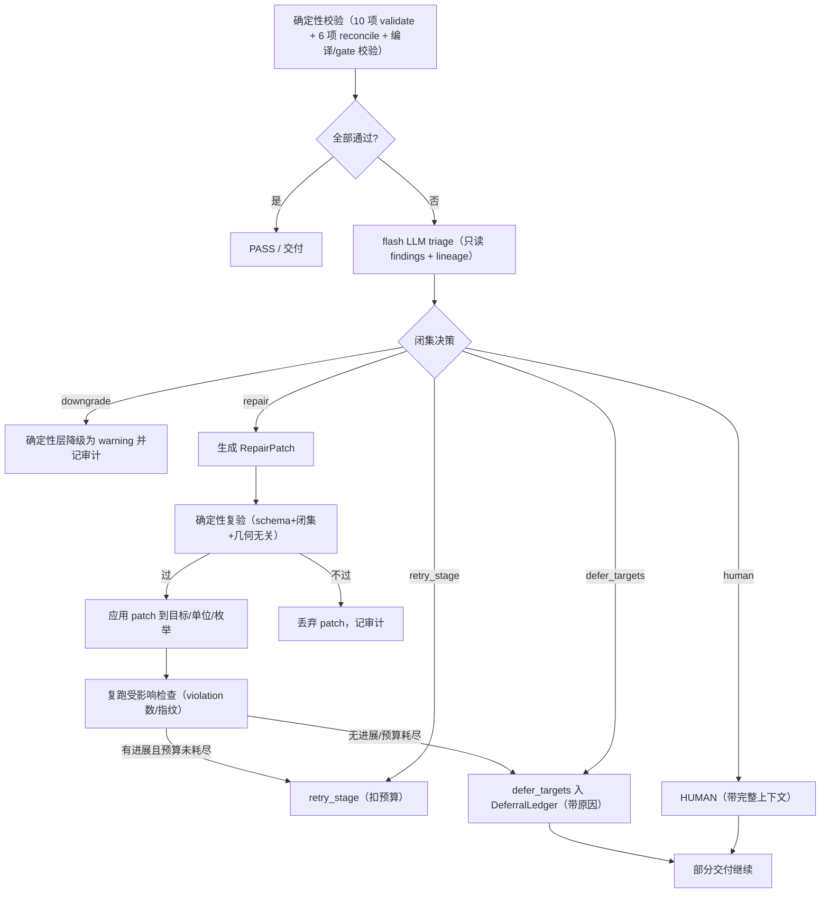

# LLM 智能校验编排方案（Exa 检索结论 + 监督式设计）

> 状态：`TARGET`（设计蓝图，本轮不实现）· 基准：实际代码接线点见 24/25 号台账
> 目标：把"死校验 → 无效重试/HUMAN 卡死"改造成"确定性校验兜底 + LLM 只做决断与修复"的监督式编排。
> 核心约束（用户明确）：**避免 LLM 随机输出造成结构性错误——LLM 永远不直接生成/改写结构性产物（几何、BSM、地块、坐标、artifact），只输出闭集决策或受限 RepairPatch，patch 必须再过确定性校验才能应用。**

## 1. Exa 检索结论（本轮检索，含来源）

| 主题 | 结论 | 来源 |
|---|---|---|
| 循环检测与降级出口 | 预算在循环开始前设定、每轮求值、终止出口必须包含 degrade/escalate/abort，而非只有 done/error；区分 repetition（失败未显式化）/ stagnation（缺信息→升级）/ cycling（需求冲突→人工）；进展必须是外部事实（violation 数、指纹），不是模型自述 | [Agent Reliability Engineering Design Guide](https://hidekazu-konishi.com/entry/agent_reliability_engineering_design_guide.html) |
| 有界重试 | per-call 上限 + per-session 总预算；预算耗尽时给模型明确指令（"此调用已失败 N 次，不要再重试，换路径或求助"），把死循环变成决策；预算从健康任务 95 分位取 | [Bounded retries for agent tool calls](https://dev.to/james_oconnor_dev/bounded-retries-for-agent-tool-calls-the-budget-that-stopped-our-infinite-loop-incidents-4354) |
| 校验瀑布与修复环 | schema（免费确定性）→ 规则语义 → LLM-as-judge（仅规则编码不了时，最便宜优先短路）；修复提示"只改出错字段，其余保持原值"；修复后的输出重新走完整瀑布；LLM 重试仍是概率调用，与原始输出同等怀疑 | [outputguard](https://github.com/ndcorder/outputguard) · LLM Output Verification Patterns |
| 确定性保持确定性 | 精确匹配/计算/策略阈值/路由/格式范围校验用代码；LLM 用于模糊分类、脏数据抽取、歧义判断；"模型提议，代码裁决"；seam（模糊模型→精确函数的边界）是可靠性关键 | [Keep Deterministic Steps Deterministic](https://opennash.com/blog/keep-deterministic-steps-deterministic-when-to-use-rules/) |
| guardrail 分层 | 按成本分层、最便宜先跑并短路；LLM-as-judge 最贵，仅用于高价值低量或异步审计 | [Choosing Runtime Guardrails for LLM Apps](https://aidefense.dev/posts/choosing-runtime-guardrails-for-llm-apps/) |
| 单位/数量规范化 | 确定性解析器 + 别名表 + typo 建议（"你是不是指"）+ keep_raw 审计 + 闭集枚举；拒绝跨维度换算；LLM 把自由文本单位规范为数值时需带 confidence | [lingo](https://github.com/pascalorg/lingo) · [NLP-Unit-Converter](https://github.com/s4tyendra/NLP-Unit-Converter) · [LLM Structured Outputs](https://collinwilkins.com/articles/structured-output) |

repo 内既有结论（不重复，仅引用）：`docs/_archive/design/18_EXA_ARCHITECTURE_ALIGNMENT.md`（LLM 边界五原则）、`07_VALIDATION_FEEDBACK.md`（定向反馈矩阵）、`13_AUTOREPAIR_MULTIMODAL.md`、`docs/_archive/design/19_WIRING_ROADMAP.md`（接线清单，部分已过时，见 24 号 §6）。

## 2. 设计原则（本方案）

1. **确定性保持确定性**：几何数学（拓扑/重叠/面积守恒/硬约束）、schema、闭集 enum、精确匹配、算术、路由阈值一律代码执行（OpenNash 结论）。
2. **LLM 只做决断与修复**：LLM 输出只能是 `ValidationOrchestrationDecision`（闭集）或受限 `RepairPatch`；不得直接创建/改写 `PlanningProgram`、`PlannedState`、`ParcelChangeSet`、BSM、坐标、几何或任何 CAS artifact。
3. **patch 应用前必须确定性复验**：任何 LLM patch 先过 schema + 闭集 + 几何无关性校验，再走目标检查复跑；复验不过 → patch 丢弃并记审计。
4. **校验瀑布分层，最便宜优先短路**：schema（0 成本）→ 规则/几何（确定性）→ flash LLM triage（仅规则判不了）→ 人工（真正歧义/越权）。
5. **进展 = 外部事实**：只依据 `gate_progress_metadata` 的 `issue_fingerprint`/`inputs_changed`/violation 计数变化判断进展，LLM 自述不算。
6. **repair-first, retry-last**：能生成目标级 RepairPatch 就不整链/整维度重跑；重试是最后手段且必须扣预算。
7. **硬失败默认目标级 defer + 部分交付**：LLM triage 后仍不可修的目标进 `DeferralLedger`（带原因），其余继续交付，只有真正歧义/越权才 HUMAN（已确认）。

## 3. 目标契约（仅设计，不实现）

```python
class ValidationTriageInput(BaseModel):
    """LLM triage 的输入：typed findings + lineage + 上下文，全部由确定性层提供。"""
    stage: str                       # validate/reconcile/l3/ground/select
    findings: list[ValidationIssue]  # 复用现有 ValidationIssue（含 code/severity/target_ids/evidence_ids）
    issue_fingerprint: str           # gate_progress_metadata 计算
    previous_attempts: int           # 已重试次数（预算扣减依据）
    artifact_refs: dict              # 只读 CAS refs，禁止 LLM 写
    repair_options: list[str]        # 该 stage 当前允许的 RepairDirectiveType 闭集

class ValidationOrchestrationDecision(BaseModel):
    """闭集决策，LLM 唯一可输出的"决断"。"""
    decision: Literal[
        "repair",            # 生成 RepairPatch（见下）
        "downgrade",         # 判定为误报/口径问题：降级 warning 并记审计
        "retry_stage",       # 判定可收敛：重试指定 stage（必须说明为何这次会不同）
        "defer_targets",     # 目标级搁置：target_ids + reason 入 DeferralLedger
        "human",             # 真正歧义/越权：只带上下文，不猜测
        "pass_with_warnings" # 全部 warning，放行
    ]
    reason: str                       # 一句可审计理由（引用 findings code）
    affected_target_ids: list[str] = []
    downgrade_codes: list[str] = []   # decision=downgrade 时
    retry_stage: str | None = None    # decision=retry_stage 时（闭集：l3/ground/select/execute）
    patch: "RepairPatch | None" = None

class RepairPatch(BaseModel):
    """受限修复：只允许修 LLM 该修的字段，其余禁止。"""
    directive_type: Literal["EXCLUDE_BSMS","REALLOCATE","REBUILD_GEOMETRY",
                            "REQUIRE_SOURCE_EVIDENCE","NORMALIZE_UNIT","NORMALIZE_ENUM"]
    target_ids: list[str]
    unit_mapping: dict[str, str] = {}   # NORMALIZE_UNIT：原单位 -> 标准单位
    enum_fix: dict[str, str] = {}       # NORMALIZE_ENUM：字段 -> 闭集值
    exclude_bsms: list[str] = []
    rebuild_strategy: str | None = None
    rationale: str = ""
```

规则：`RepairPatch` 只携带"修什么"，应用由确定性层执行（如 `unit_normalization`、`_apply_repair_directives`、`semantic_repair` 的闭集 patch 校验），LLM 不接触 artifact 本体。

## 4. 监督式编排流程（flash triage + 目标级 RepairPatch）



### 4.1 预算与进展护栏（设计）

- **per-stage 重试预算**：沿用 `BUSINESS_RETRY_LIMIT=3`；新增**每 session 校验预算**（如 `VALIDATION_BUDGET_PER_SESSION=20` 次 triage/重试调用，设计值可配），任何 retry_stage 都必须扣减。
- **进展判定**：只读 `gate_progress_metadata`（`issue_fingerprint`/`inputs_changed`）+ 确定性检查的 violation 计数；无变化 → 下一次 triage 输入必须包含"inform"观测（把失败显式化），再下一次进入"constrain"（移除该 stage 的 retry 选项，强制 defer/human）。
- **阶梯**：inform → constrain → escalate（defer 或 human），与 Agent Reliability 结论一致。

### 4.2 单位语义（设计，对应 25 号 A 组高发点）

- **确定性别名 + typo 建议**：扩展 `unit_normalization.py`，未知单位给出"你是不是指 X"候选（difflib 已有），并 `keep_raw` 保留原始文本供审计。
- **计数单位当面积**：沿用现有 `count_unit_as_area_dropped`（warning + 丢弃约束），扩展到所有 measure 字段，不再 error。
- **面积/长度单位未知**：先 flash 修复（已有），flash 失败或仍未知 → `NORMALIZE_UNIT` patch 再试一轮，仍失败 → 目标级 defer（`NORMALIZE_UNIT` 不得改变数值/几何）。
- **禁止跨维度换算**：kg→m 之类直接拒绝（lingo/convert.unit 结论），不猜。
- **单位错误不再触发整维度 program_rework**：`unsupported_*_unit`/`incomplete_area_range` 等从 error 降级或目标级修复，只有真实矛盾（如 category/output 冲突）才进 L3 rework。

## 5. 接线点指引（后续实现，基于实际代码）

| 目标 | 位置 | 改动方向 |
|---|---|---|
| triage 入口 | `workflow/stages/validate.py::validate_node`、`domain/validation/validate_gate.py` | 路由前先跑 `ValidationTriageInput` → `ValidationOrchestrationDecision`，再决定 PASS/RETRY/defer/human |
| repair 应用 | `workflow/stages/select.py::_apply_repair_directives`、`workflow/stages/execute.py`（§50-106） | 统一消费 `RepairPatch`（含 NORMALIZE_UNIT/ENUM 由 `claim_draft`/`unit_normalization` 应用） |
| 单位修复 | `domain/program/flash_unit_repair.py`、`claim_draft.py`、`unit_normalization.py` | 优先级：别名/typo → flash → NORMALIZE_UNIT patch → defer |
| L3 rework 收敛 | `domain/program/gate.py`、`workflow/root_graph.py::apply_human_review_decision` | 把"单位/口径类 error"移出 contradiction 集合；`program_rework` 只用于真实矛盾 |
| 进展护栏 | `domain/common/gate_progress.py`、`workflow/root_graph.py::_retry_or_human` | 增加 per-session 校验预算 + inform/constrain 阶梯 |
| defer 落账 | `workflow/root_graph.py::_apply_structural_target_deferrals`、`deliver.py`（DeferralLedger） | 复用现有 ledger 机制，LLM 只给 `defer_targets + reason` |
| gate 语义对齐 | `workflow/gate_policy.py`、`domain/program/target_projection/gate.py` | 修复 25 号 §B 记录的路由不一致（gate 发 L3，策略表落 HUMAN） |

## 6. 后续实现验收标准（供实现阶段逐条核验）

1. 同一 finding 重试至多 N 轮（默认 3），且每轮 violation 计数或 `issue_fingerprint` 必须变化；无变化即 inform→constrain→defer，绝不无限重试。
2. 单位/参数口径错误不再触发整维度 `program_rework`；`unsupported_*_unit`/`incomplete_area_range` 走降级或目标级修复。
3. 无法自动修复的目标进入 `DeferralLedger`（带 `reason`/`target_ids`），其余目标照常交付（`delivery_status=partial`），不再 HUMAN 阻断。
4. LLM 决策 100% 过确定性复验：`ValidationOrchestrationDecision` 闭集合法、`RepairPatch` 应用前复验、LLM 从未直接写入 CAS artifact（用审计日志断言）。
5. `accessibility`/`contract_completeness`/`traceability`/`worker_failures` 具备可执行处置（指令或 defer），不再因缺指令 blocked。
6. `target_projection` gate 的 `L3` 路由与策略表一致（回 L3 或 defer，而非落默认 HUMAN）。
7. 每 session 校验预算可配置（环境变量），超限走 escalate（defer/human），且所有 triage/修复调用可被 `StatsCollector` 计量。

## 关联

- 校验现状与死校验清单：`docs/design/25_VALIDATION_INVENTORY.md`
- 模块/结构性产出：`docs/design/24_MODULE_OUTPUT_INVENTORY.md`
- 既有 Exa 对齐结论：`docs/_archive/design/18_EXA_ARCHITECTURE_ALIGNMENT.md`


## 7. 实施状态更新（2026-08-15）

本设计“必要子集”已部分落地：目标级 defer（DeferralLedger + ExecutionPlan 修订）、进展护栏（identical issue_fingerprint 只允许 1 次重放 + per-session `VALIDATION_BUDGET_PER_SESSION` + inform->constrain->defer 阶梯）、单位/参数口径降级、无处置检查补确定性处置、gate L3 路由对齐、EXECUTE 错误显性化。完整 LLM triage 编排（`ValidationOrchestrationDecision` / `RepairPatch` / 预算内 triage 调用）仍为 Phase 2 未实施。
