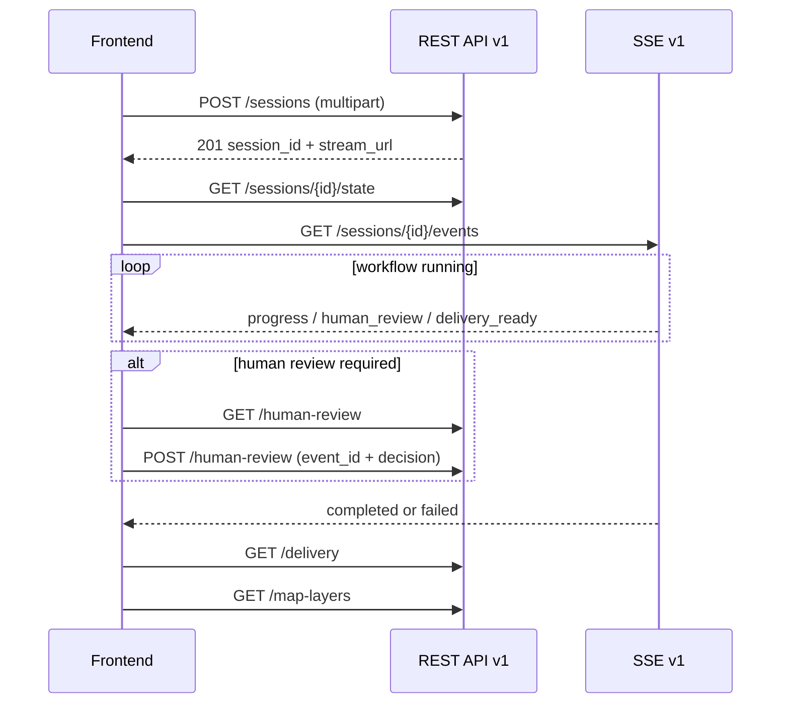

# 前端开发者 API / SSE 完整接入手册

本文是前端开发和后续后端演进的共同契约。适用于 Web、移动端、自动化测试和
需要消费规划进度或成果的其他客户端。

权威机器契约：

- REST：`docs/contracts/openapi-v1.json`
- SSE：`docs/contracts/sse-events-v1.schema.json`
- 服务前缀：`/api/v1`
- 当前 API schema 版本：`1.0`

## 1. 前端只能依赖什么

前端可以依赖：

- `/api/v1` 的 response model；
- SSE 公开 envelope；
- `SessionProjection.links` 返回的资源地址；
- `DeliveryProjection` 和 `MapLayerCollection`；
- HTTP 状态码及 `ApiError.code`。

前端禁止依赖：

- `AgentState`、LangGraph checkpoint 或节点名称；
- Artifact Store 路径、artifact type、revision 或 payload；
- `PlannedState`、`allocated_geojson`、`gis_data`；
- 后端文件路径和磁盘布局；
- 日志文字、Python 异常类型或 Human Review 的内部 interrupt 格式。

## 2. 完整生命周期



推荐启动顺序：

1. 创建会话并持久化 `session_id`。
2. 请求 `/state` 建立可恢复基线。
3. 记录 `last_event_seq`。
4. 建立 EventSource。
5. 根据事件更新临时进度；资源状态仍以 REST 投影为准。
6. 收到 Human Review、交付就绪、终态或 resync 后重新拉取对应 REST 资源。

页面刷新时不要重新创建会话。使用已有 `session_id` 执行步骤 2–4。

## 3. 会话创建

`POST /api/v1/sessions`，`Content-Type: multipart/form-data`，成功返回 `201`。

常用字段：

| 字段 | 类型 | 必填 | 说明 |
|---|---|---:|---|
| `project_name` | string | 是 | 不允许空白字符串 |
| `village_name` | string | 否 | 村庄名称 |
| `province/city/county/township` | string | 否 | 行政区划 |
| `planning_period` | string | 否 | 规划期限 |
| `village_data` | string | 否 | 文本基础数据 |
| `task_description` | string | 否 | 任务描述 |
| `constraints` | string | 否 | 约束文本 |
| `step_mode` | boolean | 否 | 分步审核模式 |
| `rag_enabled` | boolean | 否 | RAG 开关 |
| `rag_layer_config` | JSON string | 否 | 按层配置 |
| `village_data_files` | File[] | 否 | 基础数据/GIS 文件 |
| `task_files` | File[] | 否 | 任务文件 |
| `constraint_files` | File[] | 否 | 约束文件 |

```ts
const body = new FormData();
body.append('project_name', form.projectName);
body.append('village_name', form.villageName ?? '');
for (const file of form.villageFiles) {
  body.append('village_data_files', file, file.name);
}

const response = await fetch(`${baseUrl}/api/v1/sessions`, {
  method: 'POST',
  body,
});
if (!response.ok) throw await toApiError(response);
const created: SessionCreated = await response.json();
```

同一用户操作不要自动重试创建请求，否则可能创建多个会话。网络结果不确定时应先
让用户确认，未来若后端增加 idempotency key，前端再启用自动重试。

## 4. SessionProjection：页面恢复基线

`GET /api/v1/sessions/{session_id}/state`

```ts
type RunStatus =
  | 'pending' | 'running' | 'paused' | 'reviewing'
  | 'revising' | 'completed' | 'failed';

interface SessionProjection {
  schema_version: '1.0';
  session_id: string;
  status: RunStatus;
  active_stage: string;
  phase: string;
  progress: number; // 0..100
  human_review_pending: boolean;
  delivery_status: 'complete' | 'partial' | 'diagnostic_only' | null;
  statutory_complete: boolean;
  last_event_seq: number;
  links: {
    events: string;
    event_sync: string;
    delivery: string;
    map_layers: string;
    human_review: string;
  };
}
```

UI 判断规则：

- `status=completed` 不等于法定成果完整；必须继续看 `delivery_status` 和
  `statutory_complete`。
- `paused` 或 `human_review_pending=true` 时展示 Human Review。
- `failed` 展示诊断入口，不应伪装成空成果。
- `active_stage` 和 `phase` 只用于展示，不参与前端业务路由判断。
- `progress` 是阶段级估算，不作为计费、审计或完成判据。

## 5. SSE 协议

`GET /api/v1/sessions/{session_id}/events`

每个业务事件都具有：

```ts
interface EventBase<TType extends string, TData> {
  schema_version: '1.0';
  event_id: string;
  seq: number;             // 会话内单调递增
  session_id: string;
  occurred_at: string;     // ISO 8601 UTC/offset datetime
  type: TType;
  data: TData;
}
```

公开事件类型：

| type | 用途 | 前端动作 |
|---|---|---|
| `progress` | 高频进度和细粒度阶段信号 | 更新临时进度；`data.type` 可由 adapter 映射 |
| `human_review` | 进入人工审核 | 拉取 `/human-review` |
| `delivery_ready` | 交付投影可用 | 拉取 `/delivery`；需要地图时拉取 `/map-layers` |
| `completed` | 工作流正常终止 | 关闭流并刷新 state/delivery |
| `failed` | 工作流失败 | 关闭流并展示 `ApiError` |
| `resync_required` | 本地事件窗口不连续 | 执行完整 REST 恢复，不应用旧事件 |

服务端每 15 秒发送 SSE comment heartbeat。它没有业务 `type`，不得进入 Store。
服务端建议浏览器 3 秒后重连；原生 EventSource 会保存最后一个 SSE `id` 并通过
`Last-Event-ID` 发送。

```ts
function connect(session: SessionProjection): EventSource {
  const source = new EventSource(`${baseUrl}${session.links.events}`);
  const types = [
    'progress', 'human_review', 'delivery_ready',
    'completed', 'failed', 'resync_required',
  ] as const;

  for (const type of types) {
    source.addEventListener(type, (raw) => {
      const event = JSON.parse((raw as MessageEvent).data) as PublicEvent;
      if (event.seq <= eventStore.lastAppliedSeq) return;
      eventStore.apply(event);
    });
  }
  return source;
}
```

不要同时实现 EventSource 自动重连和另一套无限定时器重连。只有明确收到关闭且浏览器
不再重连时，客户端才执行有上限的重建连接。

## 6. 事件补偿与 resync

`GET /api/v1/sessions/{id}/events/sync?after={lastSeq}`

返回 `events`、`last_seq` 和 `resync_required`。恢复算法：

```ts
async function recover(sessionId: string, lastSeq: number) {
  const state = await api.getState(sessionId);
  const sync = await api.syncEvents(sessionId, lastSeq);

  if (sync.resync_required) {
    store.replaceSessionProjection(state);
    if (state.delivery_status) store.replaceDelivery(await api.getDelivery(sessionId));
    store.setLastSeq(state.last_event_seq);
    return;
  }

  for (const event of sync.events.sort((a, b) => a.seq - b.seq)) {
    if (event.seq > store.lastSeq) store.apply(event);
  }
}
```

以下情况必须做完整 REST 恢复：

- 收到 `resync_required`；
- 本地发现 `seq` 跳号；
- 浏览器从休眠恢复；
- 页面跨版本热更新；
- SSE 收到终态但本地状态仍显示 running。

## 7. Human Review

`GET /api/v1/sessions/{id}/human-review` 返回：

- `pending`：是否有待处理审核；
- `event_id`：当前审核乐观锁；
- `paused_stage`：暂停阶段；
- `items`：展示和决策所需结构化条目。

提交 `POST /api/v1/sessions/{id}/human-review`：

```json
{
  "event_id": "current-event-id",
  "action": "approve",
  "decisions": {}
}
```

`action` 只能为 `retry`、`approve`、`reject`。必须回传 GET 得到的同一个
`event_id`；提交期间禁用按钮。冲突、重复或过期决策不得静默重试，应刷新审核资源。

### 7.1 中断恢复与页面恢复不是一回事

前端只负责两类动作：

1. 页面/SSE 恢复：先读 `/state`，再用 `events/sync?after=N` 补事件；这不会重新运行
   后端图，也不会产生新的规划 revision。
2. 用户明确决策：读取 `/human-review` 的当前 `event_id`，提交一次审核命令；这才会
   继续 LangGraph 执行。

不要让 SSE 重连、页面刷新、轮询超时自动调用审核接口或 checkpoint resume 接口。
后端恢复是 compare-and-set：旧页面提交 `event_id` 时返回 `409`，前端应重新拉取
`state` 和 `human-review`，向用户展示当前审核内容，而不是自动重放旧决定。

### 7.2 端到端恢复状态机

```text
CONNECTING
  -> BASELINE_LOADING (/state)
  -> CATCHING_UP (/events/sync?after=N)
  -> LIVE (EventSource + Last-Event-ID)

LIVE -- human_review --> REVIEWING
REVIEWING -- user submit(event_id) --> RESUME_REQUESTED
RESUME_REQUESTED -- 202/200 --> CATCHING_UP
RESUME_REQUESTED -- 409 --> BASELINE_LOADING

LIVE -- resync_required/seq gap --> BASELINE_LOADING
LIVE -- completed/failed --> TERMINAL_REFRESH (/state + /delivery)
```

审核按钮必须以 `event_id` 为版本锁；`status=paused` 不是恢复命令，
`last_event_seq` 也不是 HUMAN 决策 token。地图和交付数据在恢复后仍然只从新的
`DeliverySpatialSnapshot` 投影读取，不能把旧 GeoJSON 与新事件拼接。

后端后续若开放通用 `ResumeCommand` API，前端只传 `command_id/session_id/mode` 以及
对应的 `event_id`、`checkpoint_id` 和小型 `payload`；不得传 `AgentState`、checkpoint
完整 JSON、artifact 内容或内部 LangGraph 节点名。这样可以在后端替换 checkpoint/store
实现时保持前端协议稳定。

## 8. 地图数据

`GET /api/v1/sessions/{id}/map-layers`

只有 `DeliverySpatialSnapshot` 可用后才返回；此前 `404` 表示“尚无权威空间快照”，
不是会话失败。

图层类型：

- `current`：完整现状层；
- `planned`：完整期末规划用地，不是 changes-only；
- `overlay`：设施、道路、轴线等叠加层；
- `constraint`：约束与管控层。

前端缓存键使用 `${session_id}:${snapshot_checksum}`。checksum 改变时整体替换图层，
不要把新旧 snapshot 的 feature 增量合并。`feature_count` 用于快速 UI 统计；实际
渲染以 `geojson.features` 为准。保持 current/planned 独立开关。

## 9. DeliveryProjection

`GET /api/v1/sessions/{id}/delivery`

- `available=false`：DELIVER 尚未产生 manifest；这是正常中间态。
- `complete`：当前约定的成果集合完整。
- `partial`：存在明确延期，但成果仍可使用。
- `diagnostic_only`：仅用于诊断/人工处理，不得标记为正式成果。
- `statutory_complete=true`：法定完整性门槛通过。

下载按钮只使用 `downloads` 或 `deliverables` 中公开的路径，不得自行拼接后端磁盘
路径。`snapshot_checksum` 应与地图响应一致；不一致时重新拉取两者。

## 10. 错误处理

v1 错误使用：

```ts
interface ApiError {
  schema_version: '1.0';
  code: string;
  message: string;
  request_id: string;
  retryable: boolean;
  details: Record<string, unknown>;
}
```

| HTTP | 前端处理 |
|---:|---|
| 400/422 | 展示字段或语义错误，不自动重试 |
| 404 state | 会话不存在，退出会话页 |
| 404 map-layers | 快照尚未可用，等待 delivery_ready |
| 409 | 刷新资源，通常是过期 Human Review |
| 429 | 遵守 `Retry-After` |
| 500 | 记录 `request_id`，仅在 `retryable=true` 时有限重试 |
| 503 | 服务未就绪，指数退避并给用户明确提示 |

日志和错误上报至少记录 `request_id`、`session_id`、endpoint、HTTP status，禁止上传
用户文件内容或完整规划数据。

## 11. 前端状态分层

推荐 Store 分为：

1. `sessionProjection`：REST 权威会话状态；
2. `eventCursor`：最后应用的 seq；
3. `transientProgress`：SSE 高频临时状态；
4. `deliveryProjection`：交付结论；
5. `mapSnapshot`：按 checksum 整体缓存；
6. `humanReview`：按 event_id 管理的审核状态。

SSE 不应直接覆盖 delivery/map 的权威内容；它只通知“何时重新获取”。页面刷新后，
即使没有任何历史 SSE，也必须能仅凭 REST 投影恢复正确 UI。

## 12. Mock 与测试

前端单元测试至少覆盖：

- 重复 seq 被忽略；
- seq 跳号触发 resync；
- `completed + partial` 不显示“法定完整”；
- map-layers 404 显示等待态；
- snapshot checksum 改变时整体替换；
- Human Review event_id 过期时刷新；
- `failed` 与网络 `onerror` 被区分；
- EventSource cleanup 不产生双连接。

E2E 最小链路：创建会话 → state → SSE → 可选 Human Review → delivery → map-layers。
测试不得调用已删除的 artifact、render-layers、旧 stream/status/sync 接口。

## 13. 后端后续开发必须遵守的兼容规则

### 可在 v1 内发布的非破坏变更

- 新增 endpoint；
- DTO 新增有默认值或可选字段；
- 新增 `progress.data` 的细粒度信号；
- 新增可忽略的 map layer name；
- 增加新的 `ApiError.code`。

前端应忽略不认识的可选字段和 `progress.data.type`，但对未知顶层 SSE `type` 记录
遥测且不改变状态。

### 必须发布 v2 的破坏变更

- 删除或重命名公开字段；
- 改变字段类型、枚举既有含义或 HTTP method/path；
- 改变 `seq`、`event_id`、checksum 的身份语义；
- 把现有成功状态改成错误状态，或反之；
- 改变 current/planned 图层的完整快照语义；
- 改变 Human Review event_id 的并发控制语义。

### 后端新增功能的提交清单

1. 只在 `backend/app/api/v1/contracts.py` 定义公开 DTO。
2. route 只调用 application service，不把 AgentState/artifact 原样返回。
3. 为 endpoint 声明 response model、状态码、错误语义和 summary。
4. SSE 新顶层类型加入判别联合；普通进度优先放入 `progress.data.type`。
5. 重新运行 `backend/scripts/generate_api_contracts.py`。
6. 提交 OpenAPI 和 SSE Schema 的快照变化。
7. 增加后端 contract test、前端类型/adapter 测试和迁移说明。
8. 破坏性变更必须新建 `/api/v2`，v1 进入明确的 deprecation/sunset 周期。

### 契约评审问题

- 前端能否在不知道 artifact 和节点名称的情况下使用它？
- 页面刷新后能否仅凭 REST 恢复？
- SSE 丢失或重复时是否仍然正确？
- partial、diagnostic、statutory complete 是否没有混用？
- 新字段是否真的属于公开领域模型，而不是内部调试数据？
- 是否更新了机器契约、示例、测试和退役矩阵？

## 14. 当前限制和后续接口方向

以下能力仍使用未版本化的业务命令接口：报告、反馈、检查点、规划文本、GIS 增量
上传、导出和删除会话。前端可以继续调用，但应集中封装在 API client，不得散落在
组件中。后端后续应按优先级迁移为 v1/v2 资源，并在 OpenAPI 中补齐严格 DTO：

1. 报告和下载资源；
2. 会话删除与配置；
3. 检查点/修订命令；
4. GIS 增量上传；
5. 通用反馈与对话命令。

迁移前不能删除这些命令接口；迁移后按 `api-sse-cutover.md` 相同流程完成调用扫描、
route absence 测试和文档更新。
